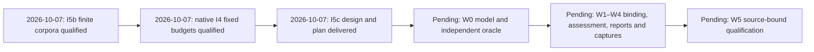
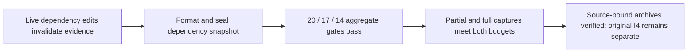
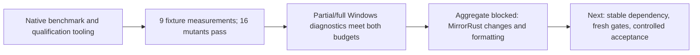
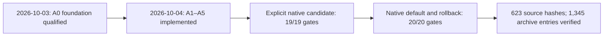
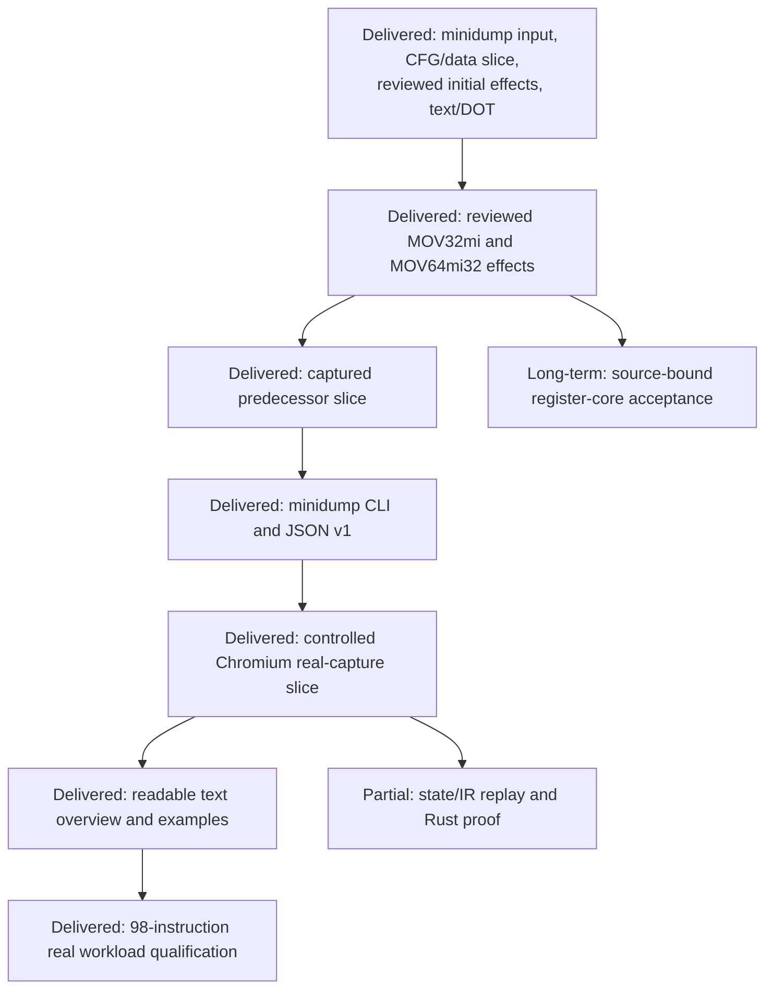

# Ariadne checkpoints

## Context and follow-up

**Status.** Chronological record; earlier entries describe their own dates.

**Why this document exists.** [Roadmap](ROADMAP.md) defines the stages whose progress is recorded here.

**What this document establishes.** This chronology records what was delivered, which checks were exercised and what was still open at each checkpoint. The latest scope decision supersedes earlier project commitments.

**Where to go next.**

- [Plan index](.agents/plans/README.md) — identifies what is still open after the recorded deliveries.
- [Evidence guide](tests/README.md) — explains how to interpret retained results without treating them as fresh qualification.
- [Basic v9 candidate check](docs/Ariadne/bap-analysis-core-design.md#current-basic-v9-candidate-compatibility) — separates tested replacement behavior from the unchanged production pin and historical runtime identity.
- [Plain REP and coverage accounting](docs/Ariadne/bap-analysis-core-design.md#plain-repeated-string-profile-and-coverage-accounting) — defines the separate v12 three-form contract and the unmet full-coverage obligations.

**What remains unresolved.** These results apply to the recorded sources, backend and workload. They do not qualify the current checkout without fresh or exact-source-verified evidence. Retired ISA milestones in older entries are no longer active work.

For the wider context, see the optional [documentation map](docs/documentation-map.md).

Current validation follows the [executable test matrix](tests/README.md). Dated run
results below are historical; their Git links do not establish a current pass.

## 2026-10-24 — Selected conversion source constraints

The [canonical constraint slice](docs/Ariadne/amd64-coverage-design.md#1017-conversion-family-source-constraints)
and [execution ledger](.agents/plans/amd64-operation-coverage.md#conversion-family-source-constraints-2026-10-24)
add a separately reviewed candidate source pack for PH2PS/PS2PH base/X variants.
All 22 typed claims validate against 205 physical anchors; fresh seven-PDF
reconstruction and independent output replay pass. Descriptive lane/memory/
broadcast/rounding kernels grant no production admission or vector must-defs.

Two source conflicts and two unresolved-scope boundaries remain explicit:
PH2PS YMM clearing overlaps 128 declared result bits; legacy denormal prose and
the generic F16C table disagree; PS2PHX embedded-rounding and aggregate feature-
width scope need resolution. The code does not guess a hardware correction.
Ten focused tests include 1,024 immediate/MXCSR selector combinations. All 487
tooling and 145 BAP Python tests, format/layout/navigation checks pass.

This is a selected source-only gate, not completed family semantics or P2.
All 115 migration obligations, ten earlier architectural references and 516
unparsed cells remain unchanged. Other families/source sections, ambiguity
adjudication, corpus adoption, legality and runtime support remain open. No
source/producer pin, Rust/native behavior or full-coverage flag changes. Products
stay ignored under `target/coverage-20261024/conversion-constraints-01/`.

## 2026-10-24 — Publisher migration structural entry review

The [canonical P1 review](docs/Ariadne/amd64-coverage-design.md#1016-publisher-migration-entry-review)
and [execution ledger](.agents/plans/amd64-operation-coverage.md#publisher-migration-entry-review-2026-10-24)
add a fresh source-entry review tool and explicit reviewed title/extent links.
Both official replacement downloads return HTTP 200 and match their existing
pins. Actual seven-PDF extraction and independent output reconstruction pass.
All 110 entry records map to five prior-family links and 100 additional source
sections, with complete raw section/word-geometry bindings and retained row/
constraint observations. All 2,657 historical gaps remain intact.

Twenty-six focused controls, 477 tooling tests, 145 BAP Python tests and
format/layout/navigation pass. No runtime, source-lock, publisher/producer pin
or admission changes occur in this source-only slice. Generated review products
stay ignored under `target/coverage-20261024/corpus-review-01/`.

This completes a structural P1 subgate, not semantic migration or adoption.
All 115 original obligations remain unresolved: mapped source families can
still differ in behavior/encoding/constraints; whole-text/extension review and
the Vol5 publication-marking conflict remain open. Parsed-constraint, source-
adoption, legal-domain and full-AMD64 flags stay false. Earlier native/model/
capture results retain their exact dated source scopes.

## 2026-10-24 — Finite memory-MOV8 native consumer completed

The [canonical consumer contract](docs/Ariadne/amd64-coverage-design.md#1015-memory-mov8-native-consumer-continuation)
and [execution ledger](.agents/plans/amd64-operation-coverage.md#memory-mov8-native-consumer-continuation-2026-10-24)
now add test-only native observers and a strict separate checker. Seven exact
named release tests pass under the final source/tool/input/test-artifact freeze:
5,760 address-64 instances in ninety synthetic Windows/Linux minidump batches,
5,760 address-32 refusals in ninety batches and the four register/barrier
regressions with 1,280 instances. Independent raw-byte expectations check partial
register writes and preserved memory origins; actual target/root/seed identities
and complete native/Rust observations agree. Refused roots provide no precise
address, definite write or consumer traversal.

The portable domain test, 24 checker/lifecycle controls, 474 default Rust tests/
166 ignored, 64 core-only/22 ignored, 467 tooling and 145 BAP Python tests,
strict Clippy and format/layout/navigation checks pass. Production projection,
helper pins and all four producer/projection source seals remain unchanged in
this extension. The final `memory-native-02` run supersedes the first test source
for this gate; disposable products remain ignored under `target/coverage-20261024/`.

This closes the finite memory-native consumer boundary only. The source corpus,
115 review obligations, ten unresolved architectural references, 516 unparsed
cells, wider domains/consumers, real execution history and full AMD64 coverage
remain open. Existing producer/projection assessment flags retain their scope.

## 2026-10-24 — Per-form source-rule mapping resumed

Resumed from `8317f4d` under the user's new instruction. The
[canonical continuation](docs/Ariadne/amd64-coverage-design.md#1014-per-form-source-rule-mapping-resumed)
and [execution ledger](.agents/plans/amd64-operation-coverage.md#per-form-source-rule-mapping-resumed-2026-10-24)
supersede the stop below. Both memory-MOV8 forms now require the five missing
prefix/order/REX/length/operand-size source links; ten removal controls pass.
Independent enumeration preserves all 5,760 points and the existing address-size
dispositions. No production semantics or prefix policy changes.

Fresh ledger extraction/check and six binding/reconciliation steps pass. Both
affected registry candidates are promoted byte-for-byte after fresh source/BAP/
LLVM/numeric/Rust campaigns. Maintained-path checks pass and reject the old
observations. The register-native gate is rerun after promotion: all four named
tests, 1,280 instances/twenty batches, refusal controls and stable 755-source/
test-artifact identities pass. Unaffected v2/v3 seals remain current and unchanged.

Root tests pass 473 default/164 ignored and 64 core-only/22 ignored; strict
Clippy, format/layout, 209 focused controls, 460 tooling and 145 BAP Python
tests pass. Wider coverage remains incomplete: memory-native consumption,
115 corpus-review obligations, ten unresolved architectural references, 516
unparsed selected cells and complete symbolic candidate domains remain open.
No production semantics, prefix policy or producer/helper pins change. Disposable
products stay ignored under `target/coverage-20261024/mapping-resume-01/`.

## 2026-10-24 — AMD64 constraint and MOV8 continuation stopped for publication

**Status: stopped at the user's request; completed work and the unfinished
review requirement are preserved for commit and push.** All worker campaigns
are stopped. The [canonical continuation record](docs/Ariadne/amd64-coverage-design.md#1013-constraint-and-mov8-continuation-stopped-for-publication)
and [execution plan](.agents/plans/amd64-operation-coverage.md#continuation-stopped-for-publication-2026-10-24)
define this boundary. Full AMD64 coverage remains incomplete.

- P1 adds executable publisher-corpus comparison across eleven dimensions.
  Fresh extraction and independent replay cover five predecessor PDFs and two
  replacements; all 2,657 historical gap IDs, ordinals and objects are preserved.
  Volume 4 expands from 1,761 to 1,973 pages and 679 to 779 instruction entries
  (105 added/five removed titles). Volume 5 keeps its legacy rows and selected
  constraint references but has different raw representations and source-status
  markings. The candidate retains 115 review obligations and is not adopted.
  Sixteen controls pass, including source/output omissions and forged adoption.
- P2 adds 24 typed architectural clauses with 1,118 anchors and 26 references:
  sixteen source locations resolved, ten applicability/scope references open.
  All 516 unparsed selected cells remain visible. The full integrated ledger
  passes extraction/check with all historical records and seven adjudications,
  plus an optional publisher-candidate branch. Its 683 unresolved nodes are
  graph obligations, not an instruction count or coverage percentage. P1/C2,
  corpus adoption, complete constraints and full legal-domain flags remain false.
- P3/P4 adds a bounded dependent ModRM/SIB/displacement grammar and a separate
  5,760-point memory-MOV8 domain. Fresh BAP/LLVM observations cover both target
  labels: 2,880 address-64 points are supported and 2,880 address-32 points stay
  refused by the existing prefix policy. Numeric probes expose 5,240 address-32
  mismatching observations; the 520 matching address-32 observations do not
  override that refusal. All address-64 observations pass their numeric checks.
  The independent Rust observer and full-source binding checks pass. Memory-MOV8
  native-consumer validation and complete symbolic-domain bindings remain open.
- The separate register-MOV8 native gate passes four exact named release tests:
  640 encodings across two targets, 1,280 instruction instances in twenty
  synthetic minidump/native-analysis batches, independent byte-origin checks,
  24 host and 120 native structural refusals. Six actual bad address-32 lifts
  remain behind existing guards across 78 profile refusals and eighteen stopped
  instances. No production behavior or LLVM semantic fallback was introduced.
  The fresh checker binds source/tool/input identities and the executed test
  binary; its current stopped-source assessment passes.
- All four binding registries were resealed only with fresh source/BAP/oracle/
  Rust campaigns. Twelve final steps pass, including expected incomplete-gate
  exits and 89 focused controls. Default Rust tests pass 473/164 ignored;
  all-feature/all-target Clippy, formatting, layout, 459 tooling tests and 145
  BAP Python tests pass. No new core-only run was completed in this continuation;
  its earlier result retains its own scope.

**Unfinished at stop:** the requested five additional per-form source-rule
links (`prefix-group-order`, `legacy-prefix-byte-groups`, `rex-placement-count`,
`instruction-length-limit`, `operand-size-override`) were not applied. Those
facts already belong to the bound architecture pack, but the explicit form
dependency mapping remains a review requirement. No reseal or rerun after that
proposed change occurred. The completed campaigns qualify the preserved
pre-adjustment sources; they do not satisfy this outstanding mapping requirement.

**Resume only after a new instruction.** Apply and review the missing mapping,
then refresh its affected ledger/binding/native source seals and campaigns.
Continue corpus adoption/scope, unparsed constraints, wider domains, consumer
and implementation stages afterward. Generated products stay under ignored
`target/coverage-20261024/`; maintained files contain code, small actual inputs,
reviewed constraints and executable tests.

## 2026-10-23 — Pinned tool recovery and current-source replay

**Status: tools restored; helper-build migration v1 adopted and finite gates pass.**
The user approved recovery of the artifacts missing from the preceding resume.
The [canonical recovery record](docs/Ariadne/amd64-coverage-design.md#1011-pinned-tool-recovery-and-current-source-replay)
gives package versions and scope; the [execution plan](.agents/plans/amd64-operation-coverage.md#resumed-source-review-and-local-native-checks)
retains the remaining binding/native exits.

- Official packages reproduce all three pinned PDF tools, 71 unique shared
  libraries and 89 per-tool dependency entries. A scoped launcher uses the
  recovered read-only root; installed system binaries and maintained pins are
  unchanged. The prior PDF-runtime prerequisite is resolved.
- Thirteen fresh campaign stages pass: five-volume reproduction/check, three
  full geometry extraction/checks, five-volume region checks and integrated
  authority/obligation extraction plus independent reconstruction. All 2,657
  original gap objects, ordinals and stable IDs are preserved. The corpus has
  4,128 pages and eleven required region clauses.
- Seven conflict records receive checked bounded adjudications across five
  source issues; all 33 table relations pass as 26 local-row series and seven
  independent tables. The immutable raw conflicts remain visible. Forty-one
  unresolved graph nodes retain corpus authority/adoption, extension-scope and
  constraint work; P1/C2/full legal-domain completion remain false.
- MOV8 source replay verifies all 292 anchors and nine typed clauses. The exact
  LLVM 20.1.2 library is recovered from the official archive. All three advanced,
  LODS and REP-address producer manifests/executables now match their unchanged
  pins. Isolated reconstruction restores the original Clang 20/GCC 13
  disassembly stub; independent review verifies all six artifact hashes and
  source bindings. The physical SDK is unchanged. Its complete historical
  manifest remains unrecovered, so this is exact producer-artifact recovery.
  The two historical BAP/LLVM helper binaries remain unrecovered. The
  [versioned helper-build migration v1](docs/Ariadne/amd64-coverage-design.md#1012-helper-build-migration-v1-and-renewed-finite-qualification)
  qualifies and promotes current-source replacements, retaining old identities
  at immutable `43588f9` and backups under ignored work. Semantic profiles,
  domains, BAP runtime and all three producer locks are unchanged.
- Fresh v2/v3/MOV8 source/BAP/oracle/Rust campaigns pass with those helper
  builds. v2 retains 3 supported/21 unsupported points; v3 checks 56 AMD points
  and 111 observations, with v15 covering its finite domain. MOV8 checks 640
  points, 1,280 BAP/LLVM observations and 10,240 numeric cases, while its native
  consumer remains unqualified. Independent review verifies source closures,
  unchanged contracts and before/after identities. The three tested registries
  are promoted byte-for-byte; normal-filesystem checks without overlays and 83
  affected controls pass afterward.
- The final native release suite passes all six named tests, including 448
  native/Rust parity instances, v12 saved-capture roundtrip/tampering and
  advanced composition positive/tampering compatibility. The same audited
  current core retains all 341 passing refusal controls, fourteen source
  hashes and seventeen SDK/compiler/model/engine identity fields. Helpers,
  loaded libraries and recovered producers are verified stable. N's finite
  gate passes for this migrated environment. The earlier debug diagnostic
  under the stale LLVM helper was interrupted and receives no aggregate pass.

Recovery and campaign products are ignored under `target/tool-recovery/` and
`target/rep-pdf-tools/`. No generated result replaces an executable gate.
The tool prerequisite boundary is closed for this environment. Corpus
adoption, constraint completeness, broader domains/consumers and full AMD64
coverage remain open; all 10,569 full symbolic candidate bindings remain open.

## 2026-10-23 — AMD64 source review and native refusal checks resumed

**Status: resumed from `43588f9`; validation improvements delivered, full
source/binding/native gates remain incomplete.** The user's new resume
instruction supersedes the stop below. The [canonical record](docs/Ariadne/amd64-coverage-design.md#1010-resumed-source-review-and-validation)
and [execution ledger](.agents/plans/amd64-operation-coverage.md#resumed-source-review-and-local-native-checks)
describe the changes and next executable boundary.

- P0/P1 now integrates fresh authority replay into obligation extraction/check.
  Corrections require exactly the seven immutable conflict IDs; saved pass
  reports cannot replace publisher-source replay. Proof checks reject foreign
  publications, misplaced cells, headers and detached VEX premises. Independent
  visual review corroborates all five source issues. Fresh official Vol4 r3.27
  and Vol5 r3.16 PDFs match the separate authority inputs; old corpus locks
  remain unchanged and corpus migration/adoption remain open.
- Table review corrects Vol4 PDF350→351: complete VMOVDQU8 and VMOVDQU16 tables
  are independent, with all twelve explicit rows checked. Reviewed source
  decisions now contain 26 complete-local-row series and seven independent
  tables. Small actual geometry inputs and rejection controls preserve every
  historical gap and table identity. The full pinned source reconstruction is
  still required before promoting this result to final-source qualification.
- P2/P3 retains the 640-point MOV8 domain, 10,994 XED records, 10,569 long-mode
  candidate obligations, 425 mode exclusions and two partial relations. P4
  rejects noninteger batch/count fields, missing/extra frames and wrong ready
  identities. Zero complete candidate bindings remain. v2/v3 binding checks
  correctly reject stale sources; v2/v3/MOV8 pins were not resealed.
- The compatible SDK is available on this host. A fresh local native core
  passes fourteen source checks, seventeen SDK/compiler/model/engine identity
  checks and all 341 refusal controls (125 direct, 216 framed). Two independent
  REP producer builds agree but differ from the existing pin; available
  advanced/BAP/LLVM artifacts also differ from their required pins. Native
  parity and compatibility attempts fail before semantic comparison. The 448
  required parity instances remain unexercised; N remains incomplete. No
  private-source handoff occurred.
- Root validation passes 472 default Rust tests/160 ignored, 64 core-only/22
  ignored, all-feature/all-target Clippy and formatting. All 399 tooling and
  145 BAP Python tests pass. The root lock changes only MirrorRust's package
  version from `0.1.0` to the actual `1.0.0`; tests use the verified read-only
  I5b snapshot, preserving sibling edits. Native tests and unavailable source
  campaigns are not credited by these portable results.

**Next:** recover the pinned Poppler 26.01/MuPDF 1.27/Python 3.14.4 and native
library closure plus exact producer/reference artifacts, or prepare a separately
reviewed versioned migration. Reproduce the corpus, finish authority/ledger
extraction/check, freeze sources, refresh v2/v3/MOV8 with fresh
source/BAP/oracle/Rust observations, then complete native parity/compatibility.
Do not promote visual review, stale bindings or a refusal-only pass into these
gates. Broader P0–P8/N remains incomplete. Generated PDFs, review output,
builds and diagnostics remain ignored under `target/`.

## 2026-10-23 — Remaining AMD64 plan execution stopped at user request

**Status: stopped; work in progress is preserved for commit and push.** The
user explicitly requested stopping current work before publication. All worker
campaigns are stopped; no native source transfer occurred. This entry does not
promote any remaining full-coverage gate.

Work started from the [published remaining plan](.agents/plans/amd64-operation-coverage.md#remaining-coverage-execution-plan)
at `e3d86db`. The following implementation and small test inputs are preserved:

- P0/P1 adds `amd64_source_obligations.py`, reviewed obligation inputs and
  sixteen passing unit controls. Fresh five-PDF reproduction completed. Pure
  derivation over actual geometry accounts for 33 table relations as 27
  complete-local-row series and six independent tables, preserving all 2,657
  historical records. The final current-module extraction/check and visual
  sampling of the new boundary proofs were not completed. Authority-validator
  integration is unfinished; this ledger still leaves all seven conflicts
  unresolved.
- The separate authority checker and eleven unit controls are present. Fresh
  official downloads found Vol4 r3.27 and Vol5 r3.16 with different bytes from
  the old pins; no old lock was replaced or corpus adoption claimed. An
  actual-source replay computed candidate adjudications for all seven conflict
  records, but preceded the final VEX.L heading guard. Final full replay and
  independent review remain unfinished. Public PDFs/products are ignored
  under `target/p1-authority/`.
- P2/P3 adds source-constraint, finite-domain and reconciliation modules with
  24 passing controls and independent review. Actual source replay checked
  292 anchors/nine typed MOV8 clauses. The finite domain has 640 byte points.
  Reconciliation retains 10,994 XED records, 10,569 long-mode candidate
  obligations, 425 mode exclusions and two partial relations, with zero
  complete authoritative candidate bindings. General dependent fields, SMT,
  alias dispatch and full constraint coverage remain open.
- The additive MOV8 binding tool, ten unit controls and an ignored Rust
  observer are present. An initial campaign exercised 1,280 fresh BAP/LLVM
  observations across Windows/Linux target labels and passed the actual Rust
  byte-origin observer. Subsequent domain/source hardening changed bound
  sources; the later checker correctly rejected the saved binding as stale.
  This earlier campaign is not final-source qualification. The assessment
  separates finite projection from unexercised native-consumer validation.
- The only Rust change is a test-module hook and its observer; production
  projection behavior was not changed. Existing v2/v3 implementation hashes
  are also stale after this source change and have not been resealed. Full
  default/core-only/Clippy/format qualification was not completed for this WIP.
- N's 25-file payload and thirteen existing bound inputs were verified, and
  local audit/qualification runners were prepared under ignored `target/`.
  Portable checks passed 22 Python and three Rust tests; native tests remain
  unexercised. Automatic review rejected private-source transfer without
  specific payload/destination approval. A local alternative was investigated:
  only the SDK manifest is available; the compiler/findlib, SDK prefix,
  compatible rootfs and pinned source archive are missing. No native build
  started. The pending transfer request does not override this stop instruction.

**Resume only after a new user instruction.** Finish authority review and ledger
integration, complete the table-boundary visual/source checks, then freeze the
code and rerun the current extraction/check campaigns. Reseal v2/v3/MOV8
binding inputs only together with fresh source/BAP/oracle/Rust campaigns.
Native qualification still needs its compatible environment and authorization
for any private-source handoff. The broader P0–P8/N plan remains incomplete.
Generated PDFs, transcripts, observations, reports and build products remain
ignored; maintained files contain implementation, reviewed inputs and tests.

## 2026-10-23 — Historical AMD manual-gap backlog accounted for

**Status: all 581 remaining historical gaps have source-backed dispositions;
full AMD64 coverage remains open.** The [C2 source reconstruction contract](docs/Ariadne/amd64-coverage-design.md#102-geometry-and-source-region-execution-c2)
and its [execution plan](.agents/plans/amd64-operation-coverage.md#source-and-domain-execution-c1c4)
record the completed historical-backlog slice.

- Fresh extraction/check accounts for the remaining 145 Vol3, 269 Vol4 and
  167 Vol5 records. The totals are now 159/1,987/511: all 2,657 original gaps
  have a disposition, with zero unassigned records. Every original ID, ordinal,
  gap object and legacy source address is preserved, and all 2,076 previous
  dispositions remain unchanged. The historical v1 lock and inventory remain
  intact.
- The delta contains 140 resolved-cell records, twelve continuations, 422
  non-encoding material records and seven explicit source-conflict records.
  Narrow geometry rules cover centered CMOV/SETcc groups, wrapped encodings,
  superscripts, combined cells, actual heading/prototype overlays and source
  diagrams/tables/footers. Literal malformed operands, bitfields and mnemonic
  disagreements remain visible; material/conflict constraints stay unparsed.
  A repeated-cell assignment defect found during review is fixed and covered
  by missing-occurrence and shared-cell rejection controls.
- All 61 geometry controls, thirteen historical extraction controls, 145 BAP
  Python tests and 328 tooling tests pass. Full three-volume reconstruction and
  five-volume region checking pass, accounting for 4,128 pages and eleven
  required region clauses. Negative controls reject lost, duplicate, moved or
  foreign cells, conflicting owners and resealed output omissions. The nine
  extractor/dependency identities are bound transitively in both output kinds.
- Both finite binding registries now bind the helper closure. Fresh actual
  BAP/source-cell/oracle/Rust campaigns pass after source freeze: v2 retains
  24 points with three supported/21 unsupported and 39 source identities; v3
  retains 56 AMD points, 111 profile observations and 61 source identities.
  The 48 binding controls include independent helper-drift rejection for both
  registries. No Rust behavior changed; the two affected Rust observers reran.
- Rust layout and documentation-link checks pass. The canonical design, stage
  ledger, roadmap, test matrix and architecture diagram are synchronized. The
  [previous 581-gap reading view](.agents/chatdocs/ariadne-amd64-coverage-execution-gap581-20261023/index.html)
  is preserved separately before refreshing the current execution view.
  Generated corpus products, validation outputs and logs remain ignored.

`oldGapBacklogClosed` is true, but source completeness, complete constraint
parsing, legal encoding completeness and C2 completion remain false. Seven
source-conflict records, global rules/footnotes/diagram semantics and 33
cross-page continuation candidates remain separate obligations. Official
Vol4/5 byte identity, all 10,569 full symbolic-domain bindings, broader
consumers/architecture families and full AMD64 coverage remain open. The v15
native handoff retains its earlier pending status; this source-accounting work
does not qualify that gate.

This continuation follows the request to fill the remaining 581 gaps and the
standing instruction to record completed work here, then commit and push.

## 2026-10-23 — AMD address-size REP and coverage bindings advanced

**Status: current local v15 gates pass; native v15 and full AMD64 remain open.**
The [v15 source contract](docs/Ariadne/amd64-coverage-design.md#107-amd-address-size-rep-implementation-r2)
and [expanded binding registry](docs/Ariadne/amd64-coverage-design.md#108-expanded-source-to-consumer-bindings-c3c4)
advance the coverage program from the completed R1 boundary below.

- C2 adds 350 source-backed dispositions: 2,076 total and 581 unresolved,
  preserving all 2,657 original gap IDs/objects without regressions. The delta
  includes exact table ownership and diagram classification; diagram constraints,
  global rules, footnotes, 33 cross-page ambiguities and the AES owner mismatch
  remain open. Fresh three-volume extraction/check and five-volume region checks
  pass; 23 geometry and thirteen historical extraction controls pass.
- AMD-specific v15 selects 56 canonical memory-REP tuples, adding 28 address-32
  cases. A separate source bundle replaces four incorrect nonempty MOVS lifts
  and supplies missing exact lifts. Two independent builds match manifest
  `815fc8842899d05f6db51aa53cf21b4c82fd50fdae42200b43df4e6735cf48d4`
  and executable `e834c5e9e25a4b2f93de448a01326482493a93430ea1ce43428289b2685c727e`.
  Earlier producer pins and default-address behavior remain unchanged.
- Fresh AMD Ryzen 9 7950X and Intel Core 5 220H probes show different zero-count
  upper-lane behavior. v15 explicitly binds AMD semantics and records the premise
  in address-32 evidence; the AMD64 architecture label does not establish vendor.
  The source oracle passes 178,080 comparisons, the transport passes all 64
  form/target cases, and all 448 local capture instances pass.
- C3/C4's separate v3 registry validates 56 AMD points from 516 exact source
  anchors and 111 fresh producer/profile observations. Supported counts remain
  profile-specific: 3/24/28/56 for v12–v15. The Rust observer and 47 checker
  controls pass. The refreshed v2 pilot keeps its original 3/21 result.

Current checks pass 472 default Rust tests/159 ignored, 64 core-only/22 ignored,
Clippy, formatting, layout, 107 BAP Python controls and 327 tooling controls.
Four current optimized loop mutants are detected after passing exact controls;
source restoration, unchanged observers and current source hashes verify.
The dependency uses the existing read-only MirrorRust snapshot. Generated run
products stay ignored; only small executable inputs, fixtures and pins are maintained.

Automatic approval review rejected the new 25-file v15 native source/control
payload, saying prior approval covered the earlier handoff. Specific approval
has been requested. The [prepared native stage](.agents/plans/amd64-operation-coverage.md#native-amd-address-size-qualification-pending-approval)
requires a fresh core build, 341 native refusal controls and 448 native parity
instances; none is claimed from older helpers or local-only checks.

All 10,569 candidate full-domain bindings remain open. C1–C4 broader exits,
other prefixes/segments, proof consumers, faults/I/O, architecture families and
full AMD64 coverage remain incomplete. The previous R1-qualified HTML view is
preserved separately and the [current execution view](.agents/chatdocs/ariadne-amd64-coverage-execution-20261023/index.html)
is refreshed with these scopes.
The user requested checkpoint publication followed by commit and push for this
continuation; the native gate remains explicitly pending in that publication.

## 2026-10-23 — Memory REP native qualification completed

**Status: R1 complete for its finite 28 default-address tuples; full AMD64 remains open.**
After explicit user approval, the prepared 25-file source-only payload was
verified and transferred to the isolated `win10` workspace. Thirteen existing
Rust/model/legacy inputs matched before installation. The original SDK inventory
verified and built a fresh native core with executable SHA256
`b01c3bf697eb53c355c88716b4ee41a0010809bd71c501fbb3ac9be86698a7bf`.

The retrieved helper passes an explicit audit of fourteen native source hashes,
the SDK lock and seventeen SDK/compiler/model/engine identity fields. All 259
native refusal controls pass: 97 direct and 162 framed. Both native parity tests
pass, covering 192 v13 and 224 v14 tuple instances across sixteen synthetic
Windows/Linux capture queries. Full Rust/native state equality and every
effects, weak-write, origin, seed/root, memory-gap and investigation assertion
hold. The v12 saved-capture/tampering and older advanced-composition
positive/tampering regressions also pass with the same helper. Source and
artifact identities are rechecked after execution.

The corrected common test filter includes both matrices; the older
`native_memory_rep_recipe_matrix` prefix alone would skip the LODS/v14 test.
The [canonical findings](docs/Ariadne/amd64-coverage-design.md#106-current-root-checks-and-remaining-qualification)
and [executed native gates](.agents/plans/amd64-operation-coverage.md#native-memory-rep-qualification)
record the scoped result. The [HTML execution view](.agents/chatdocs/ariadne-amd64-coverage-execution-20261023/index.html)
is refreshed while its pre-native version is preserved. No code or test sources
changed during this continuation; the previously passing root checks and four
compiled mutations retain their exact source scope. No commit or push performed.

At this R1 boundary, 931 manual gaps, 10,569 candidate bindings, broader address-size,
proof-consumer, fault/I/O and architecture-family gates remain open. This finite
qualification does not establish full instruction-domain or hardware correctness.

## 2026-10-23 — Coverage plan source/domain and memory REP execution

**Status: finite implementation and local gates exercised; full coverage remains open.**
The [completion design](docs/Ariadne/amd64-coverage-design.md#10-source-review-and-validation-status)
and [execution ledger](.agents/plans/amd64-operation-coverage.md#coverage-completion-design-stages)
record the current continuation from `e44ce2b` plus uncommitted prior REP work.
The [execution reading view](.agents/chatdocs/ariadne-amd64-coverage-execution-20261023/index.html)
preserves the current design and findings alongside the original proposal.

- C1 reproduces all five pinned APM volumes with candidate v2 tooling.
  Fresh official V1–3 bytes match; indexed official V4/5 endpoints return 404.
  Scope/extension/global-rule audits and reviewed corpus adoption remain open.
- C2 retains all 2,657 historical gap IDs: 1,726 have source-backed
  dispositions and 931 remain unresolved. All 4,128 pages and eleven required
  region clauses are enumerated. Footnotes, constraints, merged/cross-page
  semantics and the AES bookmark-owner mismatch remain open.
- C3/C4 implement a separate source-derived 24-point legal-domain pilot with
  3 supported/21 unsupported v12 points. Fresh source-bound BIL, 720 numeric
  comparisons and the exact-lift Rust observer pass. Pilot total disposition
  and current bindings pass; full source, grammar and implementation do not.
- R1 selects 24 original producer memory-string forms under v13 and adds four
  actual source-built LODS forms under v14. v12 and earlier source pins remain
  frozen. Two new LODS builds match, with 14,400 independent comparisons;
  the original 24-form oracle passes 43,200 comparisons. Thirteen Rust transport
  tests include actual four-form/two-target projection. These plain profiles
  refuse proof transports, address overrides, I/O and partial-fault claims.
- R2's fresh 504 BAP/LLVM observations expose four address-32 MOVS lifts with
  wrong 64-bit count/pointers and 32 concrete counterexamples; the other 24
  canonical forms have empty BIL. No prefix admission broadens.

Local captured-input matrices pass 192 v13 and 224 v14 instances. The final
serial default suite passes 457 Rust tests/155 ignored, core-only 64/22, plus
strict Clippy, formatting, layout and links. An earlier concurrent run hit an
existing guard deadline and receives no passing credit. The MirrorRust
dependency uses the existing read-only pinned snapshot; core-only retains no
normal external dependencies. Native LODS transport and numeric tests are
separate from the native-core parity gate recorded above.
All 81 BAP-side Python controls and 304 tooling controls pass.
Four optimized compiled loop mutants are detected after passing exact unchanged
controls; private SUTs/builds, current source identity, source restoration and
unchanged observers are verified. This is Rust-loop evidence, not a substitute
for the separately exercised native-core campaign.

Specific user approval resolved the earlier automatic approval-review rejection
of the native source payload. The [native follow-up](#2026-10-23--memory-rep-native-qualification-completed)
supersedes this entry's initial pending v13/v14 parity and native-refusal gates.
The 10,569 symbolic candidates still lack vendor-wide authoritative bindings;
R2–R4, architecture families and Q1 remain open. No commit or push performed.

## 2026-10-23 — REP and AMD64 completion design proposed

**Status: design only; implementation and full-coverage gates remain partial.**
The [canonical completion design](docs/Ariadne/amd64-coverage-design.md)
defines source-region recovery, legal-form grammars, authoritative bindings,
remaining REP families and versioned consumer/outcome contracts. Its
[execution stages](.agents/plans/amd64-operation-coverage.md#coverage-completion-design-stages)
keep source/legality, implementation and current validation exits separate.
The [HTML presentation](.agents/chatdocs/ariadne-amd64-coverage-design-20261023/index.html)
includes the architecture diagram. Creating these documents supplies no new
instruction admission or runtime qualification; the finite v12 implementation
and its validation remain recorded below.

## 2026-10-23 — Plain REP dependency projection and coverage accounting

**Status: finite v12 implementation and native checks pass; S4/Q0 remain partial.**
This continuation starts from `e44ce2b` and processes the open REP/full AMD64
item under the [execution stage](.agents/plans/amd64-operation-coverage.md#resume-plain-rep-and-coverage-accounting)
and [canonical contract](docs/Ariadne/bap-analysis-core-design.md#plain-repeated-string-profile-and-coverage-accounting).
The earlier REP-refusal statements retain their v10/v11 historical scope.

Explicit `Config::with_repeated_strings(dir)` or environment mode
`ARIADNE_BAP_SOURCE_EXTENSION_MODE=repeated-strings` selects plain producer
`bap-bit-provenance-v12` using the unchanged pinned advanced flag bundle.
The environment also requires `ARIADNE_BAP_SOURCE_EXTENSION=dir`. Only exact
`F3 A4` MOVSB, `F3 AA` STOSB and `F3 A6` REPE CMPSB are admitted, with one
top-level typed loop and definite virtual bindings. Nested/extra loops,
external control, RIP writes and unreviewed prefixes remain refused. Existing
packaged/default, Basic v9 and advanced v10/v11 pins and interpretations stay
unchanged.

The zero-or-more dependency closure preserves entry origins, loop-carried
origins and possible body writes; weak `memory:any` updates do not kill earlier
memory origins. Work is bounded by 262,144 steps and 4,096 fixed-point rounds,
with explicit resource errors. Loop access addresses remain unknown and
iteration-dependent, and target/native scalar transfers havoc loop-written
architectural and virtual outputs. Guard, captured-target and refinement proof
modes refuse v12 before helper dispatch, including requests with no roots.
The native dispatch/direct-proof boundary recognizes the exact colon-delimited
v12 token from overall `semantic_profile` or site projection across all nine
proof transports, including empty/all-null sites. Recovery separately refuses
empty analysis domains.
Plain saved-capture replay trusts validated reader-supplied normalized effects,
bound to captured bytes, profile and query evidence, and rejects tampering.
It does not independently replay raw REP BIL/effect semantics; the existing
capture trust boundary is unchanged. Hardware partial faults, general REP and ISA correctness remain
outside this finite contract.

Eight portable projection tests, six consumer tests and one early refusal test
pass. Fresh BIL covers six Windows/Linux form/target pairs, 54 prefix-negative
controls and old-profile v10/v11 refusal. Before final native identity-boundary
hardening, three plain REP native integration tests pass, including 24
Windows/Linux sequences, full native/Rust state equality and saved-capture
tampering; all eight existing advanced regressions also pass at that source
boundary. The final rebuilt native helper passes 41 compiled direct controls
and 54 framed-dispatch controls, 95 total, superseding the earlier nine-control
check. Its three plain REP integration tests and one positive old-advanced
composition/tampering regression also pass. The latter is a compatibility
recheck, not a ninth distinct advanced test. All 14 source hashes bound by the
final native helper match the current checkout.
The numeric oracle passes 720 comparisons.
Current root checks pass 439 default Rust tests (149 ignored), 64 core-only tests
(22 ignored), strict all-feature/all-target Clippy, formatting and the
213-source Rust layout check. All four optimized Rust mutants are detected by
exact named assertions after passing controls; selected observers and SUT
sources are restored and the completed campaign verifies source stability.
The mutation campaign completed before final native proof-policy hardening;
its Rust SUT and selected observers remain byte-identical. The later native
policy is checked separately by the 95 native controls, three REP integration
tests and positive old-advanced proof recheck against the final helper.
An old negative test that used
v12 as an unknown profile now uses unassigned v999; the existing guard deadline
passes its serial rerun. The first mutation attempt was interrupted to correct
that fixture and receives no completed-campaign credit. Failed attempts receive
no passing credit.

The completed current v12 native survey covers all 171 representative byte
cases: 57 supported projections, eight conservative unknowns, 75 missing
producer lifts, 28 unsupported control/semantics, two encoding disagreements
and one query error. All nine independent expectations match. PUSHFQ (`9C`)
reproduces `BIL AST budget exceeded` in direct fresh lifting and remains a query
error. The first local survey's decoder-EOF failures lacked the exact LLVM
library path and earn no semantic credit; the completed rerun uses unchanged
LLVM 20.1.2 and its matching libxml2 library.

The new [accounting gate](tools/amd64_coverage.py) separates symbolic templates,
unresolved manual legality, exact byte observations and absent authoritative
form-to-byte bindings. Actual pinned XED accounting reproduces 10,994 templates,
10,569 long-mode candidates and 425 exclusions; all 10,569 candidates remain
without authoritative bindings. Fifteen new accounting controls and 31 existing
inventory/manual/survey controls pass. Candidate sample associations, name
matches, old passing flags and aggregate counts cannot establish full support;
`--require-full` writes its worklist then fails while any acceptance gate is
unmet. Current exact-byte accounting records 57 supported, eight opaque and
106 missing cases and returns strict exit 2 as intended.

The three pinned public PDFs reproduce outline/content/counts and still contain
2,657 transcription gaps. Their new `pdftotext` 26.01 full-layout hash differs
from the historical pin, so strict manual validation rejects the regenerated
products; locks remain unchanged. Accepted manual products are omitted and stay
explicit obligations. Pinned denominator fields retain all 4,118 manual rows
and 2,657 gaps even when those products are omitted. Official-download identity
for Volumes 4/5, complete vendor legality,
concrete-domain expansion, wider S1/S2–S5/U5 and Q1 remain open. No full AMD64,
real-capture, timing or release acceptance is claimed. Reports, transcripts,
raw logs, copied sources and generated products remain ignored disposable work.

## 2026-10-23 — Current Basic v9 candidate compatibility checked

**Status: three native candidate tests pass; production Basic pin unchanged.**
The follow-up to `faf75f7` checks whether the available runtime can exercise the
Basic v9 contract despite the unavailable historical artifact. The
[canonical design](docs/Ariadne/bap-analysis-core-design.md#current-basic-v9-candidate-compatibility)
records the candidate identity and [execution plan](.agents/plans/amd64-operation-coverage.md#current-basic-v9-candidate-check)
records the remaining adoption boundary.

All three existing [native v9 tests](tests/bap/source_extension.rs) pass in a
disposable source copy with an explicit pin for the current Basic build. They
cover actual four-flag BIL and the unchanged corpus, composed-mode refusal and
tamper poisoning, and synthetic Windows/Linux minidump preparation with complete
native/Rust state equality, opaque-site binding and target-resolution refusal.
The run verifies 647 shared source/test/native and Cargo files against the
current checkout; the unrelated real Windows capture archive remains excluded.

With the unchanged production lock, both the current Basic build and the
advanced bundle fail all three tests at the manifest identity check. Their
typed BIL agrees for F5/F8/F9/FD on both Windows and Linux in eight direct
comparisons, apart from their separately bound build IDs. That finite agreement
does not make the advanced bundle a Basic v9 artifact.

The current Basic rebuild therefore supports the tested behavior under its own
pin. Adopting it requires a separate explicit Basic pin review; reproducing the
historical identity still requires the original artifact or a matching build.
Production sources and locks remain unchanged, and the scratch lock is restored
after testing. Reports, logs and copied sources remain ignored run products.
This check adds no real-capture, full-ISA, timing or release qualification.

## 2026-10-23 — AMD64 guard replay and composed fixture resumed

**Status: resumed; finite native integration passes, overall qualification remains open.** Work resumes
from `3024fcb` under the existing
[operation plan](.agents/plans/amd64-operation-coverage.md#resume-guard-replay-and-composed-fixture).
The [canonical design](docs/Ariadne/bap-analysis-core-design.md#pinned-form-inventory-and-advanced-producer)
retains the versioned contracts and limits.

The empty guard report is now reproduced independently of the advanced producer:
the rooted table exceeds the default eight candidate epochs and correctly stops
with `guard-closure-round-limit`. Its test now selects a finite 64-epoch allowance
and requires the actual MOVAPS guard. A packaged BAP/LLVM regression passes both
the default stopped case and the explicitly selected aligned case. Production
defaults, source recognition and strict expected target sets are unchanged.

Saved guard replay now supplies the reviewed opcode identity for the eighteen
exact POPCNT/LZCNT/TZCNT forms already admitted by v10/v11. Portable hostile-byte
and old-profile controls pass, as does replay over fresh actual BAP lifts for
all eighteen forms. Fresh numeric oracles pass 4,020 count and 720 repeated-string
comparisons. The latter still grants no REP production admission. Composed
original-control replay also uses the declared advanced projection instead of
the default profile; its legacy branch stays unchanged. A portable regression
checks all eighteen forms and refuses altered prefixes and old profiles.

After the approved source/test handoff, the original compatible isolated
userspace passes the SDK inventory and smoke checks. Two independent advanced
producer builds reproduce identical manifest/executable bytes. They establish
a source/SDK-bound dependency identity different from the saved lock, so the
[advanced lock](native/bap/source-coverage/advanced.runtime.lock.json) is explicitly
re-pinned; mismatching candidates were rejected before this change. The Basic
v9 builder and lock remain unchanged.

All eight advanced native tests now pass, including eighteen actual count
compositions, rooted flag tables, MOVAPS guards, alternate roots/calls, writer
refinement, native/Rust full-state equality and hostile saved-proof controls.
The separate legacy v7/v8 capture pair passes and detects its compiled
dependency-reversion mutant. Current native proof compatibility passes 88
controls and detects nine compiled checker mutants. Generated native replay
matches 330 core/stateflow observations; both wrong-digest controls reject before
dispatch. These are finite declared corpora, not general advanced qualification.

The three recorded Clippy failures are fixed. Two stale guard mutation selectors
are repaired, count-replay and composition-profile mutants are added, and all
eight selectors are unique. All eight optimized Rust mutants are detected by
nine named assertion rejections after passing controls, with restored SUT
sources and unchanged observers. A nonstandard assertion message initially
failed qualification; its standard-assertion rerun qualifies separately. Startup,
compile and interrupted attempts receive no behavioral credit. The optional
legacy native driver now reads the maintained small byte/BIL input instead of
the removed evidence collection; its path-policy regression passes.
Local dependencies are available through the ignored
`target/mbt-cargo-home` cache. The lockfile reflects the current sibling MirrorRust
package version. Transferred inputs exclude Git history, generated evidence and
the real Windows capture archive. Run products remain disposable.

Current local checks pass 424 default Rust tests (145 ignored), 64 core-only
tests (22 ignored), strict all-feature/all-target Clippy, 46 BAP Python controls,
251 general Python controls, Rust layout and documentation links. The required
root format/default/core-only/Clippy checks also pass under the existing
read-only MirrorRust snapshot workflow. Only `tests/protocol.rs` is formatted in
that private dependency copy; the sibling checkout remains untouched. Direct
format checking against the original sibling still reports its existing style
differences. Core-only normal dependencies remain empty.

The initial direct-host SDK failure is resolved by its original isolated
userspace: the outer WSL distribution still lacks the required tools/libc and
must not be substituted. After restoring the installed TLC launcher's unchanged
jar, predicate oracles, Apalache typechecking and all 58 finite TLC configurations
pass safety/expected outcomes/fair termination. No TLA+ model body was changed.

The exact historical Basic v9 runtime remains unavailable. A fresh build has a
different identity and is rejected by its unchanged lock; positive v9 producer
compatibility under that historical pin is therefore unexercised. The later
candidate check above separately exercises replacement behavior under its own
isolated pin. Inventory legality gaps and wider S2–S5/U5/Q1
objectives remain open. These scoped native/model results do not refresh wider
capture, performance or release qualifications.

## 2026-10-22 — AMD64 items 1–3 stopped at user request

**Status: stopped, partial implementation; not accepted as complete.** The user
requested stopping current work, recording this boundary, then committing and
pushing the snapshot. All implementation and native-test workers stopped.
This checkpoint supersedes any inference that the active
[operation plan](.agents/plans/amd64-operation-coverage.md) has completed items
1–3. Windows v3/APX was outside this continuation and remains open.
The source baseline for this continuation was
`01a98a075c3bbf2ed1020d3bbf71e5876502b281`.

### Saved implementation

1. **Instruction inventory.** Pinned Intel XED extraction reproduces 10,994
   symbolic encoding templates: 10,569 long-mode candidates and 425 excluded
   forms. Nine inventory controls pass. AMD Volumes 3/4/5 have reproducible
   source-index and table extraction with thirteen controls passing: 1,063
   outline entries and 4,118 parsed rows in total. These counts are not an
   exhaustive legal-form or supported-semantics denominator. The three volumes
   retain respectively 159, 1,987 and 511 extraction gaps; strict no-gap checking
   fails explicitly. Mode/prefix/feature references and name-only XED candidates
   still need legality reconciliation, including unmatched RMPQUERY/RMPREAD
   candidates. Vol3 matches its official source pin. Vol4/5 are pinned
   AMD-authored archive copies; official-download byte identity is unverified.
   See the [XED extractor](tools/amd64_inventory.py),
   [manual extractor](tools/amd64_manual_inventory.py) and
   [manual pins](tests/bap/fixtures/amd64-semantics/manual-inventory.lock.json).
2. **Broader finite semantics.** Advanced profiles v10/v11 add canonical
   `MXCSR:32` / `FPU_CONTROL:16` variables with weak `state:other` writes, exact
   canonical NOP forms, data-only path joining with a 262,144-step work cap,
   and the eighteen reviewed POPCNT/LZCNT/TZCNT register/memory forms.
   Twelve focused pure tests, fourteen actual FP-control/NOP/PSHUFB forms and
   eighteen count-effect forms passed before the stop. Independent fresh-BIL
   numeric checks pass 4,020 count comparisons and 720 repeated-string
   comparisons. **REP production admission was not implemented:** `While`
   remains explicitly rejected. The REP oracle validates finite concrete BIL;
   it does not establish projection, downstream-consumer or hardware-fault
   support. Missing producer lifts, wider state, floating-point/vector,
   system/exception and full prefix/loop semantics remain open.
3. **Advanced producer integration.** A separate reproducible producer bundle
   selects plain/guarded v10/v11 with guard report/policy v3, target report v4,
   composition v4 and refinement receipt/assessment v2. Native profiles and
   report consumers were updated; Basic v9 retains its refusal contract.
   Two builds match the advanced manifest/executable lock. Focused Rust
   compilation, native helper construction and thirty portable guard tests
   passed (one ignored). The actual native integration matrix is only partial,
   as detailed below. This producer is not generally qualified for advanced
   use. See the [canonical design](docs/Ariadne/bap-analysis-core-design.md#pinned-form-inventory-and-advanced-producer)
   and [integration tests](tests/input/source_extension_advanced.rs).

### Failed and unexercised gates

The completed main advanced native run had **five passing tests and one failing
test**. Passing cases covered fourteen flag/guard cases, twenty-four memory
refinement cases, six FP-control/NOP/PSHUFB guard cases, two alternate-root/CALL
target cases, and one composed-wire control plus six rejected corruptions.
These finite successes do not constitute a passing combined-analysis gate.

The original rooted CLC relative32 table fixture used `CMP EAX,0; JA abort` and
failed with `unbounded-control-index`. After changing the equivalent low-arm
condition to `JNE`, its targeted rerun failed because `guard_roundtrip` indexed
an empty guard vector in the first combined CLC case. That fixture edit is saved;
the helper failure was not fixed and the test was not rerun after the stop.
The strict expected target sets remain unchanged.

Mandatory-count prefix admission has no completed guard/native replay wiring.
REP fixed-point execution, zero-iteration origin preservation, conservative
RCX/RSI/RDI/flag clobbers, and later-iteration memory-writer tests remain design
work. The current target extractor skips `While`; this must not become an
unchanged-register transfer when REP is eventually admitted. Memory refinement
must retain an incomplete footprint rather than certify first-iteration accesses.

Old-v9 and complete v7/v8 saved-profile compatibility runs were not started.
The guard mutation selector requires review after the profile refactor; no new
compiled mutation campaign, TLA+ qualification, full native generated replay,
real-capture, timing or release gate completed. No TLA+ model was changed.
The independent review was interrupted and provides no completed review verdict.

### Validation and resume boundary

Before the stop, core-only tests passed 64 with 22 ignored and no activated
external normal dependencies; 251 general Python controls passed. Publication
checks on the stopped snapshot pass 422 default Rust tests (142 ignored), 46 BAP
Python controls, formatting, Rust layout and documentation navigation.

**Strict Clippy fails** on the stopped snapshot: the old `ordinary_unknown`
wrapper is unused in non-test builds, and two new test assignments trigger
`clippy::replace_box`. These failures are preserved for the next work session;
no implementation or lint fixes were made after the stop. The successful default
suite excludes the ignored native matrix whose failures are recorded above.
Earlier passing native build/helper identities do not qualify later sibling edits.

Resume only on a subsequent user instruction. First inspect the committed
snapshot and failing integration test; complete the rooted/composed fixture and
count replay wiring, then implement REP only with all consumer contracts.
Rebuild the native helper after freezing sources, repair and run applicable
mutation controls, exercise saved-profile compatibility and native matrices,
and complete root checks. Reconcile the manual inventory gaps before closing S1;
keep S2–S5 and the overall item-1/item-2 objectives open until their exits hold.

Transient artifacts remain under ignored `target/`, including
`bap-source-advanced-{a,b}/runtime`, `bap-core-advanced`,
`amd64-inventory-repro-a`, `amd-manual-index-repro/volume{3,4,5}`,
`bap-bit-count-oracle-a`, `bap-repeated-string-oracle-a`, and
`advanced-target-debug-01/target.json`. These local run products are disposable
and are not repository evidence or portable prerequisites. The commit contains
implementation, test inputs, executable validators, dependency pins and docs.

## 2026-10-22 — AMD64 operation coverage implementation begins

The requested [operation coverage program](.agents/plans/amd64-operation-coverage.md)
now has two implemented finite tracks. [Unwind recovery](docs/Ariadne/investigation-design.md#amd64-unwind-coverage-program)
uses Ariadne profile v4 for conventional Windows metadata v1/v2, preserves older
profiles and distinguishes machine frames from ordinary calls. Fifty-three focused
tests and 103 fresh Windows reference comparisons pass; sparse capture and
malformed instruction-boundary checks have separate Rust tests.

The [source-built flag extension](docs/Ariadne/bap-analysis-core-design.md#explicit-source-built-flag-extension)
adds explicit opt-in BAP CLC/STC/CMC/STD semantics with reproducible dependency
pins, checked transport and native/Rust parity. The 171-encoding survey moves
from 44 to 48 projected cases and 80 to 76 missing lifts; other categories are
unchanged. Eight Rust extension controls, four direct native refusal controls
and sixteen Python producer/survey controls pass. Default behavior remains
separate; guarded/target/refinement modes are not admitted under v9.

The current default/core-only Rust suites pass 410/64 tests (134/22 ignored),
with strict Clippy, formatting, layout and navigation. Three property tests
exercise 384 configured unwind cases, 251 general Python controls pass, and a
compiled stack-slot mutation is detected after repairing isolated-copy inputs.
Runtime-table, chained-range and legacy code-pointer overflow now produce
explicit failures; saved replay and live-reader binding are tested separately.
Earlier source-stability, RET-immediate and mutation-compilation failures remain
uncredited. Generated run products stay outside maintained source.

Full AMD64 coverage remains incomplete: exhaustive legal forms, wider producer
and state/prefix/control semantics, composed v9 analysis and Windows v3/APX
context/metadata qualification are open. These finite deliveries do not close
full model, real-capture, performance, release or universal-proof gates.

## 2026-10-22 — Retained evidence replaced by executable tests

The user superseded the earlier retention policy and requested removal of the
complete evidence collection. The [test matrix](tests/README.md) and
[T0–T5 ledger](.agents/plans/generated-validation-retention.md) own the migration.
Active consumers use explicit expected vectors, small actual inputs and fresh
validators. Historical passing records are not current test expectations.
The 666-output compatibility contract remains an explicit test vector; the
controlled Windows fixture contains only the dump, PE and witness and is
independently inspected at test time. Archive production/publication and the
old runtime-export gate are retired. The collection is now removed (5,229 files / about 3,646.58 decimal MB). Fresh
execution passes 3,200 configured property cases, 76 model-generated traces,
494 matched observations, twenty compiled mutants, 104 live scalar-BIL checks
and 247 Python controls. All applicable root Rust checks, reports-only tests,
layout and navigation checks pass. The core-only dependency tree stays empty.
The installed native analysis helper is source-stale and the full qualifier's
sealed dependency view is inactive; native-core/capture, timing and release
qualification remain unexercised. No generated result is retained in source.

## 2026-10-21 — Generated correctness tests and compact evidence retention

The [assurance contract](docs/Ariadne/semantic-assurance.md#generated-validation-and-evidence-retention)
and [G0–G4 ledger](.agents/plans/generated-validation-retention.md) add an
independent literal core reference, generated step/completion checks and a routine
runner with compact success receipts. The [fresh receipt](tests/README.md)
passes 3,200 configured property cases plus twelve TLA+-generated core traces,
168 matched observations and five detected compiled mutants. A stale may-write
mutation selector was repaired for the current engine; older failures remain
uncredited. The receipt and input inventory total about 135 decimal KB.

Six qualification writers now deduplicate equal payloads within self-contained
tar archives while retaining every logical member and payload hash. The
[experiment](tests/README.md)
reduces a temporary copy from 326.47 to 158.77 decimal MB with all 3,435 members
verified. Existing archives are unchanged. Git LFS now skips large raw evidence
archives by default; selected qualification inputs require explicit fetching.

The [validation audit](tests/README.md)
records 249 passing Python controls and all applicable root Rust/layout/doc
checks. An initial guard deadline failure under overlapping builds is retained;
the complete isolated default-suite rerun passes without changing that deadline.
Native/capture, Stage E, performance and release qualification remain separate.

## 2026-10-21 — I5c W4/W5 execution preparation, gates still pending

The [canonical execution guide](docs/Ariadne/address-wrap-design.md#w4w5-execution-preparation-2026-10-21)
and [preparation record](https://github.com/NzSN/Ariadne/blob/32fbda931177184f429eae37920a5d228d63e31f/evidence/Ariadne/address-wrap/20261021/w4-w5-preparation/README.md)
add the twelve-control CLI runner, eight-case Windows capture wrapper, 24-mutant
driver, exact 666-output comparator, retained-runtime exporter and aggregate
qualification/sealing tooling. Local Python controls, source-seam checks,
formatting and layout pass; these are preparation evidence only.

Fresh stream verification authenticates all 2,713 W1 archive members and all
666 original output payloads, with the original baseline digest and 36 retained
CLI parity rows preserved. Current-output comparison remains unexercised.
Cargo tests and Clippy stop at the missing offline `minidump` package. Native
helpers/SDK/runtime, the dependency snapshot and eight required working-tree
LFS inputs remain unavailable. Historical controller paths identify the retained
campaign layout but do not establish an accessible qualification host.
No new native analysis, model execution, capture, compiled mutation, replay or
timing acceptance is claimed; W4/W5 and full I5c remain pending.

## 2026-10-21 — I5c binding, public pilot and full matrix qualified

The separate [W1](https://github.com/NzSN/Ariadne/blob/32fbda931177184f429eae37920a5d228d63e31f/evidence/Ariadne/address-wrap/20261020/w1/README.md),
[W2](https://github.com/NzSN/Ariadne/blob/32fbda931177184f429eae37920a5d228d63e31f/evidence/Ariadne/address-wrap/20261020/w2/README.md) and
[W3](https://github.com/NzSN/Ariadne/blob/32fbda931177184f429eae37920a5d228d63e31f/evidence/Ariadne/address-wrap/20261021/w3/README.md) records close those
stage exits on their exact source/tool snapshots. W1 preserves all 666 legacy
outputs and 36 parity comparisons; its sealed archive has 2,713 members.
W2 runs the public arithmetic/budget pilot and seven actual native synthetic
cases. W3 checks all 140 independent decisions, 44 pre-budget binding controls,
24 strict serialized controls and fresh native preparation/completion of all
114 raw cases. Formatting, default/core-only tests and all-features/all-targets
Clippy pass remotely, with unchanged source/tool/dependency/native/runtime pins.

W2/W3 local records retain receipts/controllers and actual named case rows;
their full raw logs remain remote for W5 sealing. Earlier source-package,
test-API and collector failures stay uncredited. No local build, native analysis
or model run was used. W4 CLI/native recipe sources are implemented after review,
but product/native-build/eight-owned-capture gates remain pending. W5 mutations,
replay, legacy/I4/I5a/I5b refresh, timing and full evidence acceptance also remain
pending. These later records do not rewrite the earlier W0/design checkpoints.

## 2026-10-21 — Finite specification S3 evidence sealed

The [model guide](Specs/README.md#specification-synchronization-s3-qualification-2026-10-20), [completed S0–S3 ledger](.agents/plans/specification-sync.md) and [sealed evidence](https://github.com/NzSN/Ariadne/blob/32fbda931177184f429eae37920a5d228d63e31f/evidence/Ariadne/specification-sync/20261020/README.md) retain the successful 2026-10-20 lookup8 qualification. The full suite has 53 type calls covering 32 root modules, 40 bounded checks, 24 TLC runs,all 20 Memory partitions, six scripts, eight audited core TLC configurations and five replay types. The 120 Java calls include three identity checks; eight targeted preflight checks and three final equality controls are separate.

The forty bounded calls retain30 `NoError` and 10 `ExecutionsTooShort` outcomes. All ten terminal cases have one TLC initial state and matching finite graph depths; the original maximum bounds remain unchanged, without claiming full-length executions. The 1,118-file snapshot and source/tool/derived hashes are stable. The evidence archive SHA is `92045c6f12f2f280e8fb81350eb0f972741c96a708182a71a9dc262a78596674`; promotion archive SHA is `3ef87cce1f40f15f4e12ab1833e3c89f0cfb8240eefe3d7d63350b229659161a`. Every archive member is stream-verified with no duplicate, missing or unexpected pathname; the one internal compatibility link is materialized with its original target recorded.

All earlier failures and partial campaigns remain uncredited; no original record is rewritten. The historical 20261011 audit counts remain historical. Adjacent pinned standard-module/license and deterministic external finite lookup generation preserve reproducibility and algebraic authority. W0 fresh typing is separate from its earlier finite model/oracle tier; no W2 runtime, ISA, universal or release acceptance is claimed.

## 2026-10-20 — I5c W0 finite model/oracle qualification

The [canonical design](docs/Ariadne/address-wrap-design.md#w0-qualification-2026-10-20)
and [stage plan](.agents/plans/i5c-address-wrap.md) now have
[sealed W0 evidence](https://github.com/NzSN/Ariadne/blob/32fbda931177184f429eae37920a5d228d63e31f/evidence/Ariadne/address-wrap/20261020/w0/README.md):
140 independent decision rows, 52 scenarios, one Apalache typecheck and six
TLC configurations, with 12 oracle controls, 88 sequence controls and all 114
synthetic raw inputs. The 23 qualified normal files are byte-identical to the
promoted layout. No Apalache bounded-SMT or runtime acceptance is claimed.

Producer03 separately reviews all 114 preparation shapes, including four
explicit receipt-absence corrections; its observations do not supply arithmetic
expectations. Earlier model/probe/packaging failures remain uncredited. The
2,207-member archive has SHA-256
`5e7b164af51caecc322400f9bcb1425c0ed5bf895087569d56d973685ed701c7`.
Compiled/runtime payloads remain in verified remote retention; the publication
records their identities rather than claiming all payload bytes are local.
The 666 legacy outputs in W0 are BEFORE evidence only. At that checkpoint W1
tests and W2–W5 remained pending; the later W1–W3 records above supply their
separate binding, pilot and matrix qualification without changing W0 credit.

## 2026-10-20 — Scanner S2–S4 qualified partial follow-up

The [Scanner ledger](.agents/plans/scanner-partial-explanation.md#s2s4-qualification-2026-10-20)
and [canonical case summary](docs/Ariadne/investigation-design.md#scanner-partial-explanation-follow-up)
now have [source-bound evidence](https://github.com/NzSN/Ariadne/blob/32fbda931177184f429eae37920a5d228d63e31f/evidence/Ariadne/scanner-followup/20261020/README.md).
All twenty recovery-obligation sites have captured-byte/projection dispositions;
nine INT3 control disagreements and one UD1Lm/UD2B disagreement retain explicit
barriers. All 123 entry-location requirements and all 28 historical gaps remain.
Native/Rust full states and explanations agree on 768 starts, 895 edges and
19 slice sites. The result remains partial without truncation; audit completion
does not identify the executed path, actual writer or bad-pointer producer.

Three old/current reports replay in every format; nine corruptions are rejected.
The baseline v3 and current v6 producer profiles remain distinct. Separate direct
BAP observations have their own query scope; the failed literal cross-session
AST comparison earns no equivalence credit. S1/M4 retains its earlier finite
candidate-table qualification and is not relabeled as a fresh campaign.
The analysis snapshot contains 1,075 files, capsule `ced9183d56c58eaa18014540d7a9e63a5b5b1de1e0f61551fb619ce8ee027c36`.
Archive SHA-256: `ed0c443bda51f62d6bb8e83b76355ae9e216eb208c7c73bcf0ea1e0657f95ec5`.
No producer/runtime semantics changed. Three indexed ledgers remain unfinished.

## 2026-10-20 — Captured indirect-target R6 finite qualification

The [resolver design](docs/Ariadne/indirect-target-resolution.md#r6-qualification-refresh)
and [R0–R6 ledger](.agents/plans/indirect-target-resolution.md#r6-qualification-refresh--2026-10-20)
pass the declared [finite qualification](https://github.com/NzSN/Ariadne/blob/32fbda931177184f429eae37920a5d228d63e31f/evidence/Ariadne/indirect-target-resolution/20261020/README.md).
Final source capsule: 1,076 files, SHA-256
`193e31bb835bda4a4e4b5fc59397c424f11adefc691d1e309faf7ff0348d43a5`.
Archive SHA-256: `bb44c1a28ebee857e5775fac304f74383e7c75bfdd0286b41cc45642880064ba`. Root/features/native:
`default 334, core-only 64, reports 77, BAP 202, resolver 46`; 39 Python controls, five finite model configurations and
typechecking pass. Fresh mutation coverage is 14 Rust plus one native legacy-v1
resolver mutant with passing controls and intended compiled behavioral failures.
Fresh replay matches 168 core plus 162 stateflow observations; wrong digests
dispatch none. Twelve core/stateflow mutants are retained S6 evidence after
221 relevant input and identical-helper checks; they are not a fresh campaign.

Original Windows dump048B retains artifact SHA-256
`5fea4ca614706fe0040ed3231efee0edf9ce4004a51d902bb581025b48bade08`,
entry `0x00007ff640079640`, seed/fault `0x00007ff640079670` and dispatch
`0x00007ff64007968b`. Its 58 table entries yield all 45 exact witnessed targets;
coverage stays incomplete and the explanation partial. Full native/Rust states
retain 3,977 decoded sites, 4,819 edges, 392 slice sites and 10,744,212 definition
links, with digest `4b5c6d947ac8622932e63d8731733e4cf328b7d7401302fcc68ffa0d2ffcf30c`.

Native/Rust JSON explanation-only CLI samples are
`37070` / `15990` ms; maximum resolver passes are
`88753` / `68248` µs.
The original 60,000 ms CLI and 1,000 ms resolver criteria remain unchanged;
production native transport stays 30 s. The diagnostic driver pins/exports the
query and uses a 60 s public response timeout solely for state parity, without
CLI timing credit. Producer/runtime semantics retain their prior contracts.

The archive preserves the native wrong-seam review, Cargo stale-mtime feedback,
Windows/WSL failures, missing inspection metadata, stopped preliminary campaigns
and prior failed timing/acceptance records. Current closure does not relabel them
as passing. Real Linux full dumps, all-format full base reports, packaged release,
execution history/root cause and universal refinement remain unqualified.
At the R6 publication checkpoint four indexed ledgers retained unfinished work;
the later Scanner publication above closes its separate audit. Canonical paths
remain stable.

## 2026-10-20 — Frame-path F4 finite original-capture qualification

The [canonical contract](docs/Ariadne/investigation-design.md#f4-post-s6-qualification)
and [F0–F4 ledger](.agents/plans/frame-path-enumeration.md) pass their declared
finite clauses under [source-bound evidence](https://github.com/NzSN/Ariadne/blob/32fbda931177184f429eae37920a5d228d63e31f/evidence/Ariadne/frame-paths/20261020/README.md).
Source2 capsule: 1,070 files, SHA-256
`ed7b76ef6b9ac6f32e66c570d0234780861afe123fe0786916b33d7eba1bb84d`.
Root/feature/property/native controls: `334 / 64 / 77 / 202 default/core/reports/BAP tests; 10 graph and 3 unwind properties; 7 native/legacy tests`.
Compiled mutations with passing observers: `6 compiled mutations rejected after 6 passing controls`.
Six frame-path model configurations and typechecking pass. Archive SHA-256:
`42feba66c6445de674ddaf0aa7f3ec3d63ca845a5c117c45d02c9e8352eb40ff`.

The original dump SHA
`9be21e47453fec954857db52db7dfe3b8c5a5c6a49369d39a10eb701de9624ab`,
thread 23668, physical frames 1→0 and NP=10 retain the unchanged S6 requests
and full native/Rust states. The final 32-node/two-visit policy produces
one independently checked structural path;
coverage remains partial. Native/reference path products and helper-free replay
agree. Independent decoder graph caps, reports-only proof-profile rejection and
trusted expected original-report identity have passing failure controls.

The initial 512-node/million-search-state attempt retained zero paths and remains
a failed positive gate. Earlier unavailable results and source/property receipts
remain historical. This closes finite F4 without closing general unwinding,
release/large-report qualification, feasibility, executed history, root cause or
universal refinement. Five indexed ledgers still contain unfinished work.

## 2026-10-19 — Caller S6 bounded completion accepted

The [caller plan](.agents/plans/caller-semantic-coverage.md) completes S6 under
[source-bound evidence](https://github.com/NzSN/Ariadne/blob/32fbda931177184f429eae37920a5d228d63e31f/evidence/Ariadne/caller-semantic-coverage/20261019/README.md).
Caller: 9,589 decoded sites, 11,321 edges, 141,301,903 reaching links and 91,175
actions. Callee: 778 sites, 895 edges and 1,304,602 links. Saved and raw original
requests/full Rust-native states match; every reaching row is independently
checked. The million-action and 256 MiB result caps remain.

RPO and shared exact membership improve completion while ordinary replay stays
unchanged. Rebuilding current LLVM yields `6bb0005e…`, restoring the 30 original
caller barriers. Stale `45dad913…` partial reports remain historical. The
completed-prefix total-action-budget regression is corrected with red/green tests.

Root/features/Clippy, eight typechecks/113 configurations, 330 replay observations,
29 unique compiled mutations and 24 wire controls pass. Source capsule:
`d1c705d04fb20c215601416911355d274aa0b3fec3fac3539f259d5917257cc6`. Archive: `240dd9fafd7cafe78ab531934cf5c122955e4629c46e6b7803794ca75987922d`.
Later MOVAPS, two callee targets, frame-path F4, broad release/large-report
qualification, history and universal refinement remain separate. This entry
supersedes the earlier caller-budget and stale-decoder coverage limits; original
receipts retain their dates and scope.

## 2026-10-19 — Frame-question remote qualification and finite acceptance

The [P0–P10 plan](.agents/plans/frame-question-investigation.md) and
[canonical design](docs/Ariadne/frame-question-investigation-design.md) now have
[source-bound remote evidence](https://github.com/NzSN/Ariadne/blob/32fbda931177184f429eae37920a5d228d63e31f/evidence/Ariadne/frame-question/20261019/README.md)
for the declared finite profile, including imported FC5/FC6 and selected M4.
The 875-file source capsule is
`7e23bbd4aab5e12e48d342d4ab0a9c9b51e2aacbd8ed35c2a749919c088610c6`.
Root default/core/reports/BAP tests pass 323/57/70/194 with 114/22/22/56 ignored;
format, Clippy, layout/features, 32 finite model configurations, independent
oracles, 16/12/5 question/connection/memory compiled mutations and named native,
live-capture and saved-report compatibility tiers pass remotely.

The exact retained original/controlled sources produce independently checked
22/133-edge shortest structural examples. The original saved-source question
remains unknown with all 610 gaps; the controlled real capture yields 371 value
records and preserves 10 candidates plus interference. A supplementary original
fault query retains 25 values and 12 visible origins while honestly stopping
origin refinement. Full selected Scanner assessment preserves baseline bytes,
retains all 12 original candidates and matches native/Rust output. Actual prior
question products, structural v1/conditional v2 and both legacy combined-report
versions replay; BAP-only saved replay uses unavailable helper/runtime paths.

Additional raw original refresh remains guard-candidate-coverage limited
(caller 9/callee 769 nodes, no admitted active caller link). It is not credited
as parity with the declared retained large source. Initial missing-rg, output
parent and independent-observer stopped-count interpretation failures remain
failed attempts in the evidence. The final memory mutation driver records
positive controls, compiler/test/log hashes and source stability.

The sealed archive contains 324 members, 186,653,677 bytes, SHA-256
`3a051719957d3c373b074e4187e557a822e475b2a3dba65ae85f716139bebdf0`.
Postqualification documentation changes are separate from the exercised source
capsule. Caller S6, frame-path F4, broader release/history and universal
refinement remain open. Scanner S1's selected memory gate closes; S2–S4 remain.

## 2026-10-18 — Section-5 question integration, local scope

The [question design](docs/Ariadne/frame-question-investigation-design.md) and
[P0–P10 ledger](.agents/plans/frame-question-investigation.md) now have the owned
source/evidence facade, typed alternative/fault queries, fair resolver prefix
rotation, checked finite GPR constraints, immutable revisions, compatible
completed-callee reuse and candidate-preserving local dependency collection.
The opt-in `--frame-question JSON` publishes separate JSON/text/DOT views with
strict helper-free saved replay. The original structural/connection artifacts
and normal native full-analysis route keep their separate contracts.

[Local source-bound evidence](https://github.com/NzSN/Ariadne/blob/32fbda931177184f429eae37920a5d228d63e31f/evidence/Ariadne/frame-question/20261018/README.md)
records 323 default, 57 core-only, 70 reports-only and 194 BAP-only passing tests;
114/22/22/56 tests remain ignored respectively. Format, Clippy, layout,
18 question/scheduler TLC configurations, the imported memory model, independent
oracles and 16 compiled mutations pass. Nine selected native compatibility tests,
a normal-native-default/Rust byte comparison, live finite question controls and
two capture applications/replays are separate exercised tiers. Earlier failures
and an interrupted mutation attempt remain in the record with failed status.

The recursive Crashpad capture yields 371 scoped value records (four observed,
367 derived) and all 10 original memory origins plus external interference.
Numerical prefix-depth exhaustion remains explicit and no writer is falsely
excluded. The original large case remains unknown after the resolver's
1,048,576 operations and a scalar prefix-depth stop; all 610 source gaps survive.
Neither query completes caller dataflow or establishes executed history.

Remote Windows WSL, imported FC5/M4, caller S6, frame-path F4 and release
qualification remain open. The program's local implementation/acceptance record
does not close those gates.

## 2026-10-18 — Stage 5.2 represented frame connections

The [connection consumer](docs/Ariadne/investigation-design.md#structural-corridors-and-cycle-summaries)
and [FC0–FC6 ledger](.agents/plans/frame-connections.md) add the privately bound
`BoundFrameStructure` consumer, activation-qualified graph/context/frontiers,
independent corridor/SCC/example work, iterative SCC condensation and bounded
BFS/edge-detour examples. The opt-in `--frame-connections N:M` route publishes
strict self-contained `ariadne.frame-connections/v1` JSON/text/DOT and replays
all assessment claims while preserving the original source publication.

[Fresh local evidence](https://github.com/NzSN/Ariadne/blob/32fbda931177184f429eae37920a5d228d63e31f/evidence/Ariadne/frame-connections/20261018/README.md)
records 305 default, 57 core-only and 70 reports-only passing tests, with
111/22/22 ignored respectively; format/Clippy/layout/navigation, 13 finite model
configurations, 516 independent graph expectations and 16 compiled mutations
pass. Selected live conditional/stop, saved replay, legacy source/path report
and native-default compatibility checks pass separately. Remaining ignored
tests are not implied to have run.

Both independently checked captures yield complete represented corridors/SCCs
and one shortest example under NP=2. The original 10,367-node source has a
23-node corridor, 3,143 components (33 cyclic) and a 22-edge example. The
controlled recursive source has 176 nodes, a 140-node corridor, 167 components
(three cyclic) and a 133-edge example. All source gaps and premises survive.
These are structural witnesses; feasibility, history and writer exclusion are
unassessed. The remote launcher/SSH configuration are unavailable in this
session, so remote qualification remains open. No release, S6 or F4 gate closes.

## 2026-10-16 — Explicit conditional MOVAPS alignment hypotheses

The [alignment-hypothesis extension](docs/Ariadne/investigation-design.md#explicit-alignment-hypotheses)
and [H0–H5 ledger](.agents/plans/alignment-hypotheses.md) add structural-only
`--assume-frame-aligned FRAME:VA`, a separate source-bound finite residue proof,
conditional report v2 and standalone replay. Existing baseline requests,
source/guard/target/composition evidence and verdicts remain unchanged; ordinary
v1 replay is byte-compatible with the actual prior publication.

[Qualification](https://github.com/NzSN/Ariadne/blob/32fbda931177184f429eae37920a5d228d63e31f/evidence/Ariadne/alignment-hypotheses/20261016/README.md) binds
source capsule `34d078b4e3c94977620e72313111d40d52fae1978af05b0682d716d1bec5d556`
(1,060 files), unchanged 725-file runtime inventory and pinned helpers. Remote
format/Clippy and 298 default / 57 core-only tests including three doctests
each pass, with 108 / 22 ignored. Nine kernel tests, 25 model configurations,
39 independent oracle cases, six compiled mutants, named capture/codec tests,
38 release compatibility controls and actual v1/v2 saved replay pass their
declared tiers. Not every ignored test is claimed as exercised.

On the named dump, baseline `094136` preserves the old qualified v1 binding;
conditional `094313` applies H at frame 1 / `0x00007ff7744035c9`. Baseline
Unknown is retained, while Assumed alignment admits the normal edge to 35d1.
Caller recovery changes from 9,590 / 9,589 / 11,321 to 9,600 / 9,600 / 11,331
visited/decoded/edges; callee 778 / 778 / 895 is unchanged. Zero dataflow/slice
work is preserved. An independent 153,210-state product BFS matches all incoming
and masked facts. The caller retains 565 boundaries after replacing the guard
gap with a newly reached return context; callee retains its 45 boundaries.
This conditional result proves neither H nor executed history, target narrowing,
path feasibility, completed caller S6, frame-path F4 or a performance gate.

## 2026-10-16 — Structural frame report before dataflow

[Stage 5.1](docs/Ariadne/investigation-design.md#structural-frame-report-before-dataflow)
and its [SF0–SF6 ledger](.agents/plans/frame-structure-report.md) complete the
separate `ariadne.frame-structure/v1` product and `--frame-structure N:M` route.
The `rust-recovery/v1` producer consumes final validated BAP requests and stops
before `FinishRecovery`, retaining typed gaps, local frontiers and verified E8
frame links with zero dataflow/slice actions. Existing completed-analysis
routes and frame-path input requirements retain their contracts.

[Source-bound qualification](https://github.com/NzSN/Ariadne/blob/32fbda931177184f429eae37920a5d228d63e31f/evidence/Ariadne/frame-structure/20261016/README.md)
uses corrected source capsule `8266a844e60e3afbcaa8f0bba557899a0466e18940d8fa881630377cf78bb37c` (1,093 files),
baseline `4811d7d`, and an unchanged 693-file runtime inventory. Remote format,
285 default tests / 57 core-only tests (each including three doctests), Clippy,
layout, reports-only/BAP-only builds and a dependency-free core check pass.
The final finite model run passes 43 configurations, the independent literal
oracle passes 65 cases/eight negative controls, and nine compiled behavioral
mutants are rejected with passing baseline observers. The new capture CLI test
and 38 named release native/capture/compatibility controls pass separately;
106 default and 22 core-only ignored tests are not all claimed as exercised.

Final run `dump-final-20261016T055748` publishes physical frames 1→0: caller
9,590 visited / 9,589 decoded / 11,321 edges; callee 778 / 778 / 895. Both drain
in Recover with zero dataflow/slice actions. Frozen 075602 requests, captured
sources and required proofs match exactly, and an independent oracle matches
the full typed graph, provenance, obligations and reached E8 link
`0x00007ff774404108` → `0x00007ff77443d960`, continuation
`0x00007ff77440410d`. Public BAP-only saved replay succeeds without helpers or
runtime and reproduces all three output formats byte for byte.

The Stop-barrier validator defect found during qualification is corrected;
earlier failed attempts remain historical receipts. Caller guarded load
`0x00007ff7744035c9`, callee indirect sites DA0E/E200, exceptional exits and
opaque call context remain visible. This delivery does not close caller S6,
frame-path F4, full caller state parity or historical path reconstruction.

## 2026-10-16 — Retired ISA model documentation removed

Removed the 26 AMD64 model guides and the initial x86-64 semantics guide after
their specifications had already been removed. Navigation, terminology and the
Lean README now point to the [active assurance boundary](docs/Ariadne/semantic-assurance.md#dependency-audit-and-retained-references).
The retained Lean sources, raw evidence and active analysis models are unchanged;
this documentation cleanup does not refresh earlier qualification results.

## 2026-10-15 — Caller normal-flow coverage; completed caller analysis still open

The [caller coverage correction](docs/Ariadne/caller-semantic-coverage-design.md) implements checked local normal-completion terminals and exact MOVAPS-load guards. The [S0–S6 ledger](.agents/plans/caller-semantic-coverage.md) remains active: S0–S5 pass their source-bound scope, while S6 still lacks completed caller native/Rust state equality. The [qualification record](https://github.com/NzSN/Ariadne/blob/32fbda931177184f429eae37920a5d228d63e31f/evidence/Ariadne/caller-semantic-coverage/20261015/README.md) separates the final helper, earlier full run and passing admission refresh.

Final S5 source archive `c35459a19b1e2f5f139730bea6c119cfceff603207254b52d42effac68654a5f` (937 files), helper `d39df81c64c1fd832b88dd48652572234422d8d8840d277cbb83fb88e783e725`, passes 242 default/46 core-only tests, format/Clippy/release, nine capture tests, 88 direct/24 protocol controls, nine caller behavioral mutants, two frozen legacy-capture controls/one dependency mutant, native/frame/composition/tool gates, 330 generated observations, three opaque controls and retained report replay. The unchanged model/oracle sources retain their 58 predicate-case and 71-case/12,752-extent/8,944-truncation results. Review corrections retain completeness-bit parity, required legacy frame proofs and the frozen native capture dependency.

Dump probe `073143` on its separately bound 935-file source archive removes all 30 original caller barriers without replacement, validates 29 terminal receipts, preserves roots/premises and all nine table/64-target/51-start facts, and retains complete DA09/DADD certificates. Initial MOVAPS is aligned under recorded normal-flow/entry premises; the later load remains unknown. Caller recovery reaches 9,589 decoded sites/11,321 edges but Rust hits 1,000,000 actions in dataflow and native completion hits its action budget. Callee completes with full parity; two indirect barriers remain. NP10 paths are unavailable with `missing-frame-query`, not proven absent.

Final-helper admission refresh `075602` passes exact normalized-request and guard/target/composition proof-report equality for both frames, caller structural recovery/native admission and callee full parity. It records that caller completion was not attempted and full caller parity is not claimed; the original full-run action limits remain unmet. Normal-flow terminal coverage excludes handler/debugger resumption from local scope rather than assuming it impossible. Heavy validation runs remotely; no full S6 acceptance or plan archival is recorded here.

## 2026-10-15 — Inductive loop-target closure

The [loop-aware extension](docs/Ariadne/guarded-target-resolution-design.md#proposed-stable-base-invariant-follow-up) is implemented and [qualified remotely](https://github.com/NzSN/Ariadne/blob/32fbda931177184f429eae37920a5d228d63e31f/evidence/Ariadne/loop-aware-target-resolution/20261015/README.md) within its coverage-only captured-table scope. Source-bound root/native/model checks, eight behavioral mutants, actual legacy semantic replay and 330 generated observations pass. An original-dump publication failure exposed omitted referenced Stop endpoints; the corrected coordinator binds the complete represented graph before producing proofs.

Fresh probe `051409` completes DA09 and DADD with four targets each and independently accepted induction receipts. All nine original table sites are complete, all 64 destinations and 51 formerly missing starts reconcile, and native/Rust full requests and states match for both frames. The parent ninth C5 clause is closed. At that checkpoint caller coverage still had 30 barriers, MOVAPS was unknown and NP10 listing was unavailable because its active call anchor was missing or ambiguous. The later caller-coverage checkpoint above records the subsequent change and its new completion limit. Full frame-path and universal-refinement gates remain separate.

## 2026-10-14 — Guarded captured-target composition

The [composition design](docs/Ariadne/guarded-target-resolution-design.md) and
[active C0–C6 ledger](.agents/plans/completed/guarded-target-resolution.md) now compose guarded
preparation and target recovery on one source-bound candidate graph. Original
control, effect-free pending continuations, paired replay, shared epochs and
final effect selection remain distinct. Symbolic byte/short loads and bounded
infeasible contexts retain unknown writes and feasible cycles. Snapshot queries
use their declared finite start budget across bounded BAP child sessions.

[Remote qualification](https://github.com/NzSN/Ariadne/blob/32fbda931177184f429eae37920a5d228d63e31f/evidence/Ariadne/guarded-target-resolution/20261014/README.md)
records 218 default tests, 46 core-only, native capture/kernel/report controls,
19 finite model configurations and 330 generated replay observations. Both
completed dump03958 frame queries agree exactly between native and Rust. Nine
original candidate sets match all 64 destinations; all 51 formerly absent starts
were attempted. Eight certificates are complete; DA09 and the newly exposed
DADD retain cyclic coverage residuals. Whole-candidate coverage still leaves the
initial MOVAPS unknown and NP10 frame paths unavailable. Full closure remains
open, and the plan is not archived as full acceptance.

## 2026-10-14 — Captured XORPS shift-count correction

The [shift-count design](docs/Ariadne/bap-shift-count-design.md) and
[X0–X4 execution](.agents/plans/completed/bap-shift-counts.md) correct Ariadne's blanket binary
operand-width rule: pinned BAP permits independent shift counts and left-width
results. Full unsigned counts and justified XOR equality preserve conservative
origins. Default v6/guarded v7 distinguish new semantics; older identities remain.
[Remote qualification](https://github.com/NzSN/Ariadne/blob/32fbda931177184f429eae37920a5d228d63e31f/evidence/Ariadne/bap-shift-width/20261014/validation.json)
records 186 default/46 core-only tests, exact-asset and independent numeric
controls, affected native suites, six mutants, 27 models and 330 replay
observations. The original XORPS now projects; the full captured guarded query
remains unavailable at the existing 4 MiB evidence limit. No ISA, universal
proof, full-dump paths or general vector-value precision is claimed.

## 2026-10-14 — Proof-gated MOVAPS normal admission

The [guard design](docs/Ariadne/justified-branch-pruning-design.md) and
[G0–G4 plan](.agents/plans/completed/justified-branch-pruning.md) are implemented with opt-in
Windows normal-call entry premises, full candidate closure, finite residue
proofs, versioned native capture and query-bound reports. Default v4 remains.
[Fresh remote evidence](https://github.com/NzSN/Ariadne/blob/32fbda931177184f429eae37920a5d228d63e31f/evidence/Ariadne/guard-admission/20261014/validation.json)
binds root/native checks, 27 predicate-model configurations, independent oracle,
six guard mutants and 330 existing native replay observations.

The byte-identical dump03958 frame pair still returns unavailable/zero paths:
guarded candidate discovery passes MOVAPS but hits a typed operand-width
mismatch at XORPS `0x00007ff7744075b3` before final proof/query publication.
General exception graphs, SIMD width compatibility, XMM unwind and full-dump
path qualification remain separate. This is finite implementation evidence,
not universal refinement, hardware semantics, executed history or root cause.

## 2026-10-13 — Original dump retried at b5d56b7

The [retry record](https://github.com/NzSN/Ariadne/blob/32fbda931177184f429eae37920a5d228d63e31f/evidence/Ariadne/indirect-target-resolution/dump-retry-b5d56b7-20261013/report.json)
binds the committed sources, rebuilt pinned helper and unchanged original dump.
All 26 resolver tests passed, including four previously pending native cases.
Native and Rust retain the same 45 dispatch targets and exact historical full
state: 3,977 decoded starts, 4,819 edges, a 392-site slice and 10,744,212 definition
links. Production CLI explanations are byte-identical; their individual timing
samples are 38.61 s / 19.92 s, below the unchanged 60 s criterion.

The explanation remains `Partial` and `truncated=true` at its existing
32,768-origin-link limit; incomplete dispatch coverage, unknown origins/effects
and 13 decode failures remain explicit. The core state comparison is complete.
The prior remote source-transfer block was resolved by verifying and transferring
only the publicly published commit. The fifteen-mutant campaign and full
revised-helper replay/mutation aggregate remain pending; full R6 is not accepted.

## 2026-10-13 — Follow-up resolver review corrections

The [second review corrections](docs/Ariadne/indirect-target-resolution.md#second-review-corrections)
align frontier admission with the producer's complete pending stack, require
passing unmodified mutation controls and the native arithmetic diagnostic, and
propagate invalid proof data from budget-fitting retention merges. The
[correction record](https://github.com/NzSN/Ariadne/blob/32fbda931177184f429eae37920a5d228d63e31f/evidence/Ariadne/indirect-target-resolution/review-corrections-20261013/report.json)
binds root/portable checks, nine mutation observer/runner/checker tests and six
native source-level frontier cases. Those OCaml 5.1 diagnostics are separate
from pinned SDK/helper qualification. Four native tests, fifteen mutant runs
and full R6 qualification remain pending; remote source transfer still requires
the previously requested explicit authorization. Earlier records retain their
source identities and scope.

## 2026-10-13 — Indirect-target implementation review fixes

The [review follow-up](docs/Ariadne/indirect-target-resolution.md#implementation-review-follow-up)
fixes bounded-revalidation witness loss, path-combination completeness, actual
receipt budget admission, repeated charging of shared destinations and duplicate
JSON construction. Preparation modes and resolver convergence now have explicit
private types. Regression tests reproduce the two correctness failures and
verify conservative outcomes after the fixes.

The [review-fix record](https://github.com/NzSN/Ariadne/blob/32fbda931177184f429eae37920a5d228d63e31f/evidence/Ariadne/indirect-target-resolution/review-fixes-20261013/report.json)
binds 144 passing default tests, 46 core-only tests, format, Clippy, layout,
documentation and four mutation-observer tests. The mutation runner now requires
fourteen Rust mutants and one native mutant with expected named runtime failures.
Pinned native and mutation execution remain pending after automatic approval
review rejected the private source-archive transfer to `windows-dev` until its
payload and destination are explicitly authorized. The initial qualification
record below is historical; its R6 correctness claim omitted required mutations,
and the original native performance gate remains open.

## 2026-10-13 — Captured indirect control targets

The [canonical resolver design](docs/Ariadne/indirect-target-resolution.md) and
[R0–R6 ledger](.agents/plans/indirect-target-resolution.md) deliver opt-in AMD64 pointer-slot
and bounded signed-32 relative-table near jumps. Admitted BIL and immutable
capture reads produce target receipts under `FrozenCapturedControlData`;
new local destinations expand discovery without making slice seeds roots.
Both cores retain unknown alternatives and validate final incoming coverage.

The [source-bound record](https://github.com/NzSN/Ariadne/blob/32fbda931177184f429eae37920a5d228d63e31f/evidence/Ariadne/indirect-target-resolution/qualification-20261013/report.json)
retains five Apalache/TLC scenarios, independent oracles, synthetic Windows/Linux
captures, direct hostile receipt controls, root/native regressions, 330 generated
replay observations and detection of 9 resolver plus 12 core/stateflow mutants.
The original 1,305,482,568-byte Windows dump recovers all 45 witnessed dispatch
edges. Full native/Rust states agree on 3,977 starts, 4,819 edges, a 392-site slice
and 10,744,212 reaching-definition links. Earlier 46.87 s native / 27.74 s Rust samples remain historical. Current
native runs complete with an explicit response deadline but exceed the frozen
60 s CLI criterion; performance acceptance remains open. Lossless native
completion interning and private delta caches preserve the analysis contract.

R0–R5 are implemented and R6 correctness passes for the named finite corpus;
the current native CLI timing gate remains unmet. The fault explanation remains
`Partial`, including incoming RDX and incomplete coverage after graph expansion.
Real Linux full-dump, full base-report rendering in all formats and packaged
release qualification are unexercised. Failed earlier trials and the original
inspection/baseline artifacts retain their identities. No executed-path or root
cause claim follows.

## 2026-10-11 — Active specifications synchronized

The [model ownership audit](Specs/README.md#current-model-ownership) and
[S0–S3 ledger](.agents/plans/specification-sync.md) cover 17 active and five replay
modules. Core/stateflow/IR and replay contracts remain current and byte-identical.
Memory refinement now models constrained facts, representation/cap stops and
unavailable/candidate preservation. Frame paths now retain typed parallel edges,
DFS state, scan/work/visit/step guards and conservative partial/exhausted results.
Effects producer wording and shared/specialized checking entry points are updated.

The [source-bound record](https://github.com/NzSN/Ariadne/blob/32fbda931177184f429eae37920a5d228d63e31f/evidence/Ariadne/specification-sync-20261011/report.json)
retains parsing of 22 modules/19 configurations, 13 bounded frame traces and
22 scalar probes plus candidate/wrap controls, stub-tool checker dispatch and
failure propagation, 117 default/45 core tests and all 13 property tests.
The audit preserves 934 existing runtime/native/corpus/Lean/evidence/architecture
bindings and both replay oracle inventories. S0–S2 are complete; S3 remote
Apalache typechecking and exhaustive TLC safety/liveness remain pending.
Historical evidence, native/release qualification and the separate architecture
edit remain unchanged.

## 2026-10-11 — Retired ISA specifications removed

The [assurance contract](docs/Ariadne/semantic-assurance.md#dependency-audit-and-retained-references)
now removes the retired AMD64/x86-64 specification track: 73 TLA+ modules,
38 configurations, ten shell checkers, its source/coverage inventory directory
and fifteen obsolete Python tools/tests. The manual source pin moves byte-for-byte
to [amd-manuals.lock.json](tests/bap/fixtures/amd-manuals.lock.json) for active effects
provenance. Historical links point to immutable Git archives. Active models,
the root Lean library, existing implementation and raw evidence are preserved.

Fresh checks pass all three active-qualification tests, parsing of the 17
remaining TLA+ modules, documentation navigation, Rust layout and diff hygiene.
The existing orchestration test's missing mock corpus was reproduced from HEAD
and repaired; no production runner behavior changed. The preservation audit
checks 677 existing source/fixture/model/Lean/evidence identities. This cleanup
does not refresh native, model-exploration or release qualification.

## 2026-10-11 — Frame-path property-based tests

The [generated coverage contract](docs/Ariadne/investigation-design.md#frame-path-property-based-coverage)
and [separate property record](https://github.com/NzSN/Ariadne/blob/32fbda931177184f429eae37920a5d228d63e31f/evidence/Ariadne/frame-paths/property-validation.json)
add 13 Proptest properties with shrinking and persisted regression seeds.
All 1,664 fixed-seed generated cases pass: ten properties cover independent
typed edge-word expectations, loops/parallel edges, strict NP and work/byte
budgets, nested/recursive activations, ordering, scoped IDs and strict evidence/
codec integrity; three generate unwind allocations, validity groups, register
values, bounded prefixes and altered receipts over synthetic captures.

The optional `property-tests` feature pins cached Proptest 1.9.0. Default and
core-only builds do not activate it; core-only dependency activation remains
empty. Fresh 117-test default and 45-test core-only suites and final all-feature/
all-target Clippy pass. The record binds 162 source/fixture hashes. Production
frame-path logic is unchanged; earlier native/model/source records retain their
original identities and scope. No new native, remote model/mutation, actual
full-dump or release qualification is claimed.

## 2026-10-11 — Bounded frame-path source and finite-runtime checkpoint

The [investigation contract](docs/Ariadne/investigation-design.md#bounded-frame-to-frame-path-listing)
and [F0–F4 plan](.agents/plans/frame-path-enumeration.md) now implement fewer than positive
`NP` listed paths from frame N toward M with `N >= M >= 0`. The first Windows
AMD64 profile reads captured PE/runtime/unwind/stack evidence, verifies active
direct calls, distinguishes recursive activations and separately bounds path
count, graph/work/loop/payload and cooperative search time. Per-register evidence
distinguishes top-context observations from derived caller values. An incomplete
list never excludes a possible memory writer.

The [source-bound record](https://github.com/NzSN/Ariadne/blob/32fbda931177184f429eae37920a5d228d63e31f/evidence/Ariadne/frame-paths/source-validation.json)
pins 160 source/fixture hashes, 64 independent graph oracles, 14 synthetic
capture encodings, 117 default tests (82 ignored), 45 core-only tests (22 ignored),
all-feature/all-target Clippy under the read-only dependency snapshot and final
native/Rust parity on diamond and recursive fixtures. A transient `Text file busy`
failure in an unchanged protocol-test helper is retained; its isolated rerun and
the full serial root rerun pass. Source/TLC-configuration parsing passes after a
revision preserving the original freeze; no model exploration is credited.

Full design acceptance remains false. Remote model exploration, five isolated
real-code mutations and independently inspected actual full-dump qualification
remain pending. General unwind, indirect/tail/JIT/inline/exceptional frame
support and historical executed paths are outside this finite profile. Existing
local core effects, default reports and raw historical evidence are retained.

## 2026-10-11 — Memory refinement source and finite-runtime checkpoint

The [memory design](docs/Ariadne/memory-provenance-refinement.md) and
[M0–M4 plan](.agents/plans/memory-provenance-refinement.md) now have an independent
oracle, TLA+ source, opt-in BIL transfer evidence, immutable candidate assessment,
bounded scalar preimages/worklist, strict separate report and explicit CLI mode.
Original roots, effects, memory origins and default reports remain the baseline.

The [source-bound record](https://github.com/NzSN/Ariadne/blob/32fbda931177184f429eae37920a5d228d63e31f/evidence/Ariadne/memory-refinement/source-validation.json)
retains 784 range/1,280 inverse cases, source regressions, 103 passing default
tests (81 ignored), 45 core-only tests (22 ignored), all-feature/all-target
Clippy under the frozen read-only dependency snapshot, layout/format/docs checks,
five-node pinned-lifter report-byte parity and one-site captured-register/native
reference parity. The accepted helper was restored from sealed evidence after
the older cached helper failed its completion-capability handshake.

Full design acceptance remains false. Remote Apalache/TLC, real-code mutations
and the complete Scanner candidate table remain pending; recorded SSH endpoints
close the connection. No large local campaign, historical-path or root-cause
claim is credited. The model annotation correction is bound by a new revision
record while the original pre-runtime freeze remains unchanged.

Updated **2026-10-10**: the [projection-admission plan](.agents/plans/completed/bap-projection-admission.md)
has P0–P4 accepted on the qualified real Windows replacement. The
[user decision](https://github.com/NzSN/Ariadne/blob/32fbda931177184f429eae37920a5d228d63e31f/evidence/Ariadne/bap-admission/p4-acceptance-20261010.json) excludes
the remaining historical real-Linux clauses; no required P4 work remains.
Bounded native completion pages allow the Scanner query to complete. The
[replacement record](docs/Ariadne/file-reader-design.md#windows-replacement-capture-and-bounded-query) binds the fresh
corpus and fixed budgets; old Linux coverage and six historical hashes remain
unexercised.

The **2026-10-07** I5c design checkpoint is historical. Its separate
[2026-10-20 W0 record](https://github.com/NzSN/Ariadne/blob/32fbda931177184f429eae37920a5d228d63e31f/evidence/Ariadne/address-wrap/20261020/w0/README.md) now
qualifies the finite model/oracle and synthetic-input gate. The later
[W3 record](https://github.com/NzSN/Ariadne/blob/32fbda931177184f429eae37920a5d228d63e31f/evidence/Ariadne/address-wrap/20261021/w3/README.md) qualifies the
implemented assessment/report matrix; W4 product/capture and W5 remain pending.
I5b zero-base-plus-displacement has B0–B5 implemented and qualified for its
recorded finite source/fixture and controlled Windows tiers. The product intent
is debugging bugs at the machine-code level using captured instruction/context evidence.
Native BAP remains the CLI default, and controlled
Windows I5a is qualified under a read-only, hash-pinned MirrorRust dependency
snapshot. The latest retained records pass 20 Stage 2 gates, 17 investigation gates,
14 I5a source/fixture gates and both controlled capture modes. Active Windows
I4 is re-pinned and the native performance follow-up meets its fixed 2-second
CLI limit at 1,692.696 ms for the exact controlled query. BAP lifting stays trusted
and the independent ISA track retired.

## 2026-10-10 — User accepts P4 with historical real-Linux clauses excluded

The user accepted P4 after excluding the remaining absent controlled Linux
capture, its six historical output comparisons and real-Linux capture/phase
qualification. The [acceptance decision](https://github.com/NzSN/Ariadne/blob/32fbda931177184f429eae37920a5d228d63e31f/evidence/Ariadne/bap-admission/p4-acceptance-20261010.json)
binds the passing Windows replacement and retained external evidence, verified
implementation/fixture hashes and the exact exclusions. Existing Linux fixture
checks remain part of the passing finite corpus.

No required P4 work remains in the accepted scope. Generic-runner ingestion of
separate external evidence and old Scanner Rust timing repetitions are optional
follow-ups. Historical failure/unexercised flags stay unchanged; acceptance adds
no executed-history, actor, universal ISA/refinement or packaged-release claim.
This records a user decision and documentation only; no new heavy campaign ran.

## 2026-10-10 — Selected real Windows capture closes active P4 gates

The [replacement](docs/Ariadne/file-reader-design.md#windows-replacement-capture-and-bounded-query) independently binds
`dump_79938FAE443F4021A4F7B6C215`, its 516,256-byte capture-only derivative and
matched PE/PDB entry. Default native and Rust reference recover 29 starts,
31 edges and a 10-site slice containing the earlier R8 producer. The answer
remains partial; no execution history or actor is established.

All 20 native-core gates, Stage 1/Stage E/input/effects/models, 330 replay
observations, 12 algorithm/eight boundary/25 admission mutations and product
parity pass. All 17 investigation gates pass with source/tool-verified reuse.
Eighteen frozen historical hashes reproduce and six distinct replacement outputs
pass exact current native/reference/default comparison. The explanation-phase
sum of medians is 2.870 ms against 250 ms; Windows-98 is
475.664 ms against 2,000 ms and I5a
fixture budgets pass. The [sealed record](https://github.com/NzSN/Ariadne/blob/32fbda931177184f429eae37920a5d228d63e31f/evidence/Ariadne/real-capture-repin-79938/report.json)
retains sources, tools and scope; heavy work ran remotely.

The previous original-corpus acceptance remains false. The six old Linux hashes
and real-Linux capture coverage remain unexercised. Retained Scanner/PreParser
implementation/helper identities match; the interrupted Rust-repeat campaign
receives no new completion credit.

## 2026-10-10 — Remote completion transport and available P4 tiers pass

The [remote evidence](https://github.com/NzSN/Ariadne/blob/32fbda931177184f429eae37920a5d228d63e31f/evidence/Ariadne/bap-admission/remote-20261010/report.json)
binds the restored SDK, clean helpers, current root/native/Stage E/minidump gates,
25 admission mutations, 330 native observations, 12 algorithm and eight boundary
mutations. Active input/effects models and eight-case BAP TLA replay pass.
Paging retains the 8 MiB frame limit and retrieves one validated final result;
large-result parity and twelve hostile page/lifecycle cases pass.

The exact external derivative is independently regenerated remotely. Scanner
completes with 768 starts, 895 edges and 19 slice sites; PreParser retains the
SIMD stop and missing consumer. All four requested forms are projected. Two
complete Rust-reference samples match native raw base-report hashes; remaining
Rust repeats were stopped and receive no complete-repeat credit. No historical
execution or bad-RSI producer is established.

Owned native/reference and nine I5a fixture measurements pass. Quiet scoped
Windows I4 is 480.236 ms against the unchanged 2,000 ms budget. Eighteen historical
hashes reproduce; six, Linux I4 and full aggregate/product clauses require the
absent controlled Linux capture. The [2,959-member archive](https://github.com/NzSN/Ariadne/blob/32fbda931177184f429eae37920a5d228d63e31f/evidence/Ariadne/bap-admission/remote-20261010/evidence-manifest.json)
is remotely verified. Heavy local work is stopped; the remote workspace remains
available for resumption. Full P4 and full native-default qualification remain false.

## 2026-10-10 — Initial v3 admission checkpoint; P4 aggregate incomplete

Executed P0–P3 of the [projection-admission plan](.agents/plans/completed/bap-projection-admission.md):
four-form projection, typed capability admission, no generic opcode whitelist,
ordinary data-only continuation with all-location possible effects/no kills and
Rust/native/report contract checks. The [checkpoint](docs/Ariadne/bap-analysis-core-design.md#admission-checkpoint)
retains 58 cases/37 forms, 104 independent numeric comparisons, root checks,
330 native observations, twelve algorithm and eight boundary rejections.
P4 is not accepted: the first prefix mutant is rejected by the test but its
custom assertion text is not credited by the harness. Final mutation/aggregate,
fixed-budget/phase and bound external Electron qualification remain unfinished.
Older v2 evidence remains historical; no root-cause or release claim is made.

## 2026-10-09 — BAP documentation synchronized with current implementation

Audited BAP plans, helper/module guides, assurance and consumer documentation
against the current lifter, projection, native passes, CLI and qualification
inventories. The [audit guide](docs/Ariadne/bap-analysis-core-design.md#documentation-audit) and
[identity record](https://github.com/NzSN/Ariadne/blob/32fbda931177184f429eae37920a5d228d63e31f/evidence/Ariadne/bap-documentation-audit.json) distinguish the
matching October 7 nested refresh from stale standalone snapshots. Current
projection remains v2 with its finite whitelist and conservative stop policy;
P0–P4 remains planned. Stale I4 timing gaps, helper prerequisites and historical
provider/bootstrap wording are corrected. This is documentation and retained
evidence verification, not a new runtime or release qualification campaign.

## 2026-10-07 — I5c address-wrap design and plan selected

The user selected the next fault-time arithmetic assessment. The
[design](docs/Ariadne/address-wrap-design.md) and
[W0–W5 plan](.agents/plans/i5c-address-wrap.md) define `T = unsigned base + signed encoded
displacement` before 64-bit reduction, with an independent model/oracle first,
sealed binding and a small question-specific interface.

Source review confirms that I5a already computes modular EA and I5b retains
encoded roles; the new question needs a wide sum and explicit wrap classification.
A two's-complement displacement-bit carry is not the predicate. The inherited
lower-range access policy admits upper wraps into that range and no-wrap cases;
mathematical underflow remains unknown for v1 fault assessment. Conditional
arithmetic facts do not override missing fault-admission premises.

This is documentation only. No new source, model, fixture, capture, CLI or
measurement is delivered. W0–W5 remain pending; old contracts, capture pins,
fixed budgets and retained acceptance evidence remain unchanged. Six design
arithmetic/range examples and four candidate recipe decodings are checked;
these provide no implementation, model or hardware/capture acceptance credit.
The design links directly to its implementation plan, and the plan/roadmap/
documentation entry points name its unresolved scope.

The following table records the 2026-10-07 status. The later
[W0 qualification](https://github.com/NzSN/Ariadne/blob/32fbda931177184f429eae37920a5d228d63e31f/evidence/Ariadne/address-wrap/20261020/w0/README.md)
supersedes its W0-pending state. The later
[W1–W3 qualification](https://github.com/NzSN/Ariadne/blob/32fbda931177184f429eae37920a5d228d63e31f/evidence/Ariadne/address-wrap/20261021/w3/README.md)
supersedes those implementation states; W4–W5 remain pending. The table and
diagram below preserve their original design-date scope.

| I5c stage | Checkpoint status | Next required evidence |
| --- | --- | --- |
| Design and linked plan | Delivered as documentation | [Selected contract](docs/Ariadne/address-wrap-design.md) and [W0–W5 ownership/exits](.agents/plans/i5c-address-wrap.md). |
| W0 — Contract/model/oracle | Pending | Freeze the independent full-width case inventory, source review and budgets; create and check the authoritative question-level TLA+ model. |
| W1 — Binding/admission reuse | Pending | Sealed question-specific binding and shared finite receipt facts, with legacy output bytes preserved. |
| W2 — First vertical slice | Pending | Native MOV32mi wrap/no-wrap/unknown/error/budget tests through the caller interface. |
| W3 — Complete matrix/result | Pending | All six reviewed forms, mandatory controls and strict all-format recomputation. |
| W4 — CLI and captures | Pending | Explicit product modes and eight independently inspected owned partial/full Windows cases. |
| W5 — Qualification/evidence | Pending | Separate fixture/controlled tiers, mutations, old-output checks, fixed timing budgets and a verified archive. |

The dates identify recorded delivery milestones; the design arithmetic/decode
checks above are their own narrower validation. This graph grants no acceptance
credit to pending stages. Documentation link/navigation and whitespace checks
pass; Rust behavior and capture campaigns were not rerun for this Markdown-only
change. Resume at W0 rather than treating the design probes as its exit evidence.

## 2026-10-07 — Native I4 performance follow-up qualified

[D0–D3](.agents/plans/completed/i4-performance-implementation.md) are complete for the unchanged
98-start Windows fault-address explanation query. The normal native-default
release CLI measures **1,692.696 ms / 2,000 ms**, one warm-up/five measured repeats.
The separate 34-start Linux reference binding/explanation/rendering phase sum
is **182.924 ms / 250 ms**. The [validation guide](docs/Ariadne/workload-performance-design.md#native-investigation-qualification)
records exact samples, backend/query identity and finite acceptance scope.

Decoder process reuse, native derived-flow and immutable response caches,
Rust validated-row/frame reuse and parallel streaming runtime hashing preserve
full observations, 216 model actions, possible origins and explicit uncertainty.
All 18 I5b, 20 native-core, 14 I5a and nested investigation/Stage 1 gates pass,
including affected native tests, replay, mutations, normal CLI and old-output
comparisons. No fixed budget, capture pin or source-bound Stage 2 design/plan
was changed.

Completion rechecks the existing campaign against current 712-source/12-tool
inventories and the sealed MirrorRust dependency identity. This is exact-source
verified reuse of the recorded tests, with a new archive/current-inventory audit;
it is not a second runtime campaign. The [retained manifest](https://github.com/NzSN/Ariadne/blob/32fbda931177184f429eae37920a5d228d63e31f/evidence/Ariadne/i4-performance-evidence-manifest.json)
verifies all 3,625 archive entries and the nested 919-entry regression / 1,432-entry
core archives. Both earlier failed phase/timing attempts are retained separately.
Historical re-pin and I5 records remain byte-identical. Full I4 acceptance is
true for the recorded controlled capture/query; original Electron, general
latency, universal refinement and packaged-release qualification remain outside
this result.

## 2026-10-07 — I5b machine-code debugging question qualified

[B0–B5](.agents/plans/completed/i5b-zero-base-offset.md) are implemented and qualified for the
finite Windows AMD64 scalar MOV base/displacement profile. The
[validation guide](docs/Ariadne/zero-base-offset-design.md#retained-qualification) and
[aggregate](https://github.com/NzSN/Ariadne/blob/32fbda931177184f429eae37920a5d228d63e31f/evidence/Ariadne/i5b-qualification.json) record **18/18 gates**, 57
independent fixtures plus one auxiliary call case, all 15 detected real-code
mutants, stable 294-source/11-tool inventories and separately passing partial/
full controlled Windows tiers under the sealed MirrorRust snapshot.

The debugger-facing answer binds exact captured opcode/bytes, encoded base and
signed displacement, valid fault-context base value, effective address and
reported inaccessible byte. Six real positive/refuted/indexed-unknown controls
are independently inspected against raw dump/context and supplied PE bytes.
Their largest CLI median is **900.772 ms / 1,500 ms**; largest binding/assessment/
all-format phase median is **1.422 ms / 10 ms**. All nine frozen fixture workloads
also pass. This supports the exact declared question, not historical null
provenance, executed paths, object lifetime or a general root cause.

All 246 old I5a assessment outputs and 24 old base/explanation reports remain
byte-exact. Refreshed I5a 14-gate, investigation/minidump/Stage E and native-core
20-gate regressions pass. The [new evidence manifest](https://github.com/NzSN/Ariadne/blob/32fbda931177184f429eae37920a5d228d63e31f/evidence/Ariadne/i5b-evidence-manifest.json)
verifies 2,005 entries in the retained archive; [case pins](https://github.com/NzSN/Ariadne/blob/32fbda931177184f429eae37920a5d228d63e31f/evidence/Ariadne/i5b-controlled-cases.json)
preserve exact per-capture identities/questions. Historical records and the
source-bound Stage 2 design/plan remain unchanged. I4's separate over-budget
Windows criterion and other I5/I6/I7 work remain open.

## 2026-10-07 — I5b hypothesis selected and detailed plan written

The user selected the zero-base-plus-offset hypothesis. The
[design](docs/Ariadne/zero-base-offset-design.md) scopes its first profile to
Windows AMD64 scalar MOV accesses with an encoded GPR base, no index and a
signed displacement. Its predicate is captured base zero and displacement
nonzero, distinct from I5a's zero effective address. The
[B0–B5 plan](.agents/plans/completed/i5b-zero-base-offset.md) gives source ownership, exact role/
expression agreement, independent fixtures, strict reports/CLI, mutation and
separate source/fixture/controlled-Windows acceptance criteria.

Source inspection found that affine BIL evidence loses encoded base/index roles,
while the existing bound question evidence does not retain those decoded roles.
The plan requires a new decoded-fact receipt during existing preparation and a
question-specific sealed binding. LLVM remains the independent decode reference;
BAP remains the semantic producer. Missing/conflicting prerequisites remain
unknown and no historical null provenance is asserted.

This is a documentation-only delivery. Every I5b implementation stage remains
pending. Existing qualification records retain their historical scope; no new
capture, runtime campaign, threshold change for I4/I5a or release claim is made.

## 2026-10-05 — Documentation and plan status synchronized

Current entry points, module guides, historical delivery contexts and plan
ledgers now agree with the implemented native-default pipeline and retained
evidence. The [plan index](.agents/plans/README.md) separates remaining investigation
work from delivered native, foundation, capture and qualification plans. The
[documentation network](docs/documentation-map.md) links historical results
to their accepted successors without promoting old failed flags.

Stale descriptions of unstarted Stage 2, Rust-owned production minidump analysis
and the lost Electron dump as an active I4 prerequisite are superseded. Current
usage names the BAP workload v4 / aggregate v5 schemas and the separate I4 v3
workload schema, bundled inputs and exact-copy environment overrides. Historical
reference-decoding phase timings are labeled as evidence for their earlier
pipeline, not a diagnosis of the current native I4 performance failure.

The [I4 plan](.agents/plans/completed/i4-windows-repin.md#remaining-i4-performance-qualification)
now gives the remaining measured-diagnosis and fixed-budget qualification steps.
The active result remains 17 passing correctness gates and **4,774.451 ms**
against **2,000 ms**, so full I4 acceptance is false. Native core 20-gate and
I5a 14-gate/controlled-capture records retain their separate passing scope.

This synchronization changes Markdown only. Source/tool/dependency inventories
and retained archive contents are checked against the existing records; the
source-bound Stage 2 contract/execution-plan bytes and historical evidence
remain unchanged. Navigation/context and whitespace checks pass. No new
runtime campaign, optimization, threshold change or release claim is recorded.

## 2026-10-05 — Windows I4 re-pinned; correctness passes, CLI over budget

The user authorized replacing the unavailable original Electron capture. The
[completed plan](.agents/plans/completed/i4-windows-repin.md) and
[delivery guide](docs/Ariadne/workload-performance-design.md#windows-investigation-replacement) bind the existing
independently inspected real Windows AMD64 Crashpad capture with 98 instruction
starts. The new active I4 case uses entry `0x00007ff7382f4840`, fault/seed
`0x00007ff7382f49b4`, producer `0x00007ff7382f49b1` and access index zero.
The original manifest and older records remain unchanged historical evidence.

All 17 investigation gates pass. Five native-default explanation-CLI samples
after warm-up yield **4,774.451 ms**, exceeding the unchanged **2,000 ms** ceiling.
Re-pin and correctness succeed; `fullI4RealCaptureAcceptance=false` remains an
explicit performance failure. BAP's unlimited timing policy does not waive I4.
The [I4 record](https://github.com/NzSN/Ariadne/blob/32fbda931177184f429eae37920a5d228d63e31f/evidence/Ariadne/i4-windows-repin-validation.json) and verified
865-entry archive retain source/tool identities, exact samples and reports.

The complete source refresh passes 20 core gates with 632 stable sources and
1,355 verified archive entries. Native I5a passes 14 gates with 216 sources; both
controlled capture modes pass the unchanged 1,500 ms CLI / 10 ms phase criteria
(partial 869.642 / 1.067 ms; full 873.537 / 1.032 ms). Its archive verifies 1,969
entries. Both use the same read-only dependency snapshot. Previous accepted
[core](https://github.com/NzSN/Ariadne/blob/32fbda931177184f429eae37920a5d228d63e31f/evidence/Ariadne/bap-core-history/2026-10-05-before-i4-repin/bap-core-qualification.json)
and [I5a](https://github.com/NzSN/Ariadne/blob/32fbda931177184f429eae37920a5d228d63e31f/evidence/Ariadne/i5a-native-history/2026-10-05-before-i4-repin/i5a-native-evidence-manifest.json)
bundles are preserved byte-for-byte before the source refresh.

## 2026-10-05 — Dependency isolation repairs and native I5a accepted

The [native qualification plan](.agents/plans/completed/i5a-native-qualification.md) is complete
for its recorded scope. Live MirrorRust edits first invalidated dependency hashes
and formatting. Formatting-only changes repaired the immediate failure, but
continued edits required an isolated dependency view. The new
[snapshot wrapper](tools/with_mirrorrust_snapshot.py) captures all non-ignored
worktree inputs, formats the copy, and mounts it read-only at the normal dependency
path. Manifest hashes and mount/source checks bind every qualification record;
reuse across snapshots is rejected. The live checkout remains editable.

All **183 Python qualification tests** pass. The final aggregates pass
**20/20 Stage 2**, **17/17 investigation**, and **14/14 I5a** gates with current
source/tool identities under the selected snapshot. The native 41-case corpus,
16 I5a mutants, default/reference comparisons and both controlled modes pass.
No production performance patch or timing-budget change was needed.

| Controlled capture | Assessment CLI median | Native phase median | Fixed criteria |
| --- | ---: | ---: | --- |
| Partial | 811.713 ms | 1.014 ms | 1,500 ms CLI / 10 ms phases: pass |
| Full | 843.215 ms | 1.108 ms | 1,500 ms CLI / 10 ms phases: pass |

The [qualification guide](docs/Ariadne/zero-address-design.md#native-qualification),
[fixture record](https://github.com/NzSN/Ariadne/blob/32fbda931177184f429eae37920a5d228d63e31f/evidence/Ariadne/i5a-native-history/2026-10-05-before-i4-repin/i5a-native-fixture-validation.json) and
[controlled record](https://github.com/NzSN/Ariadne/blob/32fbda931177184f429eae37920a5d228d63e31f/evidence/Ariadne/i5a-native-history/2026-10-05-before-i4-repin/i5a-native-controlled-validation.json)
keep the tiers separate. The native I5a archive verifies **1,894 entries** and
211 source hashes. The refreshed Stage 2 archive verifies **1,350 entries** and
627 Ariadne sources, and retains the complete dependency snapshot manifest.
The earlier rejected progress archive and the
[original adoption record](https://github.com/NzSN/Ariadne/blob/32fbda931177184f429eae37920a5d228d63e31f/evidence/Ariadne/bap-core-history/2026-10-04-adoption/bap-core-qualification.json)
remain byte-identical historical evidence. Original-Windows I4, packaged release,
broader hypotheses and universal refinement are not credited by this result.

## 2026-10-04 — Native I5a measurements pass; aggregate refresh blocked

This earlier block is resolved by the [2026-10-05 native qualification](docs/Ariadne/zero-address-design.md#native-qualification). The following numbers and failed decisions retain their historical meaning.

The [native qualification plan](.agents/plans/completed/i5a-native-qualification.md) now has a
completed-native-analysis phase benchmark, exact backend/query/build receipts,
current source/tool inventories and historical capture-provenance checks.
Twelve native contract controls and 28 controlled-capture controls pass. The
native corpus exercises all 41 independent cases; all sixteen I5a mutants are
detected. No production performance change was needed.

Nine measured fixtures pass the unchanged 1,500 ms CLI and 10 ms incremental
phase criteria. The retained Windows partial/full diagnostic CLI medians are
**804.201 / 811.943 ms**; their native phase medians are **0.967 / 0.994 ms**.
These diagnostics do not constitute controlled-case acceptance.

The [progress record](https://github.com/NzSN/Ariadne/blob/32fbda931177184f429eae37920a5d228d63e31f/evidence/Ariadne/i5a-native-progress/progress.json) keeps
the failed decisions explicit. The first Stage 2 refresh passed all twenty
component gates but rejected final tool stability after the sibling MirrorRust
sources changed. A rerun then failed `cargo fmt --all -- --check` in that
dependency. Investigation passed **16/17** gates; I5a passed **12/14**, with
formatting and the resulting nonpassing investigation prerequisite unresolved.
Further MirrorRust changes also invalidate reuse of the completed Stage E
dependency inventory. Ariadne's 626 aggregate source hashes remained stable.

The [qualification guide](docs/Ariadne/zero-address-design.md#native-qualification) gives the
retained samples and resumption sequence. Finish the independent MirrorRust
work and its formatting, then refresh Stage 2/Stage E and investigation, run the
fourteen I5a gates, and finally run controlled partial/full qualification with
the passing native v2 fixture record. Preserve the older accepted records and
these rejected attempts; do not rebind their hashes or promote their flags.

## 2026-10-04 — Complete native Stage 2 qualified and adopted

The [execution plan](.agents/plans/completed/bap-stage2-implementation.md) delivers native recovery,
reaching definitions, slicing, finite stateflow, capture-bound integration and
real generated helper replay. The explicit-native candidate passed 19 gates
before adoption. The final run passes **20/20 gates**, including all root checks,
native tests, complete Stage 1/Stage E regressions, default selection and explicit
Rust rollback across five captured workloads.

The [qualification guide](docs/Ariadne/bap-analysis-core-design.md#native-qualification) and
[record](https://github.com/NzSN/Ariadne/blob/32fbda931177184f429eae37920a5d228d63e31f/evidence/Ariadne/bap-core-history/2026-10-04-adoption/bap-core-qualification.json) bind 44 generated traces
and 330 observations, twelve detected native algorithm mutations, boundary
controls and five release workloads. `stage2Qualified`, `defaultNativeVerified`
and `sourcesStable` are true. The [archive manifest](https://github.com/NzSN/Ariadne/blob/32fbda931177184f429eae37920a5d228d63e31f/evidence/Ariadne/bap-core-history/2026-10-04-adoption/bap-core-evidence-manifest.json)
verifies all 1,345 entries, including a smoke check with no backend or helper-path
override against the exact final release executable.

The pinned 98-start Windows median is **4,901.01 ms native / 2,820.26 ms Rust**.
All JSON/text/DOT comparisons pass under the accepted unlimited timing policy.
This is Linux-hosted, workspace-local qualification with Windows and Linux
capture inputs; packaged release, universal refinement, ISA proof and separate
I4/I5a acceptance are not credited by this result.

## 2026-10-03 — OCaml recovery foundation qualified

The [OCaml qualification plan](.agents/plans/completed/bap-ocaml-qualification.md) now has a
workspace-local OCaml 4.12.1/BAP SDK, a standalone helper and Rust process
transport. The helper owns complete recovery input admission, actual Init/Visit
state and BAP term attribution. Its capabilities stop at Visit, observe and reset;
production analysis remains Rust.

Six explicit native test groups pass, and seven real-code mutations are detected
without observer changes. Two clean helper builds have identical hashes. SDK
library/compiler/lock substitutions and native protocol failures are rejected.
The [qualification guide](docs/Ariadne/bap-analysis-core-design.md#ocaml-foundation-qualification) records the
source-bound final decision: 199 stable source hashes and 327 verified archive
entries. Full A0 exit now passes after the user-approved formatting-only
MirrorRust change and fresh root, effects, minidump, Stage E, Stage 1 and A0
checks. All required gates pass; `a0ExitPassed=true` and `stage2Qualified=false`. Complete A1–A6 is not credited by this bootstrap.

## 2026-10-03 — Stage 2 A0 started

Created the [Stage 2 analysis contract](docs/Ariadne/bap-analysis-core-design.md)
and [A0 execution plan](.agents/plans/completed/bap-stage2-a0.md). They define immutable inputs,
BAP-owned state, strict session/action envelopes, independent recovery/stateflow
observations, full-width addresses and one-to-many BIR attribution. Production
analysis remains on the existing Rust core.

Seven envelope/attribution tests pass. Two fresh native probes against the pinned
BAP runtime confirm persistent graph/term state and unsigned address attribution.
They also show that two labels on identical TID endpoints collapse to one edge;
the analysis must retain its typed parallel-edge relation separately.

The [A0 record](https://github.com/NzSN/Ariadne/blob/32fbda931177184f429eae37920a5d228d63e31f/evidence/Ariadne/bap-stage2-a0-validation.json) binds 15 source/design
files and tool identities. Its `passed` covers these bounded checks;
`a0ExitPassed=false` and `stage2Qualified=false`. The installed extraction has no
OCaml SDK `.cmi`/`.cmxa` files, so a compatible isolated SDK and real custom-pass
initialize/observe qualification are next. No recovery/dataflow/stateflow pass,
model replay or mutation acceptance is claimed. See the
[validation guide](docs/Ariadne/bap-analysis-core-design.md#a0-capability-evidence) and
[25-entry evidence archive](https://github.com/NzSN/Ariadne/blob/32fbda931177184f429eae37920a5d228d63e31f/evidence/Ariadne/bap-stage2-a0-evidence-manifest.json).

## 2026-10-03 — BAP latency acceptance changed to unlimited

Applied the user's explicit request to remove the BAP Windows workload timing
limit. The active pin now records a null budget and an explicit unlimited policy;
workload v4 and aggregate v5 retain finite raw samples and every correctness,
provenance, artifact and source/tool check. The capture/query/bundle are unchanged.

All **60 controlled tests** and **17 implementation gates** pass, with **178
stable source hashes**. Fresh native and workload runs are retained; unchanged
model/mutation and Stage E evidence was reused after complete identity checks.
The new Windows CLI median is **3,111.33 ms**, recorded without a ceiling.
Full Stage 1 exit and the Stage 2 prerequisite now pass under the new policy;
Stage 2 implementation remains unstarted. Operational watchdogs remain separate.

See the [policy and validation](docs/Ariadne/bap-analysis-core-design.md#unlimited-timing-policy),
[source-bound record](https://github.com/NzSN/Ariadne/blob/32fbda931177184f429eae37920a5d228d63e31f/evidence/Ariadne/bap-unlimited-validation.json) and
[evidence manifest](https://github.com/NzSN/Ariadne/blob/32fbda931177184f429eae37920a5d228d63e31f/evidence/Ariadne/bap-unlimited-evidence-manifest.json).
Earlier bounded-policy results below remain historical. Changes are uncommitted.

## 2026-10-03 — Controlled Windows workload generated and repinned

After the user confirmed that the original Windows dump no longer exists,
completed the [replacement plan](.agents/plans/completed/bap-windows-repin.md). A native Windows
`crashpad-nzsn` process generated a **217,936-byte** partial dump from a controlled
98-instruction checksum/loop/branch workload. Independent byte, input/checksum,
process/module and exception/context inspection passes. The original null-write
profile also passes its capture regression; uploads remain disabled.

The [new BAP pin](tests/input/fixtures/workloads/bap-windows-workload-case.json) and
[23-entry input bundle](tests/input/fixtures/workloads/windows-inputs.tar.gz) retain
the capture, matching executable and independent witnesses. The historical
Priority 4 manifest and I4 requirement remain unchanged.

Fresh validation passes **17/17 implementation gates**, **178 stable aggregate
source hashes**, **59 controlled workload tests** and **9 inspector tests**.
The Windows query recovers **98 starts, 99 edges, a 90-instruction slice and zero
obligations**, with its RCX producer independently witnessed. Model/mutation and
Stage E components were reused only after complete source/tool checks.

The release CLI median is **10,667.76 ms** against **2,000 ms**. Phase medians
identify reference decoding at **7,572.13 ms** and core analysis at **69.61 ms**;
no optimization is included. Capture/pin delivery is complete, while full Stage 1
and the Stage 2 prerequisite remain false due to latency. Stage 2 is unstarted.
The [delivery guide](docs/Ariadne/bap-analysis-core-design.md#windows-workload-replacement),
[source-bound record](https://github.com/NzSN/Ariadne/blob/32fbda931177184f429eae37920a5d228d63e31f/evidence/Ariadne/bap-windows-repin-validation.json) and
[199-entry derived archive](https://github.com/NzSN/Ariadne/blob/32fbda931177184f429eae37920a5d228d63e31f/evidence/Ariadne/bap-windows-repin-evidence-manifest.json)
retain exact results and timing limitations. Changes remain uncommitted.

## 2026-10-03 — BAP workload qualification repair and source refresh

Completed R0–R2 of the [BAP plan](.agents/plans/completed/bap-integration.md). The Linux workload
runner now preserves its source inventory through the Windows-input branch,
requires captured preparation evidence for every decoded address and retains
raw release samples. Workload v2 and aggregate v3 validate the evidence and
require complete source/tool inventories. Full-exit and Stage 2 prerequisite
decisions require the original Windows workload's median at most 2,000 ms.

The [current record](https://github.com/NzSN/Ariadne/blob/32fbda931177184f429eae37920a5d228d63e31f/evidence/Ariadne/bap-windows-workload-validation.json)
passes all **17 implementation gates** with **177 stable source hashes**:
39 controlled Python tests, native corpus/integration, eight model cases with
99 matched states across all nine fields, 16 detected mutations and four
available release workloads. Stage E's 12-gate record was reused after verifying
all 315 source entries and its native IR/MC/Graphviz hashes. The final aggregate
also reran native rendering after repairing its Graphviz environment.

Both real Windows demo captures pass supplemental Linux BAP benchmark queries.
They each decode two instructions and do not replace the original 98-instruction
capture, which bounded searches did not locate. `stage1ExitPassed`,
`stage2PrerequisiteSatisfied` and `defaultPromotionEligible` remain **false**;
Stage 2 A0–A6 remain unstarted. See the [delivery guide](docs/Ariadne/bap-analysis-core-design.md#workload-evidence-repair)
and [238-entry archive manifest](https://github.com/NzSN/Ariadne/blob/32fbda931177184f429eae37920a5d228d63e31f/evidence/Ariadne/bap-windows-workload-evidence-manifest.json).
Changes remain uncommitted.

## 2026-10-03 — Native Windows Crashpad demo captures

Integrated `crashpad-nzsn` at `7a884c25` into a [small demo](native/crashpad-demo/README.md)
and built it with native Windows tools. The original fork checkout stayed clean;
recorded standalone compatibility files and a build-helper adjustment live in an
isolated build. The demo disables uploads and deliberately faults only after
synchronous handler registration and a flushed witness.

Partial and full capture produced **225,408-byte** and **15,987,422-byte** real
minidumps. Independent checks match process identity, exception/context, module
and executable bytes. Both capture `mov dword ptr [rcx], 5` with `RCX=0`, and
Ariadne returns `consistent_with_evidence` at address zero without assessment gaps.
Missing-handler and invalid-mode controls exit before the deliberate crash.

The capture-input gap is resolved for this controlled case. Its phase medians are
under 2 ms, but CLI medians are approximately **1.82 s**, exceeding the unchanged
**1.5 s** I5a condition. Controlled-case acceptance therefore remains partial;
the original Windows I4 artifact/query also remains separate and unexercised.
See the [delivery guide](docs/Ariadne/zero-address-design.md#controlled-windows-capture) and
[retained record](https://github.com/NzSN/Ariadne/blob/32fbda931177184f429eae37920a5d228d63e31f/evidence/Ariadne/crashpad-demo-validation.json). Raw dumps remain
under ignored `tmp/crashpad-demo/20261003/`; changes are uncommitted.

## 2026-10-03 — I5a zero-address source/fixture delivery

Implemented the [I5a plan](.agents/plans/completed/i5a-zero-address.md): immutable exception/context
evidence, exact query binding, a bounded Windows AMD64 scalar MOV zero-address
assessment, strict independent reports and explicit CLI modes. The question adds
a seed without becoming a discovery root; numeric conclusions retain their
capture/lifting premises and do not assert a root cause or historical path.

All 12 acceptance gates pass with 171 stable source hashes, including fresh
17-gate investigation, 12-gate Stage E and 11-gate minidump regressions. The new
41-case independent corpus covers six MOV forms; all 16 I5a mutants are detected,
and 24 prior CLI reports remain byte-identical. Stage E retains 64 complete
traces, 326 matched observations and 15 detected model mutants.

Nine measured fixtures meet the frozen I5a criteria: combined phase medians are
0.86–1.80 ms against 10 ms, and assessment CLI medians are 755–1,180 ms against
1,500 ms. The existing Linux explanation phase remains within its separate
250 ms condition. See the [delivery record](docs/Ariadne/zero-address-design.md#historical-source-and-fixture-qualification),
[source-bound acceptance](https://github.com/NzSN/Ariadne/blob/32fbda931177184f429eae37920a5d228d63e31f/evidence/Ariadne/i5a-validation.json) and
[verified archive manifest](https://github.com/NzSN/Ariadne/blob/32fbda931177184f429eae37920a5d228d63e31f/evidence/Ariadne/i5a-evidence-manifest.json).

Controlled real Windows I5a and original-Windows I4 acceptance remain false;
neither fixtures nor the retained Linux case replaces those missing artifacts.
Broader hypotheses and I6–I7 remain separate work. These changes are uncommitted.

## 2026-10-02 — Investigation correctness repairs

Implemented the [qualification and truncation repairs](docs/Ariadne/investigation-design.md#qualification-and-truncation-repairs):
full Windows I4 acceptance now requires valid bound explanation-CLI samples with
a median at most 2,000 ms, and exhausted explanation budgets return structurally
valid partial/unavailable answers. Strict validators and normal query outputs
remain intact.

Fresh validation passed all 17 investigation gates with 123 stable source hashes,
including 12 nested Stage E gates and 11 minidump gates. All 13 investigation
mutants and two controlled Python decision mutants were detected. Default-output
comparison preserved 24 reports byte-for-byte. The retained Linux explanation
phase measured about 159 ms against the unchanged 250 ms condition.

The [source-bound record](https://github.com/NzSN/Ariadne/blob/32fbda931177184f429eae37920a5d228d63e31f/evidence/Ariadne/investigation-correctness-validation.json)
and associated archive retain the exercised evidence. Full original-Windows I4
acceptance remains false because its pinned capture is unavailable. The
[completed fix plan](.agents/plans/completed/investigation-correctness-fixes.md) covers
these repairs, not later investigation capabilities or BAP core migration.

## 2026-10-02 — Independent ISA proof track retired

Removed register-core acceptance dependencies from the B/C/E/F, Stage E and BAP
qualification runners. Active checks retain native integration, model replay,
mutation sensitivity and workload conditions. Historical ISA sources, tools and
records remain in place; their documentation is marked retired. Analysis-level
formal models and the manual lockfile used by effects provenance remain.

This scope change does not refresh retained qualification records or waive the
missing original Windows capture. Three focused tests cover eleven controlled
runner executions and the effects source inventory; see the
[retirement validation](docs/Ariadne/semantic-assurance.md#retirement-validation).
Full native/formal campaigns were not rerun for this orchestration change.

```mermaid
flowchart TD
    A["2026-09-17 · 18d2a91<br/>Snapshot-scoped virtual-address contract"]
    B["2026-09-19 · f7b8b50<br/>Extended formal models and semantic types"]
    C["2026-09-19 · 62d7c57<br/>Rust analysis core and generated MBT bindings"]
    D["2026-09-20 · bd54f7a<br/>Initial x86-64 instruction-semantics specification"]
    E["2026-09-22 · 9a21901<br/>AMD64 foundations and scoped user64 acceptance gates"]
    F["2026-09-24 · 6fbfbd9<br/>Staged delivery roadmap"]
    G["2026-09-24 · fb7f142<br/>Pinned LLVM MC byte-span adapter"]
    H["2026-09-26 · aee833f<br/>Structured operands and reviewed conservative effects"]
    I["2026-09-26 · 712a635<br/>Windows/Linux AMD64 minidump input"]
    J["2026-09-27 · a9dc41a<br/>Text and Graphviz outcome rendering"]
    K["2026-09-28 23:08 CST · plan baseline<br/>Remaining implementation stages A–F"]
    L["2026-09-28 23:49 CST · validation<br/>Stage A MOV memory-immediate effects"]
    M["2026-09-29 07:26 CST · handoff<br/>Stage A delivered; Stage B next"]
    N["2026-09-29 10:16 CST · working tree<br/>B/C delivered; D pending; E/F partial"]
    O["2026-09-29 13:43 CST · working tree<br/>D0–D3 bounded evidence; 0/49 accepted"]
    P["2026-09-29 14:11 CST · decision<br/>D formal gate long term; practical queue separate"]
    Q["2026-09-29 17:27 CST · working tree<br/>Priority 1 real Chromium capture qualified"]
    R["2026-09-29 23:29 CST · working tree<br/>P2 no-change; P3 delivered; P4 measured partial"]
    S["2026-09-30 00:13 CST · source-bound<br/>19/19 integration gates; D source hashes unchanged"]
    T["2026-10-01 · working tree<br/>518ed9e · Stage E typed MirrorRust ports; two-fixture replay"]
    A --> B --> C --> D --> E --> F --> G --> H --> I --> J --> K --> L --> M --> N --> O --> P --> Q --> R --> S
    U["2026-10-01 · source-bound working tree<br/>Stage E complete: generated replay, mutations, reports/CLI"]
    V["2026-10-01 · working tree<br/>BAP Stage 1 implemented; Windows acceptance still required"]
    W["2026-10-01 · working tree<br/>LLVM semantic backend removed; BAP-only default"]
    X["2026-10-01 · 25e59f3<br/>Typed fault-address investigation"]
    Y["2026-10-02 · working tree<br/>One Cargo package; src/tests/target layout"]
    Z["2026-10-02 · c9eb4c5<br/>Investigation qualification/truncation repairs"]
    AA["2026-10-03 · working tree<br/>I5a source/fixture tier: 12/12 gates"]
    AB["2026-10-03 · working tree<br/>Windows Crashpad demo captures; I5a CLI over budget"]
    S --> T --> U --> V --> W --> X --> Y --> Z --> AA --> AB
```

## 2026-10-02 — Rust source layout consolidated

The [layout delivery](docs/Ariadne/architecture.md#source-layout-and-development) follows the
[source-layout plan](.agents/plans/completed/rust-source-layout.md): all 86 Rust files live under
`src/` or `tests/`, with one root Cargo manifest/lockfile and root `target/`.
Default builds provide both CLIs. Benchmarks and MirrorRust replay use optional
features; core-only builds retain no activated external crate dependencies.

Thirty report/explanation outputs match the prior executables byte-for-byte.
Generated bindings and capture/IR fixtures retain their original bytes. Replay
and mutation builds use isolated root `target/` subdirectories, and CLI
measurement/test builds use the default production feature set. The
[source-bound record](https://github.com/NzSN/Ariadne/blob/32fbda931177184f429eae37920a5d228d63e31f/evidence/Ariadne/rust-source-layout-validation.json) retains
the exercised regression tier; the original Windows I4 capture is still absent.
The root Lean/formal files and core engine/model source remain unchanged.
Validation was retained before the user-authorized publication.

## 2026-10-01 — First investigation question

The [I0–I4 plan](.agents/plans/investigation-layer.md) now has an implemented bound
fault-address explanation module, typed BIL address evidence, exact query binding,
CLI question and strict reports. The
[source-bound first-delivery record](https://github.com/NzSN/Ariadne/blob/32fbda931177184f429eae37920a5d228d63e31f/evidence/Ariadne/investigation-validation.json)
passes **16 gates**, including the full **12-gate Stage E regression**, and
**11 new actual investigation/producer mutants**. Both platform fixtures and the
pinned controlled Chromium/Linux capture retain expected producer evidence.

The [validation report](docs/Ariadne/investigation-design.md#retained-delivery-evidence) records about
153 ms incremental explanation-phase median on the 34-site real query, under
the frozen 250 ms condition. Answers retain alternatives and explicit evidence
requirements; no executed history, UAF or general root-cause proof is inferred.
Full original-Windows I4/2,000 ms qualification remains partial. I5–I7 and BAP
Stage 2 remain unimplemented; Stage D stays 0/49. Validation was retained before
the user-authorized publication.

## 2026-10-01 — LLVM semantic backend removed

Following the user's removal instruction, BAP is the sole semantic producer for
normal minidump CLI/library preparation. The semantic selector and automatic
LLVM effect fallback are removed. LLVM MC remains an independent decoded-fact
reference, with no production uses/defs/rules from its legacy semantic layer.
Historical effect-rule research and the separate supplied LLVM IR path remain.
The [removal plan](.agents/plans/completed/bap-only-semantics.md) and
[current record](https://github.com/NzSN/Ariadne/blob/32fbda931177184f429eae37920a5d228d63e31f/evidence/Ariadne/bap-only-removal-validation.json) identify the scope.

All **16 removal gates** pass against **93 stable current hashes**, including
**12 Stage E regression gates**, **99 model observations** and **16 producer/adapter
mutants**. BIL-only immediate-store coverage preserves both platform producer
fixtures; partial-register self-move definitions remain explicit. The retained
real Linux query still has 34 decoded instructions, 45 edges and a 28-site slice.
The [validation report](docs/Ariadne/bap-analysis-core-design.md#bap-only-delivery) records
remaining gaps and workload samples.

The explicit default change does not complete the missing original Windows
98-instruction qualification or its 2,000 ms condition. Stage 2 remains
unstarted and unqualified; Stage D remains **0/49**. Validation was retained
before the user-authorized commit.

## 2026-10-01 — BAP Stage 1 implementation

The [BAP integration plan](.agents/plans/completed/bap-integration.md) now has an optional semantic
backend feeding the existing Rust core. A hash-pinned isolated BAP helper,
strict Rust transport, conservative BIL projection, shared captured-preparation
seam, CLI selector and per-site reports are implemented. LLVM remains default.

The [current record](https://github.com/NzSN/Ariadne/blob/32fbda931177184f429eae37920a5d228d63e31f/evidence/Ariadne/bap-stage1-validation.json) passes all
**16 implementation gates** with **92 stable source hashes**. Its finite corpus
contains 34 native BIL cases and 23 admitted opcode forms. Independent model
replay compares all nine fields for **99 observations**, all **15 producer/adapter
mutants** are detected, and a fresh **12-gate Stage E regression** passes.
Release workload evidence shows a controlled NOT coverage gain and preserves
the real 34-site Linux analysis, at a measured median cost of about 645 ms.

**Stage 1's exit remains partial:** fresh BAP acceptance and timing on the
original hash-pinned 98-instruction Windows capture are unavailable. The
[historical BAP Stage 1 validation record](https://github.com/NzSN/Ariadne/blob/32fbda931177184f429eae37920a5d228d63e31f/evidence/Ariadne/bap-stage1-validation.json) identifies the missing
S4/S5 clause and rerun command. The 2,000 ms default-promotion target is preserved.
Stage 2 remains unstarted and unqualified; Stage D stays **0/49**. These Stage 1
implementation changes are uncommitted.

## 2026-10-01 — Stage E completion

The [completion plan](.agents/plans/completed/stage-e-completion.md) is delivered within its
finite conformance/report acceptance scope. The
[source-bound completion record](https://github.com/NzSN/Ariadne/blob/32fbda931177184f429eae37920a5d228d63e31f/evidence/Ariadne/stage-e-completion-validation.json)
passes **12/12 gates** with stable source hashes. Its 16 machine-state and
16 IR inputs cover joins, loops, empty/multiple roots and seeds, sparse/full-width
addresses, equal-valued IDs, terminal alternatives, phi inputs, memory/call
uncertainty and native text/bitcode. Repeated negotiated replay matches
**64 complete traces and 326 observations**. All **15 mechanical engine mutants**
fail as genuine model mismatches through unchanged observers/bindings.

The optional minidump `--stateflow-input` handoff retains full recovery and
preparation evidence, while the separate native IR CLI verifies owned artifacts
before analysis. Their versioned text/DOT/JSON reports preserve identity,
uncertainty and model-relative feasibility. Both command paths are checked
with Graphviz. The existing minidump regression/mutation record passes and
is reused only after an exact source-hash check; its isolated copies now include
the new report-crate dependency.

**Stage E is complete at this recorded tier.** Supplied transition relations
and completeness assertions remain premises. The 0/49 Stage D instruction-step
gate and universal Stage F Rust refinement remain open. Changes after `518ed9e`
are currently uncommitted; no new ISA or historical-execution claim is made.

## 2026-10-01 — First Stage E MirrorRust integration

The separate [Stage E harness](mbt/stage-e/README.md) now uses the sibling
`~/Repos/MirrorRust` client through two compiler-generated typed ports.
Deferred factories preserve exact-digest admission before port construction.
Four complete fixture traces (the existing machine-state and LLVM IR examples
each replayed twice) matched all 20 observations, including their declared
derived result views. Both wrong-digest checks rejected before any factory,
initialization or observation. Three projection tests, four Rust binding tests,
formatting and Clippy passed. The core harness was repaired for MirrorRust's
`NegotiatedError` API and passed its existing 12 traces, 168 matched states,
wrong-digest rejection and five engine mutation checks.

The [retained source-bound record](https://github.com/NzSN/Ariadne/blob/32fbda931177184f429eae37920a5d228d63e31f/evidence/Ariadne/stage-e-mirrorrust-integration-validation.json)
pins client, SUT, oracle and generated artifacts. The
[first-stage implementation plan](.agents/plans/completed/stage-e-mirrorrust-integration.md) is
complete. Broader generated scenarios, Stage E engine mutants,
recovery/native-adapter handoff coverage and report/CLI integration remain
open; **Stage E is still partial**. No fresh 19-component overall integration
result or universal Rust-refinement claim is made by this checkpoint.

The subsequent [installed ModelMirrors compatibility check](docs/Ariadne/architecture.md#installed-tool-compatibility-2026-10-01)
passes all 11 runtime checks: the 168 core states, 20 Stage E observations,
three pre-factory digest rejections and five expected core mutation mismatches.
The actual installed binary is hash-bound; it prints `Mirrors 0.0.3`, while
`v0.0.3.1` names the local source tag. Exact clean-tag build provenance remains
unverified because the installed binary differs from the dirty checkout's build.

## 2026-09-30 — Priority 4 qualification and measured optimization

The [qualified Windows Electron workload](docs/Ariadne/workload-performance-design.md#historical-llvm-workload-qualification)
has 98 captured decoded instructions, 113 edges and a 19-node predecessor
slice. A matching PE runtime-function entry and 101 forward byte matches
anchor the query independently of RIP. Eight exact control-only bindings
retain fully opaque effects. The private predecessor cache and checked native
helper reduce CLI median from 3,845.7 to 1,787.6 ms, meeting the fixed 2,000 ms
median budget. The measured range is 1,680.0–2,450.0 ms; no worst-case bound is
claimed. All five synthetic families complete at 128, 256 and 512 nodes.

All 277 visible actions match the frozen scanning reference, as do transitions
on 256 generated requests. Text, DOT and JSON hashes are byte-identical across
the performance checkpoints. The [integration record](https://github.com/NzSN/Ariadne/blob/32fbda931177184f429eae37920a5d228d63e31f/evidence/Ariadne/current-integration-validation.json)
has 19 passing components and 93 stable source hashes, including the fresh
11-component minidump gate, native Windows/Linux matrix, MBT replay and
mutation gates. It retains the rerun of an interrupted generated test artifact.
Practical Priority 4 is delivered for this query. Formal instruction-step
acceptance, the Rust refinement proof and Stage E generated replay remain open.

## 2026-09-30 00:13 CST — historical integration checkpoint

The integration report at that checkpoint
passed all 19 B/C/E/F gates with **89 stable source hashes**, including the
11-gate nested minidump acceptance, root and IR tests, formal fixtures and
the now explicitly selected original benchmark binary. The required
register-core gate returned its expected **pending 0/49** result. The
retained [Stage D component record](https://github.com/NzSN/Ariadne/blob/32fbda931177184f429eae37920a5d228d63e31f/evidence/Ariadne/stage-d-progress-validation.json)
matched all **242 source hashes** at that checkpoint; it remains a component
checkpoint, not accepted instruction steps. A redundant Stage D rerun passed
its first observation, AMD64 component and mutation checks before it was
stopped; that incomplete run is not counted as a new acceptance result.

## 2026-09-29 23:29 CST — practical priorities 2–4

The [Priority 2 review](docs/Ariadne/operand-effects-design.md#selected-path-no-change-decision-2026-09-29)
found no exact source-reviewable instruction effect needed to reach the
possible address producer in the first real Chromium case. Seven pre-seed
calls remain deliberately opaque; no ABI preservation or instruction-step
claim was added. [Priority 3](docs/Ariadne/result-rendering.md#presentation-acceptance)
delivers a readable instruction overview and reproducible Linux/Windows CLI
examples. The controlled real case retained byte-identical JSON and DOT
outputs after this text-only change.

[Priority 4 measurements](docs/Ariadne/workload-performance-design.md#historical-llvm-workload-qualification)
put the 34-node real query at a 1,299 ms median against a predeclared
2,000 ms local budget. Five-repeat 128/256-node synthetic measurements passed;
the 512-node suite hit its 180-second bound. No production optimization was
made. The required 64-node real workload is still missing, so performance
qualification remains open. The integrated minidump gate passed 11/11
components with 57 stable source hashes; the real-capture replay and
benchmark each retained 28 stable source hashes. The raw real dump remains
ignored and external to tracked files.

## 2026-09-29 17:27 CST — Priority 1 real-capture acceptance

The [controlled Chromium/Linux case](docs/Ariadne/file-reader-design.md#historical-controlled-chromium-capture)
uses an exact matching-build function symbol and forward decoding to select a
captured instruction boundary 125 bytes before the exception RIP. Ariadne
decoded 34 starts and retained a 28-node possible data slice; a reviewed RBX
load is a possible address producer for the faulting memory read. Opaque
calls and a later unsupported control remain visible. The
[source-bound record](https://github.com/NzSN/Ariadne/blob/32fbda931177184f429eae37920a5d228d63e31f/evidence/Ariadne/priority-1-validation.json) contains a
passing focused gate, three negative controls and all 11 passing minidump
regression gates with stable sources. The raw dump stays in ignored local
`tmp/priority1/`; no PE/ELF reader, historical execution claim or formal
case acceptance was added. Priorities 2–4 remain open.

## 2026-09-29 14:11 CST — assurance priorities

The [assurance decision](docs/Ariadne/semantic-assurance.md#practical-assurance-priorities)
places the unchanged **49-case Stage D acceptance gate** in the long-term
formal research track. It remains **0/49**; no profile, form, coverage ledger,
fallback or checker rule was weakened or promoted. Practical Windows/Linux
minidump investigation continues with exact source-reviewed conservative
effects and explicit unknowns.

The next practical work is to qualify a representative **historical captured
predecessor slice** beyond the tool-produced fixture, add only effect rules
that block such real paths, improve investigator presentation/release examples,
and measure larger captures before optimizing. Stage E result integration and
universal Rust refinement are separate work, not prerequisites for the
current minidump CLI. This is a planning/status change; no new acceptance test
or implementation behavior is claimed.

## 2026-09-29 13:43 CST — Stage D first-case progress

The [ISA-track retirement decision](docs/Ariadne/semantic-assurance.md)
has begun. The source-bound [historical Stage D validation record](https://github.com/NzSN/Ariadne/blob/32fbda931177184f429eae37920a5d228d63e31f/evidence/Ariadne/stage-d-progress-validation.json)
pins the first `MOV reg64, imm32` form and profile hashes, checks LLVM 20.1.2
payload observations under Windows/Linux targets, and adds TLA+/Lean fixtures
for a CPL-3 body, assumed fallthrough, LOCK #UD rollback witness and finite
RAX-byte-cell projection. Nine deliberate semantic mutations were rejected.

The default AMD64 suite passed 70 Apalache typechecks, 33 TLC configurations,
73 Lean build jobs, the combined axiom audit and 50 Python integrity tests on
stable sources. Fifteen native effects tests also passed. The
[Stage D validation report](https://github.com/NzSN/Ariadne/blob/32fbda931177184f429eae37920a5d228d63e31f/evidence/Ariadne/stage-d-progress-validation.json)
records **242 stable source hashes**. The required `register-core` gate still
reports **0/49 accepted** because the complete case-specific boundary,
TLA+/Lean correspondence, general projection and coverage-ledger binding
remain open. E/F status from the prior checkpoint is unchanged. This working
tree has not been committed or pushed.

## 2026-09-29 10:16 CST — progress through Stage F

**Stage B delivered:** two hash-pinned, tool-produced Windows/Linux minidumps
capture an independently specified earlier entry and a crash-IP seed. Both
decode four nodes; the backward slice includes the RAX address producer and
seed, excludes the unrelated RCX write, and retains an opaque `RET64`
preparation gap. These fixtures prove a captured-byte analysis path, not a
historical crash execution. The two older Breakpad dumps remain separate
crash-IP regressions.

**Stage C delivered:** the supported minidump CLI emits text, Graphviz-parsed
DOT and JSON v1 from one frozen query, with artifact/source offsets, decoder
identity, operand/effect evidence, CFG, origins and typed uncertainty. It
rejects malformed or exhausted runs without publishing a complete report.
See the [B/C validation](docs/Ariadne/file-reader-design.md#captured-predecessor-fixtures).

**Stage D remains pending:** the default profile integrity check passes, but
the required `register-core` gate still rejects **0/49** verified cases; the
72 control/stack and 156 RAM cases also remain unaccepted. The
[historical user64 coverage ledger](https://github.com/NzSN/Ariadne/blob/01ae404e8c8556966e219118945082ff8e213f7e/Specs/AMD64/user64-coverage.json) records an exact
register-MOV candidate and its open instruction-step obligations. No ledger
status or source-form hash was promoted.

**Stage E is partial:** separate Rust machine-state and native LLVM IR paths
now pass their focused TLA+ fixtures, contract negatives, Apalache/TLC checks,
and LLVM 20.1.2 verifier-backed `.ll`/`.bc` tests. Generated model-based
replay of all observable fields and CLI integration remain open. **Stage F is
partial:** a [proof-boundary record and benchmark baseline](docs/Ariadne/semantic-assurance.md#universal-rust-refinement-boundary)
measure loops, joins, calls, dense aliases and a pinned minidump; no universal
Rust refinement or solver optimization is claimed. The
[19-gate source-bound report](https://github.com/NzSN/Ariadne/blob/32fbda931177184f429eae37920a5d228d63e31f/evidence/Ariadne/stage-b-f-validation.json) passed
with **83 stable source hashes**. This working-tree progress has not been
committed or pushed.

## 2026-09-29 07:26 CST — Stage A handoff

The reviewed memory-immediate MOV effects and source-bound Stage A validation
are the delivery baseline for this commit. Both pinned Linux/Windows minidumps
now decode their crash-IP instruction, while a captured predecessor path and
backward address-producer slice remain Stage B work. The evidence-linked CLI
and JSON output remain Stage C work. This handoff does not promote an AMD64
instruction-step case: `register-core` remains **0/49** verified and `ram-data`
remains **0/156** verified.

## 2026-09-28 23:49 CST — Stage A effect delivery

Implemented the exact `MOV32mi` and `MOV64mi32` memory-immediate effect rules.
The registry is now **139 LLVM opcode identities** under
`user64-effects-v1.1`. Both pinned Windows/Linux AMD64 dumps decode their
crash-IP instruction from captured bytes: the Linux fixture decodes one node,
the Windows fixture three. Each still has one later unresolved obligation;
neither run establishes earlier address producers or the actual faulting
store's commit behavior. That predecessor slice remains Stage B work.

The [Stage A validation](docs/Ariadne/operand-effects-design.md#memory-immediate-mov-delivery-2026-09-28) records the pinned
AMD/LLVM source review, all eight passing source-bound acceptance gates,
ten rejected effect mutations, six rejected input mutations and the
unchanged 12-trace/168-state core MBT replay. The generic `AMD64-F-0503`
catalogue row still needs reviewed semantic binding before the memory form can
be accepted as an instruction step. The active profile remains **0/49**
verified `register-core` steps and **0/156** verified `ram-data` cases.
No source-form ledger, core engine or user64 profile was promoted. The
validation report below records the working-tree status at its own time point.

## 2026-09-28 23:08 CST — remaining implementation plan begins

This checkpoint starts the [current roadmap](ROADMAP.md)
from committed HEAD `a9dc41a`. The existing analyzer, LLVM MC adapter,
Windows/Linux AMD64 minidump reader, reviewed effect registry and text/DOT
renderer are delivered. No implementation or acceptance status changes at this
plan-start point; the only task edits are this checkpoint and the cross-linked
planning documents. Untracked editor/TLA+ caches remain outside delivery.

Two hash-pinned real minidumps still decode **zero** instructions at their
crash IPs because `MOV32mi` and `MOV64mi32` are outside the current reviewed
effect/control registry. The plan first reviews those exact memory alternatives,
then establishes a captured predecessor path to a decoded crash-IP slice,
and then produces an evidence-linked minidump CLI/report. Useful analysis from
those forms is distinct from source-bound ISA instruction-step acceptance.

The live `amd64-user64-v1` report at this checkpoint shows 49 paired
`register-core` bodies and **0/49 verified instruction steps**; the 72
control/stack and 156 RAM cases also have zero accepted steps. The accepted
no-trust unknown-instruction fallback remains in force. Formal case closure can
advance alongside the practical minidump path. The separate abstract-state
and supplied LLVM IR Rust machines, explicit Rust-refinement assurance and
measured scalability follow under their own gates. PE/ELF image and ELF core
readers remain deferred under the current input scope.

This entry records the plan baseline, not passing evidence for any of its six
future stages. The plan document defines each deliverable and acceptance test.

## Current delivery checkpoint

The Rust core recovers a local instruction-level CFG, computes may-reaching
definitions, and builds a backward data slice from an immutable, validated
request. Calls remain visible in the graph while local discovery and data flow
follow summary edges. Missing bytes, decode failures, and incomplete targets
remain explicit obligations.

The optional LLVM MC **20.1.2** adapter now connects caller-provided byte spans
to that core through `ByteSnapshot::to_request()`. It supplies instruction
lengths and conservative control-flow summaries, preserves captured-byte
precedence, requires explicit trust for dump/file fallback, and retains
unresolved indirect targets. The legacy `to_request()` interface treats every
successfully decoded instruction as reading/may-writing all caller-tracked
locations, with no must-writes. These summaries
do not certify precise architectural effects or verified instruction steps.

`ByteSnapshot::prepare()` now supplies reviewed normal-continuation summaries
for 139 exact LLVM opcode identities, byte-level register aliases, and per-site
evidence. Memory remains coarse and calls remain opaque. See the
[initial effects record](docs/Ariadne/operand-effects-design.md#historical-effect-qualification) and
[Stage A validation](docs/Ariadne/operand-effects-design.md#memory-immediate-mov-delivery-2026-09-28).

Windows/Linux AMD64 minidump input is delivered in [input/](docs/Ariadne/file-reader-design.md#public-interface).
The Stage B predecessor fixtures and Stage C minidump CLI/JSON v1 are
delivered. PE/ELF image and ELF core readers remain deferred; broader effect
coverage, precise aliasing and annotated assembly remain pending.
Text and Graphviz DOT rendering remains available in `ariadne::render`. The
separate machine-state and native LLVM IR Rust paths have focused fixture
validation but still need generated model-based replay. The AMD64 formal
library is not yet an accepted Rust ISA executor.

## Formal acceptance checkpoint

The live profile report was rechecked on 2026-09-28:

| Milestone | Paired bodies | Verified instruction steps | Status |
| --- | ---: | ---: | --- |
| `register-core` | 49 | 0 / 49 | Active, pending acceptance |
| `near-control-stack` | 0 | 0 / 72 | Pending |
| `ram-data` | 0 | 0 / 156 | Pending |

The conservative no-trust `UnknownInstructionFallback` foundation is accepted
for the pinned user64 profile. All **277 instruction cases remain unsupported**
under the acceptance gate. Paired bodies and successful component checks do
not establish complete instruction-step support. Broad full-manual expansion
remains deferred.

## Validation evidence

| Evidence date | Scope | Result and boundary |
| --- | --- | --- |
| 2026-09-19, recorded | Generated MBT gate | 12 complete traces, 168 matched states, required action/pair coverage, digest rejection, and five implementation mutations rejected. Not rerun for this checkpoint. |
| 2026-09-22 validation record | Latest aggregate AMD64 component checkpoint | 50 TLA+ typechecks, 22 TLC configurations, 38 Lean modules with combined axiom audit, full-width register-view symbolic check, and 32 Python tests passed. Historical checked-source evidence; not a fresh verification of current HEAD. |
| 2026-09-22, recorded | Focused user64 fallback and acceptance tooling | Fallback TLA+/Lean checks and audit, 50 Python integrity/profile/acceptance tests, and inventory checks passed. No instruction case was accepted. |
| 2026-09-26, fresh at `fb7f142` | `cargo test --offline` | 19 integration tests and 1 doctest passed. Five LLVM-native integration tests were ignored by the default test run. |
| 2026-09-26, fresh at `fb7f142` | `cargo clippy --offline --all-targets -- -D warnings` | Passed. |
| 2026-09-26, attempted at `fb7f142` | `bash native/llvm_mc/check.sh` | Stopped before native build/tests: LLVM 20.1.2 headers or library unavailable at configured paths. Native behavior was not freshly verified; this is an environment prerequisite failure. |
| 2026-09-26, fresh | `python3 tools/amd64_profile.py report` | Confirmed 49 paired register bodies and zero verified cases across all three milestones. This report does not execute the formal proof/model gates. |
| 2026-09-28, fresh | `python3 tools/amd64_profile.py report` | Reconfirmed 49 paired register bodies and zero verified cases across all three milestones. The Stage A effect rule does not change the profile case ledger. |
| 2026-09-28 23:49 CST, source-bound | Stage A integrated gate | All eight minidump gates passed, including the complete existing effects gate, formal projection/input checks, native Windows/Linux tests, real artifacts and mutations. Source hashes stayed stable; this does not certify faulting-store retirement or a user64 instruction step. |
| 2026-09-29 10:16 CST, source-bound | B/C/E/F progress gate | All 19 gates passed with 83 stable source hashes: 11 nested minidump gates, root/IR tests and checks, native LLVM IR, both E formal model fixtures, profile integrity and baseline benchmark. Required register-core acceptance remains a separately recorded expected failure; E model-based replay and F Rust proof remain open. |
| 2026-09-29 13:42 CST, source-bound | Stage D D0–D3 progress gate | Five component gates passed with 242 stable source hashes; 70 TLA+ typechecks, 33 TLC configs, 73 Lean jobs, nine first-case mutants and 15 native effect tests. Required register-core acceptance remains pending at 0/49. |
| 2026-09-29 17:27 CST, source-bound | Priority 1 controlled Chromium real-capture gate | Focused case passed with 30 forward-companion byte matches, 34 decoded starts, 28 slice nodes, Graphviz parsing, seed-only negative control and 28 stable source hashes. Changed dump and wrong build ID were rejected before publication. The existing minidump gate passed 11/11 components with 57 stable source hashes. |
| 2026-09-29 23:29 CST, source-bound | Practical priorities 2 and 3 | First real path received a no-change effect decision; the text report gained an instruction overview and two platform examples. JSON/DOT for the controlled case remained byte-identical. All 11 minidump gates passed with 57 stable source hashes; the focused replay retained 28 stable hashes. |
| 2026-09-29 23:29 CST, source-bound | Priority 4 bounded measurement | Five measured runs each for the 34-node real CLI query, the four-node Windows reference and 128/256-node synthetic families; 28 source and four tool hashes stable. The attempted 512-node five-repeat run timed out at 180 seconds. The 64-node real workload target remains open. |
| 2026-09-30 00:13 CST, source-bound | Historical B/C/E/F integration | 19/19 gates passed with 89 stable source hashes; required register-core milestone remained pending at 0/49. Stage D's retained 242-hash component record matched that snapshot; no new full Stage D gate result is claimed. |
| 2026-09-30, source-bound | Priority 4 delivery | A 98-instruction real Windows query meets the fixed median budget after optimization; 277 actions and report hashes are preserved. All 128/256/512-node synthetic families complete. Current integration has 19 passing components and 93 stable source hashes, with a recorded minidump recheck after an interrupted test artifact. Formal register-core remains 0/49. |

The full AMD64 TLA+/Lean suite was not rerun. The subsequent effects delivery
ran its focused TLA+ gate and the existing core MBT gate successfully.

## Next delivery stages

Formal acceptance work can advance alongside adapter work. The next formal
acceptance decision is the `register-core` gate: close its legality/payload,
state validity, values/flags/frames, faults/commit, instruction-boundary,
TLA+/Lean correspondence, and conservative analysis-projection obligations.

## Source records

- [Delivery roadmap](ROADMAP.md)
- [Rust implementation](docs/implementation.md)
- [LLVM MC adapter](docs/llvm-mc-adapter.md)
- [Retired ISA scope and retained records](docs/Ariadne/semantic-assurance.md#dependency-audit-and-retained-references)
- [Model-based testing evidence](mbt/README.md)
- [current roadmap](ROADMAP.md)
- [Stage A source review and validation](docs/Ariadne/operand-effects-design.md#memory-immediate-mov-delivery-2026-09-28)
- [Priority 1 real-capture validation](docs/Ariadne/file-reader-design.md#historical-controlled-chromium-capture)
- [Priority 2 effect decision](docs/Ariadne/operand-effects-design.md#selected-path-no-change-decision-2026-09-29)
- [Priority 3 presentation validation](docs/Ariadne/result-rendering.md#presentation-acceptance)
- [Priority 4 performance validation](docs/Ariadne/workload-performance-design.md#historical-llvm-workload-qualification)
- [Current integration gate](https://github.com/NzSN/Ariadne/blob/32fbda931177184f429eae37920a5d228d63e31f/evidence/Ariadne/current-integration-validation.json)

## 2026-09-26 — Operand/effects working-tree delivery

- Added `ByteSnapshot::prepare()`, a 137-location catalogue, protocol v2,
  normalized operands, 137 exact opcode rules and explicit effect/control gaps.
- Preserved `to_request()` and all existing `Ariadne.tla`/Rust engine behavior.
- Fresh integrated gate: 24 Rust tests plus one doctest, 16 real native tests
  (5 legacy + 11 effects), formatting, Clippy, both TLA+ typechecks and TLC,
  six effect mutations, and core MBT all passed with stable source hashes.
- Core MBT retained 12 traces / 168 states and rejected all five engine mutants.
- Matching LLVM development headers were downloaded/extracted into `/tmp`;
  the earlier native-prerequisite failure is resolved for this session.
- Full user64 instruction-step acceptance remains 0/277. No commit or push.

[Implementation plan](.agents/plans/completed/operand-effects-plan.md),
[rule matrix](docs/Ariadne/operand-effects-design.md#historical-rule-matrix),
[validation and limitations](docs/Ariadne/operand-effects-design.md#historical-effect-qualification).

## 2026-09-26 — Minidump-only delivery

The separate `ariadne-input` package reads Windows/Linux AMD64 minidumps,
indexes MemoryList/Memory64List/thread-stack capture, retains mapping and
context evidence, and prepares local instruction starts automatically. Captured
conflicts and holes stay explicit; no image fallback is enabled. The existing
engine remains unchanged. PE/ELF images and ELF cores are still design-only.

Linux and Windows target negotiation now shares the reviewed effect pipeline.
Local-only materialization preserves original roots, keeps seeds separate, and
returns an error rather than a partial request if resource limits are exhausted.

See [minidump usage](docs/Ariadne/file-reader-design.md#public-interface) and
[the source-bound validation record](docs/Ariadne/file-reader-design.md#qualification-records).
No commit or push was performed for this delivery. Unrelated Lean moves/deletions
in the working tree were preserved.

## 2026-09-27 — Analyzer-outcome rendering

Added the pure `ariadne::render` module with readable text and Graphviz DOT
formats. It preserves snapshot identity, structural edges, possible reaching
origins, slice membership, missing seeds and unresolved recovery obligations.
The input example keeps upstream evidence separate from the core rendering.

Root/input tests, formatting and Clippy passed; real Graphviz parsed escaped
metadata and generated valid SVG examples. Full analysis/formal suites were
not rerun for this presentation-only addition. No commit or push performed.

[Rendering guide and examples](docs/Ariadne/result-rendering.md).
