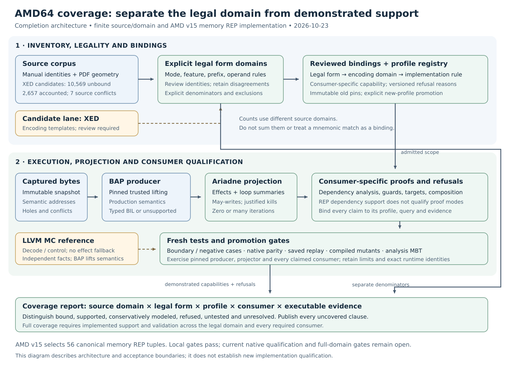

# Completing REP and AMD64 operation coverage

## Context and follow-up

**Current checkpoint: fixed-64 near-branch hypothesis accepted, 2026-10-24.**
The user selected the fixed-64 near-branch case and excluded the possible
16-bit operand overrides from that case. The
[implementation follow-up](../../.agents/plans/amd64-operation-coverage.md#fixed64-near-branch-hypothesis-follow-up)
records the pending checker projection and controls. This refines the selected
native `long-64` scope; other smaller operands and address-size rules remain
required. The preceding [H64 execution](../../.agents/plans/amd64-operation-coverage.md#h64-source-projection-and-c-inventory-execution)
implements the checked non-64-only MOVD disposition and native-64 source
inventories under the [H64 hypothesis](../../.agents/plans/amd64-operation-coverage.md#h64-native-amd64-execution-only),
which limits the proposed support target to native AMD64 64-bit execution. The
frozen source scope already selects `long-64`; this clarifies mode-specific
dispositions without excluding smaller operands or legacy instruction
encodings valid in 64-bit mode. The
[P1 source-selection completion](../../.agents/plans/amd64-operation-coverage.md#p1-source-selection-completed-2026-10-24)
accepts the exact five-edition publisher source pool under versioned policy,
with fresh original adjudication and migration replay. The subsequent
[P2 completion tasks](../../.agents/plans/amd64-operation-coverage.md#p2-completion-tasks-2026-10-24)
now execute review-disposition handling, inherited-obligation reconciliation,
clause inventories and source-conflict research under the user's instruction
to continue until an actual external blocker. The earlier
[P2 clause execution](../../.agents/plans/amd64-operation-coverage.md#p2-clause-and-reference-execution-2026-10-24)
adds architectural clauses, cell/reference dispositions and complete accepted-source
review worklists. P2 constraint and P3 legal-domain completeness remain separate. The
[per-form mapping continuation](../../.agents/plans/amd64-operation-coverage.md#per-form-source-rule-mapping-resumed-2026-10-24)
closes the explicit source-rule dependency omission with fresh affected
campaigns. The
[memory-native continuation](../../.agents/plans/amd64-operation-coverage.md#memory-mov8-native-consumer-continuation-2026-10-24)
adds a qualified finite address-64 consumer/address-32 refusal gate. Wider
coverage remains incomplete. The
[publisher entry-review continuation](../../.agents/plans/amd64-operation-coverage.md#publisher-migration-entry-review-2026-10-24)
now maps the source migration through a completed structural subgate without
adopting it. The
[conversion constraint continuation](../../.agents/plans/amd64-operation-coverage.md#conversion-family-source-constraints-2026-10-24)
validates selected source claims and retains conflicts without runtime admission.
The [remaining paired-family continuation](../../.agents/plans/amd64-operation-coverage.md#remaining-paired-family-source-constraints-2026-10-24)
continues selected source review across both revisions for GF2 inverse affine,
MOVD and scalar negative multiply-add, retaining literal contradictions.
The [section-5 execution](../../.agents/plans/amd64-operation-coverage.md#section-5-execution-and-exit-gates-2026-10-24)
adds checked current dispositions, cross-volume scaling rules and fresh
portable validation; its full-stage adoption/domain/native exits remain open.
The [stopped checkpoint](../../CHECKPOINTS.md#2026-10-24--amd64-constraint-and-mov8-continuation-stopped-for-publication)
records the publisher comparison, architectural constraint pack, memory domain,
register-native qualification and one unfinished source-rule mapping requirement.
[Current execution and prerequisites](../../.agents/plans/amd64-operation-coverage.md#resumed-source-review-and-local-native-checks)
separate the renewed finite binding/native gates from remaining full coverage.
Earlier qualifications retain their source scope.

**Status.** Completion design with finite source/domain implementation, 2026-10-23.
The working tree based on `6c3fa96` implements separately selected v12/v13/v14 REP scopes
and an AMD-specific v15 address-size successor, a candidate five-volume source
corpus, historical-gap accounting and v2/v3 finite legal-domain/binding registries. The [dated stage execution](../../.agents/plans/amd64-operation-coverage.md#source-and-domain-execution-c1c4)
distinguishes exercised clauses from the remaining full-stage exits. The broader
encoding grammar, source completeness and consumer expansions remain open;
the finite plain-dependency profiles do not grant proof-consumer admission.
The dated v15 gates below retain their recorded inputs. The recovery continuation
qualifies the current finite gate with recovered producer artifacts, the
reviewed helper builds, 341 refusal controls and 448 native parity instances.

**Why this document exists.** The [current BAP integration](bap-analysis-core-design.md#plain-repeated-string-profile-and-coverage-accounting)
owns the original three-form v12 contract; this design records its separately versioned memory-string successors and remaining obligations.
The [origin checkpoint](../../CHECKPOINTS.md#2026-10-23--plain-rep-dependency-projection-and-coverage-accounting)
records the starting 10,569 unbound symbolic candidates and 2,657 manual
extraction gaps. Geometry now gives all 2,657 old gaps source-backed
dispositions, including explicit source conflicts; none lacks a disposition. Neither the candidate count nor a
transcription-gap count is a count of unsupported legal AMD instructions.

**What this document establishes.** This is the canonical design for closing
source, encoding-domain, implementation and consumer coverage. The BAP design
continues to own the implemented semantic interface and profile contracts.
This document owns the completion data model, algorithms, dated finite
implementation findings and remaining exits.

**Where to go next.** Read the [completion stages](../../.agents/plans/amd64-operation-coverage.md#coverage-completion-design-stages)
for execution order, the [test matrix](../../tests/README.md) for executable
validation, and the [BAP trust boundary](semantic-assurance.md) for what testing
can establish. The [remaining coverage execution plan](../../.agents/plans/amd64-operation-coverage.md#remaining-coverage-execution-plan)
breaks the work after historical-gap accounting into P0–P8 and the parallel
native gate, with concrete deliveries and exit checks. The [plan reading view](../../.agents/chatdocs/ariadne-amd64-coverage-remaining-plan-20261023/index.html)
presents proposed work from `08dcab9`; it adds no implementation acceptance.
The [execution HTML](../../.agents/chatdocs/ariadne-amd64-coverage-execution-20261023/index.html)
is the current dated reading view; the [original proposal](../../.agents/chatdocs/ariadne-amd64-coverage-design-20261023/index.html)
preserves the pre-execution version.

**What remains unresolved.** The legal-form denominator, unparsed constraints, wider REP
semantics, architectural state and proof consumers remain incomplete. Official
byte identity for the historical v2 Vol4/5 files retains its old scope; the
current v3 source selection uses the exact publisher-delivered replacements
under the completed P1 policy. Universal ISA
execution correctness and Rust refinement remain separate obligations.
Windows unwind coverage remains with the [investigation design](investigation-design.md#amd64-unwind-coverage-program).

## 1. Problem and completion target

The work has three distinct deliverables:

1. A complete, source-backed inventory of legal forms within an explicit
   architecture scope, with checked encoding domains and exclusions.
2. Versioned bindings from those domains to implemented BAP transport,
   projection and consumer contracts.
3. Executable validation of every required form and contract partition, with
   gaps, tool failures and environmental premises remaining visible.

The proposed initial source scope is documented AMD64 long mode, including
application and privileged/system operations, the five architectural subsets
already named by the program, and an explicit extension manifest. Each release
must freeze vendor, publication revisions, extensions and execution modes.
Intel-only, future and undocumented XED records retain explicit dispositions;
they are not silently promoted into the AMD denominator or silently dropped.
A combined AMD/Intel claim needs its own pinned Intel source and extension set.
The scope freeze is an implementation gate, not a scope decision already accepted
by this proposal.

All documented forms inside the selected scope remain obligations. Missing
capture state, privilege, CPUID or operating-system state can produce explicit
conditional outcomes; they cannot justify removing a difficult instruction
from the denominator. A later scope change creates a new manifest and a visible
delta. It cannot turn an old incomplete campaign into a complete one.

“Full coverage” here means implementation and validation coverage of that
declared domain. It does not mean every concrete instruction execution has been
tested or that BAP has an independent ISA-correctness proof. A finite sample
cannot establish those stronger claims.

## 2. Current boundary

| Domain | Current state | Consequence |
| --- | --- | --- |
| XED source | 10,994 symbolic records: 10,569 long-mode candidates, 425 exclusions | A frozen candidate grammar, not a legal AMD instruction count. |
| Manual transcription | Historical v1 has 4,118 rows and 2,657 gap records; every old gap now has a source-backed disposition, with zero unassigned gaps and seven explicit source-conflict records | The old lock remains unchanged. Conflict and material dispositions retain unparsed constraints; historical backlog closure does not establish complete source/constraint coverage or a legal encoding. |
| Source provenance | Earlier publisher retrieval matched Vol1 r3.25, Vol2 r3.45 and Vol3 r3.38. The resumed review retrieves official Vol4 r3.27 and Vol5 r3.16 bytes matching the separate authority inputs, but differing from the old corpus pins. | Old Vol4/5 locks remain unchanged; bounded corrections do not establish corpus migration or adoption. |
| Current extraction | Candidate v2 reproduces all five volumes under pinned `pdftotext` 26.01, MuPDF 1.27 and Python 3.14.4; Vol3–5 normalized content matches v1 while full-layout hashes differ | Existing strict v1 pins remain active. Equal normalized content does not authorize migration or close previously unparsed source regions. |
| Representative v12 survey | 171 exact byte cases: 57 projected, 8 conservative unknowns, 106 remaining gaps | These samples do not bind any symbolic form authoritatively. Nine independent expectations match. |
| REP v12 | Exact `F3 A4`, `F3 AA`, `F3 A6`; plain dependency analysis only | Its three-form admission remains frozen. |
| REP v13/v14 | v13 selects 24 nonempty default-address producer forms; v14 adds four exact LODS forms from a separate pinned BAP source bundle | Both remain plain dependency profiles; address overrides, I/O and guard/target/refinement/composition proof transports remain refused. The recorded R1 boundary passed 416 native parity instances and 259 refusal controls; the recovered v15 environment has its separately qualified finite gate. |
| AMD REP v15 | 56 canonical memory-REP tuples: 28 default-address plus 28 address-32; the source bundle supplies 32 exact sequences | The original local record covers 178,080 numeric comparisons, 64 transport/projection cases and 448 capture instances. Current helper-build migration v1 passes fresh bindings, 448 native parity instances, 341 refusal controls and compatibility under the explicit AMD premise. |
| Accounting v1 | Candidate-only associations remain unchanged | The frozen 10,569 candidates still lack vendor-wide authoritative legal-form bindings. |
| Legal-domain/binding v2 pilot | Three source-derived F3 MOVS/STOS/CMPS families enumerate 24 canonical byte/environment points: 3 supported and 21 explicitly unsupported for v12 | Total disposition of this pilot does not close implementation, source completeness or the vendor denominator; fresh source-bound BIL, numeric and Rust admission checks pass for this pilot. |
| Legal-domain/binding v3 | 56 canonical AMD points, 516 source anchors and 111 fresh profile observations; v15 covers all points in this finite domain | Earlier profiles retain explicit unsupported points. Full source/vendor completeness and all 10,569 symbolic-domain bindings remain open. |
| Memory-MOV8 native consumption | 2,880 address-64 encodings × two targets plus all 2,880 address-32 refusals × two targets; seven named tests with current source/tool/test-artifact binding | Loads preserve untouched bytes, stores keep prior `memory:any` origins and refused roots stop before consumers. Synthetic normalized-analysis validation; full grammar, source completeness, ISA truth and execution history remain separate. |

The survey's 106 remaining cases comprise 75 missing producer lifts, 28
unsupported control/semantics outcomes, two encoding disagreements and one
query error. The latter is PUSHFQ (`9C`), whose fresh lift exceeds the helper's
BIL AST budget. These are measured outcomes for selected bytes, not estimates
of how many legal forms remain.

## 3. Architecture



The source lane establishes encoding membership and applicability. The semantic
lane implements analysis behavior under pinned BAP lifting. Their join is a
versioned binding registry; the coverage validator checks their common domains
and current validation inputs. XED and LLVM provide independent encoding and
control checks. Neither supplies a substitute instruction-effect implementation.

Maintain source pins, compact grammar/rule definitions, reviewed correction
patches, generators and small regressions in the repository. Reconstruct PDFs,
full layout/geometry products, expanded inventories, solver products, reports
and copied build trees under ignored `target/` or temporary work. Do not restore
a retained qualification-evidence collection.

## 4. Source reconstruction and manual gaps

### 4.1 Freeze a reproducible source corpus

The implemented candidate [`source-corpus/v2` lock](../../tests/bap/fixtures/amd64-semantics/source-corpus-v2.lock.json)
identifies publication, revision, publisher, retrieval origin, exact PDF
size/digest, selected chapters, appendices and global encoding-rule obligations.
The [source-corpus tool](../../tools/amd64_source_corpus.py) binds extractor
sources, executable and shared-library hashes, versions, options, locale and
normalization schema. Its decision remains `candidate-proposed-unreviewed`;
24 source-listed extension-family candidates are discovery inputs with explicit
unresolved supplementary-publication and CPUID/vendor audits. A live URL alone
is not a reproducible source identity.

Preserve the existing corpus lock. A new extraction toolchain produces a
separate candidate lock. Review PDF identity, full-text/geometry differences,
source-region coverage and normalized row/constraint differences before adopting
it. Reusing the old content digest is insufficient if changed source regions
were never represented by the old extractor.

### 4.2 Recover geometry and ownership

Use PDF word/glyph coordinates, table boundaries and outline ownership to build
source cells. A `sourceCell` has a PDF digest/page, rectangle, glyph span/digest,
table/row/column identity, owning instruction sections, continuation links and
footnote references. Printed page labels are useful annotations; PDF page
indices remain unambiguous source addresses.

The parser must track tables across pages and represent merged cells explicitly.
A spanning encoding cell can cover several operand rows only when geometry and
source structure justify that span. Never fill down a previous opcode merely
because the current cell is blank. Preserve alternative interpretations as
unresolved records.

Every old gap receives a source-backed disposition: resolved cell, justified
continuation, non-encoding material, source conflict, duplicate/alias, or unresolved. Record the
original gap ID, affected source cells, correction rule and review rationale.
Deleting a gap, suppressing a line class, or moving text outside a table does
not resolve an obligation. The implemented [geometry extractor](../../tools/amd64_manual_geometry.py)
now preserves those identities and reconstructs word-coordinate ownership;
[its finite execution](#102-geometry-and-source-region-execution-c2) accounts
for every historical gap. Later source replay adjudicates the seven conflict
records and all 33 table relations while preserving the original transcriptions.
Corpus adoption and unparsed constraints remain open.

### 4.3 Establish source completeness separately

Account for every selected source region, including prefix rules, operand-size
rules, exception/applicability notes, appendix maps and extension updates.
“All 2,657 gaps resolved” closes the old transcription backlog only. It does not
prove that the previous 4,118 rows contained all instruction forms or all global
constraints. Source-region coverage and legal-form derivation require their own
reviews and executable omission controls.

## 5. Legal forms and authoritative bindings

### 5.1 Keep identities separate

These records define the completion target. The restricted
[`legal-forms/v2` pilot](../../tests/bap/fixtures/amd64-semantics/legal-forms-pilot-v2.json)
and [`profile-bindings/v2` pilot](../../tests/bap/fixtures/amd64-semantics/profile-bindings-pilot-v2.json)
now implement a finite subset; the wider source/domain and semantic-contract
records remain to be completed:

| Entity | Required identity and content |
| --- | --- |
| `CoverageScope` | Vendor/publication/extension set, modes, environment axes, required semantic profiles/consumers and digest. |
| `SourceCell` | Exact source location, ownership, transcription/constraint role and reviewed disposition. |
| `LegalForm` | Source references, operation/operand roles, byte grammar, effective-size rules, prefix constraints and applicability predicates. |
| `TemplateRelation` | Legal-form IDs, frozen XED IDs, relation kind and source-backed explanation for equivalence, splitting, aliasing, overlap or absence. |
| `SemanticContract` | State reads/writes, normal/exceptional outcomes, memory/order/environment effects and conservative-analysis obligations. |
| `ProfileBinding` | Legal-form domain, producer and implementation rule IDs, semantic-contract ID, profile/consumer capabilities, source/ABI digests and validation obligations. |
| `ByteCase` | Exact consumed bytes, decode environment, binding/form IDs, independent expectations and current observations. |

A manual row can describe several legal forms, and several rows can describe
one form. One XED template can intersect multiple forms, and several templates
can cover one form. Store these relations explicitly; mnemonic and IFORM name
agreement is only a search aid.

Source-backed AMD forms absent from XED remain first-class obligations. Their
absence triggers a decoder/producer gap or a reviewed alternate encoding
reference; it must not remove them from the legal inventory. Conversely, each
XED candidate needs an explicit vendor/scope/alias/undocumented/future/unresolved
disposition.

### 5.2 Specify a restricted encoding grammar

Represent consumed instruction bytes, limited to 15 bytes, with declarative
constraints over opcode maps, prefixes and ordering, operand/address size,
REX/VEX/EVEX/XOP fields, ModRM/SIB, displacement, immediate and extension fields.
Preserve operand roles and register restrictions, including high-byte/REX
conflicts and reserved fields. Stream bytes after the consumed instruction are
separate input, not part of its identity.

Keep these predicates distinct:

```text
encoding_member(form, bytes, decode_environment)
instruction_applicability(form, architectural_environment)
profile_admission(binding, consumed_bytes, decode_environment,
                  pinned_producer_identity, typed_BIL, requested_consumers)
```

A recognized encoding can require an architectural exception in a particular
environment. It is not necessarily undecodable. Feature-dependent opcode
aliases need guarded resolution; a disabled feature must not automatically be
treated as either “not in scope” or a generic invalid opcode.
Admission must validate the entire chain from captured consumed bytes through
the legal-form match to the exact producer query/BIL and consumer selection.
Bind snapshot/VA, bytes/extent, target/environment, helper/runtime identity and
AST digest; a well-typed BIL shape for different bytes is insufficient. When a
feature-dependent alias cannot be selected from justified premises, retain the
alternatives under a reviewed join or report the unresolved applicability.

### 5.3 Check totality and overlap

For a legal form `f`, let `D(f)` be its declared byte/environment domain. Each
point must have a checked disposition: implemented binding, architectural alias
or exception contract, explicit unsupported obligation, or unresolved region.
Aliases and exception outcomes count as supported only through their own
implemented contracts. Scope exclusions are accounted before constructing
`D(f)`; removing a point already inside it requires a new reviewed scope manifest.

The validator checks:

```text
S(f) union U(f) union X(f) = D(f)       # total disposition accounting
S(f) = D(f), U(f) = X(f) = empty       # implementation completeness
binding_domain is a subset of its referenced legal-form domains
overlaps have identical meaning or a checked, source-backed dispatch rule
```

Here `S` is the union of implemented binding domains, `U` is explicitly
unsupported, and `X` is unresolved. Covering a region with an unsupported record
completes its accounting, not its implementation.

Use finite enumeration for small fields and a restricted constraint solver for
larger symbolic products. A solver timeout, unsupported constraint or unknown
answer leaves the obligation open. Do not assign success after a work cap.
Independently replay satisfying witnesses and counterexamples; use separate
checks for table/grammar derivation, partition coverage and implementation
dispatch. The grammar and its translation remain reviewed trust premises.

A byte recipe is a witness to membership, not proof of totality. A collection
of passing examples cannot certify `S(f) = D(f)`. Conversely, domain totality
does not prove instruction execution semantics; that remains under the BAP
trust boundary and separately exercised analysis contracts.

### 5.4 Version the authoritative path

Keep `ariadne.amd64-form-case-associations/v1` candidate-only and preserve
`coverage/v1` behavior. The separate [v2 legal-domain checker](../../tools/amd64_legal_forms.py)
implements `legal-forms/v2`, `profile-bindings/v2` and `coverage-assessment/v2`
for the restricted pilot. It rejects unknown fields, duplicate identities,
orphan references, inconsistent aliases and stale source, producer, grammar or
consumer digests. Unsupported grammar and exhausted enumeration return an
unknown outcome; the pilot supplies no wider solver or source-completeness claim.

No `authoritative: true` switch may promote an existing association. The new
checker must validate the source derivation and domain obligations. Digests bind
the reviewed inputs; hashing a claim does not establish its authority.

## 6. Remaining REP design

### 6.1 Expand operation dimensions explicitly

The proposed memory-string progression is:

| Family | Repeat condition | Element widths | Address-size work |
| --- | --- | --- | --- |
| MOVS, STOS, LODS | F3 count-controlled | 8 / 16 / 32 / 64 | Default 64-bit addressing, then separately reviewed 32-bit addressing. |
| CMPS, SCAS | F3 while equal; F2 while not equal | 8 / 16 / 32 / 64 | Same independent address-size progression. |
| INS, OUTS | Separately reviewed F3 I/O repetition | 8 / 16 / 32 | Separate external-state, privilege and exceptional-completion contracts. |

R1 implements the default-address portion through two successor profiles: v13
for 24 nonempty original producer lifts, and v14 for those forms plus four LODS
lifts from a separate BAP source bundle. See the dated execution below for
producer, projection and consumer-validation scopes.

These family/condition/element choices give 28 memory-string planning tuples
at default address size, including the current three, or 56 after adding the
second address-size choice. They are planning tuples, not legal-form or
exhaustive-encoding counts. Prefix/segment variants and environmental domains
still require source-derived bindings. [AMD repeat-prefix tables](https://docs.amd.com/api/khub/documents/BqEoC2FadIAgbrUdEzDJIg/content#page=54)
are the source starting point.

Each recipe records operation, element width, address/count/index width,
repeat condition, applicable source-segment selection, exact prefix constraints
and environment predicates. A MOVSD string encoding must never be selected by
the ambiguous mnemonic alone. Extra prefixes, prefix order, repeated prefixes
and feature modifiers remain unreviewed until their particular domains are
established; F2/F3 never become generic permission bits.

For comparison/scanning repetition, the newly produced ZF controls continuation
after the first iteration. Tests must distinguish an initial ZF from the first
comparison's result. Element size and address/count size are independent.
[Intel's repeat-operation reference](https://cdrdv2.intel.com/v1/dl/getContent/671241#page=573)
provides an independent primary cross-check.

### 6.2 Preserve the abstract loop contract

Retain the v12 zero-or-more dependency fixed point as the minimum conservative
contract. Entry origins survive the zero-iteration alternative; possible body
writes do not become definite kills. LODS/SCAS add accumulator lane and flag
obligations. Element-width changes add multi-byte memory, overlap and arithmetic
wrap cases. Address-size changes add count/index lane rules and upper-half
behavior; test nonzero upper halves with both zero and nonzero effective counts.
Do not infer zero-count upper-lane behavior from a generic register-write rule.

Recognize a reviewed producer loop structure with bound temporaries, typed
conditions and no unreviewed external control. Do not synthesize effects from
an opcode when BAP lacks the lift. A larger legitimate BIL tree needs a reviewed
transport/resource contract; raising an AST limit alone does not implement a
missing architectural state bank.

Preserve bounded work and explicit exhaustion. A more precise range or
closed-form optimization must conservatively refine the established loop
summary and pass the same zero-iteration and loop-carried-origin controls.
Do not concretely iterate a captured RCX value: the snapshot does not establish
the instruction's entry count or earlier executed iterations.

### 6.3 Separate normal completion and fault/restart semantics

Extend the semantic outcome model before claiming fault-sensitive REP support.
Represent normal completion, a possible completed-iteration prefix followed by
a fault, and interruption/restart boundaries under their architectural premises.
Do not make a partial prefix imply the final normal result or attach a
normal-completion guard to a fault outcome. Memory accesses need conditional
width/progress/ordering information, not a first-iteration affine address
reused for the entire operation.

I/O repetition requires explicit external I/O state and side effects; it cannot
be implemented by a `memory:any` rule. A port read can precede a later memory
fault. The [Intel REP INS reference](https://cdrdv2.intel.com/v1/dl/getContent/671241#page=572)
and [comparison fault behavior](https://cdrdv2.intel.com/v1/dl/getContent/671241#page=574)
must be reconciled with the selected AMD contracts before admission. A
normal-completion numeric oracle does not close those gates.

### 6.4 Version every consumer capability

Freeze v12's current meaning. Allocate successor semantic profiles and, where
needed, new receipt/checker generations; numeric version IDs are assigned at
implementation time. Reusing the same producer binary does not make a new
projection or proof contract equivalent to an old one.

| Consumer | Required expansion contract |
| --- | --- |
| Plain dependency projection | Exact recipe admission, bounded closure, lane/flag/memory effects and explicit outcomes. |
| Address evidence | Retain every possible access; iteration-dependent addresses stay unknown unless a separate range contract is validated. |
| Guard admission | Derive transfers over the whole loop; preserve an unaffected register only after checking all writes; no assumption of nonzero count or normal completion. |
| Captured targets | Havoc every possibly written binding or validate a loop summary; preserve original edges, candidates and coverage obligations. |
| Memory refinement | Treat all potentially reached writes as barriers unless a checked footprint proves exclusion; no first-iteration disjointness shortcut. |
| Composition/native replay | Replay the same profile, outcomes, query and proof premises; invalidate receipts when any bound rule changes. |

Use explicit capabilities per profile and consumer. During migration, a
consumer continues to refuse unsupported recipes before work, including empty
and all-null source domains and direct checker entry points. Bind the overall
semantic identity as well as site identities. Old/current transport mixing and
substring lookalikes must remain negative controls.

## 7. Close the rest of AMD64 by contract family

After the denominator is available, generate work by missing capability rather
than selecting convenient mnemonic examples. BAP source gaps, transport gaps,
state-bank gaps, projection gaps and consumer gaps are separate classifications.
PUSHFQ's AST-budget failure belongs to transport/producer assessment until a
reviewed lift is transported; it does not count as supported after a counter
is increased.

Architecture-state stages need explicit alias and partial-write rules for
wider vectors/masks, x87/MMX relationships, control/status state, segment bases,
system registers and external state. Atomic/order effects and system or
exceptional control require contracts beyond ordinary scalar writes. Coarse
`state:other` writes cannot justify killing unrelated aggregate origins.

Each family slice must connect source legality, actual producer BIL, normalized
effects, required consumers, independent tests and an exact profile identity.
An implemented conservative contract may legitimately retain environmental
unknowns. An unimplemented operation cannot close its row by emitting generic
unknown effects. BAP remains the semantic dependency; LLVM remains the
independent decode/control reference. Supplied LLVM IR and abstract stateflow
remain separate APIs.

## 8. Validation and acceptance

Track four independent axes for every binding:

| Axis | States and required evidence |
| --- | --- |
| Source/domain | Unresolved, reviewed member/alias, justified exclusion; source-backed grammar and totality/overlap checks. |
| Implementation | Missing producer/transport/state/projection/consumer, or implemented named contract; no credit from decoding alone. |
| Execution | Unexercised, passed, failed or blocked by prerequisite; exact current source, tools, profile, query and corpus. |
| Capability | Explicit support/refusal for each required consumer and outcome; approved conservative behavior has a stated invariant and precision limit. |

Do not overload one Boolean “supported” with all four meanings. Report source
coverage, binding-domain coverage, tested partitions and semantic outcomes
separately. A full claim names its scope and required consumer set, and requires
all of their obligations. A narrower plain-projection release can state its
own finite support while program-wide Q1 remains open.

The validation suite must include:

- Independent source-region omission and merged/continued-cell regressions;
  legal AMD forms absent from XED; overlapping feature-dependent aliases.
- Exact-byte positives and negatives for widths, address size, prefix fields,
  register restrictions, reserved encodings, length boundaries and trailing
  stream bytes; wrong-byte/environment/producer bindings despite valid typed
  BIL. Unsupported is distinct from architecturally invalid.
- REP zero/one/many counts, both directions, initial/opposite ZF, first/late
  mismatch, overlap, pointer wrap, lane preservation, segment-state uncertainty,
  later-iteration writes, virtual bindings and resource exhaustion.
- Actual fresh BAP BIL with independently supplied numeric/flag/memory
  expectations, Rust/native full-state comparisons and saved-proof tampering.
- Compiled mutants for dropped source regions, narrowed domains, omitted entry
  joins, single-pass loop summaries, stale output equations, first-iteration
  alias exclusion and omitted overall-profile checks.
- Applicable analysis-model/replay checks and root format/default/core-only/
  strict-Clippy/layout checks. New analysis contracts need their owning model
  changes and qualification; an encoding inventory does not replace them.

Mutant credit requires a passing exact control, a compiled changed SUT, the
intended unchanged observer's behavioral rejection, private build outputs and
restored source/observer checks. Missing runtimes, solver unknowns, timeouts,
compile failures, ignored tests and old reports never supply positive credit.
Keep a small actual regression for each closed failure class; regenerate the
large campaigns instead of maintaining their logs or passing flags.

## 9. Delivery sequence and stop rules

The [linked execution stages](../../.agents/plans/amd64-operation-coverage.md#coverage-completion-design-stages)
own scheduling and status. Source and REP work may proceed in parallel, but a
REP slice does not close the inventory gate, and inventory closure does not
qualify a producer or consumer.
The [post-backlog execution plan](../../.agents/plans/amd64-operation-coverage.md#remaining-coverage-execution-plan)
orders the remaining C1–C4, R2–R4, A1 and Q1 work into source adjudication,
constraint extraction, legal-domain construction, bindings, implementation and
integrated validation. Its first delivery tracks all seven conflicts and 33
table relations; its proposed first new domain pilot is register-only byte MOV.

| Stage | Exit |
| --- | --- |
| C1 — Source scope | Freeze corpus, vendor/extension boundaries and official source identities. |
| C2 — Transcription | Account for all selected regions and resolve each old gap with a source-backed disposition. |
| C3 — Legal domains | Complete reviewed grammar, manual/XED reconciliation, aliases and counterexamples. |
| C4 — Binding checker | Versioned authoritative schema; checked totality, overlap and dispatch; no unresolved domain silently omitted. |
| R1 — Memory REP | Review and qualify remaining default-address memory-string tuples under a new profile. |
| R2 — Address/prefix variants | Qualify address-size, segment and prefix domains with lane/zero-count controls. |
| R3 — Proof consumers | Implement each required guard/target/refinement/composition contract and native replay generation. |
| R4 — I/O and faults | Implement environmental and partial-completion/restart contracts; retain explicit gaps until qualified. |
| A1 — Architecture families | Close producer/state/projection/control gaps for every legal form and required consumer. |
| Q1 — Scoped full coverage | All previous required exits and current validation obligations pass for the frozen scope; report proof and environmental limits. |

R1's finite default-address gate is recorded as complete. Next work is the
remaining C1/C2 source/ownership audit, broader C3/C4 domains and the current
v15 native gate; its canonical address-size producer correction is implemented.
Do not first add thousands of name associations or enable generic loop/prefix
admission. If the source corpus, domain solver or semantic producer cannot meet
an exit, retain the specific blocker and continue independent stages without
changing the acceptance predicate.

## 10. Source review and validation status

The implementation seams reviewed for this design are the
[XED extractor](../../tools/amd64_inventory.py),
[manual extractor](../../tools/amd64_manual_inventory.py),
[source-corpus candidate tool](../../tools/amd64_source_corpus.py),
[geometry reconstruction](../../tools/amd64_manual_geometry.py),
[finite legal-domain checker](../../tools/amd64_legal_forms.py),
[candidate accountant](../../tools/amd64_coverage.py),
[v12 matcher](../../src/bap/repeated_strings.rs),
[typed admission](../../src/bap/admission.rs),
[dependency projector](../../src/bap/projection.rs),
[address evidence](../../src/bap/address.rs),
[target transfers](../../src/bap/target_resolution.rs) and
[native capture boundary](../../native/bap-core/capture.ml).

The [current checkpoint](../../CHECKPOINTS.md#2026-10-23--plain-rep-dependency-projection-and-coverage-accounting)
records the prior finite validation. The initial design publication ran only
document/link/SVG checks. The execution below adds independently scoped
source-reconstruction and finite-domain tests; it does not convert the remaining
proposals into accepted source, encoding or semantic coverage. Current helper,
source and observer identity checks remain required after further implementation
changes.

Primary source entry points are the pinned
[AMD Volume 3 revision 3.38](https://docs.amd.com/v/u/en-US/24594_3.38_APM_Vol3_PUB),
the repository's [manual source pins](../../tests/bap/fixtures/amd64-semantics/manual-inventory.lock.json)
and [XED source/selection pins](../../tests/bap/fixtures/amd64-semantics/inventory.lock.json).
The Intel cross-checks cited in section 6 are references to review, not a newly
adopted source corpus. They require explicit source pinning before becoming
denominator authority.


### 10.1 Source-corpus execution: C1

2026-10-23: the new candidate lock covers all five APM volumes, AMD long-64
application and privileged/system operations, and the five architectural
subsets. Supplementary AMD publications and source-listed extension families
retain explicit unresolved obligations; the candidate cannot self-assert
reviewed adoption. Vol1/2 global rules and every non-reference chapter/appendix
remain required source regions.

Fresh publisher retrieval matches the exact repository PDF sizes and SHA256
pins for Vol1 r3.25, Vol2 r3.45 and Vol3 r3.38. AMD's indexed
[Vol4 r3.26 content URL](https://docs.amd.com/api/khub/documents/ioQiNhSqxlMkRaU~IyGQYQ/content)
and [Vol5 r3.16 content URL](https://docs.amd.com/api/khub/documents/w13cmcpL4f9MCT4WPN6eDg/content)
return HTTP 404 during the current check. Search-index revision metadata does
not establish equality with the pinned archive bytes. Those two byte-identity
clauses remain open.

A bounded follow-up against AMD's static `26568.pdf` and `26569.pdf`
download endpoints also times out without verified PDF bytes. That result
neither disproves availability nor establishes equality with the archive pins.

The candidate pins `pdftotext` 26.01.0, MuPDF 1.27.0 and Python 3.14.4,
their executables and 89 runtime-library identities, extractor source hashes,
UTF-8/layout/bounding-box options, `LC_ALL=C`, `LANG=C`, `TZ=UTC` and the
normalization schema. Fresh `reproduce` and `check-products --require-all`
exercise all five PDFs. Vol3–5 normalized content hashes match the historical
v1 content, while all three full-layout hashes differ; historical locks are
unchanged. Fourteen source-corpus controls reject missing identities, false
adoption/completion fields, changed tools/libraries/options/locale, altered
PDFs/products, unsafe origins and incomplete or stale migration reviews.

A fresh validation campaign starts with `reproduce` against the pinned PDFs
and tools, then runs `check-products`. The latter verifies current identities
and generated bytes; it does not rerun PDF extraction. Resealing an altered
intermediate manifest cannot replace the fresh extraction premise. Migration
checks bind explicit review inputs and comparison artifacts but never establish
corpus adoption by themselves. C1 remains open pending reviewed scope/extension
boundaries, complete source-region/global-rule coverage, migration review and
official Vol4/5 byte identity.

### 10.2 Geometry and source-region execution: C2

2026-10-23: the first geometry pass established 1,726 source-backed dispositions
and 931 unresolved gaps; the next pass added 350 dispositions. The final
historical-backlog pass accounts for the remaining 581 obligations. All 2,657
gap IDs, ordinals, original objects and legacy source addresses remain present,
and all 2,076 earlier dispositions remain byte-for-byte equivalent as JSON data.

| Publication | Original gaps | Source-backed dispositions | Unresolved |
| --- | ---: | ---: | ---: |
| Vol3, 24594 | 159 | 159 | 0 |
| Vol4, 26568 | 1,987 | 1,987 | 0 |
| Vol5, 26569 | 511 | 511 | 0 |
| Total | 2,657 | 2,657 | 0 |

The last 581 dispositions have distinct source obligations:

- Vol3 accounts for 60 CMOV width-group gaps, 34 SETcc alias-group gaps,
  five wrapped opcode fragments, one literal `F2/F3` encoding and 45 explanatory
  material records. Shared cells require exact named columns, tightly spaced
  and isolated source-owned groups, and a unique centered opcode. Literal
  MOVDIRI/MOVDIR64B `3B` bytes remain unchanged.
- Vol4 accounts for 269 records through explicit notes, footers, semantic/alias
  tables, source headings/prototypes, superscript geometry, named column bounds
  and retained word-box spans for combined cells. AESENC's actual heading
  supplies an ownership overlay while preserving its incorrect historical
  `AESDECLAST VAESDECLAST` bookmark association. Seven records retain
  `source-conflict`: malformed operands/bitfields or disagreements between a
  printed mnemonic and its section heading. Examples include
  `xmmVGETEXPPD2`, `X.1323r33111.` and SHA256MSG1 within the SHA256MSG2 section.
  No intended correction or authoritative legal binding is inferred.
- Vol5 accounts for 166 material records and one FNSTENV operand continuation.
  Owned EPS labels, immediate-field captions, before/after stack labels and
  numeric-result headers bound the material. Repeated and staggered text
  requires unique neighboring anchors, increasing source order and distinct
  source-cell assignments; one PDF cell cannot discharge two historical lines.

Material and conflict records retain `constraintsParsed=false`. Their
disposition establishes where the old parser overreached or what source text
it missed; it does not validate a legal encoding or parse a diagram's operation.
Recovered bindings live in explicit disposition evidence, leaving the historical
inventory and existing derived rows intact. The old generic CMOV/AES refusal
controls remain active; the new rules require additional structural evidence.

The [geometry extractor](../../tools/amd64_manual_geometry.py) dispatches pure
per-volume recovery passes after the original parser. Integration checks reject
mutated context, rewritten IDs or prior dispositions, absent/foreign source
cells, lost legacy source lines and invented entry/row identities. Its
`extractorSources` map binds all nine extraction/dependency modules in both
geometry and region products. The v2/v3 binding registries inherit that closure;
editing any volume helper invalidates both registries. `check` reconstructs the
whole expected output, so resealing an omitted gap or altered owner cannot pass.

Sixty-one geometry controls and thirteen historical extraction controls pass.
Actual PDF excerpts and negative controls exercise missing, duplicated, moved
and wrong-column cells, foreign heads, misplaced superscripts, conflicting
owners, new notes/opcodes and repeated-line aliasing. The complete BAP-side
Python suite passes 145 tests and the tooling suite passes 328. The checked main
extractor SHA-256 is
`f98ac07ecbda55e32d2e2190bd4a216c44bbe28b11462bf783580d2b458ad257`;
its output also binds the eight dependency/helper identities.

Fresh `extract`/`check` cover all three historical instruction-reference
publications. Five-volume `regions`/`check-regions` enumerate all 4,128 PDF
pages and eleven required source-region clauses. The pinned C1 products and
their fresh-extraction premise remain required inputs. Enumeration does not
establish complete parsing of global rules, footnotes, semantic constraints or
the 33 candidate cross-page continuations (25 in Vol3 and eight in Vol4).
`oldGapBacklogClosed` is true; `allSelectedSourceConstraintsParsed`,
`sourceCompletenessEstablished`, `legalEncodingCompletenessEstablished` and
`c2Complete` remain false. The historical backlog is accounted for; C2's wider
source contract remains open.

### 10.3 Finite legal-domain and binding execution: C3/C4

2026-10-23: the separate v2 pilot derives canonical F3 MOVS, STOS and CMPS
families from exact Vol3 r3.38 source cells and enumerates element widths
8/16/32/64 with address widths 32/64. The predeclared scope excludes other
families, alternate prefix order and redundant/segment prefixes before domain
construction. Its 24 byte/environment points partition into three supported
v12 plain-dependency points (`F3 A4`, `F3 AA`, `F3 A6`) and 21 explicit v12
unsupported points. Unsupported points remain obligations for that consumer;
they do not deny another profile's separately qualified capability.

The checker validates total disposition, binding-domain inclusion, disjoint
S/U/X partitions, holes, aliases, exact consumed bytes/environment and source,
producer, typed-BIL and consumer identity. Twenty-four portable controls exercise
missing/narrowed domains, overlaps, wrong bytes, stale inputs, forged claims,
unknown grammar and exhausted work budgets. A total disposition result does
not satisfy implementation completeness while 21 points remain unsupported.
This pilot neither binds the 10,569 XED candidates nor establishes a full AMD
legal-form denominator. Source derivation and the restricted grammar remain
reviewed trust premises; a general constraint solver is still unimplemented.

The historical-gap continuation reseals thirty-nine implementation identities and
obtains three fresh producer BIL observations, 720 independent numeric
comparisons and the passing exact-lift Rust observer
`fresh_producer_loops_project_under_only_the_repeated_string_profile`.
Fresh `build` without `--skip-rust-admission` and `check --require-bindings`
both pass. `totalDisposition` and `profileBindingsValidated` are true only for
this pilot; implementation, source completeness, vendor-wide totality and full
AMD64 support remain false. The final binding digest is
`e303967b3d22daf32a32a4b8dbc2bb389d341117343b43e6a2c80b15ee0f944f`.
Further bound source changes require another fresh producer/oracle/Rust
campaign. C3/C4 remain partial.

### 10.4 Default-address memory REP execution: R1

2026-10-23: the 28-tuple recipe contract freezes MOVS/STOS/LODS at four
widths and CMPS/SCAS at four widths and both repeat conditions. The maintained
`memory-recipes-v2.json` records the original producer's four empty LODS lifts
explicitly. It remains a v13 availability contract; selecting v14 requires a
separate actual producer, rather than changing those old observations.

`Config::with_memory_repeated_strings(flags)` selects
`bap-bit-provenance-v13` and the unchanged advanced flag bundle. It admits
24 exact canonical byte sequences: MOVS/STOS B/W/L/Q under F3, and CMPS/SCAS
B/W/L/Q under F3 or F2. The pinned BAP names 32-bit string forms with L.
Word forms require 66 before F2/F3; REX.W follows F2/F3. Extra, reordered,
segment and address-size prefixes remain refused. v12's three byte forms and
the older packaged/Basic/advanced contracts stay frozen.

`Config::with_memory_repeated_strings_and_lods(flags, lods)` selects
`bap-bit-provenance-v14`. Environment selection requires
`ARIADNE_BAP_SOURCE_EXTENSION_MODE=memory-repeated-strings-with-lods`,
`ARIADNE_BAP_SOURCE_EXTENSION=flags` and
`ARIADNE_BAP_LODS_SOURCE_EXTENSION=lods`. v13 uses mode
`memory-repeated-strings` and only the flag directory. A missing or mismatched
LODS directory fails configuration validation. Older builder methods clear that
additional directory when selecting their own contract.

The separate LODS patch extends the pinned upstream BAP parser/type/lifter
for exact F3 AC, 66 F3 AD, F3 AD and F3 48 AD in long mode. It produces actual
typed BIL: an initialized virtual loop flag followed by one nonempty loop.
The transport validates that structure, architectural namespace and types,
source/SDK/build/executable identity, exact target/snapshot/VA/bytes/extent,
response/AST/time limits and artifact stability before and after a query.
Only an empty original lift with matching independent decode/control facts can
select this producer. BAP remains the sole semantic source; the adapter builds
no opcode effects. Combined runtime identity includes both source bundles.

With the original checked SDK in its compatible build environment, reproduce
the two isolated bundles with:

```sh
python3 native/bap/source-coverage/lods_build.py --output target/lods-source-a
python3 native/bap/source-coverage/lods_build.py --output target/lods-source-b
cmp target/lods-source-a/runtime/manifest.json target/lods-source-b/runtime/manifest.json
cmp target/lods-source-a/runtime/lods-lift target/lods-source-b/runtime/lods-lift
```

Run the selected-bundle Rust transport test with
`ARIADNE_BAP_LODS_SOURCE_EXTENSION=target/lods-source-a/runtime` and
`cargo test --offline --locked --lib native_pinned_bundle_transports_actual_typed_loops_for_both_targets -- --ignored`.
The two `memory_rep_recipe_materialization_v13`/`v14` ignored tests also need
the pinned BAP/LLVM helpers and `ARIADNE_BAP_ADVANCED_SOURCE_EXTENSION`.
Run both native matrices with
`cargo test --offline --locked --lib memory_rep_recipe_matrix_preserves_roots_effects_and_origins -- --ignored --test-threads=1`
and the current source-matching `ARIADNE_BAP_CORE_DIR`. This filter selects
both `native_memory_rep_recipe_matrix` and `native_lods_memory_rep_recipe_matrix`;
the former prefix alone misses v14. A missing or stale native core remains an
unexercised prerequisite.

Two independent corrected builds have identical manifest SHA256
`8565bd4ab05e3592ea6372fe1cceec230b131538836a61800a6f5ea3f17e4d35`
and executable SHA256
`bba596dc1f599090e20259a0d6880ec66cd5c472276678aeb17d1ce2e0b38466`.
These are adopted only in the new `lods.runtime.lock.json`; earlier locks are
unchanged. Each build checks four typed new forms, 38 refused prefix neighbors,
four trailing sequences and ten unchanged baseline observations. The serializer
uses the pinned C API casts LOW=0/HIGH=1/SIGNED=2/UNSIGNED=3; a dedicated control
rejects accidental constructor-order serialization. Earlier wrong-cast builds
and transient compilation failures receive no qualification credit.

Fresh independent equations pass 43,200 comparisons for the 24 v13 forms and
14,400 for the four LODS forms, covering zero/multiple counts, both DF values,
initial flags, comparison termination, overlap, multi-byte elements, accumulator
lanes and supplied memory/address wrap. These finite normal-completion tests
compare all represented registers/flags and complete supplied memory. Five
source/oracle controls and twelve portable transport controls pass. One ignored
Rust test exercises all four actual source lifts on both OS targets, validates
v14 projection and verifies that v13 still refuses them.

The shared zero-or-more dependency fixed point retains entry origins and
weak writes with empty `must_defs`. Iteration-dependent memory addresses stay
explicitly unknown. The two local captured-input matrices pass 192 v13 and 224 v14 tuple
instances across both OS targets, zero/nonzero setup counts and both DF
values. They validate unchanged roots/seeds, exact uses/may-writes, empty
must-writes, unknown iteration-dependent memory evidence, retained entry/REP
origins and investigation binding. Portable proof APIs refuse both profiles
before helper/decode work, including empty roots. The current native gate
also passes all 416 parity instances and 259 direct/protocol refusal controls;
the four compiled loop mutants retain their independently checked scope.
R1 is complete for these 28 default-address planning tuples. This finite
normal-completion/dependency qualification supplies no partial-fault, restart,
I/O, address-override or general ISA guarantee. C1–C4, R2–R4, A1 and Q1 remain
open at their broader exits.


### 10.5 Address-size assessment: R2

2026-10-23: fresh original BAP and LLVM probes cover 28 recipe families,
nine prefix scopes and two target labels: 504 observations. All 28 canonical
67-prefixed forms have matching decoder extents. Four MOVS widths produce
nonempty BIL, but use RCX/RSI/RDI at 64 bits; the other 24 canonical forms have
empty BIL. Thirty-two concrete counterexamples establish incorrect low-32
zero-count loop entry, high-index address behavior and both 32-bit wrap
directions for those MOVS lifts. The zero-count control evaluates loop entry
without concretely iterating a huge count. Three portable equation controls pass.

Seven neighboring prefix families retain raw observations: FS, LOCK,
duplicate address/repeat prefixes, reordered address prefixes, extra REX and
trailing bytes. Decoding a neighbor grants no semantic admission. The report
binds current helpers, libraries, source and actual BIL; its implementation,
full-acceptance and broadened-profile flags remain false. R2 needs a separately
reviewed BAP source correction for count/index/address widths and upper-lane
behavior before any new prefix can be selected. v12/v13/v14 remain unchanged.

### 10.6 Current root checks and remaining qualification

This subsection records the completed R1/v14 source boundary. The subsequent
R2/v15 continuation below has new source identities and separate current gates.

2026-10-23: the final serial default suite passes 457 Rust tests with 155 ignored;
core-only passes 64 with 22 ignored. Strict all-feature/all-target Clippy,
formatting, Rust layout and document navigation pass. The root commands use
the existing read-only, hash-pinned MirrorRust snapshot; the sibling checkout
is unchanged and core-only normal dependencies remain empty. An earlier
concurrent default run exceeded an existing guard publication deadline; it
receives no passing credit. The same frozen source passes the serial run.
All 81 BAP-side Python controls and 304 tooling controls pass, including the
new source, geometry, legal-domain, recipe, LODS and address-size checks.
Four optimized compiled loop mutants are detected at the intended named
assertions after their exact unchanged controls pass: omit zero-iteration entry,
stop after one body application, omit target havoc and permit nested loops.
Each uses a private SUT/build directory; source restoration, unchanged observers,
current source identities and the pinned MirrorRust dependency are verified.
Compile failures and timeouts earn no mutation credit. The Rust campaign and
the native campaign below establish separate finite clauses.

All 416 local memory-REP materialization instances and the separate native
LODS source/transport tests pass in their declared scopes. The user then
explicitly approved the prepared source-only transfer to `win10`, resolving the
automatic approval-review block. The 25-file payload and thirteen existing
Rust/model/legacy inputs match the checkout. The original isolated SDK verifies
its inventory and builds a fresh core whose executable SHA256 is
`b01c3bf697eb53c355c88716b4ee41a0010809bd71c501fbb3ac9be86698a7bf`.

The retrieved helper passes an explicit audit of all fourteen native source
hashes, the SDK lock and seventeen SDK/compiler/model/engine identity fields.
This audit is required: runtime transport verifies manifest/executable and
ready-frame consistency, while the native-control runner checks four policy
sources; neither alone proves that every bound source matches the checkout.
The same identities are checked again after the tests.

All 97 direct and 162 framed native controls pass. Their exact overall/site
profile checks cover v12/v13/v14, empty/all-null domains, direct checker entry
points, malformed proof bodies and lookalike tokens. The two ignored native
matrix tests both pass: 192 v13 and 224 v14 tuple instances across sixteen
synthetic Windows/Linux capture queries, with zero/nonzero setup counts and
both DF values. Every query has complete Rust/native state equality and the
existing effects, weak-write, origin, seed/root, memory-gap and investigation
binding assertions. The v12 saved-capture/tampering and old advanced-composition
positive/tampering regressions also pass against this new helper.

This closes the current R1 finite native gate. It does not enable REP proof
consumers or qualify real-capture timing, partial faults, address-size variants
or full AMD64 coverage. Source-corpus, legal-domain, architecture-family and
full-coverage exits remain open. The [completed native campaign](../../.agents/plans/amd64-operation-coverage.md#native-memory-rep-qualification)
records the approved payload, isolated environment and exact exercised gates.


### 10.7 AMD address-size REP implementation: R2

2026-10-23: v15 implements a finite canonical address-size slice under an
explicit AMD long-mode premise. It selects all 28 default-address memory REP
tuples and the corresponding 28 tuples with leading 67. The existing v12/v13/v14
contracts and producer pins retain their scopes. R2 as a whole remains open for
other prefix orders, redundant prefixes and segment-selection domains.

The new BAP source bundle composes the frozen LODS patch with
`rep_address.patch`. It supplies four default-address LODS forms and all 28
address-32 forms. It corrects the original four nonempty MOVS lifts as well as
supplying missing lifts. Selection requires exact consumed bytes, length and
ordinary-control agreement from the independent decoders; the explicit v15
producer then replaces the original lift even when that original BIL is
nonempty. The adapter transports actual BAP BIL and synthesizes no opcode effects.
All 28 default-address source behaviors remain unchanged in fresh comparisons,
including byte-identical BIL from the earlier v14 LODS runtime.

Two independent final builds have identical manifest SHA256
`815fc8842899d05f6db51aa53cf21b4c82fd50fdae42200b43df4e6735cf48d4`
and executable SHA256
`e834c5e9e25a4b2f93de448a01326482493a93430ea1ce43428289b2685c727e`.
Only the new `rep-address.runtime.lock.json` adopts these identities. Each
build checks 32 typed forms, 252 prefix neighbors, 32 trailing sequences,
28 unchanged original baseline observations and 312 runtime whitelist refusals.
The transport checks six producer-source identities, SDK/build pins, exact
query identity, one seeded nonempty loop, bounded output/time, typed expressions,
family-specific architectural writes, virtual bindings and artifact stability.
Fifteen transport tests pass, including all 32 forms on both target labels.

Address-32 execution tests the low 32 count bits, truncates each starting
source/destination effective address, and zero-extends participating count/index
updates after an actual iteration. Index arithmetic wraps at 32 bits; element
byte lanes remain contiguous in the 64-bit linear address space. A fresh qword
probe at 0xfffffffc reads through 0x100000003 and then advances ESI to 4.
Both inspected CPUs corroborate this element/index distinction.

Zero-count upper-lane behavior requires a vendor premise. On the tested
AuthenticAMD Ryzen 9 7950X, all 28 exact forms preserve count/index/accumulator
upper lanes when low ECX is zero. On the inspected GenuineIntel Core 5 220H,
zero-count RCX clears its upper half; MOVS also clears both indices, STOS clears
RDI, while LODS/CMPS/SCAS preserve their index upper halves. These are finite
hardware observations, not a universal vendor proof. The AMD manual-derived
contract and AMD observations support v15's selected preservation rule; Intel
behavior is not silently included in that contract.

The manifest binds `vendor: AMD` and the premises
`amd-long-mode-memory-rep` and `address32-zero-count-preserves-upper-lanes`.
Select it with
`Config::with_amd_memory_repeated_strings_address_size(flags, rep_address)` or:

```sh
ARIADNE_BAP_SOURCE_EXTENSION_MODE=amd-memory-repeated-strings-address-size
ARIADNE_BAP_SOURCE_EXTENSION=target/selected-advanced-flags/runtime
ARIADNE_BAP_REP_ADDRESS_SOURCE_EXTENSION=target/selected-rep-address/runtime
```

The older LODS directory must be absent in this mode; the new bundle supplies
those four forms itself. Older configuration builders clear the new selection.
For every selected 67 form, semantic evidence records
`amd-address32-zero-count-semantics-premise`. The dump's AMD64 architecture or
Windows/Linux target label does not prove its CPU vendor. Callers explicitly
select the conditional AMD semantic contract; no captured past execution is inferred.

The independent oracle passes 178,080 full represented-register/flag/memory
comparisons across 32 forms and both target labels, plus 15 refused runtime
neighbors. Fifteen portable oracle controls reject wrong count widths,
addresses, casts, termination and unrelated-state changes. Small optional C
hardware probes are retained as test inputs; binaries and results remain
ignored run products. Their 168 AMD observations and 168 Intel contrasts
corroborate the count/index boundary separately from the numeric BIL oracle.

The local v15 capture matrix passes 448 instances: 56 tuples across two OS
fixtures, zero/nonzero low counts and both DF values. Address-32 cases initialize
nonzero high count/index bits and assert the exact AMD premise. Roots/seeds,
uses, possible writes, empty definite writes, entry/REP origins, unknown
iteration-dependent addresses and investigation binding all pass. The three
portable API/configuration controls pass, including early proof refusal.

The earlier native source/control payload contains 25 files with SHA256
`ac080543a2951b6606e87d63d3085f6f5df9d2c829553182443b970cfdae2440`.
Automatic approval review rejected this changed v15 payload because the earlier
approval covered the previous handoff. At that checkpoint a fresh core build,
125 direct plus 216 framed controls and 448 native parity instances remained
unexercised. The later [local helper-build migration](#1012-helper-build-migration-v1-and-renewed-finite-qualification)
now passes these gates without a source transfer. The [historical handoff proposal](../../.agents/plans/amd64-operation-coverage.md#native-amd-address-size-qualification-pending-approval)
preserves the original payload and commands.

### 10.8 Expanded source-to-consumer bindings: C3/C4

2026-10-23: a separate v3 registry expands the canonical memory-REP domain to
56 exact byte/environment points. Seven family/condition forms combine four
element widths and two address widths. The environment binds AMD vendor,
long mode, flat default segments and finite normal completion; the prefix
policy is optional 67, optional 66, repeat, optional 48, opcode. Other orders,
redundant/segment prefixes, other vendors, I/O and fault/restart domains remain
explicitly outside this finite scope and open in the overall program.

| Plain dependency profile | Supported points | Unsupported points |
| --- | ---: | ---: |
| v12 | 3 | 53 |
| v13 | 24 | 32 |
| v14 | 28 | 28 |
| v15, AMD premise | 56 | 0 |

The checker replays 516 exact PDF/bounding-box source-cell anchors for opcode,
repeat, operand/address size and REX rules. It binds packaged BAP, the frozen
v14 LODS producer and the new AMD address-size producer to their exact code,
manifest, executable, bytes, environment and typed BIL. Fresh execution yields
111 profile observations: 75 packaged-producer queries, four v14 LODS queries
and 32 new-producer queries, representing 60 distinct producer/byte pairs.
The Rust observer checks actual supplied BIL admission across all four profiles.
Forty-eight portable controls pass, including holes, overlaps, wrong source
cells, stale artifacts, rehashed vendor/premise changes and exact JSON-type
identity and stale per-volume recovery helpers in both registries. Missing observations or a skipped Rust observer keep binding validation
false. Fresh `--require-bindings --require-implementation` passes for this
registry's v15 plain-dependency domain; older profiles remain incomplete in
that larger domain as the table shows.

The original 24-point v2 contract is unchanged. Only its current implementation
source digests were resealed; a fresh three-row BAP/oracle/Rust campaign and
`--require-bindings` pass with the same 3 supported/21 unsupported result.
After the historical-gap pass, the v3 registry binds 61 implementation sources
and repeats the complete fresh producer/source-cell/Rust observer campaign.
Its binding digest is
`f74166126ea43d855c7e6cafae61186fda365cd0d6bce41885294c9587c188db`.
The v3 finite domain establishes no complete vendor denominator or full symbolic
binding: `sourceComplete`, `vendorFullDenominator` and `fullAmd64Coverage` remain
false, and `candidateFullDomainBindings` remains zero. All 10,569 candidate
full-domain bindings remain open.

### 10.9 Current continuation checks

2026-10-23: the frozen v15 source passes 472 default Rust tests with 159 ignored,
64 core-only tests with 22 ignored, strict all-feature/all-target Clippy,
formatting and layout. The existing read-only MirrorRust snapshot is used;
core-only normal dependencies remain empty. All 107 BAP-side Python controls
and 327 tooling controls pass. Four current optimized loop mutants are detected
at the intended assertions after passing exact unchanged controls; restored
sources, unchanged observers and the final source inventory are verified.
Native v15 qualification is pending the specific source-handoff approval above.
Earlier R1 results retain their recorded source scope.

The subsequent historical-gap continuation changes Python extraction and
binding provenance, with no Rust behavior change. Its fresh checks pass all
145 BAP Python controls, 328 tooling controls, the three-volume reconstruction
and five-volume region checks, both actual BAP/Rust binding campaigns, Rust
layout and documentation links. The Rust suite and mutation counts in the
preceding paragraph belong to the recorded v15 source campaign; this
continuation reruns the two affected Rust binding observers.

### 10.10 Resumed source review and validation

2026-10-23: execution resumes from stopped commit `43588f9`. The
[P0–P4/N execution ledger](../../.agents/plans/amd64-operation-coverage.md#resumed-source-review-and-local-native-checks)
owns the next steps. This continuation changes validation tooling, reviewed
table inputs and the root dependency lock; production projection semantics are
unchanged.

The obligation checker optionally calls the authority validator with
`--authority-source-dir`. It computes bounded corrections from freshly
reproduced publisher inputs on every extraction/check, requires exactly the
seven immutable conflict IDs and binds the validator and reviewed inputs.
Serialized adjudication reports cannot replace replay. Corpus adoption,
constraint completeness and P1 completion remain separate false fields.
Source-proof checks now reject cross-publication relations, displaced operand
continuations, foreign headers and detached VEX exception/length premises.

Visual table sampling found that Vol4 PDF350→351 contains separately complete
VMOVDQU8 and VMOVDQU16 tables. A bounded structural rule checks all twelve
explicit rows, including mnemonic, operands, W field, vector length and
load/store opcode. Sixty additional actual geometry cells support the small
regression fixture. The 33 reviewed relations now comprise 26 local-row series
and seven independent tables, with no inherited encoding cells. Twenty-one
obligation controls and fifteen authority controls pass; these input-level
checks do not replace the full pinned reconstruction below.
All 33 decisions were also checked against fresh host-extracted full Vol3/4
page cells, matching 984/248 reviewed cell identities. That review reuses the
small table/row metadata and 117 historical excerpt records; it does not replay
all 2,657 historical gaps or qualify the pinned extraction runtime. Twenty
rendered pages were sampled for table boundaries, separately from the eleven
conflict/authority pages reviewed below.

Independent visual review covers all five old conflict locations and their
publisher correction/map/rule pages. Official Vol4 r3.27 and Vol5 r3.16 downloads
match the separate authority-input hashes, while Vol3 matches its existing pin.
The review corroborates the seven proposed bounded corrections. The exact
source-corpus runtime is unavailable here: its Poppler 26.01, MuPDF 1.27,
Python 3.14.4 and native-library identities differ from the available tools.
Consequently the final pinned authority replay and full source-ledger
extraction/check remain unexercised. Rendering or extracting selected pages with
the available tools supplies independent review only.

The MOV8 producer parser rejects boolean or floating-point batch/count fields,
missing/extra frames and wrong ready identities. The finite domain enumerates
640 register-byte points; reconciliation of the full pinned XED inventory
retains 10,994 records, 10,569 long-mode candidates, 425 mode exclusions, two
partial relations and zero complete bindings. These checks do not replay the
source clauses. Existing v2/v3 and MOV8 implementation identities remain stale;
the available BAP/LLVM helper binaries do not match their pins, and fresh v2/v3
binding checks reject the source drift. No registry is resealed without its
fresh source/BAP/oracle/Rust campaign.

The local BAP SDK and source archive are available and pass their inventory
check, superseding the stopped host's missing-SDK prerequisite. A fresh core
build passes its fourteen-source and seventeen-field SDK/compiler/model/engine
audit, plus 125 direct and 216 framed refusal controls. Two independent local
REP-address producer builds agree with one another but differ from the
unchanged v15 manifest/executable pins. The available advanced producer also
differs from its pin. Parity and compatibility tests fail at pin admission,
before semantic comparison; the 448-instance native matrix and named
compatibility clauses remain unexercised. N remains incomplete. No private
source transfer occurred.

The root lock's MirrorRust package version is corrected from `0.1.0` to `1.0.0`
to match the actual dependency and existing verified snapshots; all other
locked packages are unchanged. Root validation uses the read-only I5b snapshot
with manifest SHA256
`a087ecfb136795d30f6c3861d9e4003f0ed9f457db2b17561f0417551bf97854`.
Default Rust tests pass 472 with 160 ignored; core-only tests pass 64 with 22
ignored. Strict all-feature/all-target Clippy and formatting pass. Ignored
native tests supply no qualification credit. All 399 tooling controls and 145
BAP Python controls pass, including the 35 constraint/domain/reconciliation/
MOV8 checks. Rust layout and documentation navigation remain root checks.

The next required step is recovering the exact extraction and producer
artifacts, or preparing a separately reviewed versioned migration. Then replay
the full source/authority ledger, freeze the implementation, refresh the three
binding campaigns and complete native parity/compatibility. Wider P2–P8 source,
domain, architecture and consumer exits remain open. Maintained files contain
code, reviewed decisions and small actual-input fixtures; all generated review,
build and test products remain ignored under `target/`.

### 10.11 Pinned tool recovery and current-source replay

2026-10-23: the user approved recovery of the exact missing tools. Official
Ubuntu packages restore the existing PDF-runtime pins without changing any
executable or lock. The isolated root is `target/rep-pdf-tools/root`; a scoped
read-only loader mount leaves installed system tools intact. All three tools,
71 unique shared-library identities and 89 per-tool dependency entries match.

| Recovered package group | Exact package version |
| --- | --- |
| Poppler utilities and library | `26.01.0-2ubuntu0.3` |
| MuPDF tools and library | `1.27.0+ds1-3ubuntu2` |
| Python | `3.14.4-1ubuntu0.2` |
| glibc | `2.43-2ubuntu2.4` |
| zlib | `1:1.3.dfsg+really1.3.1-1ubuntu3.1` |

The current zlib update differs from the pin; the preceding official package
supplies the exact required bytes. The ignored recovery manifest records the
effective 129 packages, their official URLs and archive hashes. The runtime
can be checked with the recovered launcher:

```sh
python3 target/tool-recovery/source-replay/run_pinned.py target/tool-recovery/pdf/check_runtime.py
```

The fresh source campaign runs five-volume `reproduce`/`check-products
--require-all`, all three instruction-volume geometry extraction/checks,
five-volume region checks, and integrated authority/obligation extraction plus
an independent reconstruction check. All thirteen campaign stages pass.
Every original gap object, ordinal and stable ID is verified against its
immutable baseline: 159 Vol3, 1,987 Vol4 and 511 Vol5 records, 2,657 total.
Region accounting covers all 4,128 pages and eleven required clauses.

The full ledger now computes seven bounded publisher adjudications for the
five issues and checks all 33 relations: 26 local-row series and seven
independent tables. Original conflict transcriptions and disposition records
remain intact. Its content SHA256 is
`1f58249f67ba7ed6ba79d3c6ba6fdbbb8088165ce544bcd9bfed8d08ecd2e78c`.
Forty-one unresolved graph nodes remain: corpus authority/adoption, extension
scope and unparsed constraint regions. P1, C2 and full legal-domain completion
remain false. These fresh results supersede the initial resume's unavailable
pinned-source replay; they do not promote the whole source-coverage program.

The MOV8 source pack also passes fresh replay of 292 anchors and nine typed
clauses against the recovered Vol3 geometry. Official archive recovery finds
the exact LLVM 20.1.2 library. Full v2/v3/MOV8 binding claims still require
the separately pinned BAP/LLVM executable helpers and new observations.

All three advanced, LODS and REP-address producer bundles are recovered exactly.
Each manifest and executable matches its unchanged maintained runtime lock.
The historical SDK digest is independently recorded in an older native-helper
manifest. That digest plus the unchanged source/compiler bindings reconstructs
the exact producer manifests and derived build IDs. The available SDK's C++
disassembly stub was built with Chromium Clang 24 and GCC 14 headers; first
reproducing that object establishes the source/flag recipe. Recompiling the
unchanged source with official Ubuntu Clang 20.1.2 and explicit GCC 13 headers
reconstructs the required static stub. A child-only read-only library overlay
then produces all three exact executable hashes.

The recovered bundles are under
`target/tool-recovery/producers/{advanced,lods,rep-address}-clang20-gcc13/runtime`.
Independent review verifies all six artifact hashes, sixteen maintained source
bindings, upstream/patched modules, build IDs and compiler/archive/SDK-lock
identities. The physical SDK remains unchanged and passes its inventory check.
The original complete SDK manifest and compiler/header environment are not
recovered; exact producer bytes establish artifact identity without claiming
whole historical SDK recovery or independent ISA correctness.

Generated packages, runtime files, manifests, build attempts, native test
outputs and source outputs remain ignored. The helper-build migration below
resolves the two executable prerequisites through separately reviewed current
builds; their old binary identities were not recovered.

### 10.12 Helper-build migration v1 and renewed finite qualification

**Migration `ariadne.helper-build-migration/v1`, 2026-10-23.** The approved
recovery found the exact PDF tools, LLVM library and three source-producer
bundles. The original two helper executable hashes could not be reproduced
from the evidenced build recipes or found among 1,764 cached ELF candidates.
Current-source replacements therefore receive an explicit versioned review
and fresh qualification before promotion. This is a helper-build migration,
not recovery of the two historical executable files.

| Helper | Previous SHA256 | Adopted SHA256 |
| --- | --- | --- |
| BAP transport helper | `8080fa65e7a3d6521289e277570a2666520983858fa9b8c247fbe3f470fe3615` | `6d910bf619f6ece729e85e857b60d7a22953bb633a4a43ffd99c5a5919ecc1cf` |
| LLVM MC helper | `ef0556c1b567fe0764139a57d4bad52c97d89e6a61c272e249c9a5e1d394f774` | `56a0ace11986a3f49250bc82079d40fddd383730e892a6a18891a05051dd2973` |

The [previous registry inputs](https://github.com/NzSN/Ariadne/tree/43588f9ed3659cd9a726328b3729b4cbcbe3f79a/tests/bap/fixtures/amd64-semantics)
retain the historical identities and source bindings at immutable revision
`43588f9ed3659cd9a726328b3729b4cbcbe3f79a`. The active v2/v3/MOV8 registries
change only these two helper identities and current implementation-source
hashes. Legal domains, source clauses, contracts, consumer profiles,
disposition partitions, BAP runtime and advanced/LODS/REP-address locks are
unchanged. Basic v9's immutable lock is unchanged and its separate historical
producer-compatibility limitation remains.

The replacement BAP helper is built from current `native/bap/lift.cpp` with
the existing pinned packaged runtime. The replacement LLVM helper is built
from current `native/llvm_mc/decode.cpp`, GCC 13 and LLVM 20.1.2 headers, linked
to the recovered library SHA256
`3fdd6ebc0b2b54d89e0a69e14d10403e0826fc3b6a7af742684a76ee5c6d23a0`.
Loaded-library identities are recorded and rechecked. The default ignored
LLVM helper is backed up before installing the qualified executable; the
default BAP helper already has the qualified bytes.

Qualification first uses three read-only registry overlays, a separate Cargo
build directory and the verified read-only I5b MirrorRust snapshot. Independent
review checks source closures, unchanged contract fields, artifact hashes,
observation seals and before/after stability. All eight binding campaign steps
and 35 negative controls pass:

- v2 checks 24 points, three fresh supported BAP/Rust observations and 720
  numeric comparisons. Three points remain supported and 21 unsupported;
  `--require-implementation` correctly exits 3.
- v3 checks 56 AMD points and 111 fresh observations. Supported counts remain
  3/24/28/56 for v12/v13/v14/v15; the latest profile completes this finite
  plain-dependency domain. All 10,569 full symbolic candidate bindings remain
  open.
- MOV8 checks 640 points, 1,280 fresh BAP/LLVM observations across both target
  labels, 10,240 numeric cases and the Rust byte-origin observer. Finite
  projection is checked; native-consumer and full implementation completeness
  remain false.

The final native campaign uses the same selected helper builds, exact recovered
producers, audited current native core and recorded loaded-library identities.
All six named release-profile tests pass: both producer transports, 448
native/Rust v15 parity instances, v12 saved-capture roundtrip/tampering, and
advanced composition positive/tampering compatibility. Every original test
case, assertion and work limit is retained. The earlier debug diagnostic using
the stale LLVM helper was interrupted and receives no aggregate passing credit.
The current helper and fourteen native sources remain unchanged from the 341
passing refusal controls; the seventeen-field identity audit passes again.
This closes N's finite gate for the selected migrated helper environment.

After qualification and independent review, the three tested registry inputs
are promoted byte-for-byte. Previous input/default-helper bytes are backed up
under ignored `target/tool-recovery/helper-candidate-v1/promotion-v1/previous/`.
The original candidate reports retain their pre-promotion scope. Current
filesystem checks against the freshly qualified observations verify the
promoted inputs separately; no candidate result is relabeled as validation
under the old helper identities.
All 399 tooling and 145 BAP Python controls pass after promotion, alongside
formatting, Rust layout and documentation-link checks. Default/core-only Rust
and strict Clippy results from section 10.10 retain the same Rust source; the
three binding observers and six native release tests are additionally fresh.

The qualified LLVM library directory must be selected when executing native
checks:

```sh
export LD_LIBRARY_PATH="$PWD/target/tool-recovery/helpers/llvm20-plucky/usr/lib/x86_64-linux-gnu"
export ARIADNE_BAP_CORE_DIR="$PWD/target/resume-native-v15/core"
export ARIADNE_BAP_ADVANCED_SOURCE_EXTENSION="$PWD/target/tool-recovery/producers/advanced-clang20-gcc13/runtime"
export ARIADNE_BAP_LODS_SOURCE_EXTENSION="$PWD/target/tool-recovery/producers/lods-clang20-gcc13/runtime"
export ARIADNE_BAP_REP_ADDRESS_SOURCE_EXTENSION="$PWD/target/tool-recovery/producers/rep-address-clang20-gcc13/runtime"
cargo test --offline --locked --release --lib native_amd_address_memory_rep_recipe_matrix_preserves_roots_effects_and_origins -- --ignored --test-threads=1
```

These finite results do not complete corpus adoption, global constraint
parsing, full legal-domain reconciliation, broader REP consumers, MOV8 native
consumer qualification or full AMD64 coverage. The next execution stages are
the remaining P0–P8 obligations in the linked plan.

### 10.13 Constraint and MOV8 continuation stopped for publication

**2026-10-24: stopped at the user's request.** The
[execution boundary](../../.agents/plans/amd64-operation-coverage.md#continuation-stopped-for-publication-2026-10-24)
preserves completed campaigns and an unapplied per-form source-rule mapping
requirement. No further implementation, resealing or qualification follows the
stop; publication records the tested source and its remaining limitations.

The additive [corpus migration checker](../../tools/amd64_corpus_migration.py)
reproduces five predecessor PDFs and two publisher replacements. Eleven
comparison dimensions retain PDF identities, every raw line and word box,
recursive outlines, page regions, entries, rows, constraint references, gaps and
scope deltas. Exact historical IDs, ordinals and objects are preserved for all
2,657 gaps. Sixteen controls cover duplicate occurrences, source movement,
line-ending preservation, missing/resealed products, symlinks and false adoption.
Fresh extraction and independent reconstruction both pass.

| Replacement | Pages | Instruction entries | Legacy rows |
| --- | --- | --- | --- |
| Vol4 r3.26 → r3.27 | 1,761 → 1,973 | 679 → 779 | 2,818 → 3,224 |
| Vol5 r3.16, different publisher bytes | 368 → 368 | 160 → 160 | 263 → 263 |

Vol4 adds 105 titles and removes five, including renamed sections. All new
pages and entries remain in the candidate. Vol5's unchanged normalized rows
and 1,177 selected constraint references do not hide its raw representation
differences or public-use versus confidential/NDA markings. The candidate
retains 115 review obligations and is not adopted. Publisher identity and
representation comparison do not establish complete semantics or scope review.

The [architectural constraint pack](../../tests/bap/fixtures/amd64-semantics/architecture-constraints-v1.json)
adds 24 typed clauses and 1,118 exact Vol1/Vol3 anchors for prefix, size, REX,
ModRM, SIB, displacement and address arithmetic rules. Twenty-six references
have explicit states: sixteen source locations resolved, ten applicability or
source-scope questions unresolved. Footnote qualifiers and the prefix-table
scope discrepancy stay visible. All 516 unparsed selected cells remain
obligations. Seventeen constraint and 25 ledger controls pass, with fresh source
replay, visual sampling and independent rule review.

The full source ledger now integrates those clauses/references/cells plus an
optional publisher-candidate branch with 115 conditional review obligations.
The original 41 foundation obligations remain. All 2,657 historical records,
seven bounded adjudications and 33 checked table relations remain intact.
Fresh extraction/check passes with content SHA256
`5de99d9ae5254fc6a5f7cb6e45c77589084f4da7ea41207dc24b2d439713e1bd`.
Its 683 unresolved graph nodes combine different obligation kinds; that count
is neither an instruction denominator nor a coverage percentage. P1/C2,
global authority/adoption, constraint and legal-domain completeness remain false.

The additive memory-domain schema in [amd64_domains.py](../../tools/amd64_domains.py)
enumerates dependent ModRM/SIB/displacement tails. Its reviewed slice has
5,760 points: opcodes 88/8A, address-64 or canonical 67 address-32, no REX or
W=0 REX 40–47, selected register/SIB fields and signed displacement boundary
values. It includes IP-relative and no-base forms, REX extension/alias rules,
consumed length and address wrapping. Other field values, prefixes and outcomes
remain explicitly outside this finite selection. The legacy register grammar
is unchanged. Independent domain construction, address decoding, source-rule
checks and native LLVM observations reject narrowed or substituted domains.

The [memory binding checker](../../tools/amd64_memory_bindings.py) obtains 11,520
fresh BAP/LLVM observations across both target labels. All 2,880 address-64
points are supported for the selected plain-dependency contract; all 2,880
address-32 points remain unsupported by the existing prefix policy. There are
6,280 numerically matching observations and 5,240 mismatches, with 57,184
executed numeric scenarios including counterexample discovery. The 520 matching
address-32 observations do not grant admission. The Rust observer checks effects,
byte origins and prefix refusals. Memory native-consumer validation remains
false. Two XED relations remain partial; all 10,569 whole candidate domains stay
open.

The separate [register-MOV8 native checker](../../tools/check_amd64_mov8_native.py)
executes four exact named release tests afresh; it refuses saved-pass inputs,
zero/ignored/wrong tests, changed counters, stale sources/tools and changed test
binaries. Its successful stopped-source run binds 755 source files, the active
sealed MirrorRust view, current inputs/helpers and actual linked libraries.
The gate exercises 640 encodings across Windows/Linux target labels: 1,280
instruction instances in twenty synthetic minidump/native-analysis batches,
with independent expected byte origins and full native/Rust state equality.
There are 24 host refusals and 120 direct native structural refusals. The native
capture boundary still trusts reader-normalized semantics; this does not add
native independent decoding or ISA validation.

The [address-size regression](../../tests/bap/mov8_address_size_guard.rs)
reproduces six wrong BAP address-32 lifts and checks 78 profile refusals and
eighteen stopped instances in six native queries. Existing admission rejects
these forms before precise addresses, target transfers or refinement receipts
are produced. These remain stop barriers, with conservative origins and empty
definite writes. No production rule was changed or substituted with LLVM
semantics. Register native qualification is a separate assessment; the earlier
v4 projection check keeps its original projection-only native flag.

All four registries were resealed with fresh source/BAP/oracle/Rust campaigns;
twelve final campaign steps pass, including expected incomplete-gate exits and
89 focused controls. Default Rust tests pass 473/164 ignored; strict Clippy,
formatting, layout, 459 tooling tests and 145 BAP Python tests pass. The core-only
suite was not rerun during this continuation. Generated observations, PDF
products, candidate corpora, test binaries and reports remain ignored under
`target/coverage-20261024/`.

**Unfinished review requirement.** The memory forms bind and replay the full
architecture pack, but their explicit `sourceRules` lists have not yet added
`prefix-group-order`, `legacy-prefix-byte-groups`, `rex-placement-count`,
`instruction-length-limit` and `operand-size-override`. The requested mapping
adjustment was not applied before the stop. Completed campaigns cover the
preserved pre-adjustment source; they do not close that requirement. After a
new resume instruction, make and review the mapping change, then refresh its
affected source seals and campaigns before progressing to remaining scope,
constraint, domain, consumer and instruction-family work.

### 10.14 Per-form source-rule mapping resumed

2026-10-24: resumed from `8317f4d`. The two memory-MOV8 forms now name all five
previously omitted prefix/order/REX/length/operand-size dependencies. The strict
validator requires those links, and ten removal controls reject an omission
from either form. Source review checks the architectural clauses: canonical
prefix groups, at most one immediately preceding REX, the fifteen-byte bound,
and operand-size prefixes having no effect on byte operands. This mapping does
not admit additional prefixes or resolve the ten open architectural references.

Independent enumeration confirms the identical 5,760 encoding/environment
points and the existing 2,880 address-64/2,880 refused address-32 split. Only
per-form dependency links and their source/domain bindings change. Candidate
registries and fresh ledger/binding/native run products stay under ignored
`target/coverage-20261024/mapping-resume-01/`. Fresh source-ledger extraction/check
and all six binding/reconciliation steps pass; the incomplete full-domain gate
still exits nonzero as required. The 640-point register domain has 1,280 fresh
observations; the memory domain has 11,520. Its 6,280 numeric matches and 5,240
mismatches preserve the original address-size partition: matching address-32
samples still receive no admission. Both affected binding inputs are promoted
byte-for-byte after the campaigns. Maintained-path checks pass and reject the
old pre-adjustment observations; v2/v3 bindings remain untouched and current.

The native register gate runs again after promotion and passes its four named
release tests: 1,280 instances in twenty synthetic capture/native-analysis
batches, structural refusals and address-32 bad-lift barriers. Its 755 source
bindings and executed test artifact remain stable. This is register-native
consumption under trusted reader-normalized effects; memory-native validation,
hardware correctness and actual execution history remain separate.

Root checks pass 473 default Rust tests/164 ignored, 64 core-only/22 ignored,
strict Clippy, format/layout, 209 focused controls, all 460 tooling and 145 BAP
Python tests. Full source/legal-domain flags remain false: 115 corpus review
obligations, ten unresolved architectural references, 516 unparsed selected
cells and zero complete symbolic candidate bindings remain. Corpus adoption,
memory-native consumption and wider architecture/consumer coverage are next
work, rather than consequences of adding five source links. Old passing results
retain their pre-adjustment identities.
The [execution ledger](../../.agents/plans/amd64-operation-coverage.md#per-form-source-rule-mapping-resumed-2026-10-24)
tracks the remaining gate boundary.

### 10.15 Memory-MOV8 native-consumer continuation

2026-10-24: the user resumed the next open consumer gate after the five-rule
mapping refresh. The finite gate is implemented and passes under the
[execution plan](../../.agents/plans/amd64-operation-coverage.md#memory-mov8-native-consumer-continuation-2026-10-24).
The finite denominator remains 5,760 byte/environment points. This additional
gate checks address-64 native consumption and the address-32 refusal boundary;
the existing producer/projection assessment is not rewritten as a native pass.

Each supported memory instruction has an independent captured root, a register
or memory consumer and RET. Expected origins come from raw encoding fields;
native/Rust equality supplements those independent checks. Loads replace only
their encoded destination byte. Stores may-write `memory:any`, keep its unknown
entry origin and never turn a one-byte store into a whole-memory must-write.
Unsupported address-32 roots stop before consumers, with no invented slice root
or precise address evidence. Both Windows/Linux target labels are exercised
using synthetic minidumps, not claimed real program executions.

The checker must bind the source closure, actual helpers/libraries, domain and
binding inputs, selected dependency snapshot and executed Rust test binary.
Wrong names/counts, skipped tests, missing markers, stale identities and partial
output are failures. Qualification is limited to normalized native analysis;
trusted lifting, hardware correctness, broader architectural constraints,
actual executed writers and full AMD64 coverage remain separate.

The test-only observer lives in
[`mov8_memory_native_consumer.rs`](../../tests/bap/mov8_memory_native_consumer.rs),
as a child of the existing register-native test module. It adds no production
projection hook or semantic fallback. The
[`memory-native checker`](../../tools/check_amd64_mov8_memory_native.py) validates
the exact domain and source inputs, then reuses the register checker's strict
process/test-artifact lifecycle. Its seven-test freeze includes all four
register/barrier tests and has separately named memory success/refusal counters.

```sh
python3 tools/with_mirrorrust_snapshot.py run \
  --snapshot target/i5b-dependency-snapshot \
  --sha256 a087ecfb136795d30f6c3861d9e4003f0ed9f457db2b17561f0417551bf97854 \
  -- python3 tools/check_amd64_mov8_memory_native.py \
     --output target/memory-mov8-native-current
```

The portable domain test and 24 checker/lifecycle controls pass. The final
native run exercises all seven exact named tests with stable input/source/
helper/library and executed-test-binary identities. It checks 5,760 address-64
instances in ninety independent-root batches, including 2,880 loads and 2,880
weak memory stores. Another ninety batches stop every one of the 5,760
address-32 instances before its consumer, with empty precise-address evidence,
no definite writes and no invented slice roots. The existing register suite
rechecks its 1,280 instances and host/native structural and bad-lift barriers
within that same final source/tool/artifact freeze.

Explicit target identities and retained entry/seed sets are asserted for both
Windows/Linux prepared snapshots. The test-only observer extends no production
admission and leaves all four producer/projection source seals current. Root
tests pass 474 default/166 ignored and 64 core-only/22 ignored; 467 tooling,
145 BAP Python tests, strict Clippy, format/layout and documentation checks pass.
The first native run preceded the extra prepared-identity assertions; final
qualification uses the second run's exact test source. Run products remain
ignored under `target/coverage-20261024/memory-native-02/` and
`memory-native-checks-01/`. No acceptance report or copied source tree is retained
in maintained source.

The producer/projection assessment keeps its own `nativeConsumerValidated=false`
scope; the new native-consumer assessment has a separate schema and contract.
The address-32 producer remains unqualified and refused. Corpus adoption/scope,
115 review obligations, ten unresolved architectural references, 516 unparsed
selected cells and all full symbolic domains remain open. These finite results
do not change source-complete, vendor-wide or full-AMD64 flags.

### 10.16 Publisher migration entry review

2026-10-24: the user selected the source-corpus review/adoption continuation.
The [execution plan](../../.agents/plans/amd64-operation-coverage.md#publisher-migration-entry-review-2026-10-24)
first rechecks publisher identity and maps every entry change against both
actual source bodies. The 115 review obligations comprise 110 added/removed
entry records and five broader items. Five removed headings have explicit
replacement-family counterparts; the other added sections remain additional
source scope, never silently excluded from the future implementation queue.

This review must preserve the differences it discovers. A changed outline name
does not establish identical encoding tables or behavior. The old GF2 inverse
affine section has inconsistent running headings, and the new VCVT sections
include additional variants and changed prose. Legacy normalized row extraction
is incomplete, so equal extracted rows cannot prove whole-section equivalence.
Bind raw section pages, geometry, source/status markings and the original
obligation objects in addition to normalized observations.

The intended result is an executable structural source-entry review, with
complete coverage of the 110 entry records and explicit prior-family/new-source
ownership. Corpus adoption, semantic/constraint migration and full legal domains
stay separate. The original locks, publisher comparison and 115 unresolved
obligations remain immutable. Generated review products belong under ignored
`target/coverage-20261024/corpus-review-01/`.

The [review tool](../../tools/amd64_corpus_entry_review.py) reconstructs the
source comparison before consuming its obligations. Its
[reviewed input](../../tests/bap/fixtures/source-migration/entry-review-v1.json)
links five predecessor/replacement families and names every additional section.
Every mapped section binds its full raw page text, word geometry, normalized
rows and constraint observations. The original obligation objects and the Vol5
marking conflict remain explicit. Ten new unit controls and the sixteen
existing migration controls pass. Fresh extraction and independent reconstruction
also pass on the actual PDFs. The resulting map covers five prior-family links
and 100 additional sections, with all 110 original entry records preserved.
It requests both predecessor/replacement bodies for every family link; no
removed entry disappears as a cosmetic title normalization.

The five pairs have old/new extracted row counts of 3/4, 12/12, 6/10, 6/10 and
8/11. These are incomplete lexical observations. The raw section hashes and
geometry retain source differences even when row counts agree. New conversion
variants and corrected headings do not imply identical behavior, a parsed legal
domain or implemented instruction support.

Both official replacement URLs were fetched anew with HTTP 200 and byte-for-byte
pin matches. The Vol5 same-revision document still carries the recorded
confidential/NDA marking where the predecessor carries the public-use marking.
That source-status conflict is retained, not silently normalized or treated as
a resolved publication decision. All 115 original semantic/adoption obligations
stay unresolved, including the five broader review items. This delivers the P1
structural entry map only; full semantic/constraint migration and corpus adoption
remain separate work.

All 477 tooling tests, 145 BAP Python tests, formatting, layout and documentation
checks pass. This source-only slice changes no Rust/native runtime, original
source lock, publisher pin or production admission. It adds no current native,
model, capture or release qualification. Current source-stage products remain
disposable under the ignored review directory.

With the recovered pinned extractor environment and exact source caches:

```sh
python3 target/tool-recovery/source-replay/run_pinned.py \
  tools/amd64_corpus_entry_review.py extract \
  --old-cache target/amd-manual-inventory --publisher-cache target/p1-authority \
  --output target/current-corpus-entry-review
python3 target/tool-recovery/source-replay/run_pinned.py \
  tools/amd64_corpus_entry_review.py check \
  --old-cache target/amd-manual-inventory --publisher-cache target/p1-authority \
  --output target/current-corpus-entry-review
```

The checker reconstructs source products again; a saved structural result or
changed Boolean flag cannot replace fresh source replay.

### 10.17 Conversion-family source constraints

The user continued the five-family review on 2026-10-24. The first semantic/
constraint slice covers VCVTPH2PS/VCVTPH2PSX and VCVTPS2PH/VCVTPS2PHX in the
exact publisher Vol4 r3.27 sections. Its
[execution plan](../../.agents/plans/amd64-operation-coverage.md#conversion-family-source-constraints-2026-10-24)
requires source-anchored typed facts and preserved conflicts before any future
legality or implementation binding. Production admission remains unchanged.

The selected source distinguishes load/store directions, 16/32-bit broadcast
elements, denormal-exception statements, immediate/MXCSR rounding, masking and
encoding maps. It also contains statements that cannot be safely combined:
the PH2PS YMM clear range overlaps the declared result, a generic F16C denormal
row conflicts with a legacy no-denormal statement, and PS2PHX's always-MXCSR
prose needs reconciliation with its explicit embedded-rounding encoding row.
Feature-table width applicability is retained as another unresolved boundary.

Keep these as separate source claims with exact physical anchors, not guessed
hardware corrections. Small query kernels may expose payload widths, memory
roles and the reviewed immediate selector; blocked interpretations remain
unknown. This slice does not implement numerical floating-point conversion,
producer lifting, a complete encoding grammar, exception execution, vector
must-defs or source-corpus adoption. Original source gaps and all 115 migration
obligations remain explicit. The selected source-only gate now passes; whole
section semantics, corpus adoption and implementation remain open.

The [source tool](../../tools/amd64_conversion_constraints.py) validates a
separate [reviewed pack](../../tests/bap/fixtures/source-migration/conversion-constraints-v1.json)
against the exact publisher section owners and 205 anchored word spans. The
pack contains source/geometry identities and typed statements, not a passing
qualification record or a copy of full source text. Rule parameters, source
owners, anchor membership and all four unresolved boundaries must match.

`payload_shape` describes only selected lane counts, payload widths, operand
direction and broadcast elements. It retains the YMM-clear and denormal
boundaries and never returns a must-def or a legal/admitted instruction verdict.
`rounding_selector` describes the reviewed immediate selector; a PS2PHX query
with embedded rounding stops as unknown instead of guessing a mode. Higher
immediate bits here are not certified legal encoding bits.

Fresh source checking reconstructs the original seven-PDF entry review before
validating the candidate rules and independently repeats all products:

```sh
python3 target/tool-recovery/source-replay/run_pinned.py \
  tools/amd64_conversion_constraints.py extract \
  --old-cache target/amd-manual-inventory --publisher-cache target/p1-authority \
  --output target/current-conversion-source
python3 target/tool-recovery/source-replay/run_pinned.py \
  tools/amd64_conversion_constraints.py check \
  --old-cache target/amd-manual-inventory --publisher-cache target/p1-authority \
  --output target/current-conversion-source
```

The ten focused controls pass, including all 1,024 immediate/MXCSR selector
combinations, payload/memory/broadcast roles and malformed source/rule/anchor/
owner/boundary rejection. Fresh seven-PDF reconstruction and independent output
replay pass with the exact source pack and implementation bindings. All 487
tooling and 145 BAP Python tests, format/layout and documentation checks pass.
No Rust/native behavior, source lock, publisher pin, semantic profile or runtime
admission changes occur in this slice. Run products remain ignored under
`target/coverage-20261024/conversion-constraints-01/`.

This candidate pack reports two source-conflict nodes and two unresolved-scope
nodes separately from the existing ten architectural references. It does not
subtract any of the 516 original unparsed cells or mark any of the 115 original
migration obligations resolved. The [paired-family successor](#1018-remaining-paired-family-source-constraints)
reviews selected clauses in the other three families; further review must cover
whole sections, added source sections, feature/exception applicability, ambiguity
adjudication and legal-domain translation. Original corpus adoption and runtime/
native claims are not inherited from the query kernels; IEEE arithmetic,
exception execution and universal ISA correspondence remain unestablished.

### 10.18 Remaining paired-family source constraints

The user resumed the checkpoint on 2026-10-24 from `3d33273`. The
[execution plan](../../.agents/plans/amd64-operation-coverage.md#remaining-paired-family-source-constraints-2026-10-24)
continues P1/P2 after the conversion pack, reviewing selected claims in the
other three predecessor/publisher pairs: GF2P8AFFINEINVQB/VGF2P8AFFINEINVQB,
MOVD/VMOVD and VFNMADDSS/132SS/213SS/231SS. These source-only claims do not
complete whole-section migration, source adoption or family semantics.

The [review tool](../../tools/amd64_paired_constraints.py) checks a separate
[reviewed input](../../tests/bap/fixtures/source-migration/paired-constraints-v1.json)
with 24 selected clauses and 328 physical source anchors across the two pinned
Vol4 revisions. Predecessor and publisher anchors have separate namespaces;
each clause binds its exact section owner and extent. The pack retains hashes,
word spans and geometry rather than full source bodies or passing reports.
Selected normalized text equality is checked explicitly; a changed source
heading or word extraction order stays a difference. Equal selected prose
does not establish complete table, instruction or section equivalence.

The GF2 clauses retain the parity/inverse equation's byte ordering, destructive
legacy destination, extended operand widths, EVEX-only broadcast and byte mask
without memory fault suppression. The old HADDPD running heading and new GF2
heading remain different. The full inverse lookup table is unreviewed, and
feature/exception cross-reference applicability remains open. No numeric
Galois-field implementation follows from the selected equation.

MOVD retains 32-bit transfer and XMM zero extension, different legacy/extended
upper-register statements, no EVEX k-mask/fault suppression, mode-note ownership
and reserved VEX-prefix statements. Both revisions' non-64-bit VEX store row
literally specifies W=1 and `6E /r`, whereas their 64-bit store row uses W=0
and `7E /r`. Preserve this as a source conflict; the non-64-bit row is a source
review observation, not an extension of the selected long-64 runtime scope.

Scalar FMA retains the negated unrounded product, three operand-order equations,
four-operand W-dependent memory position, rounding and mask statements. Three
conflicts persist in both revisions: three-operand prose says W=1 while encoding
rows specify W=0; YMM/ZMM and broadcast prose needs reconciliation with scalar
XMM/mem32 rows; and the upper-clear statement includes bit 512. The corrected
231SS heading does not adjudicate those statements. Preserve the literal ranges
and encoding fields without generating must-defs or an intended hardware fix.
IEEE arithmetic and complete exception/embedded-rounding scope remain open.

The seven new boundaries comprise four source conflicts, two unresolved
cross-reference scopes and one unreviewed inverse table. They neither close nor
subtract from the preceding conversion pack's four boundaries, ten earlier
architectural references, 516 unparsed cells or 115 migration obligations.

Fresh reconstruction first executes the preceding conversion review, which
reconstructs all seven source PDFs and the entry migration. It then checks both
revisions' actual geometry and selected clause text. The separate checker
repeats the entire reconstruction and compares every product, preserving all
2,657 historical gap objects and original unresolved migration obligations.
The exact extraction runtime is required; saved geometry alone is not fresh
qualification. After restoring the pinned zlib into the isolated tool root,
all three extractor executables and library closures pass their unchanged pins.
System libraries are not replaced.

```sh
env LD_LIBRARY_PATH="$PWD/target/rep-pdf-tools/root/usr/lib/x86_64-linux-gnu" \
  python3 tools/amd64_paired_constraints.py extract \
  --old-cache target/rep-coverage-public-sources --publisher-cache target/p1-authority \
  --output target/current-paired-source
env LD_LIBRARY_PATH="$PWD/target/rep-pdf-tools/root/usr/lib/x86_64-linux-gnu" \
  python3 tools/amd64_paired_constraints.py check \
  --old-cache target/rep-coverage-public-sources --publisher-cache target/p1-authority \
  --output target/current-paired-source
PYTHONPATH=tools python3 -m unittest test_amd64_paired_constraints
```

The selected source gate passes fresh seven-PDF extraction and independent
product reconstruction, including the preceding conversion pack and all 115
original unresolved migration obligations. Nineteen selected text comparisons
agree and five differ. Rendered publisher-page review confirms GF feature-table
ownership and the MOVD/FMA table/prose observations; extraction order differences
remain separate from semantic equivalence.

Twelve focused controls pass, including small actual
heading/clear-range inputs, altered word geometry, omitted sources, wrong
owners/pins, type-forged parameters and refusal to skip the preceding source
reconstruction. All 499 tooling and 145 BAP Python tests pass. Ariadne formatting
and Rust layout pass. Workspace-wide formatting currently fails in unchanged
`../MirrorRust/tests/protocol.rs`; offline strict Clippy lacks the `minidump`
crate/index entry. An alternate local cache reaches resolution but requires a
lock refresh rejected by `--locked`. These failures remain unpassed and no lock
is refreshed to bypass them. Documentation navigation passes. This source-only
gate adds no Rust/native/model/capture qualification.

No Rust/native runtime, source lock, publisher/producer pin, semantic profile or
production admission changes. Products stay ignored under
`target/coverage-20261024/paired-constraints-01/`. Continue with added sections,
whole-document constraints and conflict adjudication before source adoption
or wider legal-domain binding; full AMD64 coverage remains incomplete.

### 10.19 Section-5 execution and current exit gates

**Historical P1 status.** The [P1 completion below](#1020-p1-source-selection-and-structural-migration-completed)
supersedes this attempt's overbroad whole-required-source gate and its zero
accepted count. Its other dated source/runtime findings retain their scopes.

The user requested executing P1–P8 from section 5 of the
[open-gate explanation](../../.agents/chatdocs/ariadne-amd64-open-gates-20261024/index.html#next).
The [execution ledger](../../.agents/plans/amd64-operation-coverage.md#section-5-execution-and-exit-gates-2026-10-24)
records actual commands, delivered changes and unmet full exits. This
continuation does not convert the selected-source gates into whole-corpus,
legal-domain, instruction-family or consumer acceptance.
The [execution reading view](../../.agents/chatdocs/ariadne-amd64-section5-execution-20261024/index.html)
summarizes the delivered changes, checks and remaining requirements.

#### Derived migration dispositions: P1

[The disposition tool](../../tools/amd64_migration_dispositions.py) retains the
115 original unresolved objects byte-for-byte in its canonical representation
and derives current facets under each original stable ID. Entry IDs are checked
against publication/direction/section identities; the five document-review IDs
and the 105-added/five-removed partition must match. Every one of the 100
additional source sections stays in scope. The paired-family and additional
partitions are disjoint and exhaustive. Selected conversion facts describe
replacement sections only and cannot be credited to predecessor pages.

`reduce_requirements` closes a facet only when every required premise is
established and its blocker list is empty. Public reconstruction obtains
evidence by executing the preceding seven-PDF paired-source chain. It accepts
no caller-supplied adoption, semantic-equivalence or whole-section pass flag.
The existing validators establish structural mapping and selected clauses;
there is still no complete whole-required-source validator. That missing
premise is explicit on each relevant acceptance record.

Fresh extraction, independent full-source reconstruction and nine negative/
reducer controls pass. Current counts are 110 structurally accounted entry
records, 111 closed structural facets including the entry-set aggregate,
eight original records with selected source clauses and zero closed
whole-source acceptance records. All 115 original acceptance records remain
open. `check --require-adoption` reconstructs everything again, preserves
those records and exits 2. This is a deliberate failing full exit and a passing
reconstruction, rather than a successful source-adoption result.

#### Extended architectural rules: P2

[The extended checker](../../tools/amd64_extended_constraints.py) validates a
separate [reviewed source pack](../../tests/bap/fixtures/source-migration/extended-constraints-v1.json)
with nine clauses and 53 exact anchors in the pinned Vol1/Vol3 documents. The
pack binds both PDF identities, the corpus and predecessor architecture packs,
physical cell/word identities, rule parameters and three explicit boundaries.
Both fresh source extraction and independent output reconstruction pass.

The Vol3 one-byte EVEX displacement reference now resolves to Vol1 section
4.13.8's rule: multiply the signed encoded byte by the actual memory-access
size in bytes. The source examples establish `06h * 64 = 384` and signed
`D0h * 4 = -192`; nonmultiples require the wider displacement. `scaled_disp8`
implements that equation for seven reviewed access sizes from one to 64 bytes.
`select_displacement` describes the disp8/disp32 choice only after the
instruction's memory-access size and applicability are known.

Nine controls check all 1,792 byte/size combinations, all 458,752 signed-16
offset/size choices, signed-32 boundaries, source examples, malformed scalar
types, wrong pins/anchors, lost boundaries and omission of fresh source replay.
These descriptive kernels neither decode tuple types nor admit any EVEX
instruction to production. The caller must establish the actual access shape.

The original architecture pack and its ten unresolved reference objects are
unchanged. A separate current disposition resolves the scaling equation under
that explicit memory-shape premise; nine earlier reference scopes remain in
the derived current list. All 516 original unparsed cells remain explicit.
The new generic ER/SAE facts locate non-memory EVEX.b/L'L behavior, but do not
adjudicate conflicting instruction-specific always-MXCSR prose. The cited MOV
immediate section establishes B8h–BFh GPR immediates; it does not describe every
64-bit memory displacement/address form, so that cross-reference stays open.

To repeat the complete source chain with the exact recovered extraction
runtime and caches:

```sh
env LD_LIBRARY_PATH="$PWD/target/rep-pdf-tools/root/usr/lib/x86_64-linux-gnu" \
  python3 tools/amd64_extended_constraints.py extract \
  --old-cache target/rep-coverage-public-sources --publisher-cache target/p1-authority \
  --output target/current-extended-constraints
env LD_LIBRARY_PATH="$PWD/target/rep-pdf-tools/root/usr/lib/x86_64-linux-gnu" \
  python3 tools/amd64_extended_constraints.py check \
  --old-cache target/rep-coverage-public-sources --publisher-cache target/p1-authority \
  --output target/current-extended-constraints
PYTHONPATH=tools python3 -m unittest \
  test_amd64_migration_dispositions test_amd64_extended_constraints
```

Generated products stay under ignored `target/coverage-20261024/section5-*`.
The source locks, original architecture/registry inputs, producer profiles,
production admission and full-coverage flags are unchanged.

#### Domain, runtime and integrated attempts: P3–P8

The strict memory-domain reconciliation executes against the pinned XED
inventory: 5,760 finite points, two partial relations, 10,569 remaining candidate
full domains and zero authoritative full-domain bindings. `--require-full`
exits 1. It does not reinterpret the symbolic candidate count as a legal AMD
instruction denominator or exclude unsupported regions.

The local cached BAP/LLVM helpers have the pre-migration identities
`8080fa65…`/`ef0556c1…`. Fresh C++ builds preserve these distinctions: GCC 14
reproduces the old BAP helper; isolated official GCC 13.4 packages produce
different candidates, not the adopted migration-v1 bytes. No candidate is
promoted or substituted for a required pin. Read-only discovery on the existing
qualification host finds the adopted BAP helper `6d910bf6…`; downloading and
hash-checking it recovers that exact artifact without uploading current source
or captures. It embeds a former absolute runtime path; a child-only read-only
mount alias permits its version probe without changing host directories.

The required adopted LLVM helper `56a0ace1…` and native core `c3238520…`
are not among the inspected local/remote cached candidates. The current
memory-native checker first rejects the old BAP pin; with the recovered BAP
helper selected, it then rejects the old decoder as `stale reference helper`,
before executing its named tests. The available core also has different bytes.
These are unmet artifact prerequisites, not native mismatches or passing
consumer evidence. The earlier finite native qualification keeps its dated
source/tool scope.

The packaged-producer survey uses current Rust source, the exact pinned
packaged BAP runtime and explicit LLVM library loading. Its 171 selected cases
span 49 families and report 44 supported projections, 80 missing producer
lifts, 33 unsupported control/semantic cases, eight conservative unknowns,
two encoding disagreements, two unsupported-state cases and two query errors.
Four expected flag effects are unmet without the separately selected opt-in
source producer. This survey exits 1 and supplies actual scoped gap findings,
not whole-family or full-ISA qualification. The first attempt lacked the LLVM
loader path and produced query failures; that operationally invalid attempt
supplies no instruction-coverage evidence. Wider REP fault/restart/I/O and
expanded consumer semantics were not implemented by the source kernels.

A later opt-in advanced survey selects the recovered exact BAP helper and
the unchanged advanced runtime lock, with the former runtime root bound
read-only inside a child mount namespace. It passes all nine declared effect
expectations, with stable source identities: 54 supported projections,
75 missing producer lifts, 31 unsupported control/semantic cases, eight
conservative unknowns, two encoding disagreements and one explicit PUSHFQ
transport query failure across the same 171 cases. The observer exits 0;
the remaining query failure and unsupported partitions are visible and are
not full-semantic acceptance. This run uses decoder `ef0556c1…`, so it cannot
satisfy the independent registry's newer `56a0ace1…` pin. An intervening attempt
without the runtime-root alias fails loading the helper's absolute dependency
and supplies no positive evidence. No host directory, source/producer pin or
default profile is changed by the namespace or opt-in selection.

The full generated-validation run initially exposed a concrete output-limit
failure in frame-path publication. The
[runtime repair](investigation-design.md#frame-path-final-output-budget-repair)
checks the complete serialized listing at a common boundary after all early
returns and final metadata, with a retained minimized property regression.
The initial Stage E attempt also lacked its LLVM shared-library loader path.
Neither failed attempt supplies passing credit. After the repair/environment
correction, `tools/run_generated_validation.py --mbt all` passes all seven
suites: 3,200 configured generated cases, current core replay and Stage E
stateflow/IR replay with their wrong-digest and compiled-mutation controls.
Source and tool inventories remain stable across the successful run.

Root validation uses the existing populated Cargo cache and the maintained
read-only dependency wrapper. MirrorRust revision
`5049e99886a3d1f775e60190478c26e39c9aefc9` supplies the lockfile's 1.0.0 package;
snapshot manifest SHA256 is
`ca3a054edf5cb81355ff8c3ffa4c219b8806e7c637bb017f88434cc7bd83215f`.
The live sibling declares 0.1.0 and is not modified; neither is `Cargo.lock`.
Current repaired-source checks pass 475 default Rust tests/166 ignored,
64 core-only/22 ignored, 23 focused frame-path unit/property tests, strict
all-feature/all-target Clippy, workspace formatting under the snapshot,
517 tooling and 145 BAP Python tests, layout and documentation navigation.
These resolve the preceding checkpoint's portable build-check blockers within
the selected dependency environment. They do not satisfy missing native,
capture, release or full P1–P8 requirements.

**Boundary of that earlier attempt.** The overbroad P1 whole-source label, full P2 constraint closure,
complete P3/P4 domains/bindings, missing family and REP/outcome semantics,
expanded consumer capabilities and fresh native prerequisites remain open.
The section-5 request is not completed by these partial deliveries. Continue
from the named missing premises and artifact pins; do not toggle acceptance
flags or reuse the earlier native results as current acceptance.

### 10.20 P1 source selection and structural migration completed

2026-10-24: the user requested completing P1. The
[execution ledger](../../.agents/plans/amd64-operation-coverage.md#p1-source-selection-completed-2026-10-24)
now applies P1's actual source-authority/structural-migration exit, without
requiring the detailed clause and legal-domain completeness owned by P2/P3.
The earlier `whole-required-source-review` condition was an unimplemented
umbrella requirement and is removed from the current P1 checker.
The [completion reading view](../../.agents/chatdocs/ariadne-amd64-p1-complete-20261024/index.html)
presents the accepted sources, checked decisions and remaining P2 boundary.

#### Accepted source choice

The maintained [P1 policy](../../tests/bap/fixtures/source-migration/p1-source-policy-v1.json)
selects a version-3 source pool with the following exact editions:

| Volume | Publication | Selected revision | Role |
| --- | --- | --- | --- |
| 1 | 24592 | 3.25 | Publisher source for application architecture. |
| 2 | 24593 | 3.45 | Publisher source for system architecture. |
| 3 | 24594 | 3.38 | Publisher general/system instruction source. |
| 4 | 26568 | 3.27 | Publisher SIMD/vector source, including the added sections. |
| 5 | 26569 | 3.16 | Publisher media/x87 source; variant markings are retained. |

All five official URLs are fetched anew with HTTP 200 and exact byte/size
matches. The selected documents contain 4,340 pages. The policy binds the
unchanged predecessor locks, authority decisions, table decisions, complete
scope and exact preferred editions. No old source lock or literal source
transcription is rewritten. The selected-corpus view is produced by the
[P1 source-adoption command](../../tools/amd64_source_adoption.py); the v2 corpus
remains the frozen baseline for historical-gap and existing binding replay.

The Vol5 copies have different publisher-status markings. The source-selection
decision uses exact publisher provenance and preserves both markings; it does
not declare either a publisher mistake or infer publisher intent. Every page
is checked using physical word boxes, preserving word text, positions and
multiplicities. Only these explicitly reviewed differences are admitted:

- The three exact public-use marking words versus the six exact NDA-marking
  words, each at its recorded location on every page.
- Four unchanged words in the page-29 Addison Wesley bibliography reference,
  each moved horizontally by 0.0036 PDF points. Their exact old/new boxes are
  retained in a [small source fixture](../../tests/bap/fixtures/source-migration/volume5-layout-change-v1.json).

All other 85,023 word boxes agree across all 368 pages after those exact
relocations. There is no broad footer filter, position tolerance or removal of
unreviewed text. Changed words, omitted pages, duplicated words, moved source
notes or additional geometry differences fail. Raw PDF/layout/geometry and
the original marking-conflict objects remain available in the reconstructed
comparison. This establishes a bounded source-variant decision, not an ISA
semantic or licensing conclusion.

#### Executable P1 exit

The [adoption checker](../../tools/amd64_source_adoption.py) reconstructs the
five predecessor PDFs and two replacements, all eleven comparison dimensions,
and the complete entry map. It rederives all three historical instruction
geometries from their pinned v1-compatible baselines, reruns the owning
publisher adjudicator from actual PDF products, and checks the 33 table
decisions. All seven original conflict records are adjudicated; table outcomes
remain 26 continuations and seven independent tables. All 2,657 historical
gap identities and objects are preserved.

Every one of the 115 original migration records receives a current P1
disposition bound to its immutable original ID and digest. The 110 entry
records map to five old/new family pairs and 100 additional sections. The five
document-level reviews have explicit representation, scope or variant-selection
rules. Clause interpretation, new source conflicts, feature applicability and
legal encodings remain required P2/P3 follow-ups; their incompleteness no longer
prevents a source-selection decision. It is not inferred that a mapped section
has correct or completely implemented semantics.

`amd64_migration_dispositions.py` now emits schema v2 and labels its acceptance
scope `P1-source-selection-and-representation-review`. Its public reconstruction
executes the owning adoption replay in the same process; it accepts no saved
passing receipt or caller-supplied acceptance flag. Original unresolved objects
are retained separately from the new P1 dispositions. The current result is
115 P1 dispositions closed and zero P1 dispositions remaining, with
`sourceAdoption=true`. The old always-missing umbrella condition is gone.

Fresh source-adoption extraction and independent complete reconstruction pass.
The integrated disposition extraction with `--require-adoption` also exits 0;
its independent strict replay also exits 0. Eight new
source-policy/word-box controls and the revised disposition controls pass;
all 527 tooling and 145 BAP Python tests, formatting, layout and documentation
navigation pass. This source-only continuation changes no Rust/native behavior,
producer/helper pin or runtime profile; it does not refresh earlier native or
generated-runtime qualification.

```sh
env LD_LIBRARY_PATH="$PWD/target/rep-pdf-tools/root/usr/lib/x86_64-linux-gnu" \
  python3 tools/amd64_source_adoption.py extract \
  --old-cache target/rep-coverage-public-sources --publisher-cache target/p1-authority \
  --baseline-root target --output target/current-p1-adoption
env LD_LIBRARY_PATH="$PWD/target/rep-pdf-tools/root/usr/lib/x86_64-linux-gnu" \
  python3 tools/amd64_source_adoption.py check \
  --old-cache target/rep-coverage-public-sources --publisher-cache target/p1-authority \
  --baseline-root target --output target/current-p1-adoption
```

The baseline root contains regenerated `rep-coverage-manual-PUBLICATION`
inventories/layouts for 24594, 26568 and 26569; each is checked against its
immutable input lock before geometry derivation. Missing caches, exact
extraction tools or baselines are unexercised prerequisites, not prior passing
flags. Current products remain ignored under `target/p1-completion-20261024/`.

**P1 is complete.** P2's nine current reference scopes, 516 original unparsed
cells, all added-section clause work and retained source contradictions remain
open. P3–P8 retain their domain, implementation and qualification requirements.
`constraintsParsed`, `legalDomainComplete`, `productionAdmission` and
`fullAmd64Coverage` remain false in the P1 assessment.

### 10.21 P2 clause and reference execution

This records the first P2 pass. The [completion-task follow-up](#1022-p2-completion-task-execution)
supersedes its unconditional review states, inherited boundary counts, three
unmapped figure-reference cells and alleged REX lowercase-x conflict.

2026-10-24: execution continues from P1 at `e7a594b`. The
[P2 execution ledger](../../.agents/plans/amd64-operation-coverage.md#p2-clause-and-reference-execution-2026-10-24)
tracks the architectural-constraint exit. The additive
[P2 checker](../../tools/amd64_p2_constraints.py) consumes a
[reviewed clause input](../../tests/bap/fixtures/source-migration/p2-constraints-v1.json)
independent of geometry extraction. Original architecture, conversion, paired,
extended and P1 inputs remain unchanged.

#### Reviewed clauses and ownership

Thirty additional clauses and their context/conflicts bind 804 physical anchors in Vol1 revision 3.25,
Vol2 revision 3.45 and Vol3 revision 3.38. Each clause has an explicit owner,
source cells, typed parameters, kind and dependencies. The clauses cover prefix
roles and sizes, ModRM/SIB tables, register/segment diagrams, the no-REX source
list, MOV moffsets, source-specific LOCK/REP lists, UAI and FS/GS premises.
A source table is not an instruction-domain grammar. The no-REX list includes
fixed-size operations and is not a uniform operand-size override rule.

Rendered Vol3 PDF pages 50, 51, 60, 62, 64, 67, 69, 70, 85 and 86 were also inspected.
This distinguishes actual table/diagram literals from extraction artifacts.
The checker binds text, span, rectangle and physical word-box digests. Diagrams
retain their kind and explicit width/alias parameters; relabeling a diagram as
prose fails the reviewed-input check.

The descriptive UAI predicate requires a supplied address, implemented width
(48 or 57), actual segment, active-UAI premise and implicit-system-reference
classification. Active UAI excludes bits 63:57 from DS/ES canonicality checks;
CS/SS/FS/GS and implicit IDT/GDT/LDT/TSS references retain normal checking.
It never clears address bits, enables a feature or decides other memory-access
exceptions. The separate base-addition kernel combines an already
address-size-truncated offset with a supplied captured segment base, wrapping
only at 64 bits. Neither kernel changes production analysis or establishes
earlier machine state.

#### Original cells, references and conflicts

All 516 original unparsed objects survive with unchanged digests. Current
dispositions identify 492 as support for named reviewed clauses, 16 as
individually reviewed headings/context, five as conflicting source cells and
three as still unparsed. Context dispositions name exact cells and roles;
there is no regex that classifies unknown notes or diagrams as harmless. The
three unparsed cells point to Figure 1-6, whose selector conflict is retained.
Support for a selected
clause does not establish that every possible clause in that cell or region is
parsed. The original unparsed list remains separate from current dispositions.

Four of the nine remaining reference scopes gain checked source-rule targets:
the prefix-table UAI note, null-segment exception, MOV 64-bit offset exception,
and segmented-memory/FS/GS base premises. The preceding signed `Disp8*N`
resolution survives: five of the original ten references now have source-rule
dispositions. The incorrect MOV immediate cross-reference is not rewritten;
actual MOV moffset prose/rows independently establish address-sized A0–A3 offsets.

The five open IDs are `prefix-note-2`, `prefix-note-5`, `prefix-note-6`,
`operand-note-2` and `default64-instruction-exceptions`. They require complete
mandatory-prefix/fixed-size/default-size opcode applicability and source
adjudication for the LOCK and repeat-note disagreements.

| Source | Preserved unresolved issue |
| --- | --- |
| Vol3 Table 1-12, PDF 62 | SIB base rows 110/111 include `DH`/`BH` labels. No byte-register address base is inferred. |
| Vol3 Table 1-17, PDF 69 | The ModRM base row calls its extension bit `x`; the REX field definition uses `B`. |
| Vol3 Figure 1-6, PDF 70 | Case 2 says `ModRM reg field != 100` for memory without SIB; SIB-presence rules select on `r/m`. The diagram is not silently corrected. |
| Vol1 PDF 116 / Vol3 PDF 54 | Vol1's exclusive LOCK list omits CMPXCHG16B; Vol3's exclusive list includes it. Both lists remain source-specific. |
| Vol3 PDF 49 / PDF 54 | Prefix-table note 6 restricts repeat use to compare/scan; the dedicated REP section includes count-only strings. |
| Vol2 PDF 142 / PDF 145 | Null-selector prose gives feature-dependent clear/undefined state; the FS/GS subsection unconditionally preserves hidden state. No earlier base is inferred. |

These six conflicts differ from P1's seven completed historical adjudications.
P1 does not adjudicate newly encountered clause contradictions. Earlier
conversion, paired and extended boundaries also survive.

#### Executable exit and remaining population

The public command first reconstructs P1 from all seven exact predecessor and
publisher PDFs, including original geometry and adjudications. It replays the
new clauses and prior architecture/extended packs, retains all 100 added
sections with actual section/cell/reference identities, and creates addressed
review objects for all 4,340 accepted PDF pages. Candidate reference matching
never discards unmatched notes, diagrams or words. Whole-region and
added-section clause reviews remain explicit obligations; selected anchors do
not grant page completeness.

`check` repeats the entire source construction in fresh output and compares
all artifacts and bytes. `--require-complete` evaluates remaining cells,
references, boundaries, added sections and regions. Saved flags cannot change
the result. Missing sources or tools fail reconstruction rather than receiving
historical P1 credit.

```sh
env LD_LIBRARY_PATH="$PWD/target/rep-pdf-tools/root/usr/lib/x86_64-linux-gnu" \
  python3 tools/amd64_p2_constraints.py extract \
  --old-cache target/rep-coverage-public-sources --publisher-cache target/p1-authority \
  --baseline-root target --output target/current-p2-constraints
env LD_LIBRARY_PATH="$PWD/target/rep-pdf-tools/root/usr/lib/x86_64-linux-gnu" \
  python3 tools/amd64_p2_constraints.py check \
  --old-cache target/rep-coverage-public-sources --publisher-cache target/p1-authority \
  --baseline-root target --output target/current-p2-constraints --require-complete
PYTHONPATH=tools python3 -m unittest test_amd64_p2_constraints
```

The final `run-04` extraction passes. Independent `check --require-complete`
reconstructs the full chain and matches every artifact, then exits 2 for its
concrete remaining obligations: eight original cell objects, five original
references, seven new boundaries (six conflicts/one opcode inventory), 14
inherited boundaries, 100 added sections and 4,340 whole-region clause reviews.
These categories overlap and are not summed into an instruction or clause
denominator. The source population has 264,219 cells and 1,308,000 word
observations. The added-section observations retain their original owner and
full page extents; boundary pages can supply context beyond an individual entry.

All 13 focused P2 tests, 540 tooling tests and 145 BAP Python tests pass.
The address controls exhaust all 131,072 sign/upper-bit patterns relevant to
48-bit canonicality for each segment and UAI state, all 256 such patterns for
57-bit canonicality, implicit-system exclusions and captured-base wrap cases.
Layout, documentation navigation and current implementation/input seals pass.
The initial miswired prerequisite call failed before extraction, was repaired
and receives no reconstruction credit. Intermediate source versions are not
the final seal; `run-04` and its independent check bind the current tools/input.

Products stay ignored under `target/p2-execution-20261024/`. P2 remains open
until concrete clause/region inventories and retained contradictions are
discharged. Legal domains, runtime admission and full AMD64 coverage remain
later requirements. No runtime, helper or producer pin changes here.

### 10.22 P2 completion task execution

2026-10-24: the user requested tasks to finish P2 and execution until a blocker
that cannot be handled locally. The [P2-A through P2-H task ledger](../../.agents/plans/amd64-operation-coverage.md#p2-completion-tasks-2026-10-24)
separates implementation/review work from missing external source answers.
The [detailed P2-C breakdown](../../.agents/plans/amd64-operation-coverage.md#p2-c-architectural-source-inventory-details)
explains its five reference roots, source/form inventories, typed records and
executable closure. C is pending local work; the GF question does not prevent
most of that inventory work from proceeding.
Unconditional open states and inherited dictionary-length counts were
implementation limitations, not external blockers. This follow-up implements
checked source dispositions and retains every original obligation. The engine
delivery and selected reviewed pages do not establish whole-source completeness.

#### Review and reconciliation implementation

[The review engine](../../tools/amd64_p2_review.py) consumes
[independently reviewed decisions](../../tests/bap/fixtures/source-migration/p2-review-decisions-v1.json).
For each reviewed page it checks the complete actual cell/word population,
source PDF/page identity, exact source geometry digest, typed clause inventory,
cell-to-clause/context/reference ownership and all unresolved dependencies.
Unknown notes or diagram labels cannot be declared furniture. A complete
section is derived from its required pages after all page decisions validate;
an unreviewed page remains required. No saved passing flag can close a page.

Actual Vol3 page 85 now has checked whole-page clause coverage. Page 68 has
complete cell classification but retains the unresolved Figure 1-6 selector
dependency. Thus one of 4,340 pages closes, one is reviewed with an open
dependency, and 4,338 still need full review. All 100 added-section states are
now derived from page coverage, rather than being permanently unchangeable.
They remain open because their clause reviews have not been completed.

Current boundary reconciliation preserves all 21 original objects and digests.
Each has a reviewed current disposition. A resolution must match an explicit
source-proof recipe and execute its owning source check; a caller cannot name
an arbitrary passing rule to close an unrelated source question. Two current
resolutions are checked:

- The old MOV-offset boundary is resolved by the explicit MOV moffset prose
  and A0–A3 source rows; its incorrect historical immediate cross-reference
  remains unchanged.
- The alleged REX `x` conflict resolves through Table 1-17 note 1: lowercase
  `x` denotes an undecoded extension placeholder in the ModRM r/m field,
  contrasted with uppercase `B`. It does not name the physical REX.X field.

The three formerly unparsed page-68 prose cells now have source-checked
reference mappings to the actual Figure 1-6 caption on page 70. The target's
reg/rm selector issue remains explicit. The old 516-cell objects are preserved;
current states are 492 clause support, 16 reviewed context, three reviewed
source interpretations, three reviewed source references and two still
conflicting SIB cells. Schema v2 adds the explicit reference records. The
additive clause pack now contains 31 clauses and 810 physical anchors.

#### GF source-table replay and the external stopping condition

[The GF source checker](../../tools/amd64_p2_gf.py) checks the
[reviewed literal lookup and source identities](../../tests/bap/fixtures/source-migration/p2-gf-table-v1.json)
and a [small actual table-word fixture](../../tests/bap/fixtures/source-migration/p2-gf-table-excerpt.json).
It locates all 256 entries from physical word rows/columns, including grouped
cells and rotated labels. It does not infer table order from PDF reading order
or a fixed cell-number stride. Both predecessor Vol4 page 226 and selected
Vol4 page 228 reproduce the same literal values.

All 65,536 byte products are tested against an independent shift/reduce
implementation. All 255 nonzero field inverses and the lookup convention
`inverse(0)=0` are checked against independently implemented exponentiation.
The field's polynomial 011B is bound to the actual
adjacent GF2P8MULB definition on selected Vol4 page 233. These are descriptive
source-comparison kernels; they implement no production instruction semantics.

The source table supplies `inverse(F0)=5B` and `inverse(F1)=5B`. The second
entry is selected Vol4 `pdf:228:cell:67`, word 0; its predecessor is
`pdf:226:cell:292`, word 0. Two distinct nonzero inputs having the same output
cannot describe a multiplicative inverse function. Under the documented field,
`F1 × 5B = 5A`, while inversion by search and by exponentiation both give 23
for F1. All other 255 literal entries agree with the field comparison. The
checker preserves the published 5B and emits the mismatch and duplicate-output
witness; it does not replace the source with the mathematical value.

The publisher index was queried for 24594, 26568, AMD64 errata,
NullSelectorClearsBase, GF2P8AFFINEINVQB and VCVTPH2PS. Current official Vol3,
Vol4 and combined PDFs were freshly fetched with HTTP 200 and matched these
exact identities:

| Publisher source | SHA256 | GF result |
| --- | --- | --- |
| [Vol4 revision 3.27](https://docs.amd.com/api/khub/documents/OCw3Z61a0v0jKvHJl_Qmtg/content) | `209c0ebfa2b4f5bebf7b41ad7f7c5841026166b63b43f0aeb4d9f669f43806f9` | PDF page 228 lists 5B for F1. |
| [Combined revision 4.10](https://docs.amd.com/api/khub/documents/SLs_hsYJwsu9rrIjE0rGxA/content) | `b95c6db015807bf38daed8cc0c294c42e479c42c62cf25655661754d21f591db` | PDF page 2229 repeats the same table and value. |
| [Vol3 revision 3.38](https://docs.amd.com/api/khub/documents/BqEoC2FadIAgbrUdEzDJIg/content) | `e18bd39ad0ca19d2eb9b9ea25c2635144c5ab368e5d6fbdc7a08345515ea1aee` | Retains the accepted general/system source identity. |

The index identifies the selected Vol4 and combined editions as latest in the
returned metadata. Both table pages were visually inspected after rendering;
MuPDF was used for the combined page after Poppler rendered that page blank.
The same duplicate 5B values are visible. No correcting publisher answer was
found in the searched results. This is a bounded search, not a claim that no
erratum exists anywhere.

**External answer required:** an AMD correction or authoritative interpretation
reconciling the literal lookup with its claimed Galois inverse semantics.
Numeric agreement with another implementation cannot itself establish a
publisher correction. This blocks the GF interpretation in P2-D/E and the
full P2-H exit. Local inventory/review tasks P2-C/F/G remain unfinished; they
are not reclassified as external blockers. The user's instruction permits
stopping at this unresolved source-authority question, after the delivered
implementation and its checks are made reviewable.

Products remain ignored under `target/p2-completion-20261024/`. No source lock,
raw literal, producer/helper pin or production behavior changes. P2 remains
incomplete and later-stage acceptance remains separate.

Final extraction `run-02` passes. Independent strict checking reconstructs the
entire source chain, matches every artifact and exits 2 for the remaining
obligations: two original conflict cells, five original architectural
references, six current new boundaries, 13 current inherited boundaries,
100 added sections and 4,339 not-complete regions. These categories overlap.
All 29 focused controls, 556 tooling and 145 BAP Python tests pass. Current
source/input seals, Rust layout and documentation navigation pass. The final
source snapshot also binds GPR byte-code parameters directly to Table 1-10;
the earlier successful extraction is not the final implementation seal.

### 10.23 H64: native AMD64 execution only

2026-10-24: the user proposed “support 64bit platform only.” For this AMD64
program, H64 means support for native 64-bit execution; real/protected legacy
execution, compatibility-mode execution and 32-bit/WOW64 target execution are
outside the proposed supported target. This is an execution-mode hypothesis,
not a statement that every operand, address field or encoding is 64 bits.
The [H64 task impact](../../.agents/plans/amd64-operation-coverage.md#h64-native-amd64-execution-only)
defines the source-mode projection and required controls before counts change.

The [frozen corpus scope](../../tests/bap/fixtures/amd64-semantics/source-corpus-v2.lock.json)
already records `executionModes=["long-64"]`, and
[its validator](../../tools/amd64_source_corpus.py) enforces that exact list.
The P1 source pool preserves that scope. H64 chiefly makes the target and
source-review exclusions explicit; it does not justify rewriting a source lock
or accepting an old incomplete campaign.

| Under H64 | Source/review disposition |
| --- | --- |
| Native AMD64 64-bit execution | Required selected mode. |
| 8-, 16-, 32- and 64-bit operands available in that mode | Still required where the form permits them; the typical GPR default is often 32 bits. |
| 67h address-size override selecting 32-bit explicit addresses | Still a 64-bit-mode form. Existing address-32 refusals remain unsupported gaps, not mode exclusions. |
| Legacy instruction encodings, including applicable SSE/GFNI forms | Still required when valid in 64-bit mode. Encoding family is distinct from execution mode. |
| Rows explicitly restricted to non-64-bit execution modes | May receive source-checked out-of-selected-mode dispositions; preserve their raw source and historical conflicts. |
| Shared notes and mixed-mode tables | Retain the material needed to interpret selected 64-bit rows. Do not remove a page or clause by matching “legacy.” |

One concrete conditional exclusion is `paired:movd-store-opcode`. Selected
Vol4 page 342's store row at `pdf:342:cell:37` carries marker 2; cell 77
explicitly restricts note-2 encodings to non-64-bit modes. Its literal opcode
remains 6E. The separate note-1 store row at cell 27, with opcode 7E at cell
31, remains a native-64 obligation under note 1 at cell 76. These are still
32-bit MOVD data operands in 64-bit execution. H64 can exclude the non-64-only
row from native-64 support requirements; it does not correct the publisher's
row or establish cross-mode equivalence.

At this hypothesis checkpoint the conditional exclusion had not been applied.
The [subsequent execution](#1024-h64-source-projection-and-native64-inventories)
implements its mode-evidence recipe and ownership/omission controls. Earlier
strict results retain their original counts.

P2-C still requires prefix-role and default/fixed-size inventories for the
selected 64-bit-mode forms. All five reference roots remain relevant. H64
does not remove the GF inverse question: byte operations and SIMD encodings
also occur within 64-bit execution. Feature/privilege requirements and the
application/system scope are unchanged by this hypothesis.

Runtime target selection must use the input's target architecture/context;
the analysis host being 64-bit does not establish native-64 execution for a
32-bit target. The [input contract](file-reader-design.md#public-interface)
and current reader require AMD64 system information and matching context
types. This documentation update adds no runtime enforcement or qualification.
No source/producer pin, original literal or acceptance flag changes. Only
documentation/navigation checks apply to this documentation-only update.

### 10.24 H64 source projection and native64 inventories

2026-10-24: resumed execution under H64. The
[stage ledger](../../.agents/plans/amd64-operation-coverage.md#h64-source-projection-and-c-inventory-execution)
records this continuation of P2-B/C/D. Source locks, original obligations and
raw literals remain unchanged. The execution-mode hypothesis does not remove
smaller operands, address-32 forms or applicable legacy encodings.

**Checked mode projection.** The current review input is schema v2 and binds
`executionModes=["long-64"]` to both the frozen manifest and selected source
pool. In both Vol4 editions, the MOVD source proof checks the exact store rows,
their note markers and the corresponding 64-only/non-64-only notes. The
non-64-only `paired:movd-store-opcode` boundary receives
`excluded-selected-execution-mode`; it is not relabeled a semantic resolution.
The native-64 row remains required despite its 32-bit data operand. Forged
host-bitness, operand-size or legacy-encoding exclusions fail. The GF question
has no mode-exclusion recipe.

**Native-64 inventory.** [The owning module](../../tools/amd64_p2_native64.py)
replays all 30 Appendix B source pages (PDF 627–656) against the selected Vol3
pin, with independently reviewed heading identities. Its outputs separate:

- Table B-5's 21 default-64 entries, including the wrapped PUSHF entry and the
  RET cell that occurs late in PDF extraction order. Physical word positions,
  rather than cell-number strides, establish rows and columns.
- The 27-entry no-REX list: the same 21 entries, with explicit near-branch
  aliases, plus six other fixed/system entries. A no-REX entry does not imply
  a uniform default-size or override rule.
- Table B-1's 25 pages, 172 source headings, 3,910 body-word observations and
  all 150 repeated physical note occurrences. These are source populations,
  not legal-form counts or completed instruction semantics. Physical bands
  retain vertically merged cells without inferring semantic inheritance.
- All 22 invalid-operation rows of Table B-2, five reassignment rows of
  Table B-3 and two long-mode-invalid rows of Table B-4. Excluding the old
  BOUND/LDS/LES operations does not exclude the EVEX/VEX encodings reusing
  their leading bytes. The raw `82 /2` group row is retained without expansion
  to a complete encoding domain.

All 21 default-64 entries have explicit instruction-section ownership and
checked qualifying clauses. Those records keep operand, immediate, branch
displacement, address and count widths separate. JrCXZ/LOOP counters follow
address size; native-64 PUSH with opcode 68 encodes a sign-extended 32-bit
immediate for the default 64-bit stack operand. The generic 66h-to-16 rule
still requires per-form qualification. No size-table statement generates a
definite GPR write or a memory-access width.

**LOCK/REP applicability.** [The prefix module](../../tools/amd64_p2_prefixes.py)
binds all 19 source-listed LOCK mnemonics to 195 actual manual selectors and
their instruction-owned clauses. Its reviewed selectors retain byte/word/
doubleword/quadword forms, register alternatives, memory-source-only forms
and the old single-byte INC/DEC forms now reassigned to REX. LOCK eligibility
requires the actual memory-writing alternative; register operands do not
qualify. XCHG's two operand-order spellings retain the automatic memory lock.
The CMPXCHG16B normalized row's empty old encoding field stays empty; physical
mnemonic ownership is checked without inventing bytes or feature legality.

The seven REP string families have instruction-owned prefix qualifications,
address-sized 64/32-bit counters and separate operand widths. INS/OUTS retain
their 8/16/32-bit data widths under native-64 execution. CMPS/SCAS use the
post-iteration ZF condition; count-only strings do not. Media F2/F3 opcode
selection remains a different required inventory. The generic LOCK/REP and
address-size clauses are checked alongside the instruction-owned clauses.

**Unresolved limits.** All five architectural reference roots remain open.
Full instruction-specific B-1 qualifications, mandatory-prefix applicability,
the source-list disagreements, other inherited questions, 100 added-section
reviews and whole-region review remain required. The Appendix B PREFETCHlevel
summary visibly contains `0F 18 /0-3, 7, 8`, whereas the instruction's own
PDF 337 lists PREFETCHIT1 at `/6` and PREFETCHIT0 at `/7`. The summary literal
is retained; it is not expanded into a byte domain. This additional review
item has no publisher correction or completed adjudication here. The known
GF inverse source-authority question remains in scope under H64 and blocks
the full P2 exit. Available local work is not labeled an external blocker.

**C.2 native-64 source interpretation.** Continuing the per-form 66h review
finds a conflict inside selected Vol1 revision 3.25, not material excluded by
H64. Table 3-9 at PDF 128 (printed 90), cells 32–36, gives default 64 and
possible override 16 for its seven near-branch groups. The next page, cells
14–18, says the listed actions are forced to 64 bits and the near-branch
operand size is fixed at 64. The earlier default-size text at PDF 114 and
Vol3 Table B-5's following text at PDF 655 also permit 66h-to-16. The
[current official Vol1](https://docs.amd.com/api/khub/documents/OdDzCKsU4uf~KbI1htdPvA/content)
and both rendered pages confirm the wording and the shared table cell; this
is not a word-order or superscript extraction error.

No correction was found in the targeted AMD-site searches for the near-branch
fixed/override wording and errata. These searches do not establish an exhaustive
errata review. C.2 cannot claim a fully reconciled 66h applicability rule from
these sources without an authoritative interpretation or an explicitly accepted
source-precedence hypothesis. The affected records deliberately retain
`operand16="summary-66h-rule;requires-form-qualification"`. This finding has
not been presented as a new machine-adjudicated boundary: the five original
reference roots already remain open. Instruction inventory, mandatory-prefix
review and P2-F/G work outside this source question remain unfinished local
work. GF remains the separate external source question for D/E/H.

The [subsequent fixed-64 decision](#1025-selected-fixed64-near-branch-hypothesis)
selects the fixed-64 case for continued work. The broader source disagreement
remains preserved; it no longer requires an external answer before work on
that selected case can proceed.

**Validation.** All 52 focused source/mutation controls, 579 tooling tests and
145 BAP Python tests pass. Fresh complete source extraction passes with its
current implementation/input seal. Independent strict replay reconstructs all
source products, matches every artifact and exits 2 for the concrete remaining
obligations: two original conflict cells, five reference roots, six new and
12 inherited boundaries, 100 added sections and 4,339 not-complete regions.
These categories overlap. Layout, documentation navigation and original
object digests also pass. No Rust/runtime,
producer/helper pin or production-admission changes occur in this continuation.

### 10.25 Selected fixed64 near-branch hypothesis

2026-10-24: after reviewing Table 3-9 and its note 1, the user instructed:
assume the selected execution mode, ignore the possible 16-bit near-branch
overrides and consider the fixed-64 case. This is an accepted working-scope
decision for the seven near-branch groups: CALL near, Jcc, JrCXZ, JMP near,
LOOP, LOOPcc and RET near. The selected execution mode remains native
`long-64`; compatibility-mode support is not added by the term "Long Mode"
in this decision. The [implementation plan](../../.agents/plans/amd64-operation-coverage.md#fixed64-near-branch-hypothesis-follow-up)
defines the next changes.

| Property | Selected contract |
| --- | --- |
| Near-branch operand-size case | Fixed 64 bits under the user's hypothesis. |
| Possible 16-bit near-branch operand override | Outside this selected case; preserve the source row and its original meaning. |
| 32-bit operand override | Not selected; Table 3-9 note 1 says no such prefix is available in 64-bit mode. |
| Address size and implicit counters | Separate: retain applicable address-64/address-32 cases and address-sized LOOP/JrCXZ counters. |
| Encoded relative displacement | Keep the form-specific width, including applicable 8/32-bit fields; fixed-64 operands do not create a 64-bit displacement. |
| Other instruction families | Their applicable smaller operands and override rules remain required. This does not select fixed-64 operands for all instructions. |

This decision supplies the explicit hypothesis that the earlier C.2 review
was waiting for. The contradictory source statements and historical browser
explanation remain unchanged as evidence of the broader source question.
Their reconciliation is no longer an external prerequisite for continuing
the selected fixed-64 case. The decision establishes neither a publisher
correction nor a statement about all physical CPUs or all prefixed forms.

Ignoring the alternative operand-16 case does not authorize silently dropping
66h from instruction bytes. Prefix legality, interpretation and admission
still require the exact form's encoding and semantic contract. A future
projection must identify selected fixed-64 forms and excluded operand-16
alternatives explicitly, preserving original source records. It must keep
address-32/count-width cases distinct from operand-32 overrides.

**Status at publication.** Hypothesis recorded; checker/input implementation
has not started. The user requested recording, committing and pushing before
that implementation. Existing source records still contain
`operand16="summary-66h-rule;requires-form-qualification"`; the next change
must add the current scoped disposition rather than claiming that the old
field already implements this decision. Frozen source manifests, source
literals, runtime behavior, producer/helper pins and acceptance flags are
unchanged. Full P2, GF interpretation and the other incomplete local reviews
remain open. Documentation/navigation checks validate this update; no new
source reconstruction or runtime qualification is claimed.
