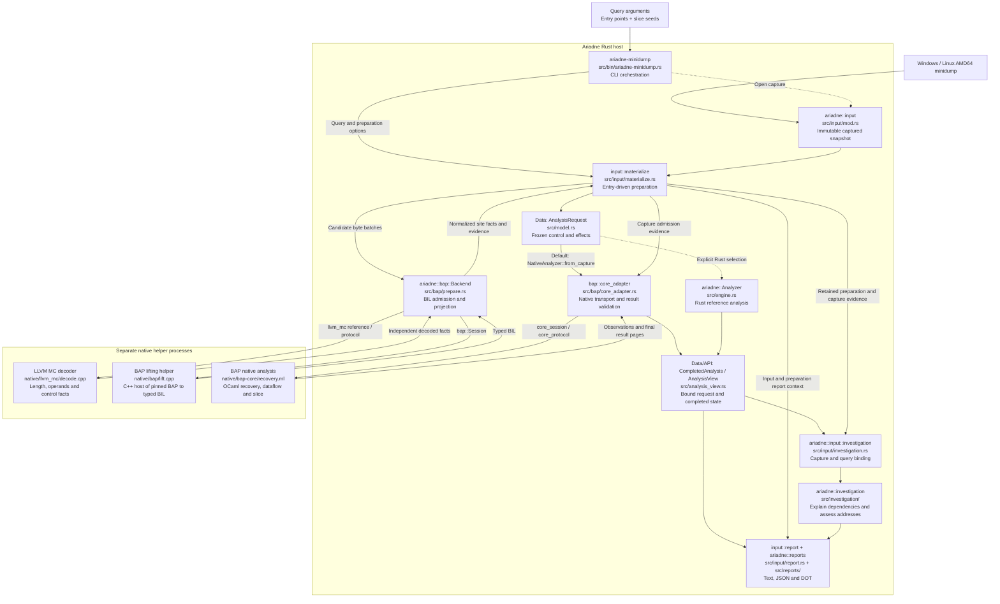
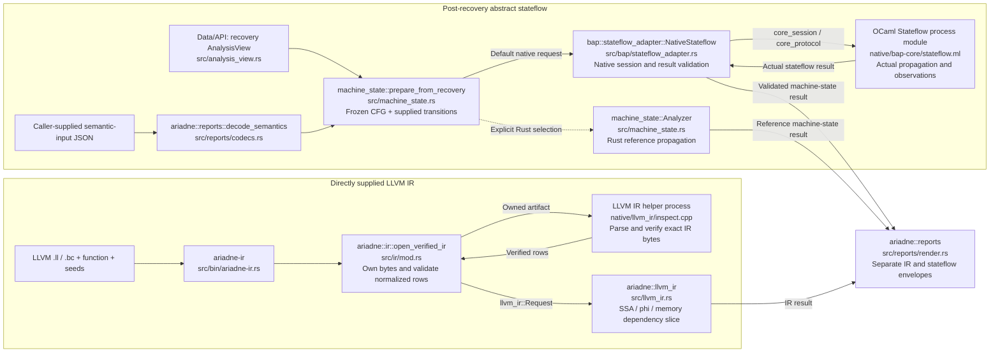

# Ariadne architecture

## Context and follow-up

**Status.** Current architecture, analysis concepts and development guide. The
original overview was source-reviewed on 2026-10-10 at `9b7615d`; development
and retained-history references were consolidated on 2026-10-11. Native BAP
analysis is the minidump CLI default; Rust remains the explicit reference.
Diagram-to-module mappings were checked against the source layout on 2026-10-11.

**Why this document exists.** The [project overview](../../README.md) and
[roadmap](../../ROADMAP.md) describe snapshot-based machine-code investigation.
This guide places the reader, instruction semantics, analysis passes and
investigation questions in diagrams linked to their actual source owners.

**What this document establishes.** Runtime data flow, Rust/native process
ownership and module paths for each diagram block, the distinction between BAP
lifting and BAP analysis, the separate supplied-IR/stateflow paths, analysis
equations, source layout and development checks. Dated layout/tool records retain
their original qualification scopes.

**Where to go next.**

- [Terminology convention](../terminology.md) — exact meanings of backend,
  analysis state, origins and evidence/acceptance claims.
- [Input design and usage](file-reader-design.md) — capture indexing, provenance and local-start discovery.
- [BAP design and usage](bap-analysis-core-design.md) — lifting, admission,
  native state ownership, checked transport and completed results.
- [Investigation contracts](investigation-design.md) — query-bound possible
  producers, captured observations and explicit gaps.
- [Completed layout plan](../../Plans/completed/rust-source-layout.md) — the
  root Cargo organization and its preserved equivalence requirements.
- [Replay procedure](../../mbt/stage-e/README.md) — current toolchain checks.
- [Formal-model guide](../../Specs/README.md) and
  [semantic assurance](semantic-assurance.md) — model authority and proof limits.

**What remains unresolved.** This architecture does not establish a universal
ISA or analysis-refinement proof. A dump supplies captured evidence, not an
execution trace. Missing bytes, unsupported semantics, uncertain memory aliases
and unresolved control targets can keep results partial. PE/ELF image and ELF
core readers remain deferred. Qualification is specific to its recorded sources,
tools and corpus; see the [accepted P4 scope](../../Plans/bap-projection-admission.md).

## Reading this guide

- [Pipeline](#main-minidump-pipeline) and [ownership](#ownership-and-process-boundaries).
- [Analysis concepts](#analysis-concepts) and [further reading](#further-reading).
- [Source layout and development](#source-layout-and-development).
- [Layout evidence](#layout-delivery-2026-10-02) and
  [installed-tool compatibility](#installed-tool-compatibility-2026-10-01).

## Main minidump pipeline

Ariadne has a **Rust host that manages captured evidence and reports**, with
separate native helpers for decoding, instruction semantics and analysis.
The arrows below show logical data dependencies; the preparation stage exchanges
bounded instruction batches with its helpers while discovering candidate starts.
Each implementation block names its module/API and principal source file.
`AnalysisRequest` and `CompletedAnalysis` are data/API boundaries rather than
additional solvers. The linked table below expands grouped source ownership.
Internal submodule names describe code ownership; public APIs may be re-exported
from [the library root](../../src/lib.rs).



1. **Read the capture.** Rust indexes captured memory and retains its snapshot
   identity, semantic virtual addresses and contributor file offsets. Adjacent
   fragments may compose a read; holes and disagreeing overlaps remain explicit.
   The production minidump reader never fills missing bytes from an executable.
2. **Prepare instruction facts.** Discovery starts at explicit entry points.
   LLVM MC supplies independent length, operand and control facts. BAP supplies
   typed BIL, its instruction-semantic intermediate language. Rust checks their
   agreement and projects admitted BIL into tracked register-byte, flag and
   memory effects. It freezes the candidate domain and instruction summaries
   before either analyzer runs. Slice seeds select results without becoming roots.
3. **Analyze the frozen request.** The default OCaml helper owns actual recovery,
   dataflow and slicing state. It builds the local CFG, computes may-reaching
   definitions to a fixed point and follows dependencies backward from the seeds.
   Preparation's earlier discovery does not replace these analysis passes.
4. **Validate completion.** Rust checks native identities, state domains,
   attribution, missing seeds and clean process completion. Bounded frames and
   immutable final-result pages transport large results. It exposes the completed
   request/state in `CompletedAnalysis` through the shared `AnalysisView` interface.
5. **Explain and render.** Investigation binds that completed analysis to the
   exact prepared query and captured evidence. It produces possible address
   origins, alternatives, gaps and evidence requirements. Fault-time assessments
   additionally use admitted exception-context observations. Rendering publishes
   base analysis and optional investigation results as text, JSON and DOT.

## Ownership and process boundaries

The block IDs correspond to the Mermaid diagram above. Input artifacts `D` and
`Q` are supplied data; all other blocks have the source owners listed here.

| Block and module/API | Linked source owners | Responsibility |
| --- | --- | --- |
| `CLI`: `ariadne-minidump` | [Binary](../../src/bin/ariadne-minidump.rs) | Select query/backend, call preparation and analysis, construct optional questions and publish outputs. |
| `R`: `ariadne::input` / `FileSnapshot` | [Module/API](../../src/input/mod.rs), [minidump parsing](../../src/input/minidump.rs), [address-space reads](../../src/input/address_space.rs), [fault observations](../../src/input/fault_context.rs) | Own immutable artifact bytes, capture indexes, source spans, metadata and context validity. |
| `P`: `input::materialize` / `FileSnapshot::prepare_with_bap` | [Materialization](../../src/input/materialize.rs), [prepared types](../../src/effects.rs) | Discover local starts from entries, request bounded site batches and freeze `FilePreparedAnalysis` with its request and retained evidence. |
| `B`: `ariadne::bap::Backend` and internal admission/projection | [Preparation](../../src/bap/prepare.rs), [admission](../../src/bap/admission.rs), [projection](../../src/bap/projection.rs), [address evidence](../../src/bap/address.rs), [location catalogue](../../src/effects/locations.rs) | Check decode/lift agreement; derive `uses`, `may_defs`, justified `must_defs`, address evidence and gaps. |
| `MC`: `ariadne::llvm_mc` bridge and decoder process | [Reference adapter](../../src/llvm_mc/reference.rs), [protocol/session](../../src/llvm_mc/protocol.rs), [native decoder](../../native/llvm_mc/decode.cpp) | Supply independent decode/control/operand facts. This path supplies no production minidump effects. |
| `L`: `ariadne::bap::Session` and lifting process | [Rust session](../../src/bap/session.rs), [typed AST](../../src/bap/ast.rs), [C++ lifter](../../native/bap/lift.cpp) | Call pinned BAP on captured prefixes and validate/transport typed BIL. |
| `F`: `AnalysisRequest` | [Core model types and validation](../../src/model.rs) | Own the immutable instruction domain, roots/seeds and normalized control/effect facts. This block is a data contract. |
| `V`: `bap::core_adapter::NativeAnalyzer` | [Adapter](../../src/bap/core_adapter.rs), [session](../../src/bap/core_session.rs), [protocol](../../src/bap/core_protocol.rs) | Admit capture-bound requests, orchestrate actual native actions, validate state/attribution and require complete transfer and clean exit. |
| `C`: native `Main`, `Recovery`, `Capture`, `Project_state` | [Main/lifecycle](../../native/bap-core/main.ml), [recovery/dataflow/slice](../../native/bap-core/recovery.ml), [capture admission](../../native/bap-core/capture.ml), [BIR attribution](../../native/bap-core/project_state.ml) | Own the production analysis state and transitions in the OCaml process. |
| `REF`: `ariadne::Analyzer` | [Rust engine](../../src/engine.rs), [shared model types](../../src/model.rs) | Independently implement recovery, reaching definitions and slicing over the same frozen request. |
| `A`: `CompletedAnalysis` / `AnalysisView` | [Read-only view and completed owner](../../src/analysis_view.rs), [result types](../../src/model.rs) | Retain the request/result used for query binding and reporting; this block is an API/data boundary. |
| `IB`: `ariadne::input::investigation` | [Capture adapter](../../src/input/investigation.rs), [domain binding validation](../../src/investigation/validate.rs) | Bind completed request/state to exact preparation, instruction evidence and reader-owned fault context. |
| `I`: `ariadne::investigation` | [Public exports](../../src/investigation/mod.rs), [explanation](../../src/investigation/explain.rs), [zero address](../../src/investigation/zero_address.rs), [zero base/displacement](../../src/investigation/zero_base_offset.rs), [fault binding](../../src/investigation/fault_context.rs) | Reuse bound analysis for possible dependencies and separately scoped fault-time assessments. |
| `O`: `input::report`, `ariadne::render`, `ariadne::reports` | [Minidump reports](../../src/input/report.rs), [core text/DOT](../../src/render.rs), [question renderers](../../src/reports/mod.rs), [publication](../../src/reports/render.rs) | Render validated owned results and capture context; the CLI chooses output mode and calls publication. |

**BAP lifting and BAP analysis are different helpers.** The C++ helper uses
BAP's instruction-lifting library. The OCaml helper links the BAP SDK and
implements Ariadne's analysis passes. Neither block invokes the generic `bap`
CLI to obtain its production results. The Rust host communicates with these
processes through checked protocols instead of linking the OCaml runtime through
Rust FFI.

`--analysis-backend rust` selects the reference analyzer while retaining the
same BAP instruction semantics. A failed native session produces an error;
it does not automatically switch to the Rust analyzer or LLVM effect rules.
The core library can also analyze directly supplied normalized requests through
its standard-library-only Rust API.

## Separate IR and stateflow paths

These are separate result families, with their own normalized requests and
schemas. `CFG` denotes a recovery view from block `A` above; the remaining
processing blocks name the actual adapter, solver and reporting modules.



| Block and module/API | Linked source owners | Responsibility |
| --- | --- | --- |
| `IRCLI`: `ariadne-ir` | [Binary](../../src/bin/ariadne-ir.rs) | Select artifact/function/seeds, invoke the adapter and solver, then render/publish the IR family. |
| `IRAD`: `ariadne::ir` | [Owned-IR adapter](../../src/ir/mod.rs) | Hash owned bytes, invoke the helper and validate normalized request rows and identities. |
| `VERIFY`: LLVM IR helper | [Native inspector](../../native/llvm_ir/inspect.cpp) | Parse/verify exact supplied bytes and emit block/value/phi/memory/call facts. |
| `IRA`: `ariadne::llvm_ir` | [IR model and analyzer](../../src/llvm_ir.rs) | Validate the request and compute its instruction-ID dependency slice, control graph and obligations. |
| `CFG`: `AnalysisView` | [Recovery view](../../src/analysis_view.rs) | Supply frozen recovery nodes, local edges, effects and retained context; it is an input API boundary. |
| `CODEC`: `ariadne::reports::decode_semantics` | [Semantic-input codec](../../src/reports/codecs.rs) | Decode separately supplied state catalogue, entry facts, transitions and completeness assertions. |
| `HAND`: `machine_state::prepare_from_recovery` | [Handoff construction](../../src/machine_state.rs) | Combine frozen recovery facts with supplied semantics, validate the stateflow request and retain full recovery context. |
| `NATIVE`: `bap::stateflow_adapter::NativeStateflow` | [Stateflow adapter](../../src/bap/stateflow_adapter.rs), [shared native session](../../src/bap/core_session.rs), [wire schema](../../src/bap/core_protocol.rs) | Transport typed stateflow inputs/actions and validate actual helper observations and completion. |
| `FLOW`: native `Main` / `Stateflow` | [Family dispatcher](../../native/bap-core/main.ml), [stateflow passes](../../native/bap-core/stateflow.ml), [project attribution](../../native/bap-core/project_state.ml) | Own stateflow propagation and model-relative edge/terminal observations in the separate native process. |
| `STATE`: `ariadne::machine_state::Analyzer` | [Rust stateflow reference](../../src/machine_state.rs) | Propagate the same finite supplied semantics as an explicit Rust alternative. |
| `OUT`: `ariadne::reports` | [Family envelopes/rendering/publication](../../src/reports/render.rs), [public exports](../../src/reports/mod.rs) | Build separate `ir_report` and `machine_report` envelopes and publish text/JSON/DOT without merging family identities. |

The [LLVM IR path](typed-replay-design.md#direct-verified-ir) verifies a directly supplied function and
analyzes its block successors, SSA/phi dependencies and conservative memory
predecessors. Its instruction IDs are distinct from machine virtual addresses;
it does not reconstruct original LLVM IR from a dump.

The [stateflow path](../machine-state-design.md) combines a frozen recovered CFG
with caller-supplied finite abstract transitions. It classifies possibilities
under those semantics while preserving structural edges. The minidump CLI uses
the native stateflow family by default and the Rust implementation when selected
explicitly. Neither path reconstructs observed execution history.

## Assurance and result meaning

[TLA+ specifications](../../Specs/README.md) define the modeled input contracts,
transitions and invariants. Generated replay compares finite observations, and
mutation campaigns check whether unchanged observers reject introduced defects.
This assurance track checks the implementation; it supplies no runtime
instruction semantics. BAP lifting remains a pinned trusted dependency, while
Ariadne owns transport, projection, analysis and evidence validation. The retired
ISA/Lean research is outside active qualification.

Across the pipeline, preserve these distinctions:

- Snapshot identity and semantic VAs are distinct from file offsets and graph IDs.
- Call edges remain visible; local recovery and dataflow follow summary continuations.
- Possible writes retain older origins; only justified definite writes kill them.
- Captured observations, dependencies derived under premises and missing evidence
  remain separate kinds of claims.

The final result is a **possible dependency explanation**. A captured fault-time
register value does not determine earlier branch outcomes, prove that a producer
executed, or identify the actor responsible for the bad value.


## Analysis concepts

Ariadne combines local control-flow recovery, forward may-reaching definitions
and backward data slicing. The [analysis model](../../Specs/Ariadne.tla) owns
the formal contract; [Rust correspondence](../implementation.md) connects it
to the reference implementation and [BAP integration](bap-analysis-core-design.md)
to the default native implementation.

| Concept | Question | Representation |
| --- | --- | --- |
| Control-flow graph | Which instruction may follow? | Semantic addresses and typed structural edges. |
| Reaching definitions | Which earlier writes may supply a location? | Sets of tagged entry/instruction origins. |
| Effects | What is read, possibly written or definitely replaced? | `uses`, `may_defs`, `must_defs`. |
| Backward data slice | Which producers connect to the selected uses? | Closure from decoded instruction seeds. |
| Call summary | Which effects may cross a call? | Opaque effects and a possible continuation edge. |

### Fixed point and origin meaning

For decoded nodes `N` and finite facts `D = (location, site, origin)`, the
analysis domain is `P(D)^N`, ordered by componentwise subset with union as join.
Ariadne iterates these equations:

```text
GEN[n] = {(l, n, instruction) | l ∈ may_defs[n]}
OUT[n] = {d ∈ IN[n] | d.location ∉ must_defs[n]} ∪ GEN[n]
IN[n]  = ENTRY[n] ∪ ⋃ {OUT[p] | p is a decoded local predecessor of n}
```

`ENTRY[n]` supplies an unknown incoming origin for every location at each root.
Bottom is an empty fact set, not numerical zero. Branch joins retain alternatives;
loop back edges require iteration. With a fixed kill set, `(X − K) ∪ G` is
monotone, and at most `|N| × |D|` node/fact pairs can be added. This establishes
finite convergence for the represented graph, not coverage of all machine runs.

A definite write replaces the last-write origin but may still depend on its
old input: `add rax, rbx` generates a new RAX origin while slicing its `uses`
through the definitions before the ADD. Only justified `must_defs` remove
origins. A store to the shared `memory:any` cell is a weak update and preserves
other possible memory writers. Location granularity is therefore decisive.

### Worked call and slice example

```asm
a: mov rax, rdi
b: call helper
c: mov rbx, rax
d: mov rcx, [rbx]
```

With entry `a`, seed `d` and opaque call effects, selected origins are:

| Before | Selected origins |
| --- | --- |
| `a` | `rax@entry(a)`, `rdi@entry(a)` |
| `b` | `rax@a` |
| `c` | `rax@a`, `rax@b` |
| `d` | `rbx@c`; memory from entry and the call at `b` |

Register names abbreviate their tracked byte cells. At `b`, possible writes
preserve old origins and add call-site alternatives. Backward closure from `d`
adds `c` for RBX and `b` for memory; `c` then adds `a` and `b`, yielding
`{a,b,c,d}`. Entry origins stay visible but are not producer instructions.
This is a hand-worked application of the model, not capture validation.

The visible call edge does not transmit origins into a callee. A local summary
edge carries opaque effects to a possible continuation; it asserts neither a
callee-derived transfer relation nor a guaranteed return. This differs from a
system-dependence-graph summary edge connecting actual inputs to outputs.
Ariadne does not implement context-matched IFDS interprocedural analysis.

The slice follows all uses of included instructions. It is an instruction-level
backward data closure, without control-dependence computation or branch-feasibility
proof. Broad opaque-call dependencies can include flag producers without making
the slice a control-dependence graph.

### Further reading

Abstract interpretation relates concrete computations to a simpler ordered
information domain. Ariadne retains possible write provenance. Proving solver
convergence and proving that decoding, edges and effects cover concrete runs
are separate obligations; `scope_closed()` is relative to supplied inputs and
local traversal policy.

| Topic | Primary reading and useful exercise |
| --- | --- |
| May/must analyses, joins and fixed points | Møller and Schwartzbach, [Static Program Analysis](https://cs.au.dk/~amoeller/spa/), Chapters 4–5 and §§5.7–5.8. Add a branch and back edge to the example and explain every surviving origin. |
| Abstract interpretation | Cousot and Cousot, [1977 paper and author summary](https://www.di.ens.fr/~cousot/COUSOTpapers/POPL77.shtml). Separate an abstract transformer's coverage from its solver's convergence. |
| Weak/strong updates and procedure summaries | [Course notes](https://cs.au.dk/~amoeller/spa/spa.pdf), §§11.5 and 8.4; compare one memory bucket with multiple abstract locations. |
| Dependence graphs and slicing | Horwitz, Reps and Binkley, [original paper](https://research.cs.wisc.edu/wpis/papers/toplas90.pdf), §§3–4, and [retrospective](https://research.cs.wisc.edu/wpis/papers/pldi88.retrospective.pdf). Distinguish dependency closure from an independently executable slice. |
| Calling context | Reps, Horwitz and Sagiv, [IFDS](https://research.cs.wisc.edu/wpis/papers/popl95.pdf). Draw two calls to one helper and identify a mismatched return. Valid call/return structure is not branch feasibility. |
| Binary memory analysis | Balakrishnan and Reps, [Analyzing Memory Accesses in x86 Executables](https://research.cs.wisc.edu/wisa/papers/cc04/BR04.pdf). Compare value-set analysis and used/killed/possibly-killed sets with Ariadne's coarse memory location. |

## Source layout and development

The [root Cargo manifest](../../Cargo.toml) defines the single package and
feature gates. Rust implementation, examples and generated bindings live under
`src/`; standalone tests and fixtures live under `tests/`. One lockfile and
`target/` root serve the repository.

```text
src/lib.rs              analysis library
src/bap/               semantic/native adapters and checked transports
src/input/             minidump reader and query binding
src/ir/                supplied LLVM IR adapter
src/investigation/     typed investigation questions
src/reports/           codecs and renderers
src/bin/               CLIs, validation and benchmark entry points
src/examples/          Rust examples
src/mbt/               replay ports and compiler-generated bindings
tests/                 standalone tests and fixtures
target/                Cargo and native build outputs
```

The `ariadne::{bap,input,ir,investigation,reports}` APIs replace the earlier
separate packages. Defaults enable input and IR; `--no-default-features` retains
the core with no activated external dependencies. Optional `bench`, `validation`
and `mbt` features expose their respective tools. Use the manifest for exact
binary and test-target names.

Run applicable checks from the repository root; native gates additionally
require the helpers and captured artifacts named by their owning feature:

```sh
cargo fmt --all -- --check
cargo build --offline --locked --release
cargo test --offline --locked
cargo test --offline --locked --no-default-features
cargo clippy --offline --locked --all-features --all-targets -- -D warnings
python3 tools/check_rust_layout.py
python3 tools/check_doc_links.py
```

Replay and mutation campaigns use distinct build subdirectories under `target/`:
shared executable names can otherwise cause a mutant or another SUT to replace
the expected binary. Release CLI measurements use the production feature set;
benchmark builds select their binary explicitly. Follow the
[repository rules](../../AGENTS.md) for source layout and checks, and each
qualification plan for any required remote placement of heavy work. These
commands are reproduction instructions, not results from this documentation change.

## Layout delivery (2026-10-02)

The [completed layout plan](../../Plans/completed/rust-source-layout.md) moved
all 86 tracked Rust files at that checkpoint into the root package. The count is
historical. The [validation record](../../evidence/Ariadne/rust-source-layout-validation.json)
binds the following retained equivalence checks:

| Check | Recorded result |
| --- | --- |
| Investigation and nested report/replay gates | 16 investigation gates and 12 nested Stage E gates. |
| Output equivalence | 30 text/JSON/DOT reports matched prior executables across platform fixtures, NOT chain, controlled Linux capture and supplied text/bitcode IR. |
| Boundary mutations | 16 BAP and 11 investigation mutants detected. |
| Generated analysis replay | 64 traces, 326 observations and 15 engine mutants. |
| Core replay | 12 traces, 168 observations and five mutants. |

Generated bindings, captured/BAP/IR fixtures, engine/model sources, specifications
and the retired Lean tree retained their bytes at that checkpoint. The merged
lockfile introduced no external package/version identities beyond the earlier
locks. The [manifest](../../evidence/Ariadne/rust-source-layout-evidence-manifest.json)
binds the [reports and logs](../../evidence/Ariadne/rust-source-layout-evidence.tar.gz).
The then-missing Windows artifact and later re-pin/performance decisions are
recorded in the [workload design](workload-performance-design.md); the layout
change itself added no semantic, historical-execution or root-cause capability.

## Installed-tool compatibility (2026-10-01)

The [installed compatibility record](../../evidence/Ariadne/installed-modelmirrors-compatibility-validation.json)
checked the actual `/home/nzsn/.local/bin/ModelMirrors` executable against the
recorded MirrorRust client and evaluators. All 11 local-stdio negotiated-replay
checks passed within this initial tier:

| Check | Recorded result |
| --- | --- |
| Correct core evaluator | 12 traces, 168 states, action/pair coverage and one port drop. |
| Machine-state fixture | Two traces, 10 observations and one port drop. |
| LLVM IR fixture | Two traces, 10 observations and one port drop. |
| Wrong semantic digests | All three interfaces rejected before factories or observations. |
| Five core mutants | Model mismatches at expected actions, with cleanup. |

| Historical identity | Value |
| --- | --- |
| Installed executable SHA-256 | `e5eab73138ad380b039e3312f6e9d860bbd99126c13a3bb84b90f206dacb41dd` |
| Executable version output | `Mirrors 0.0.3` |
| Local Mirrors tag `v0.0.3.1` | `1a069cd3e34d7bfea272e3ee7e10f51acedcc7cb` |
| MirrorRust HEAD | `a3f826f6590bea1bbbffe095353bf9a104c4c1d1` |
| Documented client tag `v0.0.1.0` | `a51149e6832d9fa2ead232c1f7157294a72557af` |

At that run, client runtime/manifest bytes matched the documented tag, while
the dirty local Mirrors build differed from the installed binary. Exact
clean-tag build provenance remained unverified. Generated bindings/corpora kept
their prepared-compiler identities; the check did not qualify a compiler migration
or TCP/mTLS. An initial probe encountered a retained intentional mutant and was
not counted as compatibility failure; accepted evaluator/mutant binaries were
individually hash-checked against the integration record.

The [typed replay design](typed-replay-design.md) records the broader subsequent
completion campaign. That later finite tier does not retroactively enlarge this
installed-tool result. Use the [current replay procedure](../../mbt/stage-e/README.md)
to check a current environment.
