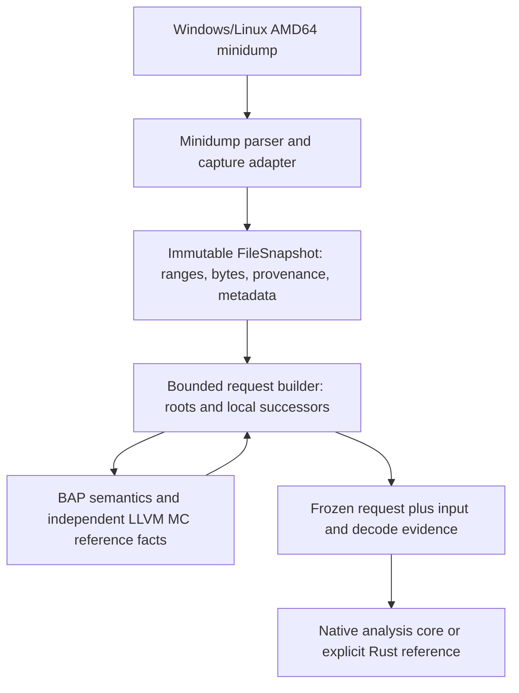

# File readers and immutable address-space preparation

## Context and follow-up

**Status.** Canonical input design, API, operating guide and capture-evidence record. Windows/Linux AMD64
minidumps are implemented; PE/ELF image and ELF-core readers remain deferred.

**Why this document exists.** The [byte-span adapter](../llvm-mc-adapter.md)
leaves file parsing, address mapping and byte provenance to readers. The
captured predecessor fixture additionally motivates
independent entry evidence before a real capture can support an earlier-origin
claim.

**What this document establishes.** Current minidump API and operations, dated
qualification records, immutable address-space reads, byte
provenance and instruction-start discovery remain separate from analysis. A
real-case claim binds the exact capture and query to an independently witnessed
entry, matching module/build identity and retained instruction evidence.

**Where to go next.**

- [Completed real-capture plan](../../Plans/completed/priority-1-real-capture-plan.md)
  and controlled-case validation —
  preserve the initial exact-case acceptance and its limits.
- [Real-capture re-pin plan](../../Plans/real-capture-repin-79938.md) — applies
  this entry/evidence contract to the accepted Windows replacement corpus.
- [Investigation design](investigation-design.md) — turns a bound query,
  possible producers and retained gaps into a fault-address explanation.
- [Roadmap](../../ROADMAP.md) — keeps PE/ELF and ELF-core formats outside current scope.

**What remains unresolved.** PE/ELF image and ELF-core sections describe deferred
designs. Production minidump reads remain capture-only. Matching symbols may
justify an entry boundary; they cannot fill capture holes or establish actual
execution. Qualification remains specific to its artifact, source and query.

For the wider context, see the optional [documentation map](../documentation-map.md).

The reader design originated on 2026-09-26 at `aee833f`; the independent-entry
and real-capture evidence contract was added on 2026-09-29. The user selected
**only the minidump path** for implementation. The sections below identify
delivered behavior and retain the deferred format contracts for future work.
The [versioned minidump report contract](result-rendering.md#json-v1) covers the
investigator CLI built on this reader.
The [current practical queue](semantic-assurance.md#practical-assurance-priorities) prioritizes a
source-anchored historical capture path; it does not expand reader formats.
The [workload-performance implementation plan](../../Plans/completed/priority-4-workload-performance-plan.md)
and [performance design](workload-performance-design.md) cover
historical measured scale without expanding reader scope. The exact-case plans
linked above use the entry and evidence contract in this document.

## Decision and supported scope

The delivered reader accepts **Windows and Linux AMD64 minidumps** behind one
immutable address-space interface. The request builder reads bytes at newly
discovered instruction starts, obtains BAP semantic summaries with independent
LLVM MC decode/control reference facts, and freezes an `AnalysisRequest` before
analysis. The CLI uses the native BAP analysis core by default; Rust remains
the reference path. Production preparation has no LLVM semantic fallback.

| Platform | Standalone image, deferred | Process capture |
| --- | --- | --- |
| Windows AMD64 | PE32+ executable/DLL, preferred image base | AMD64 minidump implemented |
| Linux AMD64 | ELF64 `ET_EXEC` and `ET_DYN` (PIE/shared object), explicit layout | AMD64 Linux/Crashpad minidump implemented; ELF64 `ET_CORE` deferred |

Windows and Linux minidump support share the capture/read contract, but each
qualification record names its exercised corpus and unexercised prerequisites.
Mach-O, kernel dumps/vmcore, ELF32/x32, WoW64/ARM contexts, rebased PE images,
full loader/relocation emulation, automatic symbol loading, general unwinding and
image-backed reconstruction remain outside delivery. External symbol witnesses
have the narrower role defined below. A finite opt-in
[Windows AMD64 frame adapter](investigation-design.md#frame-path-implementation-checkpoint-2026-10-11)
now supplies captured unwind evidence for bounded path questions; it does not
expand general image or unwind support. For any future ELF-core reader,
compressed/systemd-coredump archives must first be exported to an ordinary
ELF core; the exported artifact is the one hashed and analyzed.



## Why a reader alone is insufficient

The byte-span `ByteSnapshot` interface maps **candidate instruction VAs** to byte prefixes. It is
not a map of arbitrary memory regions. `prepare()` decodes supplied map keys
and creates placeholders for successors whose bytes were not supplied. It does
not fetch/decode those successors.

Putting one entry per PE section, ELF segment or captured memory range into that map would decode
only the beginning of each range. Putting every byte address into the map would
waste work and imply instruction boundaries without evidence.

The reader's request builder instead starts at explicit roots and asks the immutable
snapshot for up to 15 bytes at each discovered start. It follows only the core's
local edge policy and uses prepared control summaries, never printed assembly
or a second instruction-effects implementation. This is input construction;
`Analyzer` still owns its recover/dataflow/slice transitions over fixed inputs.

## Module and dependency choice

The original design used a separate `ariadne_input` package. The delivered
[source-layout consolidation](architecture.md#source-layout-and-development) supersedes that choice:
`ariadne::input` now lives under `src/input/` in the root Cargo package, with
optional features preserving the dependency-free core. The PE/ELF choices below
remain deferred design, not additional implemented readers.

The delivered reader uses the pinned `minidump` parser for minidump
streams/context metadata. The deferred PE/ELF design proposes `object` for PE
and low-level ELF program-header/note structure access.
The deferred Linux core adapter would own the bounded interpretation of Linux
notes; a generic object parser is not assumed to supply decoded Linux contexts.
Deferred dependencies must be pinned in the root lockfile and
checked for Rust 1.85 compatibility. The implemented reader uses `sha2` for
artifact identity; no Windows DbgHelp runtime is required.

Ariadne owns range interpretation, overlap policy, provenance and discovery.
The parser libraries do not decide which bytes are trusted for analysis. Prefer
their low-level stream/section/program-header views to convenience operations that silently
choose among duplicate memory descriptions. No generic parser plugin framework
is needed for these explicitly supported adapters.

Implementation layout and deferred extensions:

| Path | Responsibility |
| --- | --- |
| `src/input/mod.rs` | Public snapshot and preparation interface |
| `src/input/pe.rs` | Deferred PE validation and VA-to-file mapping |
| `src/input/minidump.rs` | Windows/Linux minidump memory, module, thread and exception metadata |
| `src/input/elf.rs` | Deferred checked ELF64 headers/program headers and standalone image mapping |
| `src/input/elf_core.rs` | Deferred Linux core captured segments, notes and per-thread observations |
| `src/input/address_space.rs` | Immutable ranges, conflicts and prefix lookup |
| `src/input/materialize.rs` | Local-successor request construction and limits |
| `tests/input/` | Hand-authored format fixtures, native end-to-end and negative cases |
| `src/bap/` and `src/llvm_mc.rs` | BAP preparation and shared batch types; LLVM decode reference |
| `Specs/AriadneInput.tla` | Implemented capture mapping, prefix evidence and local-closure contract |

## Public interface

`ariadne::input` is enabled by the root package's `input` feature and owns
parsing, immutable storage and local-start preparation. `FileSnapshot::prepare`
and the CLI use BAP as the sole semantic backend. `prepare_with_bap` accepts an
explicit configuration; ordinary preparation uses `Config::from_env`. Build
both the BAP helper/runtime and independent LLVM MC decode reference first.
Preparation itself does not run either analysis solver.

This library example explicitly selects the Rust reference analyzer. The CLI
uses native BAP analysis by default; native callers use
`NativeAnalyzer::from_capture(&core_config, session, &prepared)?.complete()`
with a manifest-bound `CoreConfig`, as in the
[CLI](../../src/bin/ariadne-minidump.rs).

```rust
use ariadne::effects::PreparationOptions;
use ariadne::input::{AnalysisQuery, FileSnapshot, OpenLimits, PrepareLimits};
use std::path::Path;

let snapshot = FileSnapshot::open_minidump("crash.dmp", OpenLimits::default())?;
let query = AnalysisQuery {
    entry_points: [0x140001000].into(), // semantic VAs, not file offsets
    slice_seeds: [0x140001006].into(),
};
let prepared = snapshot.prepare(
    &query, Path::new("target/ariadne-llvm-mc"),
    &PreparationOptions::default(), PrepareLimits::default(),
)?;
let result = ariadne::analyze(prepared.prepared.request)?;
// Retain snapshot, reads, materialization, instruction evidence and gaps.
# Ok::<(), Box<dyn std::error::Error>>(())
```

`metadata()` exposes artifact identity, platform, streams, modules, threads,
exception observations and metadata gaps. `read_prefix(va, n)` returns
`Result<ByteRead, InputError>` with contiguous unambiguous bytes, contributing
file offsets and a stop reason; conflicting contributors at the first blocked
byte remain separate from the usable prefix. `FilePreparedAnalysis` owns
`prepared`, `snapshot`, `open_limits`, `reads` and `materialization`. Core-only
builds keep external dependencies disabled.

The delivered `from_minidump_bytes` constructor serves embedded callers and
fixtures through the same validation path. A future multi-format `InputFile`
interface would explicitly select `PeImage`, `ElfImage { layout }`, `Minidump`,
or `LinuxElfCore` and a local path. Its format signatures and machine/class/type
fields must agree with that selection. Target OS and architecture remain
separate metadata; a shared dump container is not inherently Windows.

`AnalysisQuery` supplies a nonempty set of entry VAs and a set of slice-seed VAs.
Future PE readers must offer a checked RVA-to-VA conversion; ELF readers must
convert link-time addresses using the selected load bias. A raw integer argument
always means a VA, never a file offset. Entry points drive discovery; seeds do
not silently become additional roots.

Minidump metadata offers captured exception-IP observations with their origin
and validity. Deferred image/core readers would additionally offer PE/ELF
entry-point and Linux per-thread core RIP candidates. Callers may
explicitly choose these as roots. A crash IP is an observation at capture time;
it is not evidence of a function entry or earlier execution. No automatic use
of captured register values for past branch feasibility or memory aliases.

`FilePreparedAnalysis` keeps input mapping/capture evidence with the existing
instruction evidence and analysis gaps. It is possible to extract its owned
request and run `analyze()`, retaining the other fields for reports. Core
`scope_closed()` retains its current meaning; it does not certify input fidelity,
all process paths or absence of effect-precision gaps.

## Immutable storage and identity

The reader loads the artifact into owned immutable bytes under a configurable input
size limit and share that buffer internally. Do not retain a live mutable file
or infer immutability from an mmap. Hash exactly the owned bytes used by the
parser. Detect ordinary file-size/read failures; the resulting artifact hash
identifies what was read, not proof that the producer captured a coherent process.

The delivered snapshot identity is
`minidump-captured-amd64-v1:<artifact-sha256>`. A future image identity must also
bind its format, mapping profile and selected image base or ELF load bias.
Same filename or PID is not identity. Keep request roots/limits in a separate query fingerprint: they select
an analysis within a snapshot rather than change its bytes. Keep decoder/effect
versions in preparation identity as part of the preparation record.

A PE/ELF image snapshot describes the file's static image view. A minidump or ELF
core snapshot represents the bytes recorded by that capture; timestamps, process/thread IDs and
module names are metadata, not substitutes for its content identity. V1 has no
companion-file contribution to dump bytes. A future supplemented snapshot must
bind every artifact and every accepted transformation/evidence record.

Owned buffering bounds the implemented reader and avoids lazy-read lifetime
hazards, but excludes dumps larger than the configured memory budget. Report
that as a resource limit; a future immutable backing store may expand capacity
without changing address/provenance behavior.

## Address-space and read contract

Normalize mappings into sorted virtual intervals referencing immutable artifact
slices. Every interval carries source class, source artifact/file offsets and
originating section, program header or capture descriptors. Use checked arithmetic for every file
range, virtual range and descriptor-count calculation, including cumulative
64-bit memory payload sizes. Internally distinguish `ImageRva`, `FileOffset`
and `VirtualAddress` types: a minidump field named RVA is a dump-file offset,
not a PE image-relative address. ELF `p_vaddr` is a link-time VA for an image
and an already recorded process VA for a Linux core; do not apply image bias
to core segment addresses.

`ByteRead` returns the **longest unambiguous contiguous prefix** from the requested
VA, up to the requested length, plus contributing spans and the reason it stopped.
A request for 15 bytes is not a claim that the instruction occupies all 15.
Reject read lengths above `OpenLimits.max_read_bytes` before allocation.
Suggested stop reasons: `EndOfMapping`, `NotCaptured`, `ConflictingCapture`,
`UnavailableImageBytes`, `AddressOverflow`, or the requested-length limit.
A hole or conflict at the starting VA produces an empty prefix with its reason.

Reads can cross adjacent ranges of the same source class, even when their file
offsets are not adjacent. Identical overlapping capture bytes are coalesced while
retaining all contributors; differing bytes make just the affected overlap
unavailable. Never choose a winner by stream order. Determine conflicts on the
queried bytes or by a bounded normalization algorithm, not a full-address-space
byte array. Conflicting static-image mappings are rejected. Identical ELF
segment overlap may be coalesced with its contributors; adjacent page-aligned
loader mappings must not be confused with overlapping declared byte extents.

A short prefix can still decode a complete instruction: one captured NOP byte
is enough even if the following VA is absent. If decoding needs missing bytes,
retain the provider's stop reason alongside the adapter's unavailable result.
A conflict after the decoded instruction must not invalidate earlier usable
bytes. No gap is filled with zero and no read jumps across a hole.

The metadata mapping and physical capture indexes are separate. A dump module
range, Linux `NT_FILE` entry or memory-protection description does not itself
supply bytes. Captured
JIT/anonymous code remains readable without a module record. v1 does not infer
executable permission from capture alone or require a PE section, ELF section or file-backed module for every root.

## Deferred PE32+ mapping profile

Accept little-endian AMD64 executable images with consistent DOS/PE headers,
optional-header magic, section count, sizes, alignments and bounded file ranges.
Reject COFF object files and other machines instead of guessing a load model.
Use the declared preferred `ImageBase`; a requested alternative base returns
`UnsupportedMappingProfile` until relocation support is implemented.

For an initialized section byte:

```text
RVA         = VA - ImageBase
section_off = RVA - section.VirtualAddress
file_off    = section.PointerToRawData + section_off
```

The supplied prefix must fit the validated initialized portion, bounded by both
`VirtualSize` and `SizeOfRawData`. Raw alignment padding is not automatically
executable image content. Microsoft distinguishes raw and virtual section
sizes in the [PE format specification](https://learn.microsoft.com/en-us/windows/win32/debug/pe-format);
using only their validated initialized intersection is the v1 policy. Headers may map through a separately validated
`SizeOfHeaders` range. Zero/unusual virtual extents and overlapping mappings
are rejected as unsupported or malformed under this explicit conservative
profile; v1 does not promise compatibility with every Windows-loader quirk.

Record virtual zero-fill tails as image-layout metadata, but do not synthesize
them as `file_backed` instruction bytes in v1. Distinguish this intentional
unavailable image region from a missing dump capture. Loader-written imports,
relocations, TLS initialization and live patches are not reconstructed; the
snapshot is an on-disk image view, not an assertion about runtime memory.

A PE entry-point RVA is a suggested root after checked mapping. Executable
section flags are useful metadata and diagnostics, not proof of instruction
boundaries. Discovery still follows explicit roots and prepared control edges.

## Deferred Linux ELF64 image profile

Accept little-endian `EM_X86_64`, `ELFCLASS64`, `ET_EXEC` or `ET_DYN` under the
Linux image profile. Support the common System V OSABI tag as well as the Linux
tag; do not demand that Linux binaries carry a Linux-only header tag. Reject
`ET_REL`, incompatible machines/classes and malformed header/count encodings.
Map from `PT_LOAD` program headers, not `.text` or section-table entries, so
ordinary stripped images without section headers remain supported. If extended
program-header numbering needs section-header zero, validate that specific
structure rather than assuming section headers are always absent or required.

The ELF ABI defines segment file extents, virtual extents and alignment through
`p_offset`, `p_vaddr`, `p_filesz`, `p_memsz` and `p_align`. It distinguishes
initialized bytes from the extra zero-initialized memory extent. See the
[ELF program-header specification](https://refspecs.linuxfoundation.org/elf/gabi4+/ch5.pheader.html).

The proposed Ariadne translation is:

```text
segment_start = load_bias + p_vaddr
segment_off   = VA - segment_start
file_off      = p_offset + segment_off
available     = 0 <= segment_off < p_filesz
```

Check all additions/subtractions and ranges; require `p_filesz <= p_memsz` and
valid segment alignment/congruence. An executable's header bytes are available
only if covered by a mapped file range, not through an invented header mapping.
`PF_X` and other permissions are metadata, not discovered instruction boundaries.

Use load bias zero for `ET_EXEC`. For `ET_DYN`, require an explicit
`ElfLayout::LinkTime` (bias zero) or `ElfLayout::AtBias { bias }`. The latter is
an address-layout choice for static bytes, not proof of an actual runtime base
or relocation correctness. Bias is the additive delta from `p_vaddr`, not the
lowest mapped VA; these differ when the lowest segment VA is nonzero. Validate
bias alignment against the selected layout. No guessed ASLR base and no automatic
loading of the interpreter or `DT_NEEDED` libraries.

An entry-point hint is `load_bias + e_entry`, when the header actually provides
one and the result maps; a shared library with no entry hint requires explicit
roots. Keep zero-fill tails/BSS as layout metadata and unavailable instruction
bytes in v1, just as for PE. Do not claim that raw GOT/PLT, dynamic relocations,
IFUNC or TLS bytes match a loaded process. File-backed code may still be decoded
and analyzed with those static-view limits retained in evidence.

## Deferred Linux ELF64 core profile

Accept Linux AMD64 `ET_CORE` with bounded program headers and note payloads.
Unlike an ELF image, a core's `PT_LOAD.p_vaddr` is already a captured-process VA;
there is **no added load bias**. The file-backed portion of each segment supplies
captured bytes via `p_offset + (VA - p_vaddr)`. A declared payload extending past
EOF is malformed, not an invitation to silently zero-fill a truncated core.

Linux records the dumped byte count separately from a mapping's full extent.
Thus a core `PT_LOAD` with `p_filesz == 0` can describe a mapping without captured
bytes; the remainder up to `p_memsz` is **not captured**, not executable-image
BSS. A sparse filesystem hole *inside* a validated payload still reads as the
artifact's zero bytes; it is not the same as an omitted core mapping. The reader
uses encoded payload extents rather than filesystem block-allocation guesses.
The kernel's [ELF core writer](https://raw.githubusercontent.com/torvalds/linux/v6.12/fs/binfmt_elf.c)
provides the versioned source reference for this distinction.

Interpret bounded `PT_NOTE` records by owner, type, target class and payload
layout. Preserve unknown well-formed notes in the inventory. Linux `NT_PRSTATUS`
occurs per thread; repeated thread notes are not duplicate-singleton errors.
Record thread IDs, register validity and RIP observations without inventing a
single faulting thread when the evidence does not identify one. `NT_SIGINFO`,
`NT_PRPSINFO` and `NT_AUXV` add optional signal/process/auxiliary metadata.
Unsupported register extensions remain explicit metadata gaps, not host-struct
casts or assumed zero register values.

`NT_FILE` contains mapped-file ranges and offsets expressed in the note's page
units. Multiply by its recorded page size with overflow checks; do not assume
4096 or treat the offsets as bytes. Names and mappings are metadata, not captured
content or authorization to read those paths. This note's layout and the
per-thread records are defined by the same
[Linux source](https://raw.githubusercontent.com/torvalds/linux/v6.12/fs/binfmt_elf.c)
and [ELF note constants](https://raw.githubusercontent.com/torvalds/linux/v6.12/include/uapi/linux/elf.h).

Core mappings are sufficient for byte lookup without `NT_FILE`, module build IDs
or register notes. Missing optional observations must not remove actual captured
memory. Do not infer a DSO's identity or load bias from its filename alone, or
infer the crash IP from `e_entry`. Anonymous/JIT mappings use the same captured
range interface. Kernel-produced and GDB-produced core fixtures must both be
exercised before advertising the supported Linux note dialects.

## Minidump profile

Accept AMD64 Windows and Linux/Crashpad minidumps, preserving the reported OS
separately from the container format. Require an AMD64 system description; reject a missing or
contradictory architecture declaration instead of decoding based on pointer
values. Parse the stream directory and validate the payload extents of supported
streams before publishing the snapshot.

Index actual captured bytes from both `MemoryListStream` and
`Memory64ListStream`, plus [thread stack descriptors](https://learn.microsoft.com/en-us/windows/win32/api/minidumpapiset/ns-minidumpapiset-minidump_thread). Read thread/exception
contexts only with the matching architecture and validity flags. Missing context
is a metadata gap; it does not invalidate otherwise available memory. A dump
without captured instruction bytes can open successfully and produce explicit
unavailable reads.

Memory-list descriptors supply a virtual start and an individual dump-file data
location. For memory64 descriptors, payloads are packed starting at `BaseRva`;
the offset of descriptor i is that base plus the sum of preceding **payload byte
sizes**, not the descriptor table's byte size, as described for
[MINIDUMP_MEMORY_DESCRIPTOR64](https://learn.microsoft.com/en-us/windows/win32/api/minidumpapiset/ns-minidumpapiset-minidump_memory_descriptor). Keep this conversion isolated and
test it with nonuniform range lengths.

Parse [module names, image bases/sizes, timestamps/checksums and optional CodeView
records](https://learn.microsoft.com/en-us/windows/win32/api/minidumpapiset/ns-minidumpapiset-minidump_module) as evidence for locating and comparing images. Do not dereference module
paths or automatically open files named by a dump. Distinguish [memory-info
metadata](https://learn.microsoft.com/en-us/windows/win32/api/minidumpapiset/ns-minidumpapiset-minidump_memory_info) from memory-content descriptors. Ignore unsupported optional streams
with an explicit inventory entry after validating their container extents.
Malformed supported structures fail opening; absent optional streams do not.

Reject duplicate supported singleton/list stream IDs at the container level
rather than accepting a parser's implicit first/last choice. Distinct memory
sources (for example memory64 and thread stacks) may overlap and use the shared
byte-conflict policy. If a parser loses duplicate-directory evidence, preflight
the raw directory with bounded checked reads before using its typed stream API.

The implemented preflight supports stream IDs 3, 4, 5, 6, 7, 9 and 16 and
rejects duplicate supported streams and thread IDs. ThreadExList and optional
Crashpad extensions remain inventoried but uninterpreted. Nonempty nested
payloads outside the file are malformed; unsupported or absent contexts are
metadata gaps. Windows NT and Linux platform IDs are accepted with
little-endian AMD64 contexts. Thread and exception register observations stay
separate; a fault address never substitutes for RIP.

## Independent entry and real-capture evidence

The real-capture question is: **Which earlier captured instructions might have
supplied an address input used by the crash instruction?** The answer is a
possible backward data slice over a locally recovered graph, conditional on
the chosen entry, captured bytes, admitted instruction semantics and the
analyzer's conservative transfer rules.

A minidump is a snapshot, not a trace. Exception RIP can seed the question but
cannot establish an earlier instruction boundary, a function entry or an
executed path. A faulting memory write may not have committed; its
address-register dependencies remain a valid question without asserting that
the write occurred.

### Entry and byte trust rules

An admissible earlier entry is a function boundary or known target established
without decoding arbitrary bytes backward from RIP. Matching build/debug
symbols or a retained producer/trace record may supply that witness. Bind it
to the dump module using the recorded build identity, calculate the runtime
semantic VA from the module base and module-relative address, and retain the
witness artifact identity and matching comparison. Filenames, timestamps,
approximate versions, plausible instruction sequences and crash-time register
values alone are insufficient.

If a trusted function start lies just outside capture, forward-disassemble the
**exact build-matched companion** from that start to a complete instruction
boundary inside capture. Independently compare those bytes with the dump.
This establishes a local query entry; the function's uncaptured earlier
instructions have not thereby been analyzed. The external companion supplies
no executable bytes to Ariadne's reader or analyzer.

The entry and the analyzed route to the seed must lie in captured, unambiguous
memory. Matching binary/symbol files can justify boundaries and names, but
cannot fill holes, override conflicting capture or replace instruction bytes.
Keep unavailable, conflicting and unvisited starts distinct. Explicit roots
drive the materializer's local-successor discovery; seeds never become roots,
and call-only target edges never transmit local reaching definitions.

The initial candidate audit found 128 contiguous captured bytes before RIP in
each of two Breakpad fixtures, without identifying matching `driver` or
`crash.exe` symbol artifacts beside them. That historical observation showed
byte availability, not independently witnessed predecessor paths. The
[controlled-case validation](#historical-controlled-chromium-capture) and later
[replacement plan](../../Plans/real-capture-repin-79938.md) retain their own
artifact-specific entry evidence.

### Evidence chain

Retain a dated case manifest alongside the versioned
[`ariadne-minidump-report-v1` output](result-rendering.md#json-v1). Keep each link
in the chain distinct:

| Fact | Required witness | Meaning |
| --- | --- | --- |
| Artifact | SHA-256 of the exact owned dump bytes, format, platform and size | Capture identity, not proof of a coherent process snapshot |
| Crash seed | Exception-thread identity, valid captured AMD64 context and RIP | Exception observation, not an earlier entry or a substituted fault address |
| Earlier entry | Independent producer/symbol/trace evidence, exact matching module/build identity, checked RVA-to-VA calculation and any needed forward decoding from a known symbol | Justification for one candidate instruction start before RIP |
| Instruction | Captured spans with stream/descriptors and file offsets, semantic VA, decoder facts and retained BAP lifting/projection evidence | Analysis of dump-supplied bytes at an established or locally reached start |
| Local predecessor | Admitted control classification and typed recovered edge | Possible graph predecessor, not an observed branch choice |
| Value origin | Effect evidence, `uses`/`may_defs`/`must_defs` and reaching origin before the consumer | Possible supplier under the analyzer abstraction |
| Slice membership | Seed, dependency traversal and preserved gaps | Relevant possible producer, not a unique root cause |

Historical LLVM-effects captures retain the target/opcode/length and reviewed
rule evidence from their own source snapshot. Current production claims use
the BAP semantic contract. Neither evidence tier can be relabeled as a fresh
qualification of a replacement backend.

The report carries artifact/query identities, captured read contributors,
per-site preparation evidence, graph edges, reaching origins and the slice.
The separate case manifest supplies the independent entry witness and the
expected-versus-observed finding. It must not silently extend report v1 or add
a global `complete` flag. Embedding the entry witness in a product report
would require an explicitly versioned schema change.

### Real-capture result contract and limits

A qualifying predecessor case has an explicit earlier entry and valid
exception-RIP seed. At least one captured, decoded local route reaches the
seed, and an admitted effect chain places a possible producer of the faulting
memory address register in the backward slice. Retained text, DOT and JSON
outputs agree on identity, VAs, edges, origins, slice and obligations. Each
displayed producer is traceable through semantic evidence and instruction
bytes to dump file offsets. Entry definitions and opaque effects remain
labeled as unknown origins.

Unsupported control, missing bytes, conflicting capture, missing seeds, opaque
effects and resource limits retain their distinct meanings. A partial report
can guide [path-driven effects work](../../Plans/completed/priority-2-path-driven-effects-plan.md),
but cannot satisfy the predecessor-case claim until an independently anchored,
nontrivial producer slice exists. If no candidate has a valid entry witness,
retain the candidate audit and leave that case unqualified. A qualifying
possible-producer slice can still have unresolved dependencies; it does not
claim a complete execution history or root cause.

The [completed real-capture plan](../../Plans/completed/priority-1-real-capture-plan.md)
and [Windows replacement plan](../../Plans/real-capture-repin-79938.md) define
their acceptance scopes. This contract adds no executable-file fallback,
reverse-from-RIP boundary heuristic, historical execution reconstruction,
interprocedural return matching or fault/commit semantics. The independent
AMD64 instruction-step track remains [retired](semantic-assurance.md).

## Dump/file fallback

Production minidump behavior is **captured-only**; the deferred Linux ELF-core
design requires the same policy. `trusted_fallback` stays empty.
Matching a module path, timestamp, image size, CodeView identifier, ELF build ID
or `NT_FILE` record does not
prove that an uncaptured runtime byte equals a file byte. ASLR, loader writes,
hot patches and generated code can change the relationship.

A future fallback mechanism must certify the exact instruction span, artifact
identity, VA mapping, relocation treatment and runtime-change assumptions.
It must bind that evidence into snapshot/preparation identity. Merely exposing
an `assume_same_binary: bool` would conceal a material analysis assumption.

Keep the existing whole-instruction provenance contract. Adjacent captured
ranges from the same dump may compose a captured span. A captured prefix cannot
be completed with PE/ELF image bytes and then labeled wholly captured or wholly file-backed.
A captured decode failure cannot trigger a retry using file bytes. Mixed-source
instruction spans require a richer source contract and are outside this design's
first implementation.

This means a minidump or ELF core that omitted its code pages may remain unanalyzable
at the requested roots until stronger input evidence is available. Report that
limitation directly rather than silently analyzing another code image.

## Linux/Windows semantic preparation

The LLVM MC reference helper in `native/llvm_mc/decode.cpp` supports
`x86_64-pc-windows-msvc` and `x86_64-unknown-linux-gnu`. Target selection and
capability evidence remain explicit in preparation and reproducibility
records. BAP supplies production instruction semantics under the
[backend contract](bap-analysis-core-design.md); LLVM MC supplies independent
decode/control reference facts and never becomes an automatic effects fallback.

Select the profile from validated input-platform metadata or the explicitly
selected standalone image format in a future reader, never the analysis host OS. For example,
analyzing a Windows minidump on Linux still uses the Windows target profile;
a Linux Crashpad minidump uses the Linux profile. The image readers themselves
must work on either host if implemented. Claim native host execution only where tested.

Reuse the architecture-level location catalogue and semantic projection
contract across platforms. Representative end-to-end fixtures and independent
decode comparisons must exercise both target profiles; record intentional
differences rather than assuming equality from the ISA name.
Do not add SysV or Windows ABI register-preservation assumptions to opaque calls.
Linux syscalls, signal delivery, FS/GS-dependent TLS and unsupported control stay
explicitly unsupported/conservative under the existing semantic rules. Linux
file support does not automatically add syscall or signal-handler semantics.

## Request construction and decoder integration

The request builder is a finite deterministic worklist over local candidate
starts. Its index and immutable bytes stay fixed while it constructs inputs.
For each frontier batch:

1. Read at most 15 contiguous bytes per unattempted VA and retain read evidence.
2. Obtain BAP preparation results and independent LLVM reference facts for
   those prefixes.
3. Store one immutable preparation result per attempted VA. Queue all known
   local successors using `EdgeKind::is_local()`; never queue a call-only target.
4. Keep unknown indirect targets, unreadable starts and unsupported controls as
   gaps. A failure does not generate guessed fallthrough or retry forever.
5. Stop when no pending local starts remain. Assemble the total finite request,
   including call target references and unreachable slice seeds as placeholders.

An independently supplied callee root is visited normally. Back edges/self-loops
are deduplicated. An address reached inside another decoded instruction may be
decoded as its own explicitly referenced start; report overlap rather than
silently dropping an x86 control-flow alternative.

Slice seeds alone do not cause discovery. Preserve core `MissingSliceSeeds` for
unreached seeds. Distinguish unattempted reference/seed placeholders from an
attempted unavailable read in input evidence; a placeholder is not evidence that
no bytes exist at that VA.

The delivered `prepare_with_preparer` seam assembles per-candidate batch results
under the same reader-owned identity, byte and limit rules. Ordinary `prepare`
selects `prepare_with_bap`; the legacy `ByteSnapshot` adapter does not provide a
production semantic fallback. Raw protocol parsing and semantic projection
stay inside their adapters. Do not prepare the entire growing snapshot on
every iteration or rebuild/run the Analyzer merely to discover the next bytes.

Preparation uses bounded batches and may require many batches for a long
linear path. Record process launches, transport identity and timing separately
from discovery correctness; current BAP transport details belong to the
[backend design](bap-analysis-core-design.md).

`MaterializationReport` records roots, attempted starts, queued references,
limits, counts and the exact input/decoder/rule identities. Final analyzer
recovery must visit exactly the attempted set under the same local traversal
policy. Do not inject the builder's working state into the analyzer.

## Limits and failure behavior

`OpenLimits` bounds artifact bytes, stream/section/program-header/note counts and total normalized
intervals. `PrepareLimits` bounds attempted starts, queued candidates, decoded
bytes and process work. Use deterministic ordering; include limits in query
identity and report actual consumption. Current minidump open defaults are
256 MiB artifact bytes, 1,024 streams, 131,072 entries per supported list, 131,072 capture ranges, 16 MiB cumulative nested
metadata, 64 overlapping captures at a VA, and 64 KiB per public read.
Preparation defaults are 4,096 starts, 8,192 referenced candidates, 61,440
returned prefix bytes, 4,096 decoder batches and 128 starts per batch. These
are resource bounds, not large-dump performance guarantees. Deferred formats
must justify their own limits against representative fixtures before release.

Malformed file structures, invalid architecture, parser/resource failures and
protocol corruption are errors. Missing captures and unsupported control are
valid partial-analysis outcomes with evidence.

If a discovery budget is exhausted, return `PreparationError::LimitReached`
with diagnostic progress; do not publish a supposedly complete request in which
unread addresses are disguised as missing memory. A future resumable or
budget-truncated analysis result needs its own contract. The ordinary analyzer's
`done` state must not be used to hide unfinished input construction.

## Build and verification

The module uses the root Cargo manifest and lockfile, with declared Rust 1.85
compatibility; initial recorded execution used Rust 1.96.0. Ordinary tests cover
portable behavior; native tests require the corresponding helpers.

```sh
cargo test --offline --locked --manifest-path Cargo.toml
cargo test --offline --locked --no-default-features
cargo fmt --all -- --check
cargo clippy --offline --locked --all-features --all-targets -- -D warnings

python3 native/bap/setup.py
bash native/bap/build.sh
python3 native/bap-core/setup-sdk.py
python3 native/bap-core/build.py --output target/bap-core-native
LLVM20_INCLUDE_DIR=/tmp/ariadne-llvm20/usr/include/llvm-20 \
  bash native/llvm_mc/build.sh
ARIADNE_LLVM_MC="$PWD/target/ariadne-llvm-mc" \
  cargo test --offline --locked --test input_native -- --ignored
bash Specs/check-input.sh

LLVM20_INCLUDE_DIR=/tmp/ariadne-llvm20/usr/include/llvm-20 \
ARIADNE_REAL_DUMPS=/path/to/breakpad/src/processor/testdata \
  python3 tools/check_minidump.py
```

The complete minidump gate includes effects/MBT regression, isolated reader
mutations, captured predecessor fixtures, CLI checks and the two exact external
Breakpad artifacts listed below. Missing helpers/artifacts remain unavailable
verification. The gate does not download fixtures, regenerate the frozen
opcode oracle or refresh formal acceptance. Use isolated build directories for
replay and mutation SUTs.

To inspect a dump and optionally prepare an explicit hexadecimal root:

```sh
cargo run --offline --locked --manifest-path Cargo.toml --example inspect -- \
  crash.dmp target/ariadne-llvm-mc 140001000
```

The [rendering guide](result-rendering.md#minidump-example) documents
`render_minidump`, which sends core rendering to stdout and upstream diagnostics
to stderr. Its [CLI examples](result-rendering.md#investigator-cli-examples)
show atomic text/DOT/JSON publication. `--entry` and `--seed` accept repeated
semantic hexadecimal VAs; `--seed-exception-rip` adds only a seed.
`--max-starts N` bounds discovery and fails before publication on exhaustion.

### Investigation and stateflow options

`--stateflow-input SEMANTICS_JSON` supplies explicit finite semantic facts bound
to the snapshot, producing separate `machine-state` reports. The
[stateflow input/report contract](typed-replay-design.md#minidump-stateflow)
preserves recovery evidence and model-relative feasibility.

`--explain-fault-address VA --memory-access N` selects an instruction and its
explicit access index as a slice seed, never a new root. Use
`--explanation-only --format text|json|dot` for the independent explanation
envelope; output-directory mode adds `explanation.txt/.json/.dot`. The
[investigation contract](investigation-design.md) preserves per-byte possible
producers, captured evidence, alternatives and missing-evidence requirements.

`--assess-zero-address VA --memory-access N` with
`--assessment-only --format text|json|dot` or a new output directory selects the
[zero-address assessment](zero-address-design.md). `bind_fault_context` binds
reader-owned raw exception/context fields, source spans and valid observations
to the completed analysis and rejects changed public metadata. Only the
reviewed Windows AMD64 scalar MOV profile is admitted; absent or contradictory
prerequisites yield unknown. These options retain the ordinary report formats
and captured fixture bytes.

## Formal and execution acceptance

The implemented [`AriadneInput.tla`](../../Specs/AriadneInput.tla) covers captured
byte readability, file-offset correspondence, prefix evidence and local
discovery closure. The minidump execution fixtures additionally exercise
checked parsing, conflicts and failure behavior. The deferred-format design
requires extending that coverage to the following complete input contract:

- Range-to-file translation without VA/RVA/file-offset confusion or overflow,
  including ELF load bias and an unbiased core mapping.
- Distinct image zero-fill metadata and absent core payload semantics.
- Every supplied byte resolving to its recorded immutable artifact span.
- Captured precedence, overlap conflict handling and no mixed-source synthesis.
- Complete local-successor closure and call-only discovery isolation.
- No successful request publication on resource exhaustion.

This models the provider/materializer contract. It does not prove third-party
parsers or capture authenticity. Keep `Ariadne.tla` unchanged and validate the
shared traversal correspondence with real Analyzer runs.

The table covers both implemented minidump requirements and future reader
acceptance. PE/ELF-image and ELF-core rows are deferred obligations; they are
not claims of delivered support or passing tests:

| Fixture | Expected evidence |
| --- | --- |
| ELF `ET_EXEC` without section headers | Program-header-based lookup and valid entry hint |
| ELF PIE/DSO with nonzero minimum `p_vaddr` and explicit bias | Correct VA/file translation; no guessed ASLR base |
| ELF initialized segment and BSS tail | Available file bytes, unavailable synthesized instruction tail |
| ELF core with `p_filesz < p_memsz`, including zero-sized payload | Only captured prefix available; omitted memory never synthesized |
| ELF core `NT_FILE` with non-4096 page units and repeated thread notes | Checked offset scaling and distinct per-thread observations |
| Linux core without `NT_FILE` or a usable thread context | Captured code remains readable; metadata gaps explicit |
| Stripped image, kernel core and GDB core with the same instruction bytes | Correct mappings/provenance and equivalent supported decode/effects |
| Linux Crashpad minidump | Linux platform retained; same captured-prefix contract |
| Windows and Linux decoder profiles | Frozen opcode/effect fixtures exercised under both profiles |
| PE with sparse section RVAs and unrelated raw offsets | Exact bytes, VA preservation and section provenance |
| PE initialized data, raw padding and virtual tail | Available initialized prefix; tail/padding never silently invented |
| Malformed ranges/counts and overlapping PE mappings | Deterministic rejection before analysis |
| Memory-list and memory64 encodings of the same capture | Equal VA/byte results with distinct source descriptors |
| Adjacent dump fragments, identical overlap, conflicting overlap | Correct prefix composition and localized conflicts |
| Module entry without memory; anonymous/JIT capture | Metadata never creates bytes; module absence never removes actual capture |
| Short complete instruction versus truncated instruction | One-byte RET/NOP can decode; incomplete bytes remain a gap |
| Root discovers a later branch/call/loop instruction in a region | Automatic byte acquisition; all local edges followed; call-only targets excluded |
| Unreached slice seed and separately rooted callee | Seed does not become a root; explicit callee root works |
| Captured bytes differing from a companion PE/ELF image | Captured-only behavior; no replacement or auto-fallback |
| Discovery budget exhausted | No completed AnalysisRequest published |
| Matched PE/ELF image and captured minidump/core bytes at the same VA | Equal decoded local graph/effects with differing provenance |

Use hand-authored minimal binary fixtures with independent offset expectations,
plus real tool-produced artifacts for each format being qualified. Future
Linux image/core support cannot be accepted solely through handcrafted ELF
fixtures or a successful PE/minidump test run.
Parser-generated fixtures alone are not an independent mapping oracle. Native
end-to-end checks must execute the selected BAP semantic backend, LLVM MC
reference and analyzer; retain historical LLVM-only runs as historical. Add negative
controls for RVA-as-file-offset, memory64 table-size arithmetic, zero-filled
capture gaps, section-based ELF mapping, double-applied core load bias, NT_FILE
page offsets treated as bytes, arbitrary overlap selection, call-target traversal and silently
truncated discovery. Record parser versions, artifact hashes and fixture scope.

## Deferred-format delivery and acceptance

Minidump delivery already supplies the immutable capture/provenance model,
Windows/Linux platform profiles and bounded local-successor builder. The
broader original reader proposal would require a separately scoped plan:

1. Extend range/provenance fixtures for the selected additional formats.
2. Add PE and ELF image readers, explicit ELF layout and sparse-VA lookup tests.
3. Add the Linux ELF-core reader with note, payload and context evidence.
4. Reuse batch preparation and local discovery with the additional mappings.
5. Qualify real Windows and Linux image/capture paths through preparation,
   CFG and slice, retaining source-bound evidence and exact format scope.

Acceptance of that future full proposal would require both platform paths.
It is separate from the delivered minidump gate; a narrower format tier cannot
close the broader one.

This design intentionally keeps file parsing separate from precise instruction
semantics. It turns the existing analyzer into a consumer of actual artifact
bytes without implying historical execution recovery or full ISA acceptance.

## Qualification records

These dated results bind their original sources, tools and artifacts. They
qualify the current checkout only when the required identities are verified;
this documentation consolidation reruns no runtime qualification. The retired
independent ISA/Lean track is not an active input acceptance gate.

| Record | Exercised scope and retained limits |
| --- | --- |
| [2026-09-26 reader delivery](../../evidence/Ariadne/minidump-validation.json), baseline `aee833f` | Eight reader tests, including 512 bounded corruptions; six native tests; two real Breakpad artifacts; two Apalache typechecks; TLC completion/exhaustion fixtures with 5/4 states; six rejected input mutations; format/Clippy; effects regression and 12 core MBT traces/168 states plus five rejected core mutants. |
| [2026-09-29 10:16 CST predecessor/report run](../../evidence/Ariadne/stage-b-f-validation.json) | All 11 nested minidump gates passed inside the 19-gate B–F run; source snapshot stable. Tool-produced predecessor fixtures and three-format reports, not historical execution evidence. |
| [2026-09-29 17:27 CST controlled Chromium case](../../evidence/Ariadne/priority-1-validation.json) | Independently rooted Linux capture; 11 existing gates, 57 stable regression-source hashes and 28 stable focused-case source hashes; retained CLI/decoder/Graphviz identities and negative controls. |
| [2026-10-10 Windows replacement](../../evidence/Ariadne/real-capture-repin-79938/report.json) and [acceptance decision](../../evidence/Ariadne/bap-admission/p4-acceptance-20261010.json) | Selected Windows P4 scope accepted; historical Linux capture/phase clauses and six hashes remain excluded/unexercised. Finite corpus acceptance does not qualify a packaged release. |

The initial reader used separate `ariadne-input` packaging with
`minidump=0.26.1` and `sha2=0.10.9`; current source uses the consolidated root
package. The historical LLVM-effects matrix exercised both target profiles
against 137 frozen opcodes. The six reader mutants changed file offsets,
memory64 payload stepping, conflicting-byte choice, gap zero-fill, call-only
traversal and exhausted-request publication. Each was rejected by unchanged
semantic assertions after the original passed; compiler/tool/protocol failure
did not count. The modeled properties are finite correspondence checks, not
proof of parser correctness, coherent captures or universal Rust refinement.

Initial execution used Linux/WSL, Rust 1.96.0, LLVM MC 20.1.2, Apalache 0.61.0
and TLC `1476e7f`. Native Windows-host execution and Rust 1.85 execution were
unexercised. Helpers/headers and Graphviz were extracted under `/tmp`; the
historical run installed no system packages.

### Historical Breakpad artifacts

These external fixtures are not copied into the repository:

| Artifact | SHA-256 | Captured metadata |
| --- | --- | --- |
| `linux_null_dereference.dmp` | `1d82d1d98bb46fb9aa3498fce733e724e9b501824f8b8a36de22066d6d4bca33` | Linux; 8 modules; 1 thread; exception RIP `0x401f26` |
| `write_av_non_canonical.dmp` | `7012f0b943f5eacf681bcb29fc2766b75b87da1664280eaadc5dfa024f0a3abf` | Windows; 15 modules; 2 threads; exception RIP `0x7ff738721331` |

At initial reader delivery each supplied 15 captured bytes at the explicit
exception-RIP root but produced zero decoded nodes, one obligation and one
missing seed because the selected MOV form was unsupported. Later
[effect delivery](operand-effects-design.md#memory-immediate-mov-delivery-2026-09-28) admitted those forms. Preserve the
original zero-decoded observations under their own hashes; they establish
input/provenance handling, not a crash explanation.

### Captured predecessor fixtures

[`make_stage_b.py`](../../tests/input/fixtures/make_stage_b.py) chooses entries
before generating a four-instruction MemoryList program and places exception
RIP six bytes later, at its third instruction. `--check` compares generated and
committed bytes; [`stage_b.rs`](../../tests/input/stage_b.rs) pins hashes,
VAs, opcodes/lengths, capture spans, effects and reaching origins.

| Fixture | SHA-256 | Entry | Exception RIP / seed |
| --- | --- | --- | --- |
| Linux `stage_b_linux.dmp` | `7e71f4926e615789815299b98e3c3c725180ed4dce4065937fa533beb1018824` | `0x0000000000401000` | `0x0000000000401006` |
| Windows `stage_b_windows.dmp` | `f3a0407bff881356c0128e7587c03ea9f143dbd5fee59abbe8fc5edb75ad30bf` | `0x00007ff700001000` | `0x00007ff700001006` |

The program is `MOV RAX,RBX`; unrelated `MOV RCX,RDX`; faulting
`MOV dword ptr [RAX],5`; `RET`. The retained run found four nodes and three
local edges, with slice exactly **entry + seed**, no missing seeds or recovery
obligations, and explicit opaque `RET64` effects. Stream 5 file offsets remain
aligned to captured instruction bytes. This demonstrates possible address
provenance, not that the faulting write committed.

The report tests preserve high Windows VAs and identical frozen identities,
structural graphs and uncertainty across text/DOT/JSON. Graphviz 2.42.2 parsed
DOT. A root outside capture produced zero decoded nodes, `not_captured` and
`unvisited_reference`. Invalid options, missing decoder, I/O failure, reused
output directories and `--max-starts` exhaustion failed without publishing a
complete directory. Current invocation and publication rules are in the
[rendering guide](result-rendering.md#minidump-command-and-publication).

### Historical controlled Chromium capture

The [case manifest](../../evidence/Ariadne/priority-1-real-capture-case.json)
and [focused gate](../../evidence/Ariadne/priority-1-validation.json) bind a
Linux AMD64 renderer SIGSEGV generated by a fresh headless Chromium profile
navigating to `chrome://crash/renderer/member-dereference-after-free`. The
237,600-byte dump SHA-256 is
`31481f3f080b0b165cc0d0c70f555f127f882556b34129055e80b082225a45c9`.
Its ignored historical location is `tmp/priority1/chromium-member-uaf.dmp`;
the raw process dump is not tracked.

| Witness | Exact retained identity |
| --- | --- |
| `chrome` module | Base `0x566807306000`; ELF CodeView build ID `97676574663086478a8fe1b40f3a541a444bc634` |
| Companion | `/home/nzsn/Repos/chromium/src/out/Default/chrome`; SHA-256 `d665de26a68430eccf3ae2621d76738bb044619cf75d556cf6126268bbb0776a` |
| Build match | Exact little-endian Crashpad `LEpB` signature and `NT_GNU_BUILD_ID`, not filename |
| Symbol | `base::debug::AsanHeapMemberDereferenceAfterFree()`; relative `0x1061cda0`, length 187 bytes; runtime `0x566817922da0` |
| Capture | `0x566817922dc2..0x566817922fc2`; MemoryList stream 5, entry 15, file offset `0x39620` |
| Entry / seed | `0x566817922dc5` / `0x566817922e42` |

The function starts 34 bytes before capture. Forward disassembly from its
matched symbol chooses the first complete captured boundary; 30 instructions
through the seed are independently byte-compared with the dump. The companion
supplies only the boundary witness. Captured seed bytes `8b03` decode as
`MOV32rm EAX,[RBX]`; `MOV64rm RBX,[RBX]` at `0x566817922de6` supplies a possible
origin for all eight RBX cells, and `MOV64rr RBX,RAX` at `0x566817922dcf` remains
upstream.

The result has 34 decoded starts, 36 edges, 28 slice nodes and no missing seed.
Recovery stays open at unsupported `INT3` `0x566817922e5b`; opaque calls and
undefined AF remain. Entry/producer/seed map to dump offsets
`0x39623`/`0x39644`/`0x396a0`. Retained reports in
`tmp/priority1/accepted-report/` agree across formats. A seed-only run yields
exactly `{0x566817922e42}`. Altered dump bytes and a wrong build ID are rejected
before publication.

With the exact external dump/companion and matching historical tool contract:

```sh
python3 tools/check_priority1_real_capture.py \
  --dump tmp/priority1/chromium-member-uaf.dmp \
  --companion /home/nzsn/Repos/chromium/src/out/Default/chrome \
  --decoder target/ariadne-llvm-mc \
  --cli target/debug/ariadne-minidump \
  --dot /path/to/dot \
  --report-dir tmp/priority1/recheck-report \
  --validation-json tmp/priority1/recheck-validation.json
```

Both output paths must be new. A new build/capture requires a new case manifest;
missing external artifacts leave the gate unavailable. This possible local
slice does not identify an executed path, unique writer, fault commit, larger
workload performance or ISA-step proof. The later Windows replacement below
has a distinct identity and preserves this Linux case as history.

### Windows replacement capture and bounded query

The selected Windows replacement was qualified remotely and P4 accepted on
2026-10-10 under the [acceptance decision](../../evidence/Ariadne/bap-admission/p4-acceptance-20261010.json).
The [workload manifest](../../evidence/Ariadne/real-capture-workload-case.json),
[independent inspection](../../evidence/Ariadne/real-capture-repin-79938/inspection.json)
and [verified evidence manifest](../../evidence/Ariadne/real-capture-repin-79938/evidence-manifest.json)
bind the original, derivative, matched PE/PDB, entry and producer. No required
P4 work remains within the accepted scope. This supplies no real-Linux coverage:
the original six hashes remain unverified/excluded, the historical full-24
oracle remains false, and the replacement has its own six-output baseline.

Original [DumpLedger capture](https://192.168.150.219:4080/dumps/dump_79938FAE443F4021A4F7B6C215):
1,690,277,882 bytes, SHA-256
`342084c90b6e361ab94fb91a920f871581eba970810f99384d5dce00ee6d7353`.
It is Windows AMD64, exception thread `0x97f4`. The raw file remains in the
remote vault. The HTTP API requires authentication; the existing vault was read
through authenticated SSH. No service or symbol-store writes are required.

The matched PE has timestamp `0x6a87c949`, image size `0x0d708000`, SHA-256
`b537ad7b96136655b6cf640bd5a715a62a132dde6196acc925bf739164a1be3b`.
Its PDB GUID/age is `A7877FFB-94F2-DB3E-4C4C-44205044422E`/1. Fresh CDB output
names the function entry at `0x00007ff63cba6c50`; its 94 captured bytes match the
PE. The leaf function has no `.fnent` entry; the matched private PDB symbol and
forward disassembly supply the independent boundary witness.

The 516,256-byte derivative has SHA-256
`0333e29bfed1608ac877395d191642947aacc58dd81d0b786e0fd0df1a131f90`.
Its four selected ranges retain the function, exception-thread stack, iterator
map and first values. Every selected original contributor agrees. Module/system/
exception/MemoryInfo metadata and both contexts match; the original thread
context differs from the exception context and is not used as the fault context.
The derivative clears the full-memory declaration and has its own identity.

The fault instruction is `45 8a 10` (`mov r10b,[r8]`), observed with `R8=1`.
The earlier captured `4c 8b 41 08` at entry+3 loads R8 from `[RCX+8]`.
Initial native and Rust analyses both recover 29 starts, 31 edges, the same
10-site slice and all seeds. They retain the initial load among possible
producers. The answer is partial because memory aliases and entry origins remain
unknown. The register/iterator disagreement is a snapshot observation, not an
execution history or identified cause.

### Windows replacement qualification and reproducibility

All 20 native-core gates, Stage 1/Stage E/input/effects/model checks, 330 native
replay observations, 12 algorithm mutations, eight boundary mutations and
25 admission mutations pass. One warmup and five measured product runs per
backend preserve the selected query and producer. Default BAP, explicit BAP and
Rust-reference outputs agree exactly after validating/removing only the native
backend receipt.

The [output record](../../evidence/Ariadne/real-capture-repin-79938/profile-migration-report.json)
reproduces 18 frozen v2 fixture hashes and validates their declared v3 migration.
The replacement established six fresh v3 hashes; all 24 output comparisons in
that campaign passed. The six historical real-Linux hashes remain unexercised.

The [timing record](../../evidence/Ariadne/real-capture-repin-79938/phase-budget-report.json)
meets the unchanged 250 ms binding/explanation/render budget with a sum of
phase medians of **2.870 ms**. This excludes preparation and core analysis.
The selected capture's native explanation CLI median is **354.018 ms**.
The independent Windows-98 case has a **475.664 ms** CLI median against its
unchanged **2,000 ms** budget. Nine I5a fixtures and six owned native/reference captures retain
their separate finite qualification scopes. All 17 investigation gates pass;
Stage E and timing reuse is accepted only after fresh source/tool/dependency checks.

The [inspection generator](../../evidence/Ariadne/real-capture-repin-79938/inspection-generator.py)
and [CDB script](../../evidence/Ariadne/real-capture-repin-79938/entry-witness-script.sh)
retain the independent witness recipe. The original, matched companions and
derivative stay remote. In the private runtime, the derivative is
`tmp/real-capture/dump79938-scoped.dmp`; elsewhere set
`ARIADNE_REAL_CAPTURE_DUMP` to bytes matching the active manifest.

Archive compression and member verification ran remotely; local retrieval used
bounded streaming hashes. At that checkpoint, the prior Scanner/PreParser
implementation/helper identities were verified. No new complete Scanner
Rust-repeat credit was claimed. The generic runner's external-tier flag remains false because that
clause is recorded separately; it does not override the joined scope record.

The [documentation follow-up](../../evidence/Ariadne/real-capture-repin-79938/documentation-follow-up.json)
bound the later guide/status edits separately from the frozen runtime campaign
and verified the implementation and fixture hashes at that checkpoint.

The [post-acceptance documentation refresh](../../evidence/Ariadne/bap-admission/p4-documentation-followup-20261010.json)
bound the README, guides and historical successor links at its 2026-10-10
checkpoint to the accepted implementation and evidence. These receipts retain
their original paths and hashes; they do not bind the later consolidated
documentation bytes or certify a changed checkout.

## Source basis

Microsoft's [PE format](https://learn.microsoft.com/en-us/windows/win32/debug/pe-format)
explains image bases, section RVAs/raw offsets and virtual/raw size distinctions.
The conservative mapping choices above are Ariadne policy, not a claim to emulate
every Windows loader case.

Microsoft documents the
[MINIDUMP_MEMORY64_LIST](https://learn.microsoft.com/en-us/windows/win32/api/minidumpapiset/ns-minidumpapiset-minidump_memory64_list)
structure. Payload-prefix sums must be checked against actual layouts and
fixtures during implementation.

The maintained [object ELF API](https://docs.rs/object/latest/object/read/elf/),
[object PE API](https://docs.rs/object/latest/object/read/pe/struct.PeFile.html)
and [minidump API](https://docs.rs/minidump/latest/minidump/)
provide the proposed parser foundations. Their currently published API pages
were inspected for this design; dependency versions and supported features must
be pinned and validated with the implementation rather than inferred from a
`latest` URL.

Local contracts: [LLVM adapter](../llvm-mc-adapter.md),
[effect design](operand-effects-design.md),
[analysis implementation](../implementation.md), and
[Ariadne.tla](../../Specs/Ariadne.tla).
