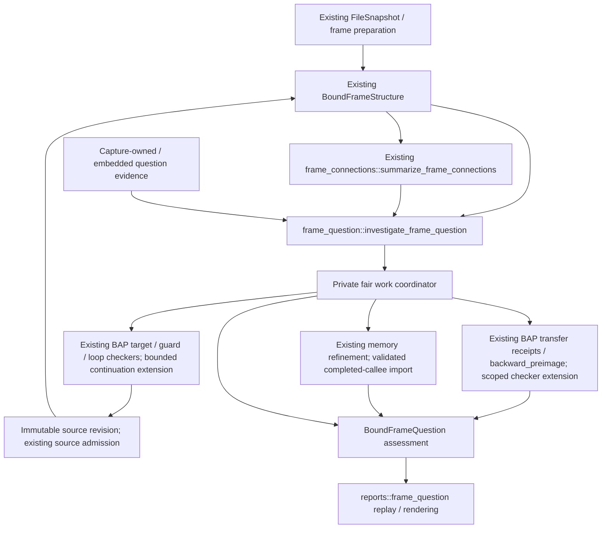

# Question-directed frame investigation

## Context and follow-up

**Status.** Implemented with [source-bound remote qualification, 2026-10-19](../../evidence/Ariadne/frame-question/20261019/README.md).
P0–P10 and the applicable FC5/FC6/M4 finite imports pass on the declared sources.
The [2026-10-18 local record](../../evidence/Ariadne/frame-question/20261018/README.md)
is retained as historical evidence. This design covers all four items of the
[original recommendation](../../.agents/chatdocs/ariadne-frame-to-frame-recommendation-20261016.html#order).

**Why this document exists.** The [recommendation](../../.agents/chatdocs/ariadne-frame-to-frame-recommendation-20261016.html#first-change)
identifies how a structural map can succeed while a selected
branch, value or possible writer remains unresolved. The investigator needs
bounded work on that question without completed caller dataflow or path enumeration.

**What this document establishes.** The coordinator's contracts for immutable
sources, fair question work, finite feasibility, local dependencies, independent
result layers and strict replay. Imported feature documents retain authority
for their own rules and recorded qualification scopes.

**Where to go next.** The [P0–P10 ledger](../../.agents/plans/frame-question-investigation.md)
records completion and limits. Read [qualification](../../evidence/Ariadne/frame-question/20261019/README.md), the
[structural](investigation-design.md#structural-frame-report-before-dataflow),
[connection](investigation-design.md#structural-corridors-and-cycle-summaries),
[memory](memory-provenance-refinement.md), [guarded-target](guarded-target-resolution-design.md)
and [model](../../Specs/README.md) contracts for the imported premises.

**What remains unresolved.** The original saved-source question is unknown at
its finite resolver/prefix bounds. The extra raw original refresh has incomplete
guard candidate coverage and no admitted caller link. Caller S6, frame-path F4,
broader release, general SMT, historical traces, loop-instance value invariants,
generic load inverses, root cause and universal refinement remain separate.

## Coverage of the four recommendation items

| Item | Investigator question | Contract owner and current state | Work in this program |
| --- | --- | --- | --- |
| 5.1 — structural report first | Which captured activations, admitted local edges and unresolved frontiers are available before dataflow completes? | [Investigation source contract](investigation-design.md#structural-frame-report-before-dataflow); `BoundFrameStructure`, v1/v2 source reports and SF0–SF6 exist with [dated qualification](../../evidence/Ariadne/frame-structure/20261016/README.md). | Reuse the privately bound source. Recheck identities for reuse; preserve missing maps, auxiliary witnesses and source gaps. Do not reimplement SF0–SF6. |
| 5.2 — cycles and examples | Which represented connections join the selected anchors, where are structural cycles, and what samples fit a separate budget? | [Connection contract](investigation-design.md#structural-corridors-and-cycle-summaries); `BoundFrameConnections` and its CLI/codec exist with [local finite/capture evidence](../../evidence/Ariadne/frame-connections/20261018/README.md). [Remote FC5/FC6 consumer acceptance](../../evidence/Ariadne/frame-question/20261019/README.md) now passes for those exact sources. | Reuse optional graph/corridor/SCC results. Their completion and retained examples are not prerequisites for value work. Retain FC5's exact source/corpus boundary. |
| 5.3 — resolve one question's bottleneck | Under declared inputs and endpoint constraints, can a selected alternative be refuted, witnessed in the model, or only left unknown; which unfinished obligation blocks the answer? | New coordinator and assessment contract below. Existing target/guard/loop proof mechanisms remain their own owners. | Admit one typed question; schedule relevant work fairly; use checked constraints and existing induction strategies; publish premises, coverage and concrete evidence requirements. |
| 5.4 — local fault dependencies | Which immediate values and possible writers contribute to a selected access, and which individual candidates can be excluded within a justified scope? | [Memory refinement](memory-provenance-refinement.md) has [remote finite/Scanner qualification](../../evidence/Ariadne/frame-question/20261019/README.md) for the selected candidate-preserving profile. | Reuse a compatible completed callee when available; add the frame/source join and question-scoped local assessment without requiring completed caller dataflow. Retain unknown memory, interference and instance ambiguity. |

The paragraph following the four items is also part of this design: frame
binding, structural recovery, feasibility, values/origins and execution evidence
have independent status. The recording capability discussed in section 6 is
outside this implementation scope; the result must accurately say when no
recording exists.

## Architecture and ownership



The revision cycle is bounded by policy, not an unlimited retry loop. A baseline
source never changes in place, and an assessment cannot carry a negative claim
from one graph epoch into another without revalidation.

| Responsibility | Existing source seam | Implementation ownership / restriction |
| --- | --- | --- |
| Capture and activation identity | [frame preparation](../../src/input/frame_structure.rs), [unwinding](../../src/investigation/frame_unwind.rs), [source binding](../../src/investigation/frame_structure.rs) | A small input adapter in `src/input/frame_question.rs`; use existing admission rather than raw graph construction. |
| Optional structural view | [connection analysis](../../src/investigation/frame_connections.rs) | Consume its underlying source and any completed layers; do not rebuild it through the completed-investigation binder. |
| Question coordination and source revisions | [Question facade](../../src/investigation/frame_question.rs) | Private `src/investigation/frame_question.rs`; own source, typed question, premises, coverage, task receipts and result identity. |
| Fair indirect-target work | [target resolver](../../src/bap/target_resolution.rs), [loop closure](../../src/bap/target_resolution/loop_closure.rs), [composition](../../src/bap/composition.rs) | Extend the existing resolver with a private bounded continuation. No competing resolver or automatic LLVM effect fallback. |
| Point-specific scalar constraints | [transfer extraction/validation](../../src/bap/refinement.rs), [inverse rules](../../src/investigation/backward_values.rs) | Private question-constraint implementation sharing those checked rules. General flags, partial writes and memory inversion require separately admitted rules. |
| Captured fault observations | [fault-context validation](../../src/investigation/fault_context.rs), [input binding](../../src/input/investigation.rs) | A new source-bound frame witness adapter; do not weaken `BoundFaultContext` or its completed-analysis contract. |
| Writer assessment | [memory assessment](../../src/investigation/memory_refinement.rs) | Reuse candidate collection and pair rules where their premises hold. Add an explicit completed-frame import; preserve the existing v1 codec and candidate universe. |
| Publication | [structural codec](../../src/reports/frame_structure.rs), [connection codec](../../src/reports/frame_connections.rs), [memory codec](../../src/reports/memory_provenance.rs) | Separate `src/reports/frame_question.rs`, with opt-in CLI integration under `src/bin/ariadne_minidump/`. Only codecs invoke the source publication handoff; analysis hashes borrowed logical sources without serializing/reparsing them. |
| Models and tests | [active models](../../Specs/README.md), existing `tests/investigation/` and `tests/input/` | [Question](../../Specs/AriadneFrameQuestion.tla) and [scheduler](../../Specs/AriadneQuestionSchedule.tla) models, independent value/oracle fixtures and compiled behavioral controls. |

## Public interface

The facade is exported from `ariadne::investigation` when the `bap` feature is enabled.

```text
investigate_frame_question(
    source: FrameQuestionSource,
    question: FrameQuestion,
    evidence: FrameQuestionEvidence,
    limits: FrameQuestionLimits,
) -> Result<BoundFrameQuestion, Error>
```

`FrameQuestionSource` accepts either existing bound source type by ownership:
`BoundFrameStructure`, or `BoundFrameConnections` with its underlying structure.
Hide the two source carriers internally and share borrowed source payloads;
do not serialize/reparse or clone a large proof dictionary just to cross this
interface. A stopped corridor/SCC/example layer does not block local questions.
The completed-investigation interface continues to require completion.

The first question kinds are:

- **Alternative consistency:** select an existing typed branch edge or unresolved
  dispatch, together with a bounded predicate at a declared point. Ask whether
  that alternative is refuted, witnessed, or unknown in the declared model.
- **Fault dependency:** select a captured fault access and a source-discovered
  load/value in a selected activation. Ask for the immediate dependency chain
  and assessments of its possible origins. A store selector may focus displayed
  detail, but cannot remove the other candidates.

Selection is restricted to the source's activation range and existing evidence
identities. A selector is not a discovery root. A prepared-but-unreached or
failed instruction may identify an obligation, but receives no invented
instruction semantics. Additional branches, values or questions need explicit
schemas and admission rules rather than an arbitrary solver-expression escape.

Validate malformed questions, snapshot/activation mismatches and invalid proofs
before interpreting resource stops. Missing optional semantics, seeds or a
completed callee yield a bound unknown layer with a reason, not a fabricated
complete answer. There is no public arbitrary-graph or trusted-certificate
constructor.

`FrameQuestionEvidence` is an opaque, validated evidence-provider handle, not an
arbitrary trusted callback. Its two real adapters are a capture-owned reader/
preparer in live input mode and an embedded receipt/byte store in saved-report
mode. Constructors bind the provider to the source snapshot and policy; produced
candidates still cross existing admission. The analysis module receives this
dependency rather than opening captures or launching a fallback itself. Handles
are not serialized or retained in results: the report keeps the bounded consumed
bytes/proofs. Provider work and helper I/O have charged operations and explicit
timeouts bounded by the remaining question policy.

### Concrete outcomes to support

| Selected question | A useful bounded answer | Required restraint |
| --- | --- | --- |
| Can the selected branch remain consistent with the declared endpoint predicate? | A checked model witness, a coverage-qualified refutation, or the specific input/semantic obligation that prevents either. | An investigator-supplied predicate is a query condition or hypothesis, never a capture observation. |
| Which unresolved dispatch should receive work to answer this question? | Its dependency on the question and a bounded serviced-task/result receipt. | Priority is not probability, and a lower-ranked frontier remains represented. |
| What can be established along the fault's immediate pointer chain? | Separate observed register values, derived producer relations, supported constraints and stopped expansions. | Preserve the observation point and condition any earlier value on its producer/context evidence. |
| Can this candidate store be excluded for this selected load? | A disjointness result covering the candidate's declared accesses/instances, alongside the unchanged alternatives. | No last-writer or root-cause conclusion; incomplete collection or scope remains explicit. |

## Identity, premises and model scope

Every value fact binds snapshot/artifact, frame-chain activation, semantic
profile and source revision, instruction point (`before` or `after`), location
and width, context/instance scope, constraint digest and premise set. File
offsets, semantic VAs, graph IDs and proof IDs remain distinct.

A static `(frame, VA)` is not a dynamic loop instance. Scope is explicitly one
of: all modeled visits; a bounded model-prefix occurrence; or visits covered by
a checked invariant. Prefix occurrences describe the model, not recovered
historical iteration numbers. Facts from incompatible prefixes or premises
cannot be combined into a jointly exact pointer. A same-register spelling is
not a same-value witness across instructions or recursive activations. Well-formed
premises that conflict with valid observations produce `premise_conflict`; keep
both sources and do not derive blanket exclusions from an inconsistent premise
set. Malformed or forged evidence remains an error.

Accept only these evidence classes:

| Evidence | Permitted use | Forbidden promotion |
| --- | --- | --- |
| Capture-owned exception fields and valid register groups | Observations at the selected exception instruction, with decoded access association. | Earlier branch outcome, earlier load memory, or an older frame's volatile argument value. |
| Validated active-call and unwind/ABI premises | Relationships at the exact points and activations their existing contract supports. | Saved return PC as path history, or a caller continuation register as an entry-time argument. |
| Checked BAP transfers/predicates | Derived constraints at supported points under their complete semantic and coverage premises. | A hash, opcode spelling or `uses`/`may_defs` sets as an arithmetic relation. |
| Explicit hypotheses | Conditional results whose dependencies retain those hypotheses. | Relabeling assumptions as observations or combining conditional results into baseline facts. |
| A compatible completed callee | Its original graph, reaching origins and slice within a validated frame import. | Joining by address/build alone or importing the older Scanner record from a different snapshot. |

Retained structural proof inputs can contain typed BIL. Reuse those ASTs only
when their site/bytes/hash, admission, final projection and conditional premises
validate. Run the existing bounded receipt extractor/checker over that evidence;
absence or incompatibility remains `semantics_unavailable`. Do not re-lift saved
reports or read current memory to invent earlier contents. New live semantic
materialization uses the existing pinned BAP/LLVM-reference admission path.

## Stage 5.3: one question, fair work and checked conclusions

### Bottlenecks and scheduling

A bottleneck is a specific unfinished obligation on which the selected answer
depends: missing source semantics, unresolved control target, unknown input,
incomplete predecessor coverage, unsupported inverse, alias/instance ambiguity,
or an exhausted task. Report the dependency explaining its relevance and the
work/evidence that could address it. Priority is not path probability or a
proof of irrelevance.

The current target resolver iterates indirect sites in address order and shares
one step counter across their inner reverse searches. A large early search can
consume the budget before a later selected site receives useful work. Replace
that scheduling internally, preserving the existing target/guard/induction
proof checks. The coordinator must be able to suspend an individual reverse
search at a charged operation, not merely between whole dispatches.

Use deterministic FIFO rotation within three bands: question prerequisites,
other relevant tasks, and coverage/frontier tasks. Each round reserves quanta
in a 2:1:1 ratio for nonempty bands; unused slots are borrowed deterministically.
New tasks join their band's tail, and no task receives a second turn ahead of
its existing peers. Fairness means that an admitted continuously runnable task
is eventually serviced if steps remain available; it promises neither success
nor service under an already exhausted finite budget. Cap admitted tasks,
generation, queue bytes, expression evaluation and source revisions separately.

Use both value dependencies and unresolved control attachments for relevance.
An off-corridor unknown target may reconnect, so it cannot be dropped by a
represented reverse slice. Opaque effects and `memory:any` retain conservative
influence. Examples may suggest presentation order but never define coverage,
writer membership or the scheduler's complete obligation set.

### Constraints and feasibility

The first checked vocabulary is finite-width constants, known-bit masks,
whole-GPR copies, admitted constant add/subtract/AND inverses, and reviewed
scalar comparisons over those relations. Keep independently supported output
facts when another output is opaque. A flag-dependent branch needs its full
reviewed comparison/flag-definition relation, not the flag name alone; reuse
accepted target-predicate rules only within their checked scope. Unreviewed
flag relations, partial-register combinations, loaded-address inversion and unsupported expressions remain
unknown until their own checked rules and tests are added. No general SMT
solver or new ISA proof track is required for this first profile.

Call-context inputs initially use existing certified ABI residue and unwind
relations at their exact points. General caller argument propagation requires
an admitted point-to-point BAP transfer/call relation; missing relations remain
symbolic. A saved continuation or crash-time volatile register is insufficient.

Endpoint observations constrain only their declared point. A fault observation
is before the faulting instruction; do not apply its successful normal transfer
as though that instruction completed. Backward transport
needs an admitted transfer and context/coverage witness at every step. A load's
value does not uniquely identify its address, and an overwrite may erase all
information about the earlier value. A structural SCC supplies no induction.
An existing stable-base dispatch invariant may close only the incoming coverage
it actually certifies; using it as a value invariant requires an independently
checked transfer/entry/preservation contract.

| Verdict | Required evidence |
| --- | --- |
| `refuted_under_model` | A replayed contradiction/exclusion proof over a sound enclosing relation and every context quantified by the claim. Missing incoming coverage or incompatible premises prevents an all-context refutation. |
| `possible_under_model` | A checked, coherent witness for all steps of the declared supported finite model, with point/activation identities. It is neither an observed execution nor proof of real-program feasibility. |
| `unknown` | Includes abstract nonemptiness without a witness, opaque transitions, missing values, incomplete coverage, unsupported rules and budgets. |

A nonempty overapproximation alone never earns `possible_under_model`.
Approximate pruning may produce a sound refutation only when the enclosing
relation and quantified coverage are checked. An exceptional terminal or a
blocked normal edge keeps its exceptional alternative; a normal-flow proof is
not a proof about resumption from an exception. No result kind means that the
program cannot connect the frames.

### Immutable source revisions

Control discovery can help a question, but question-specific predicates must not
silently alter the baseline structural artifact. Refutations decorate a separate
assessment view. Newly found targets remain candidates until the existing
captured-byte, guard, composition and recovery admission validates them.

Live discovery produces a new bound source with a parent fingerprint, identical
snapshot/artifact, original roots and selected activation range, and explicit
new reads/decoded facts. All new bytes come from that same immutable capture;
missing captured bytes cannot be filled from a later run or automatic image
fallback. Saved-source mode uses only embedded evidence and reports missing
capture evidence when extension needs bytes it lacks.

Every coverage, invariant, refutation, imported analysis and hypothesis proof
binds its exact graph/request epoch. Additional edges invalidate dependent
negative/closure claims until rechecked. Recomputed conditional proof IDs need
an explicit dependency mapping; a shared human hypothesis name is insufficient.
Cap the number of revisions. Keep each original source and its results
inspectable; no assessment is silently moved onto a different graph.

## Stage 5.4: local dependencies and candidate writers

### Completed-callee reuse and partial-source behavior

Reuse completed callee analysis when snapshot, activation, roots, normalized
request/effects, semantic profile and hypothesis context match. A sealed
completed-frame import witness binds both identities and validates the complete
state. Saved publication must retain/replay enough request and completed-state
evidence to reconstruct the full origin universe; a standalone memory-v1
assessment is not a complete-callee import certificate. If existing query identities differ, require an explicit checked
pointwise source/request equivalence; never join by naked VA or snapshot alone.
A retained analysis of another capture is not an import candidate.

If a compatible completed result is absent, the product may run a separately
bounded callee-only completion over the already admitted request, or return
`origin_collection_unavailable`. It never launches full caller completion as an
implicit prerequisite. Local supported scalar relations can still be reported
when complete reaching origins are unavailable, but they cannot claim a complete
writer universe. Existing memory-v1 rules retain their completion requirement.

For the Scanner chain
`cmp [rax+0x38]` ← `mov rax,[rsi+0x28]`, distinguish: a fault-time RAX observation;
a model-relative immediate producer relation; the loaded value under that
producer/context premise; the load's address inputs; and its possible memory
writers. These are separate facts. The design does not read fault-time memory
as the earlier load result or assert which writer executed.

### Writer universe, aliases and instances

Freeze every `memory:any` reaching origin from the compatible completed callee,
including entry memory, before exclusions. Preserve the original table and
attach assessments rather than deleting core candidates. Add explicit open
frontier, unknown effect and external-interference alternatives where the
question's scope needs them; the baseline intra-thread origin set alone is not
a complete account of all threads.

An individual instruction candidate can be excluded within scope only if every
possible store access and every instance quantified by that candidate is
covered by a checked disjointness/context witness. Reuse existing modular
constant/common-base footprint rules. Common bases require the same proved
value instance; equal register names and a path sample do not establish it.
Use modular byte-range overlap, including wrap and partial overlap, rather than
comparing address starts. Missing footprints and opaque calls remain unresolved.

A cyclic store is not excluded by disproving one unrolled occurrence. A result
about one bounded-prefix instance is labeled as such; it cannot exclude a static
all-visits candidate. Other threads remain a possible source without interval
or synchronization evidence. A single captured thread or a missing sample path
cannot establish absence of interference. An overlapping candidate is not a
last-writer proof, and disjoint local candidates do not remove entry/unknown
alternatives.

Keep value precision (`exact`, `constrained`, `unknown`) independent from
expansion status (`finished`, `stopped`, `unavailable`) and classification
(`observed`, `derived_under_premises`, `conditional`). Numerical exhaustion keeps
already established constraints and the full candidate universe. Existing
memory-v1 output bytes and baseline explanations remain separate and unchanged.

## Independent product layers

The new `ariadne.frame-question/v1` report embeds or content-addresses one
self-contained source chain and its existing publication bindings, the typed
question, source-bound optional evidence, assessment/certificates and work
receipts. A content reference is valid only if its bytes are present in the
same publication; no decoder network fetch is allowed.

| Layer | Reported independently |
| --- | --- |
| Frame binding | Available activations/anchors, missing/ambiguous relations and premises. |
| Structural recovery | Per-frame completed prefixes, stops, gaps and source revision. |
| Corridor/SCC/examples | Existing layer statuses, exact represented domains and strict NP, if requested. |
| Question coverage/resolution | Admitted/unserved obligations, semantic coverage, source revisions and stops. |
| Model-relative feasibility | Verdict plus exact model, coverage and witness/refutation scope. |
| Values/origins | Per-value precision, expansion status and per-candidate disposition. |
| Execution evidence | `not_supplied` in v1; scope-qualified recording support requires the separate section-6 design. |

Do not collapse these into one `complete` flag or reuse a source recovery status
as semantic completeness. A partial result is useful when it contains checked
facts and actionable unknowns; returning only unknowns does not satisfy every
positive implementation acceptance gate.

Live use is `--frame-question QUESTION.json`, with explicit compatible
structural preparation, question-limit and evidence inputs. The question file
includes `N:M`, one typed selector and predicates; the adapter prepares a source
without adding selector sites as roots. Reject legacy path/count, entry/seed,
supplied-stateflow and incompatible assessment combinations before capture
access. This is an opt-in mode; the normal BAP full-analysis default and old
report versions remain unchanged. There is no silently accepted free-form SMT
or arbitrary constraint-code file.

Offer JSON/text/DOT with links from each verdict and unresolved obligation to
its exact source site, predicate, candidate and certificate. Evidence requirements
identify bytes, semantic support, a valid relation/instance witness or recording
scope. A later reproduction is evidence about its own capture, not a substitute
for an absent interval in the original snapshot.

## Finite policy and replay

Preserve existing source/connection policies. The following new defaults are
the public `FrameQuestionLimits` defaults. They bound accounted work and retained data; they are not throughput measurements.

| Bound | Default |
| --- | ---: |
| Question / limit-file input | 64 KiB each |
| Outer report input/output | 1 GiB each |
| Embedded source publication | 512 MiB, separately checked from assessment storage |
| Additional semantic/proof payload | 64 MiB |
| Admitted work tasks / queued storage | 8,192 / 16 MiB |
| Quantum / charged operations per layer | 256 / 1,048,576 |
| Question states / values per finite fact | 65,536 / 256 |
| Expression nodes / depth | 8,192 / 64 |
| Writer candidates / access-pair checks | 4,096 / 65,536 |
| Proof records / source revisions | 4,096 / 4 |
| Per-layer / whole-question deadline | 10 s / 30 s |

These are accounted bounds, not a process-RSS claim. Check bytes/cardinalities
before typed copies, hashing or work; charge source decoding and certificate
validation to separate verifier bounds. Inherit each imported contract's tighter
limits instead of raising them through producer declarations. Legacy assessments
keep their smaller policies; a new collector beyond memory-v1 bounds is a new
P5 profile and qualification obligation, not an implicit legacy override. A zero work limit
stops that layer; it does not skip question/source validation or erase others.
An over-cap complete candidate table is unavailable with its original count
and source reference; no clipped table earns exclusion coverage.

Bind source fingerprints, question/point/activation scope, semantic profile,
hypotheses, limits, evidence and algorithm version into the logical assessment
identity. Bind the complete envelope separately. Replay source admission,
receipt extraction, task scheduling and every claimed conclusion; do not trust
serialized status, candidate or coverage assertions. A recorded deadline replays
a checked deterministic work prefix, not the producer's elapsed wall clock.
Producer exhaustion preserves a partial assessment; verifier exhaustion refuses
a trusted result. A recomputed hash establishes internal binding, not capture
authenticity: use an independently trusted expected publication binding or the
owning capture when authentication is required, as in the existing source
codecs. No public serialized continuation is trusted as executable
state; initial v1 resumes internal tasks only within one bounded invocation.

## Source review and decisions

Reviewed current source establishes these constraints:

1. `BoundFrameStructure` exposes recovery requests, context and private proofs
   without full dataflow; it is the existing source seam. `BoundFrameConnections`
   owns that source and completed or partial independent layers.
2. `target_resolution::resolve_inner` shares a step counter across address-ordered
   indirect sites. Fair scheduling requires a real per-operation continuation,
   rather than a new ordering wrapped around indivisible searches.
3. `refinement::extract` and receipt validation already normalize supported BIL
   transfers; they do not make effect sets invertible or admit general predicates.
4. `BoundMemoryRefinement` owns `BoundInvestigation`; candidate collection reads
   the completed reaching set. Directly accepting arbitrary partial frames there
   would violate its current contract. The new import/coordinator is additive.
5. `machine_state` and the native stateflow adapter classify supplied abstract
   relations. They are not a ready-made minidump feasibility oracle; keep those
   tracks separate until an explicit machine-code semantic adapter is qualified.
6. Source/tool and capture identities in old records differ. Matching function
   addresses or the historical count of 12 Scanner origins cannot join them.

Rejected shortcuts are full caller completion as the question gate, a second
competing resolver, arbitrary SMT as an unreviewed effect fallback, filtering
writers/frontiers through examples, and using a nonempty abstract set as a
concrete path witness. Each either restores the original bottleneck or weakens
an existing contract.

## Validation boundary and direct follow-up

The [implementation plan](../../.agents/plans/frame-question-investigation.md)
requires model authority, independent finite evaluators, real compiled mutations,
strict codec/adversarial checks and both capture applications. Existing SF/FC/M
records retain their own identities and unmet clauses. In particular, an old
model pass or earlier backend timing does not qualify a new scheduler, checker,
source revision or native validator.

The original design-only revision added no runtime result. The implemented
profile below and the dated remote qualification now supersede that planning
status; documentation checks remain separate from runtime acceptance.

## Implemented profile and usage

Concrete ownership is split between the [facade and revision binder](../../src/investigation/frame_question.rs),
[alternative checker](../../src/investigation/frame_question/alternative.rs),
[dependency collector](../../src/investigation/frame_question/dependencies.rs),
[resolver bridge](../../src/investigation/frame_question/resolution.rs),
[capture adapter](../../src/input/frame_question.rs) and
[strict codec](../../src/reports/frame_question.rs).
`FrameQuestionEvidence::with_completed_frame` consumes a sealed completed analysis
and checks its exact original request. `with_revision` accepts an independently
bound successor; old conclusions are recomputed rather than carried forward.

A request file for the finite diamond control is:

```json
{
  "schema": "ariadne.frame-question-request/v1",
  "from_frame": 1,
  "to_frame": 0,
  "question": {
    "question": {
      "kind": "alternative",
      "frame": 1,
      "site": "0x0000000000400306",
      "destination": "0x000000000040030c",
      "edge_kind": "taken",
      "endpoint": {
        "point": {"frame": 1, "site": "0x0000000000400310", "moment": "before"},
        "bank": 1,
        "width": 64,
        "mask": "0xffffffffffffffff",
        "value": "0x0000000000000000"
      }
    },
    "conditions": []
  }
}
```

Here bank 1 is RCX in the existing AMD64 `RegisterView` namespace. Addresses,
word values and masks use canonical 16-digit hexadecimal strings. Changing the
endpoint RCX to 1 refutes that branch in this fixture's supported model. Zero
constraint work, incomplete control, cycles beyond the supported instance
scope, or abstract nonemptiness without a coherent witness yield unknown.

```sh
cargo run --offline --locked --bin ariadne-minidump -- \
  tests/input/fixtures/frame_paths/diamond.dmp \
  --decoder-reference target/ariadne-llvm-mc \
  --frame-question question.json --output-dir target/my-frame-question
```

`--frame-question-limits POLICY.json` accepts the complete finite policy.
The output directory must be new; publication writes JSON, text and DOT as one
checked set. BAP supplies semantics. The default completed-analysis CLI route
and existing structural/connection/report schemas retain their separate paths.

For a fault query, replace the inner question with `kind: fault_dependency`,
`frame`, `site`, `access`, optional `load`, and optional `focus_writer`. The latter
is a focus hint and never filters the origin universe. When `load` is null, a
bounded walk through the completed callee's actual reaching definitions finds
contributing load boundaries through register arithmetic. It does not follow a
load into historical memory. Values and origins have separate receipts; the
feasibility verdict is unknown/not applicable to this query profile.

The scalar engine overapproximates finite GPR bit constraints. Concrete witness
search is a separate bounded search over exact initial assignments and loop-free
paths; it cannot certify a path with unknown branch/target/output semantics.
Constraints across activations require a separately certified call relation;
the v1 profile reports them unavailable. Conditional sources currently do not
emit positive model witnesses. All captured GPR observations constrain their captured point. A predicate moves
to the root only after a no-write check over every represented predecessor.
Unsupported relations, general argument flow and conditional normal projections
without matching retained AST evidence remain unknown.

Numerical observations are before the fault, including captured registers used
as address inputs by admitted local loads. Earlier facts require the recorded
producer/prefix relations. Constant/copy/add/subtract/AND inverses reuse the
existing checked rules. A generic load and an unsupported two-register inverse
retain the established postcondition and stop that expansion.

The inherited connection receipt summarizes availability of its represented
graph; the embedded connection report retains the separate corridor, SCC and
example statuses, including stops. Neither a stopped SCC layer nor its samples
control value/origin coverage.

The private FIFO uses slots `[question, relevant, question, coverage]`. Resolver
quanta count bounded reverse-prefix operations. AST rewriting, table enumeration
and existing loop-proof attempts remain bounded atomic operations under their
own policies; deadlines are cooperative boundaries, not process preemption.
Legacy callers keep their original scheduling. A stopped resolver cannot erase
unknown frontiers or turn a partial result into a refutation. The new Rust/native
validators also retain only the exact named pre-question v3/loop checker identities
for old source replay; arbitrary checker digests remain invalid.

Saved replay requires only `--no-default-features --features bap`. The codec
replays source admission, revisions and conclusions without helpers, capture
reopening or network fetches. Independently trusted expected bindings authenticate
which publication was intended; internal rehashing alone does not authenticate a
capture. See the qualification record for the exercised corpus and exact limits.

### Point order, cycles and whole-register soundness

Before-state witnesses require all explicit point facts to have been checked at
their actual moments. A condition after the current endpoint cannot be treated
as already satisfied by visiting that address. Such a query may remain unknown
in the bounded prefix profile. The captured top PC is a before-state boundary:
its successful normal transfer and after-state are unavailable to this profile.
The structural source still retains all original edges.

Refutations require acyclic represented value flow in v1. A cycle can be relevant
even when a point constraint prunes its first visit; a captured observation must
not be forced onto that first visit. General all-visit value coverage requires
an independently admitted value invariant, beyond the existing dispatch-target
invariant. Positive witnesses still require a coherent loop-free prefix.

Every GPR environment value has width 64. A narrower physical output is unknown
unless the retained BAP expression itself establishes the whole word; partial
word joins cannot manufacture zero upper bits. The synthetic loop/point control,
future-after-condition, captured-boundary and mixed-width controls are checked
by separate compiled mutations in the current evidence record.

## 2026-10-19 source-bound acceptance

The [new record](../../evidence/Ariadne/frame-question/20261019/README.md) binds
an unchanged 875-file campaign capsule to remote root/features, 32 finite model
configurations, independent oracles, 33 compiled mutations, native compatibility,
live controls, both declared capture-source applications and helper-free replay.
The question consumer remains Rust over admitted BAP semantics; native-default
and native/Rust Scanner comparison are separately exercised tiers.

The original declared saved source keeps all 610 gaps; its alternative query
remains unknown at the resolver-work and scalar-prefix limits. The controlled
real capture supplies four observed and 367 derived value records, with all 10
memory candidates plus interference. Its value layer stops at depth while its
origin layer finishes. The additional original local-fault query preserves 25
value records and 12 visible candidates; conservative origin charging stops
refinement, so the publication keeps an unknown candidate count and unresolved
entries. The selected historical Scanner's full 12-origin table is separately
checked against completed baseline reaching definitions with exact native/Rust
assessment equality and unchanged default report bytes.

The extra fresh original source refresh is more limited than the retained
structural input: candidate coverage leaves its initial MOVAPS unknown and its
active caller link unavailable. The exact saved original source remains the
consumer acceptance input; no fresh raw-source structural parity or completed
caller claim is inferred from this finite question qualification.
