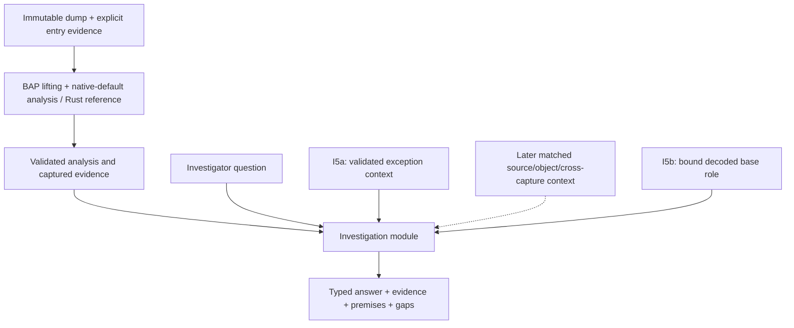

# Fault-address investigation design

## Context and follow-up

**Status.** The first fault-address explanation is implemented. The retained
[Windows correctness re-pin](workload-performance-design.md#windows-investigation-replacement) and subsequent
[performance qualification](workload-performance-design.md#native-investigation-qualification) qualify the exact
98-instruction replacement query under their recorded source/tool/dependency
identities. The distinct zero-address and zero-base-plus-displacement questions
are implemented within their finite profiles; address-wrap remains selected,
with implementation and qualification pending. On 2026-10-11, the user relaxed
the frame-to-frame question to listing fewer than `NP` possible paths. The
bounded frame-path contract below is qualified within the finite Windows AMD64
captured-unwind and original physical-frame 1→0 scope. The
[2026-10-20 F4 evidence](https://github.com/NzSN/Ariadne/blob/32fbda931177184f429eae37920a5d228d63e31f/evidence/Ariadne/frame-paths/20261020/README.md)
records model, mutation, native/reference, original-capture and saved-replay gates. The later [S3 finite model suite](https://github.com/NzSN/Ariadne/blob/32fbda931177184f429eae37920a5d228d63e31f/evidence/Ariadne/specification-sync/20261020/README.md) independently qualifies the declared model scripts and preserved bounds; it adds no new runtime or capture acceptance.
The [2026-10-24 final-output repair](../../.agents/plans/frame-path-enumeration.md#final-output-budget-repair-2026-10-24)
fixes a generated publication-cap failure; its portable checks do not refresh
the earlier native/capture qualification.
The [2026-10-13 full-dump application attempt](https://github.com/NzSN/Ariadne/blob/32fbda931177184f429eae37920a5d228d63e31f/evidence/Ariadne/frame-paths/dump03958-20261013/report.md)
returned unavailable for physical frames 1→0: a runtime-table budget and then
unsupported vector semantics prevented an admitted active-call anchor.
The [later vector admission validation](https://github.com/NzSN/Ariadne/blob/32fbda931177184f429eae37920a5d228d63e31f/evidence/Ariadne/bap-vector-registers/20261013/report.md)
resolved that namespace refusal while retaining the alignment stop at that date.
The [2026-10-15 caller coverage qualification](https://github.com/NzSN/Ariadne/blob/32fbda931177184f429eae37920a5d228d63e31f/evidence/Ariadne/caller-semantic-coverage/20261015/README.md)
subsequently removes the original caller barriers and recovers its larger
structural graph. That dated run exhausted its caller action budget and left
the completed-query path mode unavailable. Stage 5.1 implements
a separate structural report before dataflow. Its
[2026-10-16 qualification](https://github.com/NzSN/Ariadne/blob/32fbda931177184f429eae37920a5d228d63e31f/evidence/Ariadne/frame-structure/20261016/README.md)
completes SF0–SF6 within the finite Windows AMD64 captured-frame/E8-call scope;
caller completion now has [S6 qualification](https://github.com/NzSN/Ariadne/blob/32fbda931177184f429eae37920a5d228d63e31f/evidence/Ariadne/caller-semantic-coverage/20261019/README.md),
and finite frame-path F4 now has its own separately bound qualification.
[Stage 5.2](../../.agents/plans/frame-connections.md) implements represented
corridors, SCC summaries and bounded examples over the validated structural
source; [remote consumer qualification](https://github.com/NzSN/Ariadne/blob/32fbda931177184f429eae37920a5d228d63e31f/evidence/Ariadne/frame-question/20261019/README.md)
now covers both declared saved-source applications. The
[complete section-5 design](frame-question-investigation-design.md) now covers
all four recommendation items, with question-directed resolution and local
fault-dependency integration qualified within the finite scope of its
[P0–P10 program](../../.agents/plans/frame-question-investigation.md).
The current [saved-XMM unwind implementation](../../src/investigation/frame_unwind.rs)
adds operation 8 to fresh frame recovery under profile v2. Historical v1
publications keep their original replay rules and qualification scope.

**Why this document exists.** The [real-capture slice](file-reader-design.md#historical-controlled-chromium-capture)
provides possible origins but leaves their explanation to the investigator.

**What this document establishes.** The design and implemented contract for
selecting a captured memory-address operand and explaining its possible earlier
byte definitions. Query identity, claims, report fields, publication, limits
and qualification preserve alternatives and missing premises. The frame-path question adds bounded structural alternatives with frame evidence.

**Where to go next.**

- [AMD64 operation coverage program](../../.agents/plans/amd64-operation-coverage.md) —
  conventional unwind completion, exceptional-transition provenance and
  separately versioned metadata coverage alongside instruction semantics.

- [Active specification synchronization](../../.agents/plans/specification-sync.md) —
  completed finite typed-edge frame-path model qualification, bounded stops and preserved historical receipts.

- [Implementation ledger](../../.agents/plans/investigation-layer.md) — delivery stages,
  selected address-wrap work and later questions.
- [Scanner partial-explanation follow-up plan](../../.agents/plans/scanner-partial-explanation.md)
  — S0–S4 finite case follow-up is [qualified](https://github.com/NzSN/Ariadne/blob/32fbda931177184f429eae37920a5d228d63e31f/evidence/Ariadne/scanner-followup/20261020/README.md):
  twenty-site review, explicit entry boundary and a partial result with all gaps retained.
- [Memory provenance refinement](memory-provenance-refinement.md) — implemented
  Scanner diagnostic separation, bounded writer assessment and backward scalar
  inference; the selected model/mutation/Scanner profile is [qualified remotely](https://github.com/NzSN/Ariadne/blob/32fbda931177184f429eae37920a5d228d63e31f/evidence/Ariadne/frame-question/20261019/README.md).
- [Frame-path ledger](../../.agents/plans/investigation-layer.md#bounded-frame-path-question)
  — the selected strict path-count bound, frame anchors and resource limits.
- [Frame-path implementation plan](../../.agents/plans/frame-path-enumeration.md)
  — F0–F4 contract, captured unwind profile, bounded enumeration and validation.
- [Structural frame report plan](../../.agents/plans/frame-structure-report.md)
  — implemented Stage 5.1 recovery-prefix API, separate report and finite host
  policy and [source-bound qualification](https://github.com/NzSN/Ariadne/blob/32fbda931177184f429eae37920a5d228d63e31f/evidence/Ariadne/frame-structure/20261016/README.md).
  No dataflow or path enumeration is performed.
- [Frame connections plan: Stage 5.2](../../.agents/plans/frame-connections.md)
  — implemented corridor/SCC/example consumer with source-bound remote FC5/FC6 qualification.
- [Question-directed frame investigation](frame-question-investigation-design.md)
  and [complete section-5 program](../../.agents/plans/frame-question-investigation.md)
  — all four recommendation items, existing source/connection reuse and qualified
  finite question-directed resolution plus local dependency/writer integration.
- [Caller semantic-coverage design](caller-semantic-coverage-design.md)
  — terminal/load admission and the separately qualified completed-caller gate.
- [Justified branch pruning design](justified-branch-pruning-design.md) — checked
  normal-projection receipts; the later MOVAPS-load alignment remains unknown
  under the [caller coverage contract](caller-semantic-coverage-design.md).
- [Zero-address design](zero-address-design.md) and
  [zero-base-plus-displacement design](zero-base-offset-design.md) — distinct
  delivered numeric predicates, evidence and contracts.
- [Address-wrap design](address-wrap-design.md) and
  [implementation plan](../../.agents/plans/i5c-address-wrap.md) — selected arithmetic
  predicate, inherited admission limits and pending qualification.
- First delivery record and
  correctness repairs — historical
  source/fixture evidence and the limit-exhaustion repairs, with the
  [completed repair plan](../../.agents/plans/completed/investigation-correctness-fixes.md).
- [Windows replacement plan](../../.agents/plans/completed/i4-windows-repin.md),
  [performance design](workload-performance-design.md#investigation-performance) and
  [qualification](workload-performance-design.md#native-investigation-qualification) — active exact-query correctness
  and independent timing clauses.

**What remains unresolved.** The Windows replacement met its unchanged 2 s
CLI limit at 1,692.696 ms in the retained performance campaign. Controlled
Windows zero-address is [qualified under its pinned setup](zero-address-design.md#native-qualification),
and zero-base-plus-displacement has [finite corpus qualification](zero-base-offset-design.md#retained-qualification).
Later source/tool changes require renewed or complete identity-verified evidence.
Object/source context, historical execution and cross-capture questions remain
open. The bounded frame-path implementation admits a finite captured-unwind profile
and separately bound instruction graphs; general unwinding and broader capture
qualification remain open. Caller S6 and finite original-capture frame-path F4
have separate completed qualifications. The structural report retains its separate scope.
The v2 saved-XMM extension does not publish reconstructed vector-register values
or extend those historical qualifications to the new profile.
Full-memory capture alone does not supply a trace.
Possible producers and numeric conclusions do not prove a UAF, executed
path or general root cause.
The explicit alignment-hypothesis extension is implemented and
[qualified in its finite scope](https://github.com/NzSN/Ariadne/blob/32fbda931177184f429eae37920a5d228d63e31f/evidence/Ariadne/alignment-hypotheses/20261016/README.md).
Its [H0–H5 ledger](../../.agents/plans/alignment-hypotheses.md) records the
additive conditional product; the original Stage 5.1 evidence retains its own
source identity. Caller S6 and finite frame-path F4 have subsequent, separately
bound qualification; neither closes general feasibility or history questions.

For wider navigation, see the [documentation map](../documentation-map.md).

The original proposal against `7de5a1e` on 2026-10-01 and first repairs through
`c9eb4c5` on 2026-10-02 are historical source checkpoints. Their records do not
independently qualify a later checkout.

Current validation follows the [executable test matrix](../../tests/README.md). Dated run
results below are historical; their Git links do not establish a current pass.
Former qualification-archive retention/publication clauses are retired;
current validation uses executable tests and disposable run products.

## Product position

Ariadne's current local recovery, reaching-definition and slicing algorithms
overlap BAP's analysis scope. BAP is an extensible binary-analysis framework
with disassembly, intermediate representations and analysis passes. Its
[standard-library overview](https://binaryanalysisplatform.github.io/bap/api/master/bap/Bap/Std/index.html)
and [graph solver](https://binaryanalysisplatform.github.io/bap/api/master/graphlib/Graphlib/Std/Graphlib/index.html)
support that characterization. The conclusion that these primitives can host
Ariadne's algorithms is an architectural inference, not a demonstration that
a standard BAP analysis reproduces Ariadne's exact contracts.

Ariadne is not a literal product subset: captured-only reads, immutable snapshot
identity, explicit uncertainty and source-bound validation are specialized
contracts. However, reproducing general analysis primitives should not be its
main product identity. The design centers on **crash investigation with
inspectable evidence and qualified explanations**, using BAP for analysis
mechanisms as they become accepted for the captured workload.



The current first-question implementation consumes the native-default or Rust-reference pipeline's
completed facts. Dashed inputs in the diagram are proposed capabilities.
The separate [Stage 2 migration](../../.agents/plans/completed/bap-integration.md#stage-2-bap-analysis-core)
now supplies the default native analysis. Moving that computation is
infrastructure work; the delivered zero-base-plus-displacement question is a separate domain capability.

## First question: explain a fault-address operand

Given a captured faulting instruction, a selected memory operand and an
explicit earlier entry, answer:

> Which earlier definitions could contribute to this address, what captured
> evidence supports them, and what prevents a stronger conclusion?

The implemented first question reuses the normalized request, reaching-definition
map, slice, captured reads and semantic evidence. It adds neither another
CFG/dataflow solver nor a speculative entry-point detector.

For a store through `[RAX]`, the answer identifies its address inputs,
groups possible origins for the relevant RAX bytes, relates them to captured
producer instructions, and explains entry-origin or opaque-call alternatives.
For an indexed address, retain base/index/scale/displacement relationships.
An unsupported operand shape receives an explicit unavailable explanation;
the module must not guess from the last recorded register values.

This produces an explanation of possible dependencies, not an actual executed
instruction sequence or proof that the faulting memory operation committed.

## Investigation module and interface

The [Rust source-layout consolidation plan](../../.agents/plans/completed/rust-source-layout.md)
places the implemented module in `src/investigation/` within the root Cargo
package. Its initial
interface consumes a bound normalized investigation context produced from the
validated prepared analysis and completed analyzer. The concrete adapter is `input::investigation::bind_investigation` in
`src/input/`; investigation must not depend on input or reports. This preserves
the responsibility boundary when CLI and reporting modules use its results.

`AnalysisResult` stores snapshot identity without the complete query. The
implemented binding therefore compares the prepared request with the completed
analyzer's original request before consumption. Preparation now also retains
typed address-use evidence from admitted BIL. These I0–I1 prerequisites are
implemented; the binding and result contract below describes their checks.

The implemented interface is:

```text
bind_investigation(prepared, completed_analyzer) -> BoundInvestigation
explain_fault_address(bound_investigation, question, ExplainLimits) -> Explanation

question:
  instruction VA
  selected memory-access index

explanation:
  snapshot/query/tool identity
  question and supported scope
  address-expression facts
  possible producer origins grouped by location/byte
  claims with evidence references and premises
  unresolved alternatives and gaps
  evidence requirements for stronger answers
```

The CLI contract below distinguishes the implemented first question from later
proposals. Explanation budgets preserve valid partial/unavailable output, including
zero budgets, as recorded in the [correctness repairs](#qualification-and-truncation-repairs). The
interface rejects mismatched snapshot/query identity and incomplete result
construction. It returns a typed result; formatting and file publication stay
with the existing reporting modules. Its tests use the same interface as callers.

This is intended to be a deep module: callers ask one domain question, while
the implementation handles provenance joins, location grouping, gap propagation
and explanation construction. Do not publish the internal graph traversal or
one interface per primitive operation. Do not introduce a general analysis
adapter interface with only a hypothetical BAP-core implementation behind it.
The current normalized requests/results are the initial input seam.

## Evidence and claims

| Record | Meaning |
| --- | --- |
| Evidence | An observed captured byte span, metadata/register observation, or explicitly supplied external artifact, with source identity and location. |
| Analysis fact | A derived graph, effect or origin fact, bound to the exact semantic producer, projection, query and stated assumptions. |
| Claim | A question-specific assertion supported by evidence/facts and explicit premises. |
| Alternative | A possible explanation not eliminated by the available evidence. |
| Gap | A missing capture, conflicting byte, unsupported lift, unresolved target, opaque call, uncertain memory alias or missing premise. |
| Evidence requirement | A concrete observation/artifact/semantic refinement required to strengthen or distinguish a claim. |

The implemented claim classification is **observed**, **derived under premises**,
or **unknown**. The [I5a assessment](zero-address-design.md) uses separate
hypothesis conclusions in its separate versioned assessment; it does not silently extend
the current strict v1 classification. Its numeric conclusion remains derived
under premises. Do not use unsupported numeric confidence or label a
model-relative conclusion as a historical fact.

The table describes the broader domain vocabulary. Current first-question
evidence is captured instruction/projection evidence. I5a adds explicit
exception-context observations, while matched external source/object
context remains later work.

Every claim must be traceable to stable evidence/fact IDs. These IDs include
the owning snapshot/artifact and scope; equal VAs in different captures must
not join. A complete byte-origin set does not prove that all bytes came from
one producer along one feasible path. Preserve joins and mixed-byte origins.
Generic `memory:any` dependencies cannot become object-specific lifetime facts.

Captured module metadata and matching symbols/source may explain identities
or supply an independently justified entry witness. They cannot fill missing
runtime instruction bytes or silently establish binary/source correspondence.
External context must record its match evidence and role.

## Binding and result contract

Schema: **`ariadne.fault-address-explanation/v1`**. The request is a captured
instruction VA and an explicit memory-access index in the prepared query.

The input adapter checks prepared request equality with a completed analyzer,
snapshot identity, recomputed query entries/seeds/limits digest, site/read byte
agreement and evidence domains. It includes helper/runtime/AST/projection hashes
in semantic-profile binding. The owned `BoundInvestigation` has read-only
identity access; it stores the exact request/state and normalized evidence.

Address-use evidence is extracted from admitted typed BIL. The currently
supported expression is modular 64-bit affine arithmetic over **before-instruction
GPR values**, with constant, base/index coefficients and signed displacement.
RIP-relative expressions use the captured instruction VA, not a crash-register
pre-state. Sequential BIL assignments resolve architectural/virtual temporaries.
Unsupported casts, nonlinear/conditional expressions or loaded-address values
retain explicit gaps. Address inputs exclude store payload inputs.

| Explanation field | Meaning |
| --- | --- |
| `identity`, `scope_id` | Snapshot/artifact/query/request/semantic-profile identity and canonical content digest. |
| `question` | Canonical instruction VA and memory-access index. |
| `status` | `explained`, `partial` or `unavailable`; `explained` cannot carry gaps or truncation. |
| `address` | Selected access role/width, bounded expression, address input cells and BIL attribution. |
| `origins` | Per-byte/location alternatives from the core reaching map before the queried instruction. |
| `evidence` | Captured bytes, semantic identity and contributor dump offsets, scoped to the investigation. |
| `facts`, `claims` | Typed assertions and content-addressed references. Possible producers/dependencies are always `derived_under_premises`. |
| `gaps`, `evidence_requirements` | Concrete unmet evidence/semantic requirements, including affected locations where known. |
| `assumptions`, `truncated` | Scope of claims and explicit exhaustion of explanation limits. |

Claim kinds are captured instruction, address inputs, possible origin, dependency
and uncertainty. There is no confirmed-root-cause or actual-execution assertion.
Captured bytes are `observed`; semantic dependencies are `derived_under_premises`;
unmet requirements are `unknown`. Serialization rejects duplicate/unknown fields,
noncanonical VAs/bitvectors, unsupported kinds, wrong content/scope IDs, dangling
references and impossible completeness/classification.

Default finite limits: 4,096 evidence records, 32,768 origin links, 8,192 visited
dependency nodes and 65,536 claims. Exhaustion marks the answer partial/truncated
and identifies the limit. These limits are not a scale qualification; large
record/render costs remain subject to workload measurements and input limits.

Zero is valid for each limit. An exhausted budget never relaxes reference or
identity validation: a producer is retained only with its origin fact and any
required instruction evidence. If the selected site's evidence cannot be kept,
the answer is `unavailable`, `truncated=true`, with no selected address or origins
and an explicit budget gap. When that evidence and a supported address are kept
but expansion is incomplete, the answer is `partial`, `truncated=true`.
Invalid question sites/access indices still fail independently of budgets.
The [correctness-fix plan](../../.agents/plans/completed/investigation-correctness-fixes.md) describes
the boundary regressions and qualification repair.

## CLI and publication

The question adds its instruction to slice seeds, **never entry roots**. Example:

```sh
target/release/ariadne-minidump tests/input/fixtures/stage_b_linux.dmp \
  --decoder-reference target/ariadne-llvm-mc --entry 0x401000 \
  --explain-fault-address 0x401006 --memory-access 0 \
  --explanation-only --format json
```

`--explanation-only` requires `--format` and no stateflow input. Ordinary report
modes retain the original report and add an explanation envelope/text section.
Output-directory mode stages original reports and `explanation.txt`,
`explanation.json` and `explanation.dot` together. DOT retains the full typed
explanation in its metadata comment as well as evidence/fact relationships.

A complete possible-origin explanation is not a historical trace or a proof
that an instruction retired. Mixed bytes do not establish one co-occurring
whole-pointer producer. Opaque-call alternatives and `memory:any` uncertainty
remain visible; no UAF/object lifetime or numerical confidence is inferred.

## Qualification budgets and records

The first-question qualification contract measures binding, explanation and all-format rendering on
both platform fixtures, the controlled NOT chain and the retained 34-instruction
Linux case using one warm-up/five release repeats. The frozen **incremental
phase median ceiling is 250 ms for that 34-instruction query** for I4 acceptance;
this is an explanation-layer budget separate from the preserved 2,000 ms
condition for the active real Windows query. The user-authorized
[replacement](workload-performance-design.md#windows-investigation-replacement) retires the missing original Electron
artifact as an active obligation while preserving its historical records. The
Linux phase benchmark uses the Rust reference analysis; active Windows CLI
qualification verifies native BAP receipts and 98 decoded starts. Neither budget is a universal
worst-case bound.

The operational workload and acceptance records use
`ariadne.investigation-workload/v3` and
`ariadne.investigation-first-delivery/v2`. This does not change the explanation
schema above. The active case ID/digest, complete source/tool inventory and
qualification environment must match; older workload records cannot qualify the
replacement. Windows qualification is recomputed from identity-bound release
CLI **explanation-mode** samples, excluding warm-up, with at least five measured
repeats. Missing, malformed or over-budget measurements cannot grant full I4
acceptance; base-mode or phase-only timings cannot substitute.

`windows98Qualification` reports `unavailable`, `invalid`, `over-budget` or `met`,
plus the checked/valid flags, sample count, median and fixed budget. The aggregate
`fullI4RealCaptureAcceptance` additionally requires passing gates and source/tool
stability. The narrower `passed` field still describes the exercised implementation
and fixture/Linux tier. Legacy records lacking the required measurement evidence
cannot establish full Windows acceptance.

## Higher-level questions after the first slice

| Question | Additional evidence or implementation needed |
| --- | --- |
| Does the selected access start at virtual address zero? | The [implemented I5a contract](zero-address-design.md) binds validated exception-context operands and exact site/access association under the admitted scalar MOV profile. Controlled Windows acceptance is recorded in the [native qualification](zero-address-design.md#native-qualification). No null-pointer root-cause claim. |
| Is the fault-time encoded base zero with a nonzero displacement? | Implemented [zero-base-plus-displacement design and contract](zero-base-offset-design.md) and [B0–B5 plan](../../.agents/plans/completed/i5b-zero-base-offset.md); simple base/displacement profile, decoded-role evidence and valid context. [Aggregate qualification](zero-base-offset-design.md#retained-qualification) passes within the declared finite corpus; historical null derivation is outside its claim. |
| Did the selected base-plus-signed-displacement calculation wrap? | Selected [I5c design](address-wrap-design.md) and [W0–W5 plan](../../.agents/plans/i5c-address-wrap.md), with recorded W0–W3 qualification; W4 product/capture gates and W5 full acceptance remain pending. Lower-range fault admission limits v1 definite answers to upper wrap and no wrap. |
| What about historical null derivation, earlier arithmetic errors or noncanonical addresses? | Separate later hypotheses with their own definitions and architectural/context premises; the selected I5c question does not establish historical execution or general canonicality. |
| Which possible producers and inputs contribute to the selected address operand? | Delivered by the [first-question contract](#binding-and-result-contract). Selecting the actually executed alternative still needs additional evidence. |
| Is a use-after-free or object-lifetime violation supported? | Object identity and lifetime evidence such as retained allocator/runtime events; a suspicious pointer or slice alone is insufficient. |
| Which branch alternatives remain possible under known facts? | Accepted transition relations and completeness premises; retain unknown feasibility where these are absent. |
| Can fewer than `NP` possible paths be listed from frame N toward frame M, with `N >= M >= 0`? | Implemented [bounded frame-path contract](#bounded-frame-to-frame-path-listing) within the finite Windows AMD64 captured-unwind/direct-call profile. Source/fixture and finite native parity checks pass; remote model/mutation and real full-dump qualification remain pending. |
| What differs between two captures of the same investigation? | Explicit build/symbol/snapshot matching; no joins by naked address or assumed chronology. |
| What evidence would distinguish two explanations? | Concrete unresolved predicates and their required observations, not an invented historical trace. |

This roadmap adds domain questions above existing analyses. It does not claim
automatic root-cause proof, backward execution reconstruction or unbounded
cross-thread reasoning. Those require separately supported evidence and models.

## Complete section-5 investigation program

The [question-directed frame design](frame-question-investigation-design.md)
and [program plan](../../.agents/plans/frame-question-investigation.md) cover
all four items of the 2026-10-16 recommendation. This document remains the
canonical owner of the existing structural source and connection contracts.
The new design owns their composition with a bounded investigator question,
fair semantic work, scoped feasibility and local fault dependencies. The
[memory-refinement document](memory-provenance-refinement.md) retains its own
value/alias rules and [selected M4 qualification](https://github.com/NzSN/Ariadne/blob/32fbda931177184f429eae37920a5d228d63e31f/evidence/Ariadne/frame-question/20261019/README.md).

Items 5.1/5.2 are reused with their recorded qualification boundaries. New
5.3/5.4 integration has [source-bound remote evidence](https://github.com/NzSN/Ariadne/blob/32fbda931177184f429eae37920a5d228d63e31f/evidence/Ariadne/frame-question/20261019/README.md): one question does not require
completed caller dataflow, unknown continuations and candidate writers survive,
and each result layer keeps its own status. Execution-recording ingestion from
recommendation section 6 is outside this program.

## Structural frame report before dataflow

**Stage 5.1 — scoped qualification complete.** This is the canonical
contract for publishing bounded frame-local recovered structure when full
reaching-definition analysis is too expensive. The [SF0–SF6 implementation plan](../../.agents/plans/frame-structure-report.md)
records execution and acceptance. The recovery API, capture binder, separate
codecs and opt-in CLI are implemented and
[qualified on their recorded sources](https://github.com/NzSN/Ariadne/blob/32fbda931177184f429eae37920a5d228d63e31f/evidence/Ariadne/frame-structure/20261016/README.md),
including the named dump and standalone saved replay. Existing completed caller
and frame-path acceptance remain separate.

### Explicit alignment hypotheses

**Status, 2026-10-16.** Implemented and [qualified within the declared finite
profile](https://github.com/NzSN/Ariadne/blob/32fbda931177184f429eae37920a5d228d63e31f/evidence/Ariadne/alignment-hypotheses/20261016/README.md).
The [H0–H5 ledger](../../.agents/plans/alignment-hypotheses.md) records the
completed extension. Its additive checker, model, conditional request and v2
report preserve the original request/context/guard/target/composition inputs
and keep the baseline verdict separate.

`--assume-frame-aligned FRAME:VA` selects an existing reviewed MOVAPS guard in
a selected physical activation. For example,
`--assume-frame-aligned 1:0x00007ff7744035c9` means: whenever frame 1 reaches
that instruction, assume `(RSP + 0x240) mod 16 = 0`. It constrains the low four
bits at that point and supplies no new entry root or observed register value.
The hypothesis applies on every modeled visit in that activation.

A separate source-bound certificate retains the original request, source facts,
guard verdict and target/composition evidence. Its conditional residue solver
filters the incoming states at each assumed point before further propagation.
It distinguishes an assumed normal selection from alignment proved by the
original premises, an empty conditional branch and an unknown result. Limits
or incomplete incoming coverage never establish an assumed normal edge.

Only the recognized MOVAPS normal BIL may be selected under this hypothesis.
The production BAP projector computes its effects. Original target proofs are
replayed on their owning candidate graph; this extension claims no new target
precision under the assumption. Final identities bind the whole hypothesis
context and conditional request. The new structural schema is v2 when a
hypothesis participates; the ordinary v1 route and its proof contract remain
separate. Text, DOT and JSON identify the conditional premise and retain the
baseline unknown decision. Saved replay independently checks the same
bounded finite derivation. Native full analysis cannot consume this conditional
product through the existing capture interface.

The opt-in CLI is repeatable and restricted to structural mode. For the named
capture, use the retained policy and original thread/frame selection:

```sh
target/release/ariadne-minidump original.dmp \
  --frame-structure 1:0 --thread-id 23668 \
  --frame-structure-limits target/test-runs/alignment-hypotheses/20261016/corpus-policy.json \
  --assume-windows-call-entry --resolve-indirect-targets \
  --assume-frame-aligned 1:0x00007ff7744035c9 \
  --decoder-reference target/ariadne-llvm-mc \
  --bap-helper target/ariadne-bap-lift --bap-runtime tmp/bap-setup/stable \
  --output-dir conditional-frame-structure
```

The library first obtains the unchanged `FilePreparedAnalysis` through
`FileSnapshot::prepare_frame_structure`, then calls
`FileSnapshot::bind_frame_recovery_hypotheses(&chain, index, &prepared,
&[site], &limits)`. Live capture and baseline proof validation precede the
additive certificate. `bap::alignment_hypothesis::{certify, validate,
base_request, analysis_id}` owns the conditional proof contract;
`BoundFrameRecovery::alignment_hypotheses` exposes that proof separately from
the original context. `BoundFrameStructure::{is_conditional, hypothesis_ids}`
and per-map/link/control scope fields identify all retained hypotheses.

With H, the schema is `ariadne.frame-structure/v2` and producer is
`rust-recovery-alignment-hypotheses/v1`. Without H, v1 remains byte-compatible
with actual retained Stage 5.1 reports. Captured byte provenance remains
captured; derived structure, including maps and links from other participating
frames, is conservatively labelled conditional on the report's whole H set.
Baseline Unknown decisions and all original source/proof records survive saved
transport. The strict codec checks hypothesis IDs/counts under host policy
before typed allocation, then applies intersected producer/host caps before
proof replay.

`reports::frame_structure::decode` checks self-contained consistency under the
declared capture/lifting premises; `decode_expected` additionally checks a
publication binding retained independently of the report. Neither turns an
assumption into a captured observation. Standalone BAP-only saved replay needs
no native helper/runtime; JSON/text/DOT preserve the conditional annotations.

A conditional graph answers what structure can be recovered under H. It does
not establish that H held, that the instruction executed, that the memory was
readable, or which historical path executed. Caller S6 and frame-path F4 keep
their separate gates. The [dated qualification](https://github.com/NzSN/Ariadne/blob/32fbda931177184f429eae37920a5d228d63e31f/evidence/Ariadne/alignment-hypotheses/20261016/README.md)
records this conditional product's finite acceptance.

#### 2026-10-16 alignment-hypothesis qualification

The [retained bundle](https://github.com/NzSN/Ariadne/blob/32fbda931177184f429eae37920a5d228d63e31f/evidence/Ariadne/alignment-hypotheses/20261016/README.md)
binds corrected source capsule
`34d078b4e3c94977620e72313111d40d52fae1978af05b0682d716d1bec5d556`
(1,060 files; 725 runtime-inventory files unchanged), the pinned helpers and
the finite policy. Root validation passes 298 default / 57 core-only tests,
each including three doctests, formatting and Clippy. The ordinary suites leave
108 / 22 ignored tests. Nine new kernel tests, 25 model configurations,
39 oracle cases, six compiled behavioral mutants, the named capture/codec and
38 release compatibility controls pass. Actual saved v1 and standalone saved
v2 replay pass separately; this does not qualify every ignored test.

For dump `dump_03958DA4FCA844A786262A1053`, thread 23668, frames 1→0, H states
that the reviewed MOVAPS at `0x00007ff7744035c9` is aligned whenever reached.
The baseline verdict remains Unknown. The conditional basis is Assumed, with
residue mask `0x0001`, and the normal edge to `0x00007ff7744035d1` is admitted
only under H.

| Frame | Baseline visited / decoded / edges | Conditional visited / decoded / edges |
| --- | --- | --- |
| 1, caller | 9,590 / 9,589 / 11,321 | 9,600 / 9,600 / 11,331 |
| 0, callee | 778 / 778 / 895 | 778 / 778 / 895 |

All roots, captured-source facts, original requests/contexts and guard/target/
composition receipts are retained unchanged as baseline inputs. An independent
explicit product BFS checks 153,210 states under a 153,600-state bound and
172,346 transfer evaluations, matching every incoming and masked residue fact.
This finite graph retains structural edges; a composed path can still be
infeasible. No accumulated branch-constraint SAT/SMT or executed-path claim is
made.

The caller retains 565 typed boundaries: the prior unresolved guard disappears
under H, while a newly reached return adds an opaque call-context boundary,
giving 536 opaque contexts and 29 exceptional exits. Callee boundaries remain
45: two unknown indirect targets, eight unknown call targets, 25 opaque
contexts and 10 exceptional exits. No new target precision is claimed.
Caller S6, frame-path F4, full caller dataflow, exact history and performance
qualification remain separate.

### Prepared input and recovery prefix

Each reportable frame requires a successfully prepared **final normalized BAP
request**, its exact snapshot/query identity and existing captured-byte,
guard/terminal, target/loop and paired-composition validation. Candidate graphs,
pending proof inputs and invalid receipts cannot substitute for that request.
Preserve the declared entry roots, capture-only reads, semantic VAs, accepted
normal-completion scope, proof epochs and explicit residuals. LLVM MC remains an
independent decode/control reference and supplies no fallback effects.

A privately constructed, standard-library-only `RecoveryResult` in
`src/recovery.rs` owns the validated immutable request and structural result.
It runs the existing `Analyzer` deterministic `Visit` prefix and stops **before
`FinishRecovery`**, including when `pending` is already empty. Thus a drained
result remains in `Phase::Recover`; it is not a completed `AnalysisResult`.
Before each next Visit, queue exhaustion takes priority over the Visit limit,
which takes priority over the deadline. Zero limits are real limits. Receipt
replay validates the exact prefix and clock consistency without reproducing
the producer's wall clock.
Do not execute dataflow/slicing actions, compute origins, call
`NativeAnalyzer.complete`, or implement `AnalysisView` for the new core type.
Existing completed-analysis consumers and the old frame-path binder retain
their current input contracts and cannot consume this result.

The first structural producer is `rust-recovery/v1`; retain BAP semantic-input
producer/profile/helper identities separately. Native full analysis remains
the current default on existing routes. Choosing Rust for this bounded prefix
does not select or qualify a replacement full-analysis backend.

### Separate frame binding and report

`BoundFrameStructure` binds frame activations and their recovery results;
`reports::frame_structure` publishes the separate `ariadne.frame-structure/v1`
schema through private `RawReport` transport. Public `BoundFrameRecovery` and
`BoundFrameStructure` are not trusted through direct deserialization.
Construction and replay compare final normalized requests, capture evidence
and required proofs rather than trusting a serialized graph. Retain
snapshot, thread, frame-chain, function/entry, query, producer, policy and
evidence identities. Recursive activations use distinct frame-qualified nodes.

Track preparation outcome separately from recovery status. A successfully
prepared frame reports recovery `drained` or `work_stopped`, with visited,
decoded, typed edges, provenance, obligations, pending frontier, counters and
stop reasons. Source/semantic gaps are independent of whether work drained;
drained recovery can still contain failed decodes or unresolved targets.
Invalid proof, identity, byte or topology evidence is a hard validation error,
not a gap or resource stop. A hard preparation `LimitReached` can publish only
a typed diagnostic for that frame: it has no sealed request/CFG to bind.
Retain other independently prepared frames when their entries are independently
known; a failed frame cannot manufacture an entry for its neighbor.

Distinguish pending recovery work, a visited failed endpoint, opaque-call
interiors, guard/terminal residuals, unresolved indirect control and edges that
leave the declared function. Include their evidence and boundary status without
turning absent nodes into dead ends. Call edges remain visible context, while
local recovery follows summary continuations. No completed origin, value-flow,
slice, path-count or all-path reachability claim belongs to this report.

### Cross-frame evidence

Retain the captured unwind chain and active-call observations independently of
graph composition. A frame-stack relation is an annotation, not a `CALL` edge.
Stage 5.1 can add a cross-frame direct-call link only when captured reached
`E8` call bytes, the saved return continuation and the independently validated
child entry agree under the accepted frame profile. Missing, failed, ambiguous,
pending or unsupported endpoints remain explicit link diagnostics. Neither a
saved return address nor adjacent stack frames alone proves such an edge.
These structural links state possibilities under premises, not executed history.

### Finite host policy and self-contained evidence

The new mode has one finite host-trusted policy, checked before work,
allocation, proof replay and publication. It independently bounds unwind and
runtime-table entry work; preparation starts/work; captured sources, proof and
load bytes; graph nodes/edges; recovery actions and replay work; and published
bytes. Overflow uses checked arithmetic. Producer receipts record consumed
work and their own limits but cannot raise host caps. Existing 8,192-node,
4 MiB evidence and 8 MiB report clamps do not become new-mode clamps.
Finite defaults account for the retained payload and required evidence with
headroom; larger explicit values remain finite and subject to host policy. No unbounded default is implied.

V1 evidence is self-contained, using a deduplicated dictionary of captured
sources and proof/load records with validated typed references. Bind every
reference to its owner, query, semantic role and byte extent; reject missing,
duplicate/conflicting, wrong-owner or out-of-domain references. Loading and
replay enforce host limits before allocating the referenced payload. If the
evidence or publication envelope cannot fit, refuse trusted publication with
an error. Do not clip a graph or drop required proofs and then publish the
remainder as a trusted sealed graph.

### Opt-in usage and acceptance boundary

The opt-in CLI is `--frame-structure N:M`, with `N >= M >= 0`, and optional
strict JSON policy file `--frame-structure-limits <policy.json>`. It is independent of
`--list-frame-paths` and requires no `NP`. Track explicit flag use: reject an
explicit `--analysis-backend` and incompatible full-analysis, entry/seed,
explanation, assessment and path-enumeration flags in this mode. The existing
default `bap` applies only to existing full-analysis routes. Shared capture,
helper and evidence options retain their validated preparation roles.

```sh
target/release/ariadne-minidump crash.dmp \
  --frame-structure 1:0 --thread-id 23668 \
  --frame-structure-limits target/test-runs/frame-structure/20261016/corpus-policy.json \
  --assume-windows-call-entry --resolve-indirect-targets \
  --decoder-reference target/ariadne-llvm-mc \
  --bap-helper target/ariadne-bap-lift --bap-runtime tmp/bap-setup/stable \
  --output-dir frame-structure-output
```

The output directory contains `frame-structure.json`, `.txt` and `.dot`.
`--format json|text|dot` selects one stdout format instead. Saved-report replay
is a library API; no stdin saved-report replay mode is added. The ABI premise and
captured-control-data premise above are explicit options. With neither option,
the mode still retains complete BAP guard-source proofs, supplies no alignment
premise and preserves unresolved control. Native-core completion is never
required by this route.

The public API uses `recovery::recover` / `replay_recovery`,
`FileSnapshot::prepare_frame_structure` / `bind_frame_recovery`, and
`investigation::bind_frame_structure`. `RecoveryResult` exposes immutable
request, control state, limits, receipt and metrics. `BoundFrameStructure`
exposes frame maps, typed gaps, captured stack relations, admitted E8 links and
diagnostics separately. `reports::frame_structure::{render_json, render_text,
render_dot, decode}` supplies the product and replay boundary; `decode_expected`
also checks an independently retained publication binding before replay.
Saved replay establishes consistency under the declared capture identity and
trusted lifting premises. Actual artifact authentication requires the owning
capture or an independently trusted publication identity; reading the expected
binding from the same untrusted report does not authenticate it.

`FrameStructureLimits` is a strict, complete JSON policy rather than a set of
overrides, read under a fixed 64 KiB policy-file cap before opening the dump.
It covers input, unwind, preparation, recovery, aggregate evidence, proof replay,
dictionary expansion and publication independently. Defaults
allow 1,048,576 runtime rows (the retained corpus needed 440,520), 65,536 graph
nodes, 262,144 edges, 256 MiB expanded evidence/proof caps and 512 MiB input/output
caps, with 1,000,000 aggregate replay Visits and 16,000,000 replay-work units.
Larger explicit finite policy values remain possible. Explicit shared
preparation, artifact, guard and target options may lower this host policy;
their implicit legacy defaults do not replace it, and producer receipts cannot
raise it. Zero work limits remain real zero limits. A verifier exhaustion
refuses a trusted bound result; a producer stop preserves its exact pending set.

The self-contained JSON dictionary deduplicates source, normalized-request,
decoder, preparation and guard/target/composition subtrees. References carry
frame owner and semantic role. Replay checks every content identity, reference,
scope, exact prefix and claimed graph, rejecting unused records and contradictory
diagnostics. Flat dictionary expansion uses iterative bounded traversal, then
the strict JSON parser's nesting profile. Publication limits apply while
building the dictionary and writing each format.

Stage 5.1 adds no SCC summaries, path enumeration, new target resolver,
value-flow solver or resumable preparation checkpoint. Its controls cover
empty/drained prefixes, work stops, failed endpoints, typed boundaries,
tampered evidence, independent-frame survival and every resource dimension.
The qualified controls verify that no `FinishRecovery`/dataflow action occurs
and exercise default full-analysis behavior and actual legacy report replay
within the declared finite corpus.

### 2026-10-16 structural qualification

The [Stage 5.1 bundle](https://github.com/NzSN/Ariadne/blob/32fbda931177184f429eae37920a5d228d63e31f/evidence/Ariadne/frame-structure/20261016/README.md)
records SF0–SF6 completion on corrected source capsule `8266a844e60e3afbcaa8f0bba557899a0466e18940d8fa881630377cf78bb37c`
(1,093 files), based on `4811d7de6f2b86319135a5f0a1a18c397a4cd4c2`. Its 693-file runtime
inventory remains unchanged throughout final validation. The Stop-barrier
validator correction and failed earlier attempts remain in the retained
history; their passes are not substituted for the final corrected-source run.

Remote root checks pass formatting, 285 default tests including three doctests,
57 core-only tests including three doctests, all-feature/all-target Clippy,
Rust layout, reports-only/BAP-only builds and a dependency-free core tree.
The root runs retain 106 default / 22 core-only ignored tests; the new structural
capture CLI test and 38 named native/capture/compatibility cases pass separately.
The model sources pass 43 finite configurations; the independent literal
corpus passes 65 cases and eight negative observer controls. Nine compiled
behavioral mutants are rejected with passing unmodified controls. This finite
corpus is not universal refinement or qualification of every ignored test.

Final run `dump-final-20261016T055748` analyzes captured thread 23668, physical
frames 1→0, from `dump_03958DA4FCA844A786262A1053` (SHA-256
`9be21e47453fec954857db52db7dfe3b8c5a5c6a49369d39a10eb701de9624ab`).

| Frame | Visited | Decoded | Core edges | Recovery stop |
| --- | --- | --- | --- | --- |
| 1, caller | 9,590 | 9,589 | 11,321 | Drained |
| 0, callee | 778 | 778 | 895 | Drained |

Both prefixes remain in Recover with zero dataflow/slice actions. Final requests,
captured source projections and guard/target/composition proofs match the frozen
075602 inputs exactly. An independent oracle matches the full typed graph,
provenance, obligations and cross-frame link. Captured reached E8 at
`0x00007ff774404108` supports child entry `0x00007ff77443d960`, with saved
continuation `0x00007ff77440410d`, under the recorded premises.

The self-contained JSON is 112,984,262 bytes, SHA-256
`0b46b1796e85c522088305da62ccf2b0d146a3ac36e4be8bfac7a65e26c2989e`,
with binding
`229e9248025f1470110b652c92ea370131cee2bf4fe72484a8dee8cb4c39db18`.
Public BAP-only saved replay passes with all helpers/runtime absent, produces
byte-identical JSON/text/DOT and independently checks zero dataflow/slice
metrics. JSON/text/DOT publication and replay remain separate from performance
acceptance; the observed 103.99 seconds and 1,885,696 KiB peak RSS establish no
new performance gate.

Caller load `0x00007ff7744035c9` remains an unknown guard/failed final endpoint,
not an observed fault at that site. Callee indirect sites
`0x00007ff77443da0e` and `0x00007ff77443e200` retain unresolved target boundaries.
Checked exceptional exits and opaque call context are visible independently of
those unknowns. Drained recovery does not imply semantic completeness.
Caller-coverage S6, frame-path F4, full caller state parity, exact paths and
executed history remain outside this qualification.

## Structural corridors and cycle summaries

**Stage 5.2 — implemented, 2026-10-18.** This read-only consumer follows
Stage 5.1. It addresses the second item in section 5 of the
[frame-to-frame recommendation](../../.agents/chatdocs/ariadne-frame-to-frame-recommendation-20261016.html):
summarize cycles and offer bounded examples. The
[FC0–FC6 implementation plan](../../.agents/plans/frame-connections.md)
owns execution. The API and opt-in report/CLI described below are implemented.
The [local qualification record](https://github.com/NzSN/Ariadne/blob/32fbda931177184f429eae37920a5d228d63e31f/evidence/Ariadne/frame-connections/20261018/README.md)
separates fresh finite checks and capture applications from unexercised remote
and release qualification.

### Question and module interface

For an already validated structural frame report, answer:

> Which represented instruction connections join its selected frame anchors,
> which cyclic regions do those connections contain, what frontiers remain
> unresolved, and can a few example routes be shown within a separate budget?

Consume `BoundFrameStructure` directly. Do not require `Phase::Done`, compute
reaching definitions, rerun preparation or use the completed-investigation
binder. The Stage 5.1 source owns captured bytes, roots, activations,
recovery prefixes, proofs and diagnostics; Stage 5.2 adds a read-only assessment.
Ownership may move into the result, but those source facts remain unchanged.

The module has one main interface:

```text
summarize_frame_connections(
    structure: BoundFrameStructure,
    example_count_bound: positive NP,
    limits: FrameConnectionLimits,
) -> Result<BoundFrameConnections, Error>
```

`BoundFrameConnections` is privately constructed and owns the immutable source
plus derived results. Its range is the source's selected `N:M`; v1 adds no
custom instruction endpoints or scope expansion. Source validation errors are
errors. Missing anchors or stopped analysis produce explicit unavailable or
partial layers while preserving independently valid source maps.

Keep the existing `BoundInvestigation`, `BoundFramePaths`, strict NP contract,
report versions and default native full-analysis routes unchanged. The new
module is enabled with `bap`, like `BoundFrameStructure`; it adds no dependency
to the standard-library-only recovery core. It depends on validated
investigation types, not on file input or report rendering.

### Represented graph and active-call scope

Use activation-qualified nodes `(frame identity, semantic instruction VA)` and
typed edges. Equal VAs in recursive activations remain distinct. Auxiliary
frames retained as entry witnesses stay evidence, outside the selected route
graph. Do not turn slice seeds, candidate targets or saved return PCs into roots.

The route graph contains successfully decoded instructions inside the validated
frame function extents. Follow admitted local `next`, `taken`, `fallthrough`,
`jump`, `indirect` and `summary` edges whose endpoints are such nodes.
Unfollowed call-only targets are context. Add a cross-frame `call` edge only
from an already admitted `FrameStructureLink`; preserve its original byte,
continuation, activation and hypothesis evidence.

An edge to a failed, pending, missing or out-of-function endpoint remains an
explicit boundary record with the original source/destination. It cannot be
silently discarded or treated as a terminal instruction proving disconnection.
The underlying source retains every original map, edge and diagnostic even
when an item is ineligible for route traversal.

Use the existing active-anchor policy: start before frame N's verified active
call; finish at frame 0's captured PC, or frame M's active call when M is older
than frame 0. At intermediate active-call anchors, the matched transition enters
the child; the local summary continuation stays context. This admits a finite
captured-activation composition, not arbitrary earlier invocations of the same
call site. Ending at an older active-call anchor excludes that call's descent.
For `N=M`, a single validated anchor can yield a zero-edge example under NP;
this is a new derived result, not a change to the Stage 5.1 frame-map meaning.
Missing or ambiguous anchors make cross-frame corridor/examples unavailable;
available per-frame structure and SCCs can still be useful.

### Corridor, frontiers and result meanings

For the fully constructed represented graph `G`, compute:

```text
F = ForwardReachable_G(start)
B = BackwardReachable_G(endpoint)
represented_corridor = F intersect B
```

Both traversals use bounded deterministic worklists. Each discovered node is
processed once per traversal; cycles do not require enumerating loop walks.
Retain membership, original typed edges and endpoint identities. If a traversal
stops before completion, expose its work/frontier receipt and no exact corridor
intersection. A discovered concrete route can still be retained as a witness
under its own completed validation; unfinished work cannot prove absence.

Keep the following dimensions independent:

| Layer | Meanings |
| --- | --- |
| Graph construction | `complete_for_represented_graph`, `work_stopped`, `unavailable`; records whether the selected represented graph was fully materialized under host policy. |
| Represented connection | `found`, `absent_in_represented_graph`, `unknown_work_stopped`, `unavailable_anchors`. A found route is only a structural witness. |
| Corridor | `complete_for_represented_graph`, `work_stopped`, `unavailable`; unrelated to semantic path feasibility. |
| SCC partition | `complete_for_represented_graph`, `work_stopped`, `unavailable`; states its exact node/edge domain. |
| Examples | Retained count, strict NP, work counters, stop reason and restrictions; no total path-count or enumeration-completeness claim. |
| Semantic/history evidence | Inherited premises and gaps; feasibility and executed history stay unassessed. |

`absent_in_represented_graph` requires completed construction and traversal over
the declared graph. It says only that this graph contains no connecting route.
It never means the program cannot connect the frames. In particular, an unknown
target can leave the displayed intersection and reconnect later.

Retain all source gaps, then annotate their relation to the query where it can
be computed: on the corridor, forward-reachable outside it, another represented
region, or not classifiable with available work/evidence. Preserve forward-
reachable unresolved frontiers outside the corridor, not merely gaps whose
destinations already reach the endpoint. Sites lacking an admitted graph node
keep their original edge/frame attachment rather than an invented node.

Separate topological unknowns from effect precision. Missing targets, pending
work, missing bytes and unresolved guards can hide continuations. An
`UnsupportedEffects` or `OpaqueCallContext` annotation need not remove an
already admitted local continuation, and it does not become precise value or
return behavior. Checked exception exits retain the source's local-normal-
completion scope; do not invent handler resumption or claim it impossible.

### SCC condensation

Compute strongly connected components of each available activation-scoped
represented graph, including regions outside the corridor. A complete composed
partition may also be reported when all required frame maps and links exist.
Admitted cross-frame edges move to younger activations; recursion in the stack
therefore does not merge different activations into one SCC.

Use iterative traversal with explicit stacks and work/byte limits. A component
is cyclic if it has multiple nodes or a singleton self-loop. Component IDs bind
the analysis scope and canonical sorted member identities. The condensation
preserves every inter-component structural relation; edge kinds and original
edge references remain available even for parallel edges. Internal edges,
members and attached frontiers stay inspectable.

SCCs and their DAG are exact only relative to the explicitly represented graph.
Unknown additional edges could merge components. A condensed component supplies
no iteration count, termination argument, data invariant or path-feasibility
certificate. If partition work stops, retain progress and the original graph;
v1 publishes no unfinished partition as an exact set of SCCs.

### Small, independent example budget

Keep `0 <= returned_examples < NP`; reject NP=0 before work handling. NP=1
requests no retained examples while leaving corridor/SCC analysis available.
The default NP=2 permits one shortest represented route.

Use deterministic breadth-first search for the first example, minimizing
instruction-edge count over the represented graph. A route found by admitted
BFS ordering can carry that graph-relative shortest guarantee. Resource
exhaustion before discovery stays unknown; a longer frontier cannot be relabeled
as an exhaustive negative result. Tie-breaking uses canonical typed-edge order.

When more examples are requested, try bounded deterministic detours: exclude
one typed edge of an existing example and run BFS again. Validate endpoints,
edge identities and activation transitions; deduplicate by typed edge sequence.
Select additional retained examples by length and canonical edge order among
the candidates actually found. These are selected alternatives, with no claim
to be the globally next-shortest routes or an exhaustive enumeration.

V1 examples are loop-free in activation-qualified node identity. Cyclic regions
remain visible through SCCs; examples need not unroll them. Bound BFS attempts,
expanded nodes, scanned edges, candidate/frontier bytes, output bytes, deadline
and example length separately. Even if all detour attempts finish, that work
does not establish all-path coverage. A missing/omitted example never excludes
a memory writer or refutes a path's feasibility.

### Source binding, reports and compatibility

The report family is `ariadne.frame-connections/v1`, with separate
JSON/text/DOT views. It retains the original structural source, graph scope,
typed frontiers, partition/corridor memberships, examples, independent layer
statuses, counters and effective limits. Conditional Stage 5.1 inputs retain
their hypothesis IDs on every dependent result; no baseline/conditional union
is constructed.

The graph module needs a deterministic source-facts fingerprint over the
validated chain, questions, frame identities, recovery facts, active links,
premises and effective policy. The existing structural publication ID is
private to the report codec. Do not obtain it by rendering JSON inside
investigation or change the existing v1/v2 identity domains. Keep the logical
assessment identity and the enclosing publication binding distinct.

The new codec embeds one unchanged structural source report and its publication
binding, then the derived assessment. Reuse the existing structural decoder
with its own host policy before constructing a trusted source. Replay
recomputes the assessment from that source and its bounded deterministic work
receipt; it does not trust serialized corridor/SCC/path assertions or pretend
to reproduce the producer's wall clock. A trusted expected publication binding
or owning capture is still required for authentication, as in Stage 5.1.

Apply total input, nested structural decode/replay, graph work, temporary bytes,
assessment replay and publication caps before allocation or work. Producer
limits cannot raise host caps. Reject an invalid identity/proof/topology as an
error. A producer work stop can preserve a verified partial result; verifier
exhaustion refuses trusted publication. Do not clip evidence or silently adopt
the old 8,192-node/4 MiB frame-path limits. The finite defaults admit the
original large caller/callee source and graph.

The opt-in live-capture command is:

```text
ariadne-minidump DUMP --frame-connections N:M
  [--example-path-count-bound NP] [--frame-connections-limits POLICY.json]
  [existing compatible structural preparation options]
```

This command shares capture preparation with the existing structural route. An explicit full-
analysis backend, entry/seed, assessment or old path-listing option is
incompatible. The new producer performs no native full completion, reaching
definitions or slicing. The library also accepts a separately decoded
`BoundFrameStructure`; a new saved-report stdin CLI is outside v1.

### Source review and validation targets, 2026-10-18

| Current source fact | Stage 5.2 consequence |
| --- | --- |
| [`BoundFrameStructure` getters](../../src/investigation/frame_structure.rs) expose validated maps, recoveries, links, diagnostics and hypothesis identity. | Use this interface as the source; raw graph JSON is not an admission shortcut. |
| The same file retains call context, pending/failed endpoints, outside-function edges and effect gaps. | Preserve them when constructing the eligible route graph and frontier annotations. |
| [`bind_frame_paths`](../../src/investigation/frame_paths.rs) consumes completed investigations and separately caps graph admission at 8,192 nodes. | Keep that interface compatible; the new consumer has its own finite host policy. |
| [`frame_structure::identity`](../../src/reports/frame_structure.rs) is codec-private and report replay reconstructs trusted sources. | Use a lower-level source-facts fingerprint and reuse source decoding; avoid an investigation-to-renderer dependency. |
| [`AriadneFrameStructure.tla`](../../Specs/AriadneFrameStructure.tla) models the recovery-prefix source, while [`AriadneFramePaths.tla`](../../Specs/AriadneFramePaths.tla) models bounded DFS. | The separate [connection model](../../Specs/AriadneFrameConnections.tla) owns the new finite graph contract; no universal model-to-Rust refinement is claimed. |

The [FC0–FC6 plan](../../.agents/plans/frame-connections.md) covers
independent finite reachability/SCC oracles, cyclic and unknown-reconnect cases,
recursive identities, typed parallel edges, all resource stops and real compiled
mutations. The original large frame pair tests scale and source preservation.
The separate 2026-10-18 controlled recursive capture supplies a second case,
whose nine existing DFS examples are observations, not expected shortest or
SCC answers. Source/tool/capture identities and failed attempts are retained. No
remote or release qualification is claimed; fresh local results are recorded below.

Historical design-draft navigation validation on 2026-10-18 passed: 76 connected documents,
75 context sections and 2,221 local links, plus scoped whitespace checks.
These are documentation checks; no Stage 5.2 runtime/model acceptance is credited.


### Implemented policy, transport and usage

The implementation lives in [frame_connections.rs](../../src/investigation/frame_connections.rs),
with [report replay/rendering](../../src/reports/frame_connections.rs) and a
[CLI adapter](../../src/bin/ariadne_minidump/frame_connections.rs). Source capture
preparation is shared with Stage 5.1. The old structure/path codecs and full
analysis default remain separately exercised.

```sh
cargo run --offline --locked --bin ariadne-minidump -- CAPTURE.dmp \
  --decoder-reference target/ariadne-llvm-mc \
  --frame-connections 5:0 --example-path-count-bound 2 \
  --output-dir NEW_DIRECTORY
```

`--frame-connections-limits FILE` accepts a complete strict JSON
`FrameConnectionLimits` object, at most 64 KiB. The CLI validates positive NP
and policy before opening the dump. Output files are `frame-connections.json`,
`frame-connections.txt` and `frame-connections.dot`. An existing saved structural
publication can instead be passed through `reports::frame_structure::decode_expected`
and then `summarize_frame_connections`; no input adapter or helper is needed.

| Policy field | Default and meaning |
| --- | --- |
| `structural` | Existing complete Stage 5.1 policy for capture/source admission and replay. |
| `max_input_bytes`, `max_output_bytes` | 1 GiB each for the new envelope/publication. |
| `max_source_bytes` | 512 MiB for source-facts fingerprint input and embedded source publication. |
| `max_graph_nodes`, `max_graph_edges` | 65,536 / 262,144 preflight cardinalities, including retained source context in the edge estimate. |
| `max_work_bytes` | 128 MiB per accounted graph-storage or cumulative route-candidate pool. Source/proof bytes are independent; this is not a process-RSS ceiling. |
| `graph_work`, `reach_work`, `scc_work`, `example_work` | 4,194,304 / 4,194,304 per direction / 8,388,608 / 4,194,304 work units. |
| `deadline_ms` | 5,000 per graph/traversal/SCC/example layer, polled at work units. Source admission, hashing, bounded sorting and publication have their own byte/cardinality bounds. |
| `max_example_attempts`, `max_path_nodes`, `max_count_bound` | 64 BFS attempts / 4,096 nodes per route / maximum positive NP 4,097. NP defaults to 2. |

Graph work charges node, gap, edge, active-link and adjacency-index operations;
reachability charges node/edge scans. SCC work charges iterative DFS, membership
and quotient operations; example work charges BFS visits/edge scans. Ordering
and hashing have finite cardinality/byte bounds. Zero work budgets stay zero.
A source/publication byte refusal is an error; a stopped graph layer yields an
honest partial bound result with the unchanged source. Example status is
`finished`, `work_stopped` or `unavailable`; `finished` describes the requested
sample search and never claims enumeration completeness. A count stop retains
strictly fewer than NP examples.

The source-facts hash domain is `ariadne.frame-connection-source/v1`. It streams
validated chain/question/policy, complete source maps/links/diagnostics and each
recovery's identity/context/proofs, limits and exact receipt. The assessment
scope additionally binds algorithm `represented-graph-kosaraju-bfs-detours/v1`,
positive NP and policy. SCC/example IDs bind that scope and their canonical
members/typed route. No renderer is called from investigation.

The new envelope embeds `source_json` as a UTF-8 JSON string, retaining the old
source publication byte for byte, and an `assessment`. Its separate
`publication_binding` hashes the schema, source bytes and complete assessment.
The decoder rejects duplicate/unknown fields, checks host bytes/cardinalities
before typed copies, validates the nested structural source and replays every
claimed assessment field. Producer policies must fit the verifier's independent
policy; insufficient verifier resources reject the artifact instead of silently
changing the source scope or returning a trusted partial verification.

Deadline replay follows the producer's recorded deterministic work prefix.
Elapsed time is a producer observation; replay does not pretend to reproduce its
wall clock. Invalid/inconsistent receipts and altered claims fail replay.
Rendering limits apply while writing; graph/candidate accounting is deliberately
separate from serialized source/proof size.

### Finite validation and limits

The [model](../../Specs/AriadneFrameConnections.tla) and
[checker](../../Specs/check-frame-connections.sh) cover exact finite closure,
corridor/SCC relations, quotient acyclicity, a first shortest sample, strict NP,
valid further samples, unavailable anchors and preserved writers/frontiers and
hypotheses. The model guide states its abstraction boundary. The independent
literal oracle covers all 512 directed three-node graphs plus diamond,
parallel-edge, self-loop and zero-edge cases. Rust uses iterative Kosaraju and
BFS; the literal oracle uses Floyd–Warshall and path permutations. A 10,000-node
chain checks graph depth beyond the old path admission cap.

The [2026-10-18 local record](https://github.com/NzSN/Ariadne/blob/32fbda931177184f429eae37920a5d228d63e31f/evidence/Ariadne/frame-connections/20261018/README.md)
contains both full capture applications and qualification receipts. The large
source produces a 23-node corridor, 3,143 SCCs (33 cyclic) and a 22-edge first
shortest example. The recursive controlled source produces a 140-node corridor,
167 SCCs (three cyclic) and a 133-edge first shortest example. These graph
results retain the source's semantic gaps and conditional premises; they add
no feasibility, history, loop invariant or writer exclusion claim. Remote
[consumer qualification now passes](https://github.com/NzSN/Ariadne/blob/32fbda931177184f429eae37920a5d228d63e31f/evidence/Ariadne/frame-question/20261019/README.md)
for these exact inputs; caller S6/frame-path F4 and fresh raw-source coverage
remain separate.

## Bounded frame-to-frame path listing

### Selected question and count bound

The user-selected relaxation on 2026-10-11 asks:

> For one captured thread, list a bounded set of possible instruction paths
> from frame N toward frame M, where `N >= M >= 0`, returning fewer than `NP`
> paths and reporting the scope and reasons for incomplete enumeration.

`N` and `M` are frame indices, optionally displayed in hexadecimal, rather than
instruction VAs. Frame 0 is the selected thread's innermost captured frame;
larger indices identify older caller activations. Bind both indices to the same
snapshot, thread and validated frame chain. Equal function addresses in recursive
activations do not identify the same frame.

`NP` is a positive integer and a strict upper bound on the returned list:

```text
0 <= returned_count < NP
max_returned_paths = NP - 1
```

For `NP = 10`, return at most nine paths. `NP = 1` allows a zero-capacity list;
it cannot establish that no paths exist. Reject `NP = 0`, invalid frame ordering
or out-of-range frame indices before budget handling. The count bound limits
retained distinct paths, not the total number of program paths or search steps.
The explicit CLI mode is `--list-frame-paths N:M --path-count-bound NP`.
Frame indices outside a recovered prefix remain unavailable when unwinding
stopped on missing evidence or a budget; they are rejected as out of range
only when the declared chain boundary is established.

### Frame evidence and instruction anchors

A frame chain is derived from captured thread/exception context, stack bytes
and accepted unwind information. Full-memory capture may provide more bytes,
but does not supply historical contexts for every frame. Each frame record must
retain its unwind method, validity, stack slots, source spans and module/build
identity. Missing unwind data, corrupt return addresses, unsupported tail-call,
inline or exceptional frames remain explicit gaps rather than guessed links.
The [reader scope](file-reader-design.md#decision-and-supported-scope) now includes
a finite opt-in Windows AMD64 captured-unwind adapter. It reads captured PE32+
headers and complete sorted runtime tables. The Ariadne profile v3 extension adds
Windows metadata-v1 recovery with near/far saved GPR/vector operations,
machine-frame restoration, validated handler/chained records, partial prologues
and recognized captured epilog suffixes. The [coverage program](#amd64-unwind-coverage-program)
tracks its current validation and remaining metadata-version limits. Unmatched/JIT
modules and unimplemented forms still stop explicitly. Unannotated leaf recovery
uses the stated Windows ABI and complete-table premises. Essential missing
thread/context records are input prerequisites, not zero-valued frames.

For `N > M`, the default start anchor is frame N's verified call site
that created frame N-1. The end anchor is the selected captured PC when `M = 0`,
or frame M's verified active call site toward M-1 when `M > 0`. Call-site anchors
are before the call instruction; a path ending there does not include its call
into the younger frame. A saved caller return address is a resume address after
the active call, so it must not be treated as a forward-execution start point.
For `N = M`, identical validated anchors may yield one zero-edge path, subject
to the count bound; different endpoints require an explicit within-frame query.

Bind each call site to captured decoded bytes and its return continuation;
do not guess a fixed instruction length or resolve an indirect target from a
return address alone. An unknown call site or missing endpoint evidence makes
that question unavailable, with the required evidence recorded. External
symbol/unwind artifacts need the reader's explicit matching/trust contract;
they cannot replace missing captured instruction bytes automatically.

#### Saved-XMM unwind support (2026-10-22)

The initial extension used `captured-windows-amd64-unwind-v2`. It accepts operation 8
(`UWOP_SAVE_XMM128`) for nonvolatile XMM6–XMM15, consumes both code slots and
scales the unsigned 16-bit offset by 16. The save address uses the fixed frame
base: captured RSP for a frame without a frame register, otherwise the frame
register minus its declared scaled offset. With a frame register, the save
must follow frame-register establishment in the prologue. The existing code
ordering, truncated-operation, read-budget and capture-conflict checks remain
applicable. See the [Microsoft unwind contract](https://learn.microsoft.com/en-us/cpp/build/exception-handling-x64?view=msvc-170).

The admitted save slot must be 16-byte aligned and its complete 16-byte span
must lie within the captured thread stack. Checked address arithmetic and
the ordinary captured-byte reader retain the read and its provenance. This
operation does not change RSP or any GPR. The public frame context remains
GPR-only; saved XMM bytes are evidence for the accepted unwind recipe, without
claiming a reconstructed vector-register context. Operation 9 remains outside
this extension.

Both standalone chain validation and validation against the owning snapshot
dispatch on the recorded profile. Saved v1 chains therefore preserve their
original stop before operation 8 and their original read sequence. Unknown
profile identifiers are rejected. Fresh v2 chain identities differ even when
their recovered frames agree with a v1 result; downstream evidence must bind
the selected chain rather than mix profiles. The existing `runtime-v1` method
label describes the Windows metadata version, not Ariadne's profile version.

This extends the concrete adapter premise; it does not change the frame-path
model's structural rules. The original-corpus checker retains its declared
v1 scope. Build and real-capture application results for this extension are
recorded separately from unexecuted test and qualification campaigns.

**Application on 2026-10-22.** An offline locked CLI build and a fresh
`--frame-connections 1:0 --example-path-count-bound 3` run on DumpLedger capture
`dump_5A5FE7964BA24F2EAB465F164F` (SHA-256
`2135f6c965c3db1b7265915fe89f222c758d8f10f1eeef782099f5887a6b0265`)
recover 29 frame records instead of the v1 prefix of one. Sixteen captured
16-byte saved-XMM slots are retained. Frame 0's return slot
`0x000000ea38bfdb48` contains caller continuation `0x00007ff77501b14f`, and
frame 1's stack pointer is `0x000000ea38bfdb50`. The later unwind stop is
`unsupported-unwind-version-or-flags` at frame 28: header `09 0a 04 00`
declares Windows unwind version 1 with handler flag 1.

The selected graph now has 18 admitted nodes, 16 traversal edges and two
unresolved guards, at `0x00007ff77501e123` and `0x00007ff775019d83`.
Both caller and child maps exist, but the active call and fault endpoint are
still unadmitted; the connection remains `unavailable_anchors`. This is one
real-capture application with default bounds, not full v2 qualification.
Automated tests, mutation/model campaigns and executable legacy replay were
not run for this extension. V1 compatibility was reviewed at both replay
dispatch sites; its runtime qualification remains separate. Disposable build
and run products are under ignored `target/dump-5a5fe796-frame-example/`.

### AMD64 unwind coverage program

The [operation coverage program](../../.agents/plans/amd64-operation-coverage.md)
extends captured unwind recovery beyond the earlier ordinary-body subset. Its
U0–U5 stages separately own conventional save operations, machine frames,
handler/chained metadata, partial prologues, epilogs, and Windows v3/APX metadata.
This is an implementation program, not a claim that every stage is complete.

New behavior uses a distinct Ariadne replay profile. Old v1/v2 products must
retain their original byte reads, stopping decisions, serialization and hashes.
An optional per-frame transition distinguishes an ordinary return from a
machine frame; it describes the transition into the next older frame. Machine
frames restore the captured saved RIP/RSP and use exact interrupted-PC lookup.
They do not establish a normal call-entry alignment premise or an active CALL
anchor. Dependent structural and path products preserve this boundary.

Handler data stays opaque. Chained records require captured bytes, compatible
metadata, cycle detection and existing read/work budgets. Partial prologue
recovery applies only completed operations. Epilog recovery requires validated
captured instruction suffixes. Missing stack/code bytes remain explicit gaps;
the parser never supplies them from a module image. Saved vector bytes remain
evidence without inventing a vector register context.

The Ariadne replay-profile number and Windows UNWIND_INFO format version are
independent. Introducing an Ariadne v3 profile does not imply support for the
separate Windows v3/APX descriptor format. Independent operation fixtures,
same-capture legacy replay and applicable Windows reference comparisons define
the stage exits; broad root tests alone cannot qualify unexercised operations.

The Windows profile reconstructs a caller virtual-unwind context; it does not
simulate execution of a return instruction. For recognized `RET imm16` epilogs,
Windows `RtlVirtualUnwind` consumes the encoding but derives caller RSP by popping
the eight-byte return slot, without adding the immediate cleanup amount. The
independent Windows reference gate checks this distinction explicitly. A machine
frame restoring interrupted RIP zero is also distinct from an ordinary zero
return-address boundary: it retains an unresolved interrupted frame.

Chained secondary fragments and machine-frame dummy prologues do not, by
themselves, establish a callable function entry or one contiguous function
interval. Their stack recovery can succeed while entry-dependent analysis
remains unavailable until independent captured-call evidence supplies the entry.

Executable validation uses the synthetic operation cases in
[`unwind_operations.rs`](../../tests/input/unwind_operations.rs), including
same-capture legacy replay, and the Windows reference runner:

```sh
ARIADNE_UNWIND_EXPORT=target/new-unwind-inputs \
  cargo test --offline --locked --test input_frame_paths \
  export_positive_unwind_inputs_for_windows_reference -- --ignored --nocapture
python3 tools/check_amd64_unwind_windows.py \
  --cases target/new-unwind-inputs --output target/new-unwind-reference
```

The export test writes only fresh ignored inputs and current compiled-source
identities. The runner invokes Windows `RtlVirtualUnwind` on positive synthetic
captures, comparing first-frame PC/SP and available registers; it never executes
captured code. Windows interop is a prerequisite. Malformed captures are tested
against Ariadne's validating reader rather than passed to the OS unwinder.
These finite comparisons do not establish Windows v3/APX coverage.

Fresh recovery now selects `captured-windows-amd64-unwind-v4`, which adds
Windows metadata-v2 EPILOG descriptors while preserving v1/v2/v3 replay.
It parses the bounded descriptor prefix separately from ordinary unwind slots,
validates flags, padding, ranges, common size and overlap, and uses the declared
epilog geometry. That geometry excludes preceding stack cleanup and includes
only the first terminal byte. Captured POP encodings and exact instruction
boundaries are checked before applying the remaining suffix. Flags-pop cleanup
and IRETQ machine-frame restoration have separate cases. A PC inside the trailing
bytes of a multi-byte terminal is rejected even when it lies outside the
descriptor's nominal span.

Metadata-v2 body/prologue recovery does not read unrelated instruction bytes.
Selected epilogs retain only the required captured instruction spans. Sparse
capture tests assert the absence of reads through missing code; the Windows
reference matrix uses complete synthetic images and supplies no native sparse
capture acceptance claim. Metadata-v3/APX, extended captured context layouts and
OS-defined canonical-frame types remain open U5 prerequisites.

Runtime-table, chained-range and code-array addresses use checked arithmetic.
Unrepresentable endpoints produce explicit overflow gaps, including during
legacy replay. Three saved-chain tests cover these boundaries separately from
the live reader, whose minidump dependency omits a module ending exactly at
the mathematical address-space endpoint. Valid representable read sequences
retain their profile-specific behavior.

### Meaning of a listed path

A listed path is a structural instruction sequence through activation-scoped
graphs, with typed edges and validated active call transitions N to N-1 through
M. Its steps use `(frame identity, instruction VA, edge kind)` so recursion and
parallel structural edges remain distinct. Preserve the endpoints, intermediate
frame constraints, instruction evidence, unresolved premises and path identity.

The current core treats call-only edges as visible context and follows local
summary edges. Cross-frame enumeration therefore needs a separate, evidence-bound
composition layer; it cannot silently reinterpret the existing core graph as
an executed interprocedural trace. Reuse completed local facts, and identify any
additional per-frame preparation as a separate bound query with explicit roots.
Other calls may remain explicit opaque summary steps. Such a path does not list
the instructions inside those callees or prove that the call returned.

Structural alternatives with unknown feasibility remain eligible. Refute a
branch only using accepted, correctly scoped semantics and observations;
crash-time flags or GPRs cannot be substituted for earlier branch inputs.
Recoverable saved registers carry per-register provenance and validity, not a
complete historical register file. A listed path is `derived_under_premises`,
and is not an observed executed path or proof of a particular memory writer.

### Enumeration and resource limits

Use deterministic bounded traversal with a declared edge order and distinct
path identities. Check budgets before expansion or allocation. Independently
bound expanded search states, scanned edges, steps per path, visits to a node
within one activation, retained frontier bytes, output bytes and elapsed time.
Preparation, frame validation and graph construction need their own input/work
limits; the final path-count cap cannot protect those earlier stages.

Stop at the first applicable boundary: exhausted frontier, `NP - 1` retained
paths, search/edge/depth/loop budget, byte limit, deadline or missing evidence.
Record cyclic frontiers without unrolling indefinitely. A loop-visit cap is a
declared search restriction, not evidence that additional loop executions were
impossible. Numerical information loss stops the affected value inference;
structural path search may continue within its independent budgets.

The separate `ariadne.frame-paths/v1` result retains:

- Exact snapshot/thread/frame-chain, query, anchor, graph and evidence identities.
- `NP`, all search/retention limits and the explicit loop/summary scope.
- The listed paths and `returned_count`, satisfying the strict count bound.
- Search counters, whether enumeration was exhausted, `truncated`, stop reason,
  unresolved frontier summaries and evidence gaps.
- Whether coverage is complete within the declared scope, partial or unavailable.

A total path count is known only after exhaustive enumeration within a closed,
declared scope. Reaching the list cap does not establish that another path exists
without a witness, or that no more paths exist. Missing control targets and
opaque-call interiors prevent claims about all concrete instruction paths.
Partial or unavailable empty lists never imply that the frames are disconnected.

### Relationship to memory-writer assessment

Frame evidence can restrict active call contexts and support additional scoped
register relations. The displayed paths are a bounded sample of alternatives;
a writer absent from that list must not be excluded merely because its path was
not retained. A writer exclusion still needs a proof covering every represented
relevant access/instance, including unresolved paths, under the
[memory-refinement contract](memory-provenance-refinement.md#assess-access-pairs-over-the-completed-analysis).

### Implementation and acceptance boundary

The [F0–F4 implementation plan](../../.agents/plans/frame-path-enumeration.md) records
the implemented model source, finite captured unwind profile, API/CLI and
validation work. The
[initial validation record](https://github.com/NzSN/Ariadne/blob/32fbda931177184f429eae37920a5d228d63e31f/evidence/Ariadne/frame-paths/source-validation.json)
retains the earlier passing tiers and then-pending qualification. The
[2026-10-20 F4 evidence](https://github.com/NzSN/Ariadne/blob/32fbda931177184f429eae37920a5d228d63e31f/evidence/Ariadne/frame-paths/20261020/README.md)
closes the declared finite model/mutation/original-capture clauses; the
[investigation ledger](../../.agents/plans/investigation-layer.md#bounded-frame-path-question)
records that scope. Independent controls must cover a two-way diamond,
insufficient list capacity, `NP = 1`, malformed `NP`/frame indices, equal endpoints,
recursive activations, loops, uncertain indirect calls, opaque summaries, missing
unwind/bytes and each independent resource boundary. In particular, a truncated
path list must never justify deleting a possible memory writer.

### F4 post-S6 qualification

The [F4 execution sequence](../../.agents/plans/frame-path-enumeration.md#f4-post-s6-execution--2026-10-20)
is qualified within the [2026-10-20 finite scope](https://github.com/NzSN/Ariadne/blob/32fbda931177184f429eae37920a5d228d63e31f/evidence/Ariadne/frame-paths/20261020/README.md).
It reuses the unchanged completed S6 caller/callee requests and the original
physical frame 1→0 question, thread 23668 and NP=10. Baseline unknown alignment/targets and the captured
call/ABI premises remain. Structural paths are not feasibility/history witnesses.

The legacy 8,192-node binder cannot admit the 10,367-site source pair.
The explicit `bind_frame_paths_with_limits` API retains the selected graph
admission bounds in the immutable source. The existing binder keeps legacy
8,192-node/32,768-edge admission and original report bytes. A present explicit
policy selects `ariadne.frame-paths/v7`; absent policy keeps the existing schema
selection. Graph-policy evidence is source-bound and replayed independently of
search caps; lowering a search cap preserves an admitted partial result.
Saved decoding uses independent `FramePathGraphLimits`: existing decoders retain
8,192-node/32,768-edge host caps as well as their byte bound. Larger reports
require `decode_frame_paths_with_policy`; producer-declared graph limits cannot
raise consumer caps. Reports-only builds reject recognized guarded/composed
profiles for v7 when BAP proof checking is unavailable. Original qualification
replay additionally requires a trusted expected artifact hash and exact original
scope. CLI use of an explicit frame-limit file selects the new binder;
ordinary default invocation remains on the legacy route.

The finite TLA+ search model already abstracts graph/byte admission as external
stops; this resource-policy extension adds concrete API/codec/boundary controls,
not a new path-feasibility solver. The frozen implementation source capsule has SHA-256
`ed7b76ef6b9ac6f32e66c570d0234780861afe123fe0786916b33d7eba1bb84d`
(source2, 1,070 files). Six finite model configurations and typechecking pass;
the evidence records `334 / 64 / 77 / 202 default/core/reports/BAP tests; 10 graph and 3 unwind properties; 7 native/legacy tests` and
`6 compiled mutations rejected after 6 passing controls` with passing observer controls.

The final original-capture attempt returns one structural path,
strictly between zero and ten, with native/Rust parity and helper-free replay.
The selected policy admits 16,384 graph nodes and 65,536 graph edges and bounds
paths to 32 nodes with two visits per activation node. The other recorded work,
scan, frontier, output and deadline bounds remain explicit. Depth restrictions
keep coverage partial and cannot exclude any possible writer. The initial
512-node policy exhausted 1,000,000 search states with zero retained paths;
that failed positive gate remains in the evidence and is not credited.

The evidence archive SHA-256 is `42feba66c6445de674ddaf0aa7f3ec3d63ca845a5c117c45d02c9e8352eb40ff`. Broader unwinding,
release acceptance, actual execution history and universal refinement remain
separate. Qualification applies to the recorded source/tool/capture/request
identities and selected bounded policy.

### Full-dump application attempt, 2026-10-13

The [dump03958 attempt record](https://github.com/NzSN/Ariadne/blob/32fbda931177184f429eae37920a5d228d63e31f/evidence/Ariadne/frame-paths/dump03958-20261013/report.md)
binds the original dump, matching private Electron PDB, independent CDB frames,
captured disassembly, source/tool hashes and two separate frame-path reports.
The selected question was physical caller frame 1 (`ParsePrimaryExpression`)
toward fault frame 0 (`Scanner::Next`), exception thread 23668, `NP = 10`.
Inline CDB annotations were not counted as activations.

The CLI returned `unavailable` with `runtime-table-budget`: Electron has 440,520
runtime entries against the finite 4,096-entry default. An explicit public-API
probe with larger capture/runtime/output budgets recovered two frames, but its
caller graph admitted only nine instructions before stopping at
`0x00007ff7744033b3` (`movaps [rsp+0x240],xmm6`). BAP projection reported
`unmodeled architectural namespace/type: YMM6`; the graph could not establish
the active call at `0x00007ff774404108`, independently observed in CDB. The
caller unwind recipe also includes `UWOP_SAVE_XMM128`, unsupported by that
historical profile and preventing
older-frame recovery. Both reports returned zero paths without starting search.
This is missing admitted evidence, not proof of no path. The attempt exercises
real-capture refusal behavior and does not pass F4 full-dump qualification.
The subsequent [finite vector admission extension](bap-analysis-core-design.md#vector-register-admission)
admits YMM6 and re-runs the same query. Its
[fresh record](https://github.com/NzSN/Ariadne/blob/32fbda931177184f429eae37920a5d228d63e31f/evidence/Ariadne/bap-vector-registers/20261013/report.md)
preserves the unchanged BIL identity and shows the remaining alignment-exception
refusal, unchanged caller graph and unavailable active-call anchor.
The [2026-10-22 unwind extension](#saved-xmm-unwind-support-2026-10-22) subsequently
adds bounded operation-8 support for fresh v2 chains; the dated v1 results above
remain unchanged.

## Acceptance

The delivered first slice retains the following regression criteria: an
independent observer must be able to verify every producer claim against the
retained inputs/results, and negative cases retain their uncertainty. Required
cases include different snapshots sharing a VA, mixed partial-register origins,
a branch join, a weak memory dependency, an opaque call, missing seeds,
unavailable/conflicting capture and an unsupported address operand.

Mutations must detect fabricated actual execution, discarded alternatives,
cross-snapshot evidence joins, suppressed call/memory uncertainty and unsupported
root-cause labels. Rendering preserves the same claim/evidence relationships
in text and machine-readable output. A retained case must show an actionable
explanation beyond the raw slice, with measured cost.

The historical [investigation repair evidence](#qualification-and-truncation-repairs)
records 17 passing gates, valid budget truncation and enforced Windows latency
qualification logic. It did not establish full original-Windows acceptance.
The later [replacement correctness record](workload-performance-design.md#windows-investigation-replacement) and
[performance qualification](workload-performance-design.md#native-investigation-qualification) establish acceptance
for the exact 98-start replacement query, with a 1,692.696 ms native explanation
CLI median and 182.924 ms sum of Linux phase medians. The missing original
Electron artifact remains historical and is not qualified by replacement data.

The [BAP-only record](bap-analysis-core-design.md#bap-only-delivery) and native-core qualification
remain bound to their recorded scope and identities. The independent ISA-step
track is [retired](semantic-assurance.md); removing it does not promote any
remaining evidence to universal correctness or packaged-release acceptance.

## Retained delivery evidence

These dated records retain their source/tool identities and original decisions.
They are historical evidence, not fresh tests of this documentation checkout.
The [implementation ledger](../../.agents/plans/investigation-layer.md) and
[evidence guide](../../tests/README.md) explain stage scope and reuse.

| Record | Exercised scope and retained decision | Limits and successor |
| --- | --- | --- |
| First delivery after `7de5a1e`, [16-gate record](https://github.com/NzSN/Ariadne/blob/32fbda931177184f429eae37920a5d228d63e31f/evidence/Ariadne/investigation-validation.json) | Both platform fixtures and controlled Linux capture passed; nested 12-gate Stage E regression and 11 actual producer/adapter/claim mutants passed with stable sources. | Full original-Windows acceptance remained false. The active replacement and its later performance qualification own the successor result. |
| 2026-10-02 repairs, [17-gate record](https://github.com/NzSN/Ariadne/blob/32fbda931177184f429eae37920a5d228d63e31f/evidence/Ariadne/investigation-correctness-validation.json) | 123 stable source hashes; nested 12-gate Stage E and 11-gate minidump campaigns; 13 actual mutants plus two Python acceptance mutants detected. | Original-Windows artifact remained missing. Controlled decision tests provided no real-Windows timing credit. |
| 2026-10-05 [Windows replacement](workload-performance-design.md#windows-investigation-replacement), followed by [performance qualification](workload-performance-design.md#native-investigation-qualification) | Correctness on the exact 98-start replacement; later native explanation CLI median 1,692.696 ms and Linux phase total 182.924 ms met the fixed 2,000/250 ms budgets. | These records cover their own source/tool/dependency inventories and finite queries; they do not qualify the missing original Electron capture. |

The first platform fixtures identify the earlier MOV as a possible RAX-byte
producer with retained dump offsets, exclude the unrelated RCX write and keep
the upstream RBX entry-origin gap. The NOT case includes both the NOT producer
and upstream MOV. Alias/self-move, branch joins, opaque calls, weak memory,
query mismatch, absent/conflicting capture, missing seeds, strict reports and
transactional publication are exercised. An answer remains partial when earlier
input provenance is unavailable; mixed byte groups do not prove one whole-pointer
history.

The controlled Chromium/Linux query retained 34 decoded sites, 45 edges,
a 28-site slice and one recovery obligation. Its explanation has eight RBX-byte
groups, 28 captured instruction records, 4,168 typed claims and 37 gaps, including
possible producer `0x0000566817922de6`. A known trigger or fixture name supplies
no UAF claim. First-delivery phase medians were approximately 1.12/86.86/65.21 ms
for binding/explanation/rendering (about 153 ms combined); full CLI medians were
about 1,408 ms base and 1,626 ms explanation. Raw
[CLI samples](https://github.com/NzSN/Ariadne/blob/32fbda931177184f429eae37920a5d228d63e31f/evidence/Ariadne/investigation-cli.csv) and
[phase samples](https://github.com/NzSN/Ariadne/blob/32fbda931177184f429eae37920a5d228d63e31f/evidence/Ariadne/investigation-phase.csv) retain variance,
RSS, counts and hashes. The repair run separately measured about 159 ms combined,
1,355 ms base CLI and 1,535 ms explanation CLI. These runs neither prove a
speedup nor bound arbitrary workloads.

The first [manifest](https://github.com/NzSN/Ariadne/blob/32fbda931177184f429eae37920a5d228d63e31f/evidence/Ariadne/investigation-evidence-manifest.json)
and [archive](https://github.com/NzSN/Ariadne/blob/32fbda931177184f429eae37920a5d228d63e31f/evidence/Ariadne/investigation-evidence.tar.gz), and repair
[manifest](https://github.com/NzSN/Ariadne/blob/32fbda931177184f429eae37920a5d228d63e31f/evidence/Ariadne/investigation-correctness-evidence-manifest.json)
and [archive](https://github.com/NzSN/Ariadne/blob/32fbda931177184f429eae37920a5d228d63e31f/evidence/Ariadne/investigation-correctness-evidence.tar.gz),
preserve derived reports, gate/mutation logs, measurements and output comparisons.
Raw real minidumps, runtime archives and build caches remain external.
The missing historical Windows artifact was 2,028,400 bytes with SHA-256
`4b3deb70134015ec227b3cf5edf82e1dac0b308b3f19ae62f79cbd4251109e86`.
Its failed/unavailable flags remain unchanged; synthetic fixtures did not
substitute for its acceptance. The formerly recorded ISA-step count of 0/49
belongs to the now-retired track and is not an active gate.

## Qualification and truncation repairs

The repaired acceptance path recomputes the Windows median from identity-bound
raw measured explanation-CLI samples and checks the supplied summary. It rejects
base-mode or phase-only substitution, missing/malformed/insufficient samples,
wrong identities, unstable sources/tools and legacy incomplete records. Tests
cover the original 9,000 ms falsely accepted against 2,000 ms, threshold equality,
gate/source failures and both runners through controlled subprocesses. The two
Python mutants bypass the threshold or trust the reported median; both fail
unchanged observers. These tests validate acceptance logic, not capture timing.

The explanation builder admits each fact/claim atomically, appends producers
only when required records fit and stops dependent expansion at exhaustion.
Existing claims can be reused without another slot; the strict validator was
not weakened. Selected evidence omitted means unavailable/truncated with no
address/origins; a retained supported address with incomplete expansion means
partial/truncated. Zero limits remain valid and invalid sites/indices remain
errors. The 480 straight-line/cyclic boundary combinations exercise zero, one
and exact-fit budgets, round trips and all formats. All 24 normal outputs across
platform fixtures, the NOT chain and controlled Linux query remained byte-exact.
Compile failures and timeouts received no mutant-sensitivity credit.

The repair's root checks recorded formatting, default tests (72 passed,
53 ignored), core-only tests (45 passed, 22 ignored), all-feature/all-target
Clippy and a release build. Nested native/replay/mutation gates separately
exercised required tests; ignored ordinary tests were not counted as executed.

## Validation entry points

Run root checks and the domain runner with pinned native/model prerequisites:

```sh
cargo test --offline --locked
cargo clippy --offline --locked --all-features --all-targets -- -D warnings
python3 tools/check_investigation.py
```

Use the [snapshot-based reproduction](workload-performance-design.md#reproduction-and-retained-evidence)
for source/tool/dependency-bound qualification. The runner materializes the active
replacement; `ARIADNE_I4_WINDOWS_DUMP=/path/to/active-pinned.dmp` optionally supplies
an exact matching copy. The former original-dump variable no longer selects the
Windows case. Numeric assessment runners belong to the separate
[zero-address](zero-address-design.md#qualification-entry-points) and
[zero-base-offset](zero-base-offset-design.md#acceptance-scope) contracts.

## Frame-path implementation checkpoint (2026-10-11)

The source interfaces are `FileSnapshot::recover_thread_frames`,
`validate_thread_frames` and `prepare_frame_with_bap`, followed by
`bind_frame_paths` and `list_frame_paths`. Capture binding rechecks raw context,
unwind and stack receipts against the owning snapshot. Standalone decoding
recomputes the chain and path list under their recorded evidence premises;
`validate_for` additionally requires the same live bound inputs. Per-register
records distinguish top-frame observed context from caller values derived via
saved slots, preserved nonvolatile registers and unwind arithmetic. Earlier
volatile RAX/RCX values are not copied from the top context.

```sh
target/debug/ariadne-minidump DUMP --decoder-reference target/ariadne-llvm-mc \
  --list-frame-paths 0x2:0x0 --path-count-bound 10 --format json
```

`--thread-id ID` selects a thread; omission selects the captured exception thread.
`--frame-path-limits JSON` supplies strict `FramePathLimits`. The mode owns
explicit per-frame preparation roots and cannot combine with entry/seed,
stateflow, memory-access or another question mode. The selected analysis backend
remains native BAP by default, with `--analysis-backend rust` as the reference.
Output-directory mode writes `frame-paths.txt`, `.json` and `.dot`; ordinary
minidump output behavior remains separate. Frame indices are bounded to 0..63
and positive NP to 1..4097 in this initial profile.

Defaults are 8,192 graph nodes, 32,768 composed edges, 4,096 search states,
16,384 scanned edges, 256 instruction nodes per path, two visits per activation
node, 4 MiB frontier/output payload and a cooperative 1,000 ms search deadline.
Frame recovery separately bounds 64 frames, 4,096 runtime records per module
and 1 MiB requested read evidence. Opening/preparation and helper timeouts
remain separate bounds. These limits do not constitute a process RSS or
hard real-time guarantee. Too-small output budgets reject publication, including
formatted output larger than its byte cap.

### Frame-path final-output budget repair

2026-10-24: the full generated campaign in the
[AMD64 section-5 execution](../../.agents/plans/amd64-operation-coverage.md#section-5-execution-and-exit-gates-2026-10-24)
finds a concrete violation of the publication contract above. The minimized
three-node graph with NP=1 and an 18,905-byte output cap can return a JSON
listing larger than that cap. The initial size check measures an empty report
envelope; later stop reasons, gaps and counters grow it even when no path is
published. Estimated retained-path overhead does not protect those returns.

The common `list` boundary now checks the complete serialized result from
`enumerate_frame_paths`, covering ordinary completion and every early return.
An oversized final listing returns `frame-output-byte-budget` instead of an
invalid successful report. Existing schema, graph/identity, path-count, origin,
coverage and deadline contracts remain unchanged. The initial envelope check
still refuses inputs that cannot fit before search starts.

The [execution follow-up](../../.agents/plans/frame-path-enumeration.md#final-output-budget-repair-2026-10-24)
records validation. A default unit regression sweeps caps around complete
serialized sizes for ordinary, unavailable, graph/depth/frontier/search-budget
results. The minimized Proptest seed remains a small executable regression in
`tests/investigation/frame_paths.proptest-regressions`. All 23 focused frame-path
unit/property tests and the full 3,200-case generated/replay campaign pass on
the repaired source, with the declared source/tool freeze. Root default,
core-only and strict Clippy checks also pass in the selected read-only dependency
environment. No new original-capture, native-consumer, release or universal
refinement qualification follows from this concrete byte-accounting repair.

The independent pre-runtime freeze covers 64 graph instances and exhaustive
sequence oracles. Fourteen synthetic PE/unwind/stack encodings cover recursion,
allocation widths, saved registers, frame pointers, missing bytes and unsupported
recipes. Source regressions also cover a captured null PC, metadata shape versus
budget stops, live rejection of a self-consistent context-offset forgery, typed
parallel edges, each work boundary, NP=1 and strict report tampering. The finite
pinned-runtime probe returns two alternatives on both diamond and recursive
fixtures with native/Rust report parity after removing observed elapsed time.

Model source and TLC configuration parse successfully without state exploration.
The [contract revision](https://github.com/NzSN/Ariadne/blob/32fbda931177184f429eae37920a5d228d63e31f/evidence/Ariadne/frame-paths/contract-revision.json)
preserves the original freeze and corrects tuple-valued TLC configuration syntax
and terminal deadlock policy. Five real-code mutation seams are specified and
checked for unique applicability; their remote campaign is unexercised. Remote
model/mutation and actual full-dump qualification remain pending. General
unwinding, jointly reconstructed historical states and executed paths remain
outside the accepted claim. This dated checkpoint is superseded only for the
subsequently exercised clauses by the [F4 qualification](#f4-post-s6-qualification);
its original receipts, counts and unexercised results remain historical.

## Frame-path property-based coverage

The opt-in `property-tests` Cargo feature adds pinned Proptest 1.9.0 with
automatic shrinking and persisted regression seeds. It is absent from default
and core-only dependency activation. These generated tests extend the finite
fixture checks; they do not qualify real full dumps, executed histories or the
then-pending remote model/mutation campaign. The subsequent
[F4 qualification](#f4-post-s6-qualification) records those separate exercised tiers.

Ten graph properties generate two to five nodes, up to eight typed edges,
cycles, parallel edges, path/visit limits and NP values. An independent oracle
constructs Cartesian words over edge IDs and filters them for connectivity,
endpoints and visit bounds; it does not reuse the engine's DFS/worklist. The
properties check exact bounded path sets, strict NP, capacity/work prefix
preservation, soundness under resource limits, input-order independence,
query-scoped IDs/live binding, nested/recursive frame composition, output byte
caps, report tampering and strict codec round trips.
These are normalized-graph contracts, not instruction-decoding conformance.

Three capture properties generate stack allocations from 8 to 128 bytes across
small and both large unwind encodings, full-width register values and context
validity groups. Independent on-disk layout and stack arithmetic establish the
expected return slots/caller SPs. They check volatile-register removal, observed
versus derived evidence, bounded recovery prefixes/read budgets and tampered
receipts against the live owning capture.

Each property runs 128 reproducible generated cases, for 1,664 cases in the
initial run. Graph and unwind seeds are fixed separately; failing cases shrink
for up to 4,096 iterations and persist under `tests/investigation/` and
`tests/input/` as `*.proptest-regressions` files for replay. Run:

```sh
cargo test --offline --locked --features property-tests --lib frame_paths::properties -- --test-threads=1
cargo test --offline --locked --features property-tests --test frame_unwind_properties -- --test-threads=1
```

The [property validation record](https://github.com/NzSN/Ariadne/blob/32fbda931177184f429eae37920a5d228d63e31f/evidence/Ariadne/frame-paths/property-validation.json)
binds the generated suite and applicable root checks to their sources. Earlier
[frame-path validation](https://github.com/NzSN/Ariadne/blob/32fbda931177184f429eae37920a5d228d63e31f/evidence/Ariadne/frame-paths/source-validation.json)
retains its original hashes and native/synthetic scope; adding properties does
not rewrite that historical evidence or grant full design acceptance.

## Guarded capture evidence

The [proof-gated MOVAPS design](justified-branch-pruning-design.md#usage-and-implemented-contracts)
adds an explicit Windows normal-call entry assumption for validated physical
frame activations. Guarded frame listings and fault-address explanations use v2
with the complete normalized request, original captured proof sources and
actual premise instances; ordinary v1 reports are unchanged. These validators
replay proof/source/effect/request bindings and do not interpret an assumed
entry residue as a captured historical RSP value. Guarded minidump v3 rendering
uses `input::report::render_bound` with a sealed completed analysis view.
The design's dated qualification states the finite exercised scope.

## Caller completion successor, 2026-10-19

The [caller S6 contract](caller-semantic-coverage-design.md) and
[qualification](https://github.com/NzSN/Ariadne/blob/32fbda931177184f429eae37920a5d228d63e31f/evidence/Ariadne/caller-semantic-coverage/20261019/README.md)
now complete the original caller/callee requests with full native/Rust equality
and independent checks of every reaching row. RPO and exact shared membership
retain all possible definitions while ordinary replay remains unchanged.
The earlier stale-decoder raw refresh keeps its recorded source identity;
rebuilding current LLVM restores the original caller coverage. The structural
products retain their own publication identities and need no completed caller
prerequisite. Frame-path F4 and general feasibility/history remain separate.

## Scanner partial-explanation follow-up

The [S0–S4 plan](../../.agents/plans/scanner-partial-explanation.md) and
[2026-10-20 follow-up evidence](https://github.com/NzSN/Ariadne/blob/32fbda931177184f429eae37920a5d228d63e31f/evidence/Ariadne/scanner-followup/20261020/README.md)
qualify the exact derivative Scanner case while preserving its partial answer.
The 571,636-byte capture SHA is
`ed82b433501162828460ccbf067476e4683a52157372b27040f0269d2b3949c5`;
entry D960, seed/fault DD6E and access zero retain the original query/request
fingerprints. The full original `9be21e47…` is a distinct snapshot; its frame
relations do not establish earlier values in this derivative query.

Fresh native/Rust full states match 768 decoded starts, 895 edges and nineteen
slice instructions. All twenty recovery obligations and all 28 historical gap
keys/order remain; explanations are byte-identical, partial and not truncated.
The historical projection-v3 output and fresh projection-v6 output have separate
semantic identities. Exact independently read prefixes and contributors support
the site review: eight opaque CALL64m target/effect boundaries, two uncertified
JMP64r target sets, nine INT3 control disagreements and one LLVM UD1Lm/BAP UD2B
decode disagreement. All twenty sites are outside the selected slice; slice
relevance clarifies presentation without deleting any query-wide uncertainty.

At the entry boundary, 123 unique location-specific requirements remain:
120 GPR byte locations, `flag:df`, `memory:any` and `state:other`. No earlier
producer, root or crash-time value is invented. The [selected S1 memory
qualification](memory-provenance-refinement.md#remote-qualification-2026-10-19)
retains all twelve possible memory origins in its separately recorded scope.
Neither this audit nor completed transport identifies the actual writer.

Public replay exercises actual historical/native/Rust explanations in
JSON/text/DOT with helpers deliberately unavailable. Nine scope/evidence/status
corruptions fail. Production AST receipts and independent twenty-site BAP
observations are retained separately: an optional literal-AST match failed for
the call sites and earns no equivalence credit. No runtime/model source changed.
The tested source capsule is `ced9183d56c58eaa18014540d7a9e63a5b5b1de1e0f61551fb619ce8ee027c36`;
archive identity and failed setup/validation attempts are in the linked evidence.
S2–S4 are complete for this finite qualified partial follow-up; unsupported
semantics, entry/alias unknowns, historical execution, root cause, release and
universal refinement remain separate.
