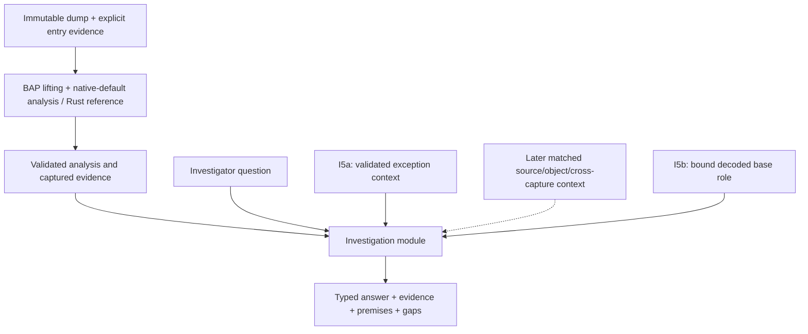

# Fault-address investigation design

## Context and follow-up

**Status.** The first fault-address explanation is implemented. The retained
[Windows correctness re-pin](workload-performance-design.md#windows-investigation-replacement) and subsequent
[performance qualification](workload-performance-design.md#native-investigation-qualification) qualify the exact
98-instruction replacement query under their recorded source/tool/dependency
identities. The distinct zero-address and zero-base-plus-displacement questions
are implemented within their finite profiles; address-wrap remains selected,
with implementation and qualification pending. On 2026-10-11, the user relaxed
the frame-to-frame question to listing fewer than `NP` possible paths. The
bounded frame-path contract below now has source implementation for a finite
Windows AMD64 captured-unwind profile, separate API/report/CLI and finite native
parity checks. Remote model/mutation and real full-dump qualification remain pending.

**Why this document exists.** The [real-capture slice](file-reader-design.md#historical-controlled-chromium-capture)
provides possible origins but leaves their explanation to the investigator.

**What this document establishes.** The design and implemented contract for
selecting a captured memory-address operand and explaining its possible earlier
byte definitions. Query identity, claims, report fields, publication, limits
and qualification preserve alternatives and missing premises. The frame-path question adds bounded structural alternatives with frame evidence.

**Where to go next.**

- [Implementation ledger](../../Plans/investigation-layer.md) — delivery stages,
  selected address-wrap work and later questions.
- [Memory provenance refinement](memory-provenance-refinement.md) — implemented
  Scanner diagnostic separation, bounded writer assessment and backward scalar
  inference; full model/mutation/Scanner qualification remains pending.
- [Frame-path ledger](../../Plans/investigation-layer.md#bounded-frame-path-question)
  — the selected strict path-count bound, frame anchors and resource limits.
- [Frame-path implementation plan](../../Plans/frame-path-enumeration.md)
  — F0–F4 contract, captured unwind profile, bounded enumeration and validation.
- [Zero-address design](zero-address-design.md) and
  [zero-base-plus-displacement design](zero-base-offset-design.md) — distinct
  delivered numeric predicates, evidence and contracts.
- [Address-wrap design](address-wrap-design.md) and
  [implementation plan](../../Plans/i5c-address-wrap.md) — selected arithmetic
  predicate, inherited admission limits and pending qualification.
- First delivery record and
  correctness repairs — historical
  source/fixture evidence and the limit-exhaustion repairs, with the
  [completed repair plan](../../Plans/completed/investigation-correctness-fixes.md).
- [Windows replacement plan](../../Plans/i4-windows-repin.md),
  [performance design](workload-performance-design.md#investigation-performance) and
  [qualification](workload-performance-design.md#native-investigation-qualification) — active exact-query correctness
  and independent timing clauses.

**What remains unresolved.** The Windows replacement met its unchanged 2 s
CLI limit at 1,692.696 ms in the retained performance campaign. Controlled
Windows zero-address is [qualified under its pinned setup](zero-address-design.md#native-qualification),
and zero-base-plus-displacement has [finite corpus qualification](zero-base-offset-design.md#retained-qualification).
Later source/tool changes require renewed or complete identity-verified evidence.
Object/source context, historical execution and cross-capture questions remain
open. The bounded frame-path implementation admits a finite captured-unwind profile
and separately bound instruction graphs; general unwinding and broader capture
qualification remain open. Full-memory capture alone does not supply a trace.
Possible producers and numeric conclusions do not prove a UAF, executed
path or general root cause.

For wider navigation, see the [documentation map](../documentation-map.md).

The original proposal against `7de5a1e` on 2026-10-01 and first repairs through
`c9eb4c5` on 2026-10-02 are historical source checkpoints. Their records do not
independently qualify a later checkout.

## Product position

Ariadne's current local recovery, reaching-definition and slicing algorithms
overlap BAP's analysis scope. BAP is an extensible binary-analysis framework
with disassembly, intermediate representations and analysis passes. Its
[standard-library overview](https://binaryanalysisplatform.github.io/bap/api/master/bap/Bap/Std/index.html)
and [graph solver](https://binaryanalysisplatform.github.io/bap/api/master/graphlib/Graphlib/Std/Graphlib/index.html)
support that characterization. The conclusion that these primitives can host
Ariadne's algorithms is an architectural inference, not a demonstration that
a standard BAP analysis reproduces Ariadne's exact contracts.

Ariadne is not a literal product subset: captured-only reads, immutable snapshot
identity, explicit uncertainty and source-bound validation are specialized
contracts. However, reproducing general analysis primitives should not be its
main product identity. The design centers on **crash investigation with
inspectable evidence and qualified explanations**, using BAP for analysis
mechanisms as they become accepted for the captured workload.



The current first-question implementation consumes the native-default or Rust-reference pipeline's
completed facts. Dashed inputs in the diagram are proposed capabilities.
The separate [Stage 2 migration](../../Plans/bap-integration.md#stage-2-bap-analysis-core)
now supplies the default native analysis. Moving that computation is
infrastructure work; the delivered zero-base-plus-displacement question is a separate domain capability.

## First question: explain a fault-address operand

Given a captured faulting instruction, a selected memory operand and an
explicit earlier entry, answer:

> Which earlier definitions could contribute to this address, what captured
> evidence supports them, and what prevents a stronger conclusion?

The implemented first question reuses the normalized request, reaching-definition
map, slice, captured reads and semantic evidence. It adds neither another
CFG/dataflow solver nor a speculative entry-point detector.

For a store through `[RAX]`, the answer identifies its address inputs,
groups possible origins for the relevant RAX bytes, relates them to captured
producer instructions, and explains entry-origin or opaque-call alternatives.
For an indexed address, retain base/index/scale/displacement relationships.
An unsupported operand shape receives an explicit unavailable explanation;
the module must not guess from the last recorded register values.

This produces an explanation of possible dependencies, not an actual executed
instruction sequence or proof that the faulting memory operation committed.

## Investigation module and interface

The [Rust source-layout consolidation plan](../../Plans/completed/rust-source-layout.md)
places the implemented module in `src/investigation/` within the root Cargo
package. Its initial
interface consumes a bound normalized investigation context produced from the
validated prepared analysis and completed analyzer. The concrete adapter is `input::investigation::bind_investigation` in
`src/input/`; investigation must not depend on input or reports. This preserves
the responsibility boundary when CLI and reporting modules use its results.

`AnalysisResult` stores snapshot identity without the complete query. The
implemented binding therefore compares the prepared request with the completed
analyzer's original request before consumption. Preparation now also retains
typed address-use evidence from admitted BIL. These I0–I1 prerequisites are
implemented; the binding and result contract below describes their checks.

The implemented interface is:

```text
bind_investigation(prepared, completed_analyzer) -> BoundInvestigation
explain_fault_address(bound_investigation, question, ExplainLimits) -> Explanation

question:
  instruction VA
  selected memory-access index

explanation:
  snapshot/query/tool identity
  question and supported scope
  address-expression facts
  possible producer origins grouped by location/byte
  claims with evidence references and premises
  unresolved alternatives and gaps
  evidence requirements for stronger answers
```

The CLI contract below distinguishes the implemented first question from later
proposals. Explanation budgets preserve valid partial/unavailable output, including
zero budgets, as recorded in the [correctness repairs](#qualification-and-truncation-repairs). The
interface rejects mismatched snapshot/query identity and incomplete result
construction. It returns a typed result; formatting and file publication stay
with the existing reporting modules. Its tests use the same interface as callers.

This is intended to be a deep module: callers ask one domain question, while
the implementation handles provenance joins, location grouping, gap propagation
and explanation construction. Do not publish the internal graph traversal or
one interface per primitive operation. Do not introduce a general analysis
adapter interface with only a hypothetical BAP-core implementation behind it.
The current normalized requests/results are the initial input seam.

## Evidence and claims

| Record | Meaning |
| --- | --- |
| Evidence | An observed captured byte span, metadata/register observation, or explicitly supplied external artifact, with source identity and location. |
| Analysis fact | A derived graph, effect or origin fact, bound to the exact semantic producer, projection, query and stated assumptions. |
| Claim | A question-specific assertion supported by evidence/facts and explicit premises. |
| Alternative | A possible explanation not eliminated by the available evidence. |
| Gap | A missing capture, conflicting byte, unsupported lift, unresolved target, opaque call, uncertain memory alias or missing premise. |
| Evidence requirement | A concrete observation/artifact/semantic refinement required to strengthen or distinguish a claim. |

The implemented claim classification is **observed**, **derived under premises**,
or **unknown**. The [I5a assessment](zero-address-design.md) uses separate
hypothesis conclusions in its separate versioned assessment; it does not silently extend
the current strict v1 classification. Its numeric conclusion remains derived
under premises. Do not use unsupported numeric confidence or label a
model-relative conclusion as a historical fact.

The table describes the broader domain vocabulary. Current first-question
evidence is captured instruction/projection evidence. I5a adds explicit
exception-context observations, while matched external source/object
context remains later work.

Every claim must be traceable to stable evidence/fact IDs. These IDs include
the owning snapshot/artifact and scope; equal VAs in different captures must
not join. A complete byte-origin set does not prove that all bytes came from
one producer along one feasible path. Preserve joins and mixed-byte origins.
Generic `memory:any` dependencies cannot become object-specific lifetime facts.

Captured module metadata and matching symbols/source may explain identities
or supply an independently justified entry witness. They cannot fill missing
runtime instruction bytes or silently establish binary/source correspondence.
External context must record its match evidence and role.

## Binding and result contract

Schema: **`ariadne.fault-address-explanation/v1`**. The request is a captured
instruction VA and an explicit memory-access index in the prepared query.

The input adapter checks prepared request equality with a completed analyzer,
snapshot identity, recomputed query entries/seeds/limits digest, site/read byte
agreement and evidence domains. It includes helper/runtime/AST/projection hashes
in semantic-profile binding. The owned `BoundInvestigation` has read-only
identity access; it stores the exact request/state and normalized evidence.

Address-use evidence is extracted from admitted typed BIL. The currently
supported expression is modular 64-bit affine arithmetic over **before-instruction
GPR values**, with constant, base/index coefficients and signed displacement.
RIP-relative expressions use the captured instruction VA, not a crash-register
pre-state. Sequential BIL assignments resolve architectural/virtual temporaries.
Unsupported casts, nonlinear/conditional expressions or loaded-address values
retain explicit gaps. Address inputs exclude store payload inputs.

| Explanation field | Meaning |
| --- | --- |
| `identity`, `scope_id` | Snapshot/artifact/query/request/semantic-profile identity and canonical content digest. |
| `question` | Canonical instruction VA and memory-access index. |
| `status` | `explained`, `partial` or `unavailable`; `explained` cannot carry gaps or truncation. |
| `address` | Selected access role/width, bounded expression, address input cells and BIL attribution. |
| `origins` | Per-byte/location alternatives from the core reaching map before the queried instruction. |
| `evidence` | Captured bytes, semantic identity and contributor dump offsets, scoped to the investigation. |
| `facts`, `claims` | Typed assertions and content-addressed references. Possible producers/dependencies are always `derived_under_premises`. |
| `gaps`, `evidence_requirements` | Concrete unmet evidence/semantic requirements, including affected locations where known. |
| `assumptions`, `truncated` | Scope of claims and explicit exhaustion of explanation limits. |

Claim kinds are captured instruction, address inputs, possible origin, dependency
and uncertainty. There is no confirmed-root-cause or actual-execution assertion.
Captured bytes are `observed`; semantic dependencies are `derived_under_premises`;
unmet requirements are `unknown`. Serialization rejects duplicate/unknown fields,
noncanonical VAs/bitvectors, unsupported kinds, wrong content/scope IDs, dangling
references and impossible completeness/classification.

Default finite limits: 4,096 evidence records, 32,768 origin links, 8,192 visited
dependency nodes and 65,536 claims. Exhaustion marks the answer partial/truncated
and identifies the limit. These limits are not a scale qualification; large
record/render costs remain subject to workload measurements and input limits.

Zero is valid for each limit. An exhausted budget never relaxes reference or
identity validation: a producer is retained only with its origin fact and any
required instruction evidence. If the selected site's evidence cannot be kept,
the answer is `unavailable`, `truncated=true`, with no selected address or origins
and an explicit budget gap. When that evidence and a supported address are kept
but expansion is incomplete, the answer is `partial`, `truncated=true`.
Invalid question sites/access indices still fail independently of budgets.
The [correctness-fix plan](../../Plans/completed/investigation-correctness-fixes.md) describes
the boundary regressions and qualification repair.

## CLI and publication

The question adds its instruction to slice seeds, **never entry roots**. Example:

```sh
target/release/ariadne-minidump tests/input/fixtures/stage_b_linux.dmp \
  --decoder-reference target/ariadne-llvm-mc --entry 0x401000 \
  --explain-fault-address 0x401006 --memory-access 0 \
  --explanation-only --format json
```

`--explanation-only` requires `--format` and no stateflow input. Ordinary report
modes retain the original report and add an explanation envelope/text section.
Output-directory mode stages original reports and `explanation.txt`,
`explanation.json` and `explanation.dot` together. DOT retains the full typed
explanation in its metadata comment as well as evidence/fact relationships.

A complete possible-origin explanation is not a historical trace or a proof
that an instruction retired. Mixed bytes do not establish one co-occurring
whole-pointer producer. Opaque-call alternatives and `memory:any` uncertainty
remain visible; no UAF/object lifetime or numerical confidence is inferred.

## Qualification budgets and records

The first-question qualification contract measures binding, explanation and all-format rendering on
both platform fixtures, the controlled NOT chain and the retained 34-instruction
Linux case using one warm-up/five release repeats. The frozen **incremental
phase median ceiling is 250 ms for that 34-instruction query** for I4 acceptance;
this is an explanation-layer budget separate from the preserved 2,000 ms
condition for the active real Windows query. The user-authorized
[replacement](workload-performance-design.md#windows-investigation-replacement) retires the missing original Electron
artifact as an active obligation while preserving its historical records. The
Linux phase benchmark uses the Rust reference analysis; active Windows CLI
qualification verifies native BAP receipts and 98 decoded starts. Neither budget is a universal
worst-case bound.

The operational workload and acceptance records use
`ariadne.investigation-workload/v3` and
`ariadne.investigation-first-delivery/v2`. This does not change the explanation
schema above. The active case ID/digest, complete source/tool inventory and
qualification environment must match; older workload records cannot qualify the
replacement. Windows qualification is recomputed from identity-bound release
CLI **explanation-mode** samples, excluding warm-up, with at least five measured
repeats. Missing, malformed or over-budget measurements cannot grant full I4
acceptance; base-mode or phase-only timings cannot substitute.

`windows98Qualification` reports `unavailable`, `invalid`, `over-budget` or `met`,
plus the checked/valid flags, sample count, median and fixed budget. The aggregate
`fullI4RealCaptureAcceptance` additionally requires passing gates and source/tool
stability. The narrower `passed` field still describes the exercised implementation
and fixture/Linux tier. Legacy records lacking the required measurement evidence
cannot establish full Windows acceptance.

## Higher-level questions after the first slice

| Question | Additional evidence or implementation needed |
| --- | --- |
| Does the selected access start at virtual address zero? | The [implemented I5a contract](zero-address-design.md) binds validated exception-context operands and exact site/access association under the admitted scalar MOV profile. Controlled Windows acceptance is recorded in the [native qualification](zero-address-design.md#native-qualification). No null-pointer root-cause claim. |
| Is the fault-time encoded base zero with a nonzero displacement? | Implemented [zero-base-plus-displacement design and contract](zero-base-offset-design.md) and [B0–B5 plan](../../Plans/i5b-zero-base-offset.md); simple base/displacement profile, decoded-role evidence and valid context. [Aggregate qualification](zero-base-offset-design.md#retained-qualification) passes within the declared finite corpus; historical null derivation is outside its claim. |
| Did the selected base-plus-signed-displacement calculation wrap? | Selected [I5c design](address-wrap-design.md) and [W0–W5 plan](../../Plans/i5c-address-wrap.md), with all implementation/model/capture stages pending. Lower-range fault admission limits v1 definite answers to upper wrap and no wrap. |
| What about historical null derivation, earlier arithmetic errors or noncanonical addresses? | Separate later hypotheses with their own definitions and architectural/context premises; the selected I5c question does not establish historical execution or general canonicality. |
| Which possible producers and inputs contribute to the selected address operand? | Delivered by the [first-question contract](#binding-and-result-contract). Selecting the actually executed alternative still needs additional evidence. |
| Is a use-after-free or object-lifetime violation supported? | Object identity and lifetime evidence such as retained allocator/runtime events; a suspicious pointer or slice alone is insufficient. |
| Which branch alternatives remain possible under known facts? | Accepted transition relations and completeness premises; retain unknown feasibility where these are absent. |
| Can fewer than `NP` possible paths be listed from frame N toward frame M, with `N >= M >= 0`? | Implemented [bounded frame-path contract](#bounded-frame-to-frame-path-listing) within the finite Windows AMD64 captured-unwind/direct-call profile. Source/fixture and finite native parity checks pass; remote model/mutation and real full-dump qualification remain pending. |
| What differs between two captures of the same investigation? | Explicit build/symbol/snapshot matching; no joins by naked address or assumed chronology. |
| What evidence would distinguish two explanations? | Concrete unresolved predicates and their required observations, not an invented historical trace. |

This roadmap adds domain questions above existing analyses. It does not claim
automatic root-cause proof, backward execution reconstruction or unbounded
cross-thread reasoning. Those require separately supported evidence and models.

## Bounded frame-to-frame path listing

### Selected question and count bound

The user-selected relaxation on 2026-10-11 asks:

> For one captured thread, list a bounded set of possible instruction paths
> from frame N toward frame M, where `N >= M >= 0`, returning fewer than `NP`
> paths and reporting the scope and reasons for incomplete enumeration.

`N` and `M` are frame indices, optionally displayed in hexadecimal, rather than
instruction VAs. Frame 0 is the selected thread's innermost captured frame;
larger indices identify older caller activations. Bind both indices to the same
snapshot, thread and validated frame chain. Equal function addresses in recursive
activations do not identify the same frame.

`NP` is a positive integer and a strict upper bound on the returned list:

```text
0 <= returned_count < NP
max_returned_paths = NP - 1
```

For `NP = 10`, return at most nine paths. `NP = 1` allows a zero-capacity list;
it cannot establish that no paths exist. Reject `NP = 0`, invalid frame ordering
or out-of-range frame indices before budget handling. The count bound limits
retained distinct paths, not the total number of program paths or search steps.
The explicit CLI mode is `--list-frame-paths N:M --path-count-bound NP`.
Frame indices outside a recovered prefix remain unavailable when unwinding
stopped on missing evidence or a budget; they are rejected as out of range
only when the declared chain boundary is established.

### Frame evidence and instruction anchors

A frame chain is derived from captured thread/exception context, stack bytes
and accepted unwind information. Full-memory capture may provide more bytes,
but does not supply historical contexts for every frame. Each frame record must
retain its unwind method, validity, stack slots, source spans and module/build
identity. Missing unwind data, corrupt return addresses, unsupported tail-call,
inline or exceptional frames remain explicit gaps rather than guessed links.
The [reader scope](file-reader-design.md#decision-and-supported-scope) now includes
a finite opt-in Windows AMD64 captured-unwind adapter. General unwinding remains
outside delivery. It reads captured PE32+ headers, complete sorted runtime tables,
v1 ordinary-body PUSH_NONVOL, ALLOC_SMALL/LARGE, SET_FPREG and SAVE_NONVOL/FAR
recipes and stack slots. Prologues, epilogues, chained/handler/XMM/machine-frame
recipes and unmatched/JIT modules stop explicitly. Unannotated leaf recovery
uses the stated Windows ABI and complete-table premises. Essential missing
thread/context records are input prerequisites, not zero-valued frames.

For `N > M`, the default start anchor is frame N's verified call site
that created frame N-1. The end anchor is the selected captured PC when `M = 0`,
or frame M's verified active call site toward M-1 when `M > 0`. Call-site anchors
are before the call instruction; a path ending there does not include its call
into the younger frame. A saved caller return address is a resume address after
the active call, so it must not be treated as a forward-execution start point.
For `N = M`, identical validated anchors may yield one zero-edge path, subject
to the count bound; different endpoints require an explicit within-frame query.

Bind each call site to captured decoded bytes and its return continuation;
do not guess a fixed instruction length or resolve an indirect target from a
return address alone. An unknown call site or missing endpoint evidence makes
that question unavailable, with the required evidence recorded. External
symbol/unwind artifacts need the reader's explicit matching/trust contract;
they cannot replace missing captured instruction bytes automatically.

### Meaning of a listed path

A listed path is a structural instruction sequence through activation-scoped
graphs, with typed edges and validated active call transitions N to N-1 through
M. Its steps use `(frame identity, instruction VA, edge kind)` so recursion and
parallel structural edges remain distinct. Preserve the endpoints, intermediate
frame constraints, instruction evidence, unresolved premises and path identity.

The current core treats call-only edges as visible context and follows local
summary edges. Cross-frame enumeration therefore needs a separate, evidence-bound
composition layer; it cannot silently reinterpret the existing core graph as
an executed interprocedural trace. Reuse completed local facts, and identify any
additional per-frame preparation as a separate bound query with explicit roots.
Other calls may remain explicit opaque summary steps. Such a path does not list
the instructions inside those callees or prove that the call returned.

Structural alternatives with unknown feasibility remain eligible. Refute a
branch only using accepted, correctly scoped semantics and observations;
crash-time flags or GPRs cannot be substituted for earlier branch inputs.
Recoverable saved registers carry per-register provenance and validity, not a
complete historical register file. A listed path is `derived_under_premises`,
and is not an observed executed path or proof of a particular memory writer.

### Enumeration and resource limits

Use deterministic bounded traversal with a declared edge order and distinct
path identities. Check budgets before expansion or allocation. Independently
bound expanded search states, scanned edges, steps per path, visits to a node
within one activation, retained frontier bytes, output bytes and elapsed time.
Preparation, frame validation and graph construction need their own input/work
limits; the final path-count cap cannot protect those earlier stages.

Stop at the first applicable boundary: exhausted frontier, `NP - 1` retained
paths, search/edge/depth/loop budget, byte limit, deadline or missing evidence.
Record cyclic frontiers without unrolling indefinitely. A loop-visit cap is a
declared search restriction, not evidence that additional loop executions were
impossible. Numerical information loss stops the affected value inference;
structural path search may continue within its independent budgets.

The separate `ariadne.frame-paths/v1` result retains:

- Exact snapshot/thread/frame-chain, query, anchor, graph and evidence identities.
- `NP`, all search/retention limits and the explicit loop/summary scope.
- The listed paths and `returned_count`, satisfying the strict count bound.
- Search counters, whether enumeration was exhausted, `truncated`, stop reason,
  unresolved frontier summaries and evidence gaps.
- Whether coverage is complete within the declared scope, partial or unavailable.

A total path count is known only after exhaustive enumeration within a closed,
declared scope. Reaching the list cap does not establish that another path exists
without a witness, or that no more paths exist. Missing control targets and
opaque-call interiors prevent claims about all concrete instruction paths.
Partial or unavailable empty lists never imply that the frames are disconnected.

### Relationship to memory-writer assessment

Frame evidence can restrict active call contexts and support additional scoped
register relations. The displayed paths are a bounded sample of alternatives;
a writer absent from that list must not be excluded merely because its path was
not retained. A writer exclusion still needs a proof covering every represented
relevant access/instance, including unresolved paths, under the
[memory-refinement contract](memory-provenance-refinement.md#assess-access-pairs-over-the-completed-analysis).

### Implementation and acceptance boundary

The [F0–F4 implementation plan](../../Plans/frame-path-enumeration.md) records
the implemented model source, finite captured unwind profile, API/CLI and
validation work without extending an existing report schema. The
[source-bound validation record](../../evidence/Ariadne/frame-paths/source-validation.json)
separates passing finite tiers from pending full qualification;
the [investigation ledger](../../Plans/investigation-layer.md#bounded-frame-path-question)
records that prerequisite. Independent controls must cover a two-way diamond,
insufficient list capacity, `NP = 1`, malformed `NP`/frame indices, equal endpoints,
recursive activations, loops, uncertain indirect calls, opaque summaries, missing
unwind/bytes and each independent resource boundary. In particular, a truncated
path list must never justify deleting a possible memory writer.

## Acceptance

The delivered first slice retains the following regression criteria: an
independent observer must be able to verify every producer claim against the
retained inputs/results, and negative cases retain their uncertainty. Required
cases include different snapshots sharing a VA, mixed partial-register origins,
a branch join, a weak memory dependency, an opaque call, missing seeds,
unavailable/conflicting capture and an unsupported address operand.

Mutations must detect fabricated actual execution, discarded alternatives,
cross-snapshot evidence joins, suppressed call/memory uncertainty and unsupported
root-cause labels. Rendering preserves the same claim/evidence relationships
in text and machine-readable output. A retained case must show an actionable
explanation beyond the raw slice, with measured cost.

The historical [investigation repair evidence](#qualification-and-truncation-repairs)
records 17 passing gates, valid budget truncation and enforced Windows latency
qualification logic. It did not establish full original-Windows acceptance.
The later [replacement correctness record](workload-performance-design.md#windows-investigation-replacement) and
[performance qualification](workload-performance-design.md#native-investigation-qualification) establish acceptance
for the exact 98-start replacement query, with a 1,692.696 ms native explanation
CLI median and 182.924 ms sum of Linux phase medians. The missing original
Electron artifact remains historical and is not qualified by replacement data.

The [BAP-only record](bap-analysis-core-design.md#bap-only-delivery) and native-core qualification
remain bound to their recorded scope and identities. The independent ISA-step
track is [retired](semantic-assurance.md); removing it does not promote any
remaining evidence to universal correctness or packaged-release acceptance.

## Retained delivery evidence

These dated records retain their source/tool identities and original decisions.
They are historical evidence, not fresh tests of this documentation checkout.
The [implementation ledger](../../Plans/investigation-layer.md) and
[evidence guide](../../evidence/Ariadne/README.md) explain stage scope and reuse.

| Record | Exercised scope and retained decision | Limits and successor |
| --- | --- | --- |
| First delivery after `7de5a1e`, [16-gate record](../../evidence/Ariadne/investigation-validation.json) | Both platform fixtures and controlled Linux capture passed; nested 12-gate Stage E regression and 11 actual producer/adapter/claim mutants passed with stable sources. | Full original-Windows acceptance remained false. The active replacement and its later performance qualification own the successor result. |
| 2026-10-02 repairs, [17-gate record](../../evidence/Ariadne/investigation-correctness-validation.json) | 123 stable source hashes; nested 12-gate Stage E and 11-gate minidump campaigns; 13 actual mutants plus two Python acceptance mutants detected. | Original-Windows artifact remained missing. Controlled decision tests provided no real-Windows timing credit. |
| 2026-10-05 [Windows replacement](workload-performance-design.md#windows-investigation-replacement), followed by [performance qualification](workload-performance-design.md#native-investigation-qualification) | Correctness on the exact 98-start replacement; later native explanation CLI median 1,692.696 ms and Linux phase total 182.924 ms met the fixed 2,000/250 ms budgets. | These records cover their own source/tool/dependency inventories and finite queries; they do not qualify the missing original Electron capture. |

The first platform fixtures identify the earlier MOV as a possible RAX-byte
producer with retained dump offsets, exclude the unrelated RCX write and keep
the upstream RBX entry-origin gap. The NOT case includes both the NOT producer
and upstream MOV. Alias/self-move, branch joins, opaque calls, weak memory,
query mismatch, absent/conflicting capture, missing seeds, strict reports and
transactional publication are exercised. An answer remains partial when earlier
input provenance is unavailable; mixed byte groups do not prove one whole-pointer
history.

The controlled Chromium/Linux query retained 34 decoded sites, 45 edges,
a 28-site slice and one recovery obligation. Its explanation has eight RBX-byte
groups, 28 captured instruction records, 4,168 typed claims and 37 gaps, including
possible producer `0x0000566817922de6`. A known trigger or fixture name supplies
no UAF claim. First-delivery phase medians were approximately 1.12/86.86/65.21 ms
for binding/explanation/rendering (about 153 ms combined); full CLI medians were
about 1,408 ms base and 1,626 ms explanation. Raw
[CLI samples](../../evidence/Ariadne/investigation-cli.csv) and
[phase samples](../../evidence/Ariadne/investigation-phase.csv) retain variance,
RSS, counts and hashes. The repair run separately measured about 159 ms combined,
1,355 ms base CLI and 1,535 ms explanation CLI. These runs neither prove a
speedup nor bound arbitrary workloads.

The first [manifest](../../evidence/Ariadne/investigation-evidence-manifest.json)
and [archive](../../evidence/Ariadne/investigation-evidence.tar.gz), and repair
[manifest](../../evidence/Ariadne/investigation-correctness-evidence-manifest.json)
and [archive](../../evidence/Ariadne/investigation-correctness-evidence.tar.gz),
preserve derived reports, gate/mutation logs, measurements and output comparisons.
Raw real minidumps, runtime archives and build caches remain external.
The missing historical Windows artifact was 2,028,400 bytes with SHA-256
`4b3deb70134015ec227b3cf5edf82e1dac0b308b3f19ae62f79cbd4251109e86`.
Its failed/unavailable flags remain unchanged; synthetic fixtures did not
substitute for its acceptance. The formerly recorded ISA-step count of 0/49
belongs to the now-retired track and is not an active gate.

## Qualification and truncation repairs

The repaired acceptance path recomputes the Windows median from identity-bound
raw measured explanation-CLI samples and checks the supplied summary. It rejects
base-mode or phase-only substitution, missing/malformed/insufficient samples,
wrong identities, unstable sources/tools and legacy incomplete records. Tests
cover the original 9,000 ms falsely accepted against 2,000 ms, threshold equality,
gate/source failures and both runners through controlled subprocesses. The two
Python mutants bypass the threshold or trust the reported median; both fail
unchanged observers. These tests validate acceptance logic, not capture timing.

The explanation builder admits each fact/claim atomically, appends producers
only when required records fit and stops dependent expansion at exhaustion.
Existing claims can be reused without another slot; the strict validator was
not weakened. Selected evidence omitted means unavailable/truncated with no
address/origins; a retained supported address with incomplete expansion means
partial/truncated. Zero limits remain valid and invalid sites/indices remain
errors. The 480 straight-line/cyclic boundary combinations exercise zero, one
and exact-fit budgets, round trips and all formats. All 24 normal outputs across
platform fixtures, the NOT chain and controlled Linux query remained byte-exact.
Compile failures and timeouts received no mutant-sensitivity credit.

The repair's root checks recorded formatting, default tests (72 passed,
53 ignored), core-only tests (45 passed, 22 ignored), all-feature/all-target
Clippy and a release build. Nested native/replay/mutation gates separately
exercised required tests; ignored ordinary tests were not counted as executed.

## Validation entry points

Run root checks and the domain runner with pinned native/model prerequisites:

```sh
cargo test --offline --locked
cargo clippy --offline --locked --all-features --all-targets -- -D warnings
python3 tools/check_investigation.py
```

Use the [snapshot-based reproduction](workload-performance-design.md#reproduction-and-retained-evidence)
for source/tool/dependency-bound qualification. The runner materializes the active
replacement; `ARIADNE_I4_WINDOWS_DUMP=/path/to/active-pinned.dmp` optionally supplies
an exact matching copy. The former original-dump variable no longer selects the
Windows case. Numeric assessment runners belong to the separate
[zero-address](zero-address-design.md#qualification-entry-points) and
[zero-base-offset](zero-base-offset-design.md#acceptance-scope) contracts.

## Frame-path implementation checkpoint (2026-10-11)

The source interfaces are `FileSnapshot::recover_thread_frames`,
`validate_thread_frames` and `prepare_frame_with_bap`, followed by
`bind_frame_paths` and `list_frame_paths`. Capture binding rechecks raw context,
unwind and stack receipts against the owning snapshot. Standalone decoding
recomputes the chain and path list under their recorded evidence premises;
`validate_for` additionally requires the same live bound inputs. Per-register
records distinguish top-frame observed context from caller values derived via
saved slots, preserved nonvolatile registers and unwind arithmetic. Earlier
volatile RAX/RCX values are not copied from the top context.

```sh
target/debug/ariadne-minidump DUMP --decoder-reference target/ariadne-llvm-mc \
  --list-frame-paths 0x2:0x0 --path-count-bound 10 --format json
```

`--thread-id ID` selects a thread; omission selects the captured exception thread.
`--frame-path-limits JSON` supplies strict `FramePathLimits`. The mode owns
explicit per-frame preparation roots and cannot combine with entry/seed,
stateflow, memory-access or another question mode. The selected analysis backend
remains native BAP by default, with `--analysis-backend rust` as the reference.
Output-directory mode writes `frame-paths.txt`, `.json` and `.dot`; ordinary
minidump output behavior remains separate. Frame indices are bounded to 0..63
and positive NP to 1..4097 in this initial profile.

Defaults are 8,192 graph nodes, 32,768 composed edges, 4,096 search states,
16,384 scanned edges, 256 instruction nodes per path, two visits per activation
node, 4 MiB frontier/output payload and a cooperative 1,000 ms search deadline.
Frame recovery separately bounds 64 frames, 4,096 runtime records per module
and 1 MiB requested read evidence. Opening/preparation and helper timeouts
remain separate bounds. These limits do not constitute a process RSS or
hard real-time guarantee. Too-small output budgets reject publication, including
formatted output larger than its byte cap.

The independent pre-runtime freeze covers 64 graph instances and exhaustive
sequence oracles. Fourteen synthetic PE/unwind/stack encodings cover recursion,
allocation widths, saved registers, frame pointers, missing bytes and unsupported
recipes. Source regressions also cover a captured null PC, metadata shape versus
budget stops, live rejection of a self-consistent context-offset forgery, typed
parallel edges, each work boundary, NP=1 and strict report tampering. The finite
pinned-runtime probe returns two alternatives on both diamond and recursive
fixtures with native/Rust report parity after removing observed elapsed time.

Model source and TLC configuration parse successfully without state exploration.
The [contract revision](../../evidence/Ariadne/frame-paths/contract-revision.json)
preserves the original freeze and corrects tuple-valued TLC configuration syntax
and terminal deadlock policy. Five real-code mutation seams are specified and
checked for unique applicability; their remote campaign is unexercised. Remote
model/mutation and actual full-dump qualification remain pending. General
unwinding, jointly reconstructed historical states and executed paths remain
outside the accepted claim.

## Frame-path property-based coverage

The opt-in `property-tests` Cargo feature adds pinned Proptest 1.9.0 with
automatic shrinking and persisted regression seeds. It is absent from default
and core-only dependency activation. These generated tests extend the finite
fixture checks; they do not qualify real full dumps, executed histories or the
pending remote model/mutation campaign.

Ten graph properties generate two to five nodes, up to eight typed edges,
cycles, parallel edges, path/visit limits and NP values. An independent oracle
constructs Cartesian words over edge IDs and filters them for connectivity,
endpoints and visit bounds; it does not reuse the engine's DFS/worklist. The
properties check exact bounded path sets, strict NP, capacity/work prefix
preservation, soundness under resource limits, input-order independence,
query-scoped IDs/live binding, nested/recursive frame composition, output byte
caps, report tampering and strict codec round trips.
These are normalized-graph contracts, not instruction-decoding conformance.

Three capture properties generate stack allocations from 8 to 128 bytes across
small and both large unwind encodings, full-width register values and context
validity groups. Independent on-disk layout and stack arithmetic establish the
expected return slots/caller SPs. They check volatile-register removal, observed
versus derived evidence, bounded recovery prefixes/read budgets and tampered
receipts against the live owning capture.

Each property runs 128 reproducible generated cases, for 1,664 cases in the
initial run. Graph and unwind seeds are fixed separately; failing cases shrink
for up to 4,096 iterations and persist under `tests/investigation/` and
`tests/input/` as `*.proptest-regressions` files for replay. Run:

```sh
cargo test --offline --locked --features property-tests --lib frame_paths::properties -- --test-threads=1
cargo test --offline --locked --features property-tests --test frame_unwind_properties -- --test-threads=1
```

The [property validation record](../../evidence/Ariadne/frame-paths/property-validation.json)
binds the generated suite and applicable root checks to their sources. Earlier
[frame-path validation](../../evidence/Ariadne/frame-paths/source-validation.json)
retains its original hashes and native/synthetic scope; adding properties does
not rewrite that historical evidence or grant full design acceptance.
