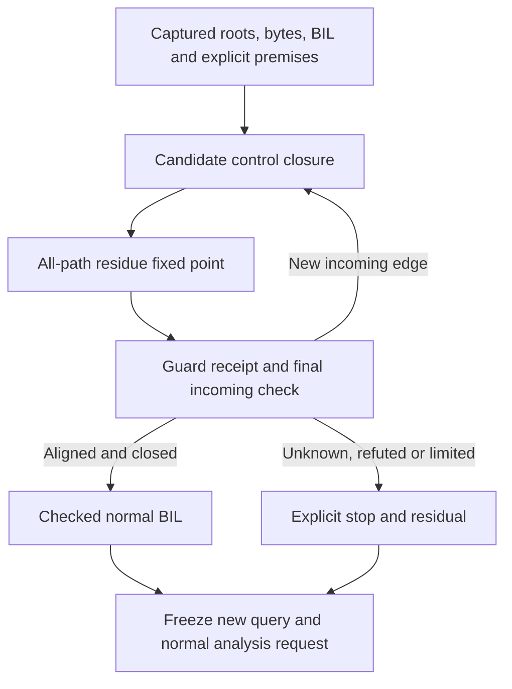

# Justified branch pruning and MOVAPS admission

## Context and follow-up

**Status.** G0–G4 first-delivery implementation and finite remote checks are complete on 2026-10-14. The original dated retry was unavailable at XORPS typed admission; the [shift-count correction](bap-shift-count-design.md#original-dump-retry-2026-10-14) resolves that stop. The initial guard-evidence cap motivated [G5 configurable budgets](../../Plans/completed/guard-budget-configuration.md), now implemented and finitely validated; the larger original caller still has incomplete candidate coverage. The later [request-budget delivery](bap-analysis-core-design.md#configurable-native-request-limit) admits its native request with an explicit larger budget. The
[G0–G4 execution plan](../../Plans/completed/justified-branch-pruning.md) records progress
and separate qualification. The selected first
delivery admits the reviewed MOVAPS normal outcome only with a checked alignment
proof. Handling both outcomes when alignment is unknown is a separate extension.

**Why this document exists.** The [finite vector admission extension](bap-analysis-core-design.md#vector-register-admission)
accepts XMM/YMM, but the [dump03958 retry](../../evidence/Ariadne/bap-vector-registers/20261013/report.md)
still stops at the lift's conditional `Exception(13)`. A later captured RSP
value cannot establish alignment at an earlier instruction automatically.

**What this document establishes.** The premise policy, finite predicate domain,
proof interface, discovery/publication rules, fault-effect distinction and
validation needed to remove an alternative only when it is impossible under
the declared analysis premises. Unknown is distinct from refuted.

**Where to go next.**

- [Guarded target-resolution composition](guarded-target-resolution-design.md) and its [C0–C6 plan](../../Plans/completed/guarded-target-resolution.md) address the nine unresolved dispatches while preserving independent remaining semantic barriers.

- [G5 configurable-budget execution plan](../../Plans/completed/guard-budget-configuration.md) releases the initial profile's fixed ceilings while preserving finite caller budgets and proof requirements.

- [Shift-count compatibility](bap-shift-count-design.md) diagnoses the later XORPS width stop and owns its authorized correction.

- [BAP integration](bap-analysis-core-design.md#projection) owns typed admission,
  projection, producer identities and native capture compatibility.
- [Frame-path contract](investigation-design.md#bounded-frame-to-frame-path-listing)
  owns activation anchors, structural alternatives and count bounds.
- [Existing stateflow design](../machine-state-design.md) classifies a frozen
  recovered graph; it is not a discovery prerequisite solver.
- [Formal-model guide](../../Specs/README.md) defines the active model authority.
  The [execution plan](../../Plans/completed/justified-branch-pruning.md) requires a frozen
  predicate-admission model and oracle before runtime changes.

**What remains unresolved.** General exception handling, page/protection faults,
precise vector values, arbitrary predicates, backward reconstruction of earlier
register values and historical execution remain outside the first delivery.
Runtime-table budgets and XMM unwind support are independent limits. This design
does not promise that dump03958 will yield frame paths after implementation.

## Decision and scope

Use one `GuardAdmission` module in the BAP preparation path. It checks supported
guard shapes, derives predicate facts from validated inputs, and returns a
decision with a replayable proof receipt. A caller cannot supply a Boolean
`aligned=true` or request that an exception be ignored.

Start with Windows AMD64 legacy 128-bit MOVAPS stores using an RSP-relative
address, and the reviewed pinned BIL shape. Restrict the first predicate to
16-byte alignment. Do not generalize admission to all exceptions, all printed
MOVAPS opcodes, AVX/AVX-512 memory forms or arbitrary BIL conditionals.

First delivery behavior:

| Predicate result at the instruction | Normal outcome | Alignment-fault outcome | Preparation decision |
| --- | --- | --- | --- |
| Proved aligned under recorded premises | Eligible for ordinary projection | Excluded under those premises | Admit the checked normal BIL and retain proof evidence. |
| Proved misaligned under recorded premises | Refuted under those premises | Represented `#GP` arm remains | Stop normal preparation; report the refuted normal outcome. |
| Unknown | Still possible | Still possible | Keep the stop and an explicit normal-or-fault residual. |
| Unreached, incomplete coverage or exhausted budget | No truth claim | No truth claim | No pruning or normal admission. |
| Invalid or inconsistent input premise | No truth claim | No truth claim | Reject the request/evidence; do not return a no-path conclusion. |

Unknown alignment therefore does not become unconditional fallthrough. A future
guard-aware profile can represent both outcomes, but must qualify the new
graph/effect contract separately.

## Instruction semantics and the pinned lift

The instruction at `0x00007ff7744033b3`, bytes `0f29b42440020000`, is:

```asm
movaps [rsp+0x240], xmm6
```

Its alignment predicate is `((RSP + 0x240) & 0xf) == 0`. Legacy MOVAPS moves
128 bits and requires a 16-byte-aligned memory operand; misalignment generates
`#GP`. This is a rule for the represented instruction outcome, not evidence
that an alignment fault happened in this process.
[Intel MOVAPS reference](https://www.intel.com/content/dam/www/public/us/en/documents/manuals/64-ia-32-architectures-software-developer-vol-2b-manual.pdf#page=51).

The [captured BIL](../../tests/bap/fixtures/vector/movaps-bil.json) contains:

```text
mem := Store128(mem, RSP + 0x240, low128(YMM6))
if ((RSP + 0x240) & 0xf) == 0:
    []
else:
    Exception(13)
```

The store precedes the guard in this pinned representation. The first delivery
may select the normal BIL only after proving that the exceptional arm is
unreachable under the declared premises. It must keep the original AST hash,
the selected normal AST hash, and the exact removed statement paths. It must
never mark an intermediate BIL store as an observed architectural write.

Before a later both-outcomes delivery, independently qualify the selected
instruction's fault effects and a reviewed transactional interpretation:

```text
aligned arm:    pending 128-bit store; commit on normal completion
unaligned arm:  alignment fault terminal; no completed normal store
```

Do not reorder arbitrary BIL or discard preceding effects for arbitrary
exceptions: some instruction families have partial effects. If this selected
fault-effect contract cannot be established, keep exceptional effects unknown.
An alignment proof also does not establish valid page permissions, canonical
addresses or absence of other faults. Retain the ordinary-memory-access scope
and do not advertise complete hardware transition coverage.

## Premises belong to an instruction point

Every seed fact names a snapshot, query, entry anchor and, when applicable,
physical frame activation. Premise origins are distinct:

| Origin | Eligible use |
| --- | --- |
| Captured register observation | At its exact captured instruction point and context only. Forward propagation is allowed from a root already bound there. |
| Derived captured/unwind fact | At the point and frame actually justified by the validated derivation. A recovered resume SP is not a function-entry SP. |
| Explicit ABI assumption | A conditional entry fact after validating the platform and function-entry anchor. Report it as assumed, not observed. |
| Derived predicate fact | A consequence of eligible entry facts, captured semantic transfers and complete incoming coverage. |

Do not add a root because a premise or slice seed names an address. Do not
propagate a crash-time observation backward into the caller's prologue. Do not
reuse a proof across recursive activations merely because the function VAs match.

The initial ABI policy is opt-in: `windows-amd64-normal-call-entry/v1`. It says
that each specifically bound root entered through a conforming normal call,
with entry `RSP mod 16 = 8`. Platform metadata or use of Windows unwind records
alone does not prove this adherence. The assumption must remain visible because
the investigation may involve corrupted stack state.

Microsoft documents 16-byte stack alignment with exceptions in prologues and
some function types, and describes the return-address push followed by the
callee's stack allocation. The entry residue above is the corresponding
conditional deduction for the selected normal-call policy, not a universal
claim about every PC or function. [Microsoft stack usage](https://learn.microsoft.com/en-us/cpp/build/stack-usage?view=msvc-170),
[prologue rules](https://learn.microsoft.com/en-us/cpp/build/prolog-and-epilog?view=msvc-170).

Do not infer balanced-call RSP preservation from an opaque call automatically.
Initial delivery havocs RSP across a call summary that may write it. A later
normal-return ABI summary needs its own explicitly selected contract.

## A finite alignment domain

Track sets of possible low-four-bit residues, not full RSP values:

```text
R ⊆ {0, 1, ..., 15}
top             = all 16 residues
join(R1, R2)    = R1 ∪ R2
add(R, c)       = {(r + c) mod 16 : r ∈ R}
subtract(R, c)  = {(r - c) mod 16 : r ∈ R}
havoc(R)        = top
```

Empty denotes no reached state, not a proof that any predicate is true. Conflicting
entry constraints must produce a separate inconsistency error. An unreachable
site is reported as unreached; incomplete discovery cannot certify unreachability.

For displacement `d`, compute `A = add(R, d)`:

```text
proved_aligned    iff reached ∧ coverage_closed ∧ A = {0}
proved_misaligned iff reached ∧ coverage_closed ∧ A ≠ ∅ ∧ 0 ∉ A
unknown           otherwise, when a represented state or missing premise remains
```

Derive transfers from admitted typed BAP assignments and supported temporaries.
Constant 64-bit ADD/SUB, stack pushes and identity transfers have simple finite
relations. They must be bound to their exact bytes and BIL, not guessed from
opcode spelling or CDB text. Unknown RSP writes, stack loads, unsupported
transfers or opaque effects widen to top. Never silently preserve RSP through
such a site. Conditional paths join by union; loops use ascending fixed-point
propagation. Ignoring ordinary branch feasibility is conservative for this
initial proof engine.

The domain is finite: on a fixed graph, at most 16 residue elements can be added
at each node. Graph growth and evidence collection need separate limits.

## Discovery must not certify its own missing predecessors

The present recovered graph stops at MOVAPS. Proving alignment over that prefix
alone does not establish that a later-discovered loop or another root cannot
reach the same VA with a different residue. A proof covering only one selected
prefix cannot authorize one unconditional instruction summary for all visits.

Preparation therefore has two separate graph representations:

1. A captured **candidate control skeleton** used to check closure and propagate
   predicate facts. At a recognized pending MOVAPS guard, it records the
   independently decoded ordinary continuation as a candidate and the alignment
   residual. This is not a committed instruction/effect or a new discovery root.
2. The final, immutable **admitted analysis request** consumed by the current
   native/Rust cores. A MOVAPS normal instruction enters this request only after
   its proof has passed the final closure check.

At a still-unadmitted guard, candidate RSP transfer havocs to top by default.
A more precise transfer, such as identity for this store, is allowed only after
an independent check of the exact reviewed byte/BIL shape proves it overapproximates
every candidate normal transition. That check must not depend on the guard
verdict or the selected normal projection being certified. Bind its own rule,
source and relation digest to the closure epoch and receipt. It supplies no
committed memory effect. This prevents a loop from making a guard proof depend
on that same proof's assumed normal effects.

Candidate discovery is still entry-driven and capture-only. Only the reviewed
pending alignment shape permits this provisional control enumeration; an
arbitrary unsupported BIL program does not obtain continuation from LLVM facts.
LLVM supplies decoded control facts, never effects or assumed predicate truth.

The preparation coordinator must:

1. Validate roots, premises, capture bytes and producer identities.
2. Build the candidate skeleton, retaining all represented incoming edges and
   an explicit residual for unresolved control.
3. Propagate residue sets to a fixed point over every represented local path.
4. Evaluate each recognized guard and build a tentative receipt.
5. Continue bounded candidate closure, invalidating dependent receipts whenever
   roots, transfers or incoming edges change.
6. Freeze only after candidate graph and fact closure, recheck every receipt
   against that candidate graph, then create one immutable admitted request
   and its final query identity using the noncyclic scheme below.

An unresolved indirect edge or control barrier that could re-enter a guarded
region makes that region's incoming coverage unknown. Conservatively widen its
facts; do not certify predecessor absence from an incomplete graph. Call/return
and external re-entry exclusions must agree with the declared local analysis
scope and remain explicit. A separate global/no-re-entry claim is not implied.

Never mutate a completed core analysis or reuse its query ID after premise or
proof changes. The existing [target-resolution design](indirect-target-resolution.md)
has a useful incoming-coverage invalidation pattern, but a target certificate
does not prove stack alignment.



## Interface, ownership and evidence

The implemented interface lives in `src/bap/guard_admission.rs`:

```rust
fn certify_guards(input: &GuardInput) -> Result<Report, Error>;
fn replay_report(report: &Report, expected: &GuardInput) -> Result<(), Error>;

// GuardInput: bound roots/premises, captured candidate skeleton,
// exact typed lifts and transfers, producer identity, policy and limits.
// GuardReport: predicate verdicts, checked normal selections,
// original exceptional residuals, proof receipts and coverage gaps.
```

Keep residue evaluation, supported-shape recognition and receipt replay behind
this interface. The preparation coordinator supplies facts and consumes decisions;
it must not duplicate the proof logic. Validation rejects forged/stale receipts
rather than treating a caller's verdict as a premise.

| Owner | Responsibility |
| --- | --- |
| `src/bap/guard_admission.rs` | Supported typed guard recognition, residue relation/fixed point, branch decisions and receipt replay. |
| `src/input/materialize.rs` | Candidate discovery, closure epochs, shared limits and freezing the final query. |
| `src/input/frame_paths.rs` | Bind frame activation/entry evidence; never invent earlier RSP observations. |
| `src/bap/prepare.rs` | After byte/control agreement, send the exact same checked normal selection to admission, projection and any semantic sidecar extraction. |
| `src/input/investigation.rs`, reports | Bind and render premises, verdicts, precision and original residuals. |
| Native `capture.ml` and handshake | Negotiate the new capture profile and validate the proof/source/effect binding before native analysis. |

A receipt must bind snapshot/artifact hash, query intent hash, roots and seeds, thread/frame
activation, exact premise origin and version, policy/limits, helper/runtime/
decoder identities, original site bytes/BIL hash and AST paths, selected normal
BIL hash, every supporting transfer, root/incoming coverage and graph epoch,
fixed-point residue facts, guard verdict and final normalized request digest.
Include a proof-rule/model version
and the checker identity. Changing any of them invalidates the receipt.

Replay the supplied fact map rather than trusting it: eligible entry states must
be included, and every predecessor transfer in the **candidate graph** must be
included in each successor's residue set, including candidate-only incoming edges
that never enter the final request. Replay unresolved-incoming barriers as top.
The set at the guarded site must be nonempty and all
included residues must satisfy the guard before normal selection is accepted.
An overapproximation is safe; omitted root or predecessor states are not.

Do not add unversioned fields to exact v1 report/capture codecs. Reserve a new
guard-receipt/capture profile and producer profile (`bap-bit-provenance-v5`) with negotiated
native support. Existing v4 remains the default until this opt-in path qualifies;
historical receipts retain their original identities. Use separate query intent
and final analysis identities so receipt binding is not circular:

```text
intent_id = H(snapshot, roots, seeds, activation,
              canonical actual premise instances, policy/model, limits)

request_hash = H(final normalized core request without final IDs/receipts)
receipt_i    = checked proof(intent_id, candidate_graph_hash/epoch,
                             source/transfer facts, verdict, request_hash)
analysis_id  = H(intent_id, request_hash, sorted receipt digests)
```

Policy alone is insufficient: different residue premises under the same policy
must produce different intent IDs. Build the final normalized request before
adding its hash to receipts; receipts reference intent ID and request hash,
never the final analysis ID that contains their digests. An envelope binds the
result to `analysis_id`. The native/report validators recheck both graph bindings,
the normal-selection/effect correspondence and the final request before publication.

## Effects and later both-outcomes support

For a proved-aligned normal selection, retain the original store's address and
payload uses, may-define `memory:any`, and leave its must-defs empty. Keep the
existing coarse vector-state precision gap. The proof grants no concrete XMM
value and no precise memory alias.

For unknown/refuted normal admission in the first delivery, do not publish the
pending store as a completed normal effect. Retain its potential normal write
as an unresolved alternative; a stop or empty path list cannot exclude a writer.

The later extension must model guarded normal transitions and fault terminals
with different committed effects. Keep structural normal edges intact and
classify their feasibility separately. A fault terminal has no target successor;
it is not an invented edge to address zero or an exception handler.

Existing [stateflow](../machine-state-design.md) can classify a frozen graph under
supplied transitions, but cannot repair the current stopped discovery on its
own. Its complete-transition declarations must not mark a site complete when
other memory faults remain outside the supplied semantics. No predicate proof
removes structural CFG evidence, narrows the core writer universe automatically,
or establishes historical execution.

## Worked conditional proof for dump03958

The [captured prologue](../../evidence/Ariadne/frame-paths/dump03958-20261013/cdb-call-unwind.log)
has eight pushes followed by `sub rsp,0x258`, before the MOVAPS store.
Under the explicitly selected normal-call entry premise:

```text
entry RSP mod 16                         = 8
after eight pushes: (8 - 8*8) mod 16    = 8
after allocation: (8 - 0x258) mod 16    = 0
store address: (0 + 0x240) mod 16       = 0
```

This is the desired certificate's arithmetic, not an already-issued certificate.
Captured, admitted BAP transfers and all-path incoming closure are still required.
CDB corroboration does not replace those transfers. With no entry premise, the
same fixed shifts leave top as top and alignment stays unknown.

If qualified, the selected normal outcome could allow discovery beyond
`0x00007ff7744033b3`. It does not prove reaching the call at
`0x00007ff774404108`, select an earlier branch outcome, or resolve a later
unsupported instruction. Runtime-table limits and `UWOP_SAVE_XMM128` remain
separate from this predicate behavior.

## Model, limits and acceptance

The frozen analysis-level model [AriadnePredicateAdmission.tla](../../Specs/AriadnePredicateAdmission.tla) was introduced before runtime changes. It covers premise validity, residue joins/transfers,
guard verdicts, closure epochs, receipt invalidation and final publication.
It asserts no pruning on unknown/unreached states, no stale publication,
no vacuous truth from empty entries, no fault-arm normal write, and preservation
of old origins for possible memory writes. It is not a revived ISA proof.

Bound candidate sites/edges, transfer evaluations, discovery rounds, residue
updates, receipt bytes and elapsed time. The finite residue domain does not
bound capture/graph growth. On any exhausted limit, report incomplete coverage
and retain the stop; never publish a partial-prefix proof as all-path coverage.
Choose numerical defaults in the reviewed implementation plan after sizing the
captured query, rather than copying a table/decoder limit silently.

| Required control | Expected result |
| --- | --- |
| Residues `{0}`, `{1}`, `{8}`, and top at the store | Aligned, misaligned, misaligned, unknown respectively. |
| ABI entry 8 plus this captured prologue | Conditional aligned proof with every supporting transfer and premise. |
| Same prologue without ABI premise | Unknown; no normal admission. |
| Joined aligned/misaligned paths or a loop changing RSP | Union facts; no false proof. |
| Opaque call, memory-loaded RSP or unsupported write | Havoc/widen to top. |
| New root or predecessor after tentative proof | Invalidate, recompute and reject stale receipt. |
| Unresolved indirect incoming or budget exhaustion | Coverage unknown; no pruning. |
| Empty/conflicting premise state, wrong snapshot/frame/PC | Inconsistency or binding error, not zero paths. |
| Changed displacement, width, bytes, AST, helper or normalized selection | Reject receipt or unsupported shape. |
| Added exception/special statement hidden in a discarded branch | Reject; proof does not excuse malformed/unreviewed BIL. |
| Literal store-first lift evaluated on fault arm | No completed normal store; arbitrary reordering forbidden. |
| Both-outcomes extension | Separate effects/terminals, preserved raw CFG, explicit other-fault coverage. |
| Native/reference/report tampering | Reject missing/mismatched premise, closure or effect receipts. |

Run model checks, portable oracle tests, pinned producer tests, native/reference
parity, mutation controls and the exact captured retry as distinct tiers.
Implementation validation must run Cargo/native/model campaigns in remote WSL,
with private replay/mutation build directories and a disk-space check first.
Each exercised tier and its remaining limits is recorded in the dated validation entry below.

## Source review before implementation, 2026-10-14

At the design baseline, the [admission checker](../../src/bap/admission.rs) validates both IF arms
before evaluation and rejects every exception leaf. The [projector](../../src/bap/projection.rs)
also rejects exception evaluation. A supplied residue alone cannot unblock either.
[Preparation](../../src/bap/prepare.rs) cleared ordinary continuations
on that failure; its post-byte/control-agreement seam is the place to integrate
the checked normal selection.

The baseline [query hash](../../src/input/materialize.rs) had no guard-premise policy;
[site evidence](../../src/investigation/model.rs) had no structured guard receipt;
native [capture admission](../../native/bap-core/capture.ml) uses exact field sets.
The implementation resolves those seams with coordinated versioned changes and keeps general exception admission stopped. Independent source reviews identified the
store-before-guard ordering and incomplete-incoming proof risk. Documentation
links are checked separately; this review is design evidence, not qualification.

## Usage and implemented contracts

For frame-path preparation, select the entry assumption explicitly:

```sh
ariadne-minidump DUMP --decoder-reference PATH \
  --list-frame-paths 1:0 --path-count-bound 10 \
  --assume-windows-call-entry --format json
```

The API is `FileSnapshot::prepare_frame_with_bap_assuming_windows_call_entry`,
which takes the validated chain, physical frame index, `function_begin`,
`FramePreparation` and `GuardAdmissionLimits`. Frame recovery and byte-read
budgets remain independent; the CLI does not enlarge runtime-table limits.
The ordinary preparation API uses the default producer without entry assumptions; the [shift-count correction](bap-shift-count-design.md) records current v6/v7 identities.

Guard-enabled preparation keeps original candidate bytes/BIL separately from
selected normal effects. `FilePreparedAnalysis::guard_admission()` exposes the
proof report; validation replays it against the immutable capture before binding
an investigation. Candidate-only instructions remain in the proof evidence.

Native input negotiates `captured-guarded-input/v1`. The helper checks model and
checker hashes, actual premises, candidate residue relations and predecessor
coverage, selected MOVAPS effects, final normalized request and analysis identity.
Guarded minidump reports use v3; guarded explanations and frame listings use v2.
Guarded explanation/frame codecs retain the structured proof and full normalized request, rejecting their removal or alteration. Guarded minidump rendering uses `input::report::render_bound` with a sealed completed analysis view; the raw `AnalysisResult` renderer rejects guarded input because it lacks query identity.
Historical v4 captures keep their original identity; ordinary report schemas retain their existing behavior.

The initial default limits are 4,096 sites, 16,384 edges, 131,072 residue updates,
262,144 transfer evaluations, eight closure rounds, 4 MiB evidence and a
cooperative 1,000 ms predicate deadline. A budget stop yields no alignment proof.

## Configurable guard budgets

The [G5 implementation plan](../../Plans/completed/guard-budget-configuration.md) implements the user-authorized release of hard guard-profile ceilings. The [captured budget diagnosis](../../evidence/Ariadne/guard-evidence-budget/20261014/README.md) found that the caller needs more than the initial 4 MiB, while Rust and native validation incorrectly used default budgets as maximum permitted budgets.

Keep current defaults for the seven `guard_admission::Limits` fields, but allow higher and lower caller-selected finite values. Typed Rust unsigned fields remain finite; configuration is no longer compared with `Limits::default()`. Native admission uses the existing checked unsigned-64 parser and unsigned comparisons, including values encoded beyond the OCaml signed-machine-integer range. Malformed, negative and unsigned-overflow inputs remain rejected. Zero continues to request the existing conservative zero-budget behavior.

The materializer and predicate checker still enforce the exact configured site, edge, update, evaluation, closure, evidence and deadline budgets. Native guard admission mirrors that policy and removes its additional absolute 8,192-site/32,768-edge checks. Full candidate closure, source replay, receipt validation and conservative handling of unknown or exhausted budgets remain mandatory. Resource configuration remains included in query and receipt identities. Producer semantics stay unchanged; exact checker/helper source identities distinguish this validator correction.

CLI guarded frame preparation accepts `--guard-admission-limits PATH` alongside `--assume-windows-call-entry`. The JSON object supplies all seven exact fields and is validated before preparation. Omission retains current defaults. API callers continue passing `Limits` directly.

For example, a 32 MiB evidence budget with larger graph/work budgets is:

```json
{
  "max_sites": 8192,
  "max_edges": 32768,
  "max_residue_updates": 262144,
  "max_transfer_evaluations": 524288,
  "max_closure_rounds": 16,
  "max_evidence_bytes": 33554432,
  "max_elapsed_ms": 10000
}
```

Save that object as `guard-limits.json` and add `--guard-admission-limits guard-limits.json` to the guarded frame command above. Increasing guard budgets does not implicitly increase reader, discovery or frame-recovery budgets; API callers configure those separately when the captured query requires them.

Guard budgets and independent native transport/recovery capabilities have different scopes. Native initialization sends one frame with a default 8 MiB budget, now configurable under the separate [request contract](bap-analysis-core-design.md#configurable-native-request-limit); normalized native recovery retains its address/edge representation limits. A larger guard budget can therefore encounter a separate explicit transport or recovery rejection. This stage does not change that protocol or promise a completed full-dump path list. Complete evidence and safe budget stops, rather than the original numerical defaults, determine predicate soundness.

## Implementation validation, 2026-10-14

The [source-bound validation](../../evidence/Ariadne/guard-admission/20261014/validation.json)
and [artifact manifest](../../evidence/Ariadne/guard-admission/20261014/artifact-manifest.json)
retain 275 hash-verified artifacts and 670 exact implementation/fixture/tool
source matches. All Cargo/native/model builds and acceptance campaigns ran in
a task-private WSL namespace on `windows-dev`. The source-only remote checkout
omits historical evidence and Lean files, so its documentation check was not
credited; the complete local checkout passed documentation navigation separately.

| Tier | Fresh result and boundary |
| --- | --- |
| Root Rust checks | Format, 175 default tests, 46 core-only tests, all-feature/all-target Clippy and layout passed. Other ignored suites retain their own prerequisite boundaries. |
| Pinned native | 12 kernel tests, nine producer tests, seven capture/parity tests and one frame-path test passed; the guarded fixture was also run separately. |
| Predicate model | Apalache 0.58.0 typecheck and 27 TLC 2026.10.06.014338 finite safety/fair-termination configurations passed. |
| Independent oracle | 56 graph/premise cases, three closure histories, 33 receipt controls and 720 numerical cases passed. |
| Guard mutations | Six separate mutants, seven exact passing-control/assertion-rejection pairs; private build trees and restored sources/observers. This retained Rust-only campaign remains byte-bound to unchanged runtime/library observers after later native corrections. |
| Existing generated native replay | 168 core and 162 stateflow observations matched; both wrong-digest controls rejected. This preserves core behavior and is distinct from predicate-model checking. |
| Original dump retry | Same original SHA-256, frame pair 1:0, NP=10 and capture-only expanded budgets; unavailable, zero paths. No full-dump path qualification. |

The [G0 freeze](../../evidence/Ariadne/guard-admission/g0-freeze-20261014.json)
preserves pre-runtime model/oracle identities, failed tool probes/typechecks,
annotation-only compatibility corrections and the later four-case zero-budget
oracle correction. Current successful evidence never rewrites the earlier
attempts as passes. Finite tests are not a universal implementation proof.

### Source-review corrections

Cross-review corrected stale query-scope reuse, exact candidate/final MOVAPS
continuation binding, opacity and independent typed-BIL validation before native
transfer narrowing, source-hole closure and the full undecodable stopped-guard
contract. Native set comparisons use set equality. Structural closure distinguishes well-formed ordinary opaque data with TOP transfers from malformed/control/hole barriers, and checks parsed AST emptiness rather than printed JSON whitespace. Report validation now binds
actual premises, full normalized request, captured bytes/original AST/producer
identities, selected normal effects/accesses and the sealed analyzed request.
Tests include fully rehashed hostile control/transfer and decoded-stop inputs, plus positive opaque-data/unknown-guard parity. Rejection does
not depend only on an outdated checksum. All confirmed findings are corrected.

### Captured retry and remaining boundary

Dump SHA-256 remains
`9be21e47453fec954857db52db7dfe3b8c5a5c6a49369d39a10eb701de9624ab`,
962,600,678 bytes, thread 23668. The default 4,096-entry runtime-table budget
still recovers one frame and stops. Explicit API limits cover all 440,520
entries / 5,286,240 bytes, recovering two frames before the unsupported unwind
operation. The default v4 run decodes nine caller and 768 callee instructions
but lacks the active call anchor; enumeration is unavailable.

The guarded run selects only `windows-amd64-normal-call-entry/v1`. Candidate
discovery continues beyond the reviewed MOVAPS, but preparation fails before
final closure at `BIL operand type/width mismatch`. No alignment receipt or frame
query is published. A separate captured-only decoded-control diagnostic locates
[the next blocker](../../evidence/Ariadne/guard-admission/20261014/artifacts/next-blocker.json):
`0x00007ff7744075b3`, bytes `0f57c0`, `XORPS xmm0,xmm0`. The
[exact pinned BIL](../../evidence/Ariadne/guard-admission/20261014/artifacts/next-blocker-bil.json)
contains a 128-bit left operand and an 8-bit shift-count expression at
`bil[3].value.rhs`; current binary-operand admission requires equal types.
This records the historical BAP/Ariadne compatibility stop. The later [shift-count diagnosis and correction](bap-shift-count-design.md) verifies that BAP permits independently sized shift counts and corrects Ariadne admission/projection and native validation. The diagnostic publishes no
normal effects, core request, guard verdict or historical path.

The guarded listing is `coverage: unavailable`, `stop: missing-frame-query`,
zero returned paths, `truncated=false`; it never searches a complete frame
query. Zero therefore does not mean no path exists. The recorded shift-width stop is resolved by the linked finite correction; general SIMD, larger guard-evidence contracts, XMM unwind, large-table CLI configuration, other faults, general
exception graphs and full release/performance qualification remain outside
this delivery. The [execution plan](../../Plans/completed/justified-branch-pruning.md)
records completion of the scoped stages and those exclusions.

## G5 budget configuration validation, 2026-10-14

The [completed G5 ledger](../../Plans/completed/guard-budget-configuration.md) and [source-bound qualification](../../evidence/Ariadne/guard-budget-configuration/20261014/README.md) record 686 matching source/tool/document hashes and 86 archived files. All final remote WSL gates pass: 14 guard controls, 189 default and 46 core-only tests, format/Clippy, 12 native kernels, nine captured/native and two frame-path tests, strict contract controls and 27 predicate-model configurations. Full unsigned budgets, each above-default field, budget identity tampering and conservative zero-budget stops are exercised. Independent read-only review found no concrete issue; mutation seam checks are not a new mutation campaign. The initial CLI fixture-only failure remains archived, followed by passing one-frame guard and three-frame diamond cases.

The original captured caller now accepts 32 MiB of evidence budget. Under the original discovery limits it stops at 4,096 starts. Expanded captured-only discovery prepares 4,764 sites, with 4,943,346 raw AST bytes and a 9,001,701-byte guard report. The report retains `candidate-coverage-incomplete` and an unknown MOVAPS verdict; higher budgets do not justify incomplete incoming coverage. A bounded native initialization attempt fails with `core request oversized` under the independent 8 MiB frame limit. No original-dump core steps or paths are qualified. The [exact probe outcomes](../../evidence/Ariadne/guard-budget-configuration/20261014/validation.json) distinguish these boundaries from the removed profile ceilings. Older source-bound qualification and diagnosis records remain historical.


The subsequent [native request-budget qualification](bap-analysis-core-design.md#request-budget-validation-2026-10-14) resolves the dated G5 transport rejection: the same original larger caller initializes at 32 MiB, while the 8 MiB default still rejects it. Incomplete candidate coverage and unknown MOVAPS alignment remain. The original G5 transport result above stays historical; no alignment proof or executed path follows from larger transport capacity.
