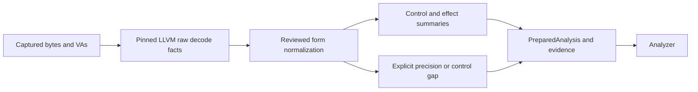

# Structured operands and conservative instruction effects

## Context and follow-up

**Status.** Canonical LLVM decode protocol and historical effect/source-review
reference. The byte-location and uses/may-defs/must-defs contract survives;
production minidump semantics come from BAP without LLVM effect fallback.

**Why this document exists.** The [original adapter](../llvm-mc-adapter.md)
provided decode facts but needed typed operands, overlap-aware locations and
justified definite replacements before those facts could feed analysis.

**What this document establishes.** The summary contract, exact helper grammar,
legacy rule matrix, source reviews and dated validation explain older effect
records while retaining LLVM's current independent decode/control role.

**Where to go next.**

- [BAP production design](bap-analysis-core-design.md) — current typed-BIL admission,
  projection and native analysis ownership.
- [Completed initial effects plan](../../Plans/completed/operand-effects-plan.md)
  — original contract/protocol/rule delivery.
- [Completed memory-immediate MOV plan](../../Plans/completed/stage-a-memory-immediate-mov-plan.md)
  — the two exact memory forms and weak-update tests.
- [Completed path-driven effects plan](../../Plans/completed/priority-2-path-driven-effects-plan.md)
  — selected-path no-change and later bounded control bindings.
- [Completed Windows workload stage](../../Plans/completed/priority-4-workload-performance-plan.md#2026-09-30-qualification-run)
  — eight observed forms and measured use of their opaque summaries.
- [BAP integration plan](../../Plans/completed/bap-integration.md#stage-1-bap-semantic-backend)
  — replacement lifting backend under the surviving summary contract.
- [Semantic assurance](semantic-assurance.md) — trusted lifting, finite conformance
  and retirement of independent instruction-step proofs.

**What remains unresolved.** Historical LLVM form counts are not BAP coverage
or ISA proofs. Every exact form still requires its reviewed shape/prefix rules;
precise memory aliases and general callee effects remain uncertain. Retired
source-form discrepancies and unproved instruction boundaries are preserved as
history, not active acceptance gates. Dated results qualify only their sources.

For the wider context, see the [documentation map](../documentation-map.md).
The original design was proposed on **2026-09-26**, baseline `fb7f142`, and
implemented before production semantics migrated to BAP.

## Historical decision and surviving contract

The 2026-09-26 design retained LLVM MC 20.1.2 decoding and introduced native
structured facts, reviewed Rust normalization and conservative effects feeding
`AnalysisRequest`. Recovery, reaching definitions and slicing were unchanged.
That LLVM semantic route is historical; BAP now supplies production semantics.
The surviving seam is the canonical location/effect summary and its evidence.



## Original implementation and seam

At baseline `fb7f142`, `native/llvm_mc/decode.cpp` emitted length/control facts
while `src/llvm_mc.rs` assigned `uses = may_defs = locations`, `must_defs = {}`.
The implemented historical preparation seam introduced immutable options and
an owned result before `Analyzer::new()`; its original interface sketch was:

```rust
impl ByteSnapshot {
    pub fn prepare(
        &self,
        decoder: &Path,
        options: &PreparationOptions,
    ) -> Result<PreparedAnalysis, AdapterError>;
}

pub struct PreparedAnalysis {
    pub request: AnalysisRequest,
    pub instructions: BTreeMap<Address, InstructionEvidence>,
    pub gaps: Vec<PreparationGap>,
    pub identity: PreparationIdentity,
}
```

The original `user64-effects-v1` profile uses a typed catalogue whose serialized
keys must exactly equal `ByteSnapshot.locations`; callers cannot supply semantic
callbacks or ad hoc trusted flags. A catalogue constructor supplies consistent
keys. `PreparationIdentity` records decoder/protocol, ruleset and catalogue;
instruction evidence retains selected bytes/provenance, form/operands, rule,
control and quality. Legacy `to_request()` preserves its coarse vocabulary;
prepared consumers retain evidence beside the result. `scope_closed()` remains
recovery-only and never implies complete preparation or semantic coverage.

## Decode facts and normalization

Protocol schema and LLVM version are separate identities. The bounded tagged
wire grammar below carries exact opcode, ordered tagged operands, explicit
and implicit uses/definitions, ties, load/store/unmodeled flags and existing
control facts. Rust binds each row to original selected bytes and validates
lengths. Metadata is decoder evidence: a descriptor definition cannot alone
justify a kill, and missing metadata cannot prove preservation.

Reviewed, version-pinned shapes normalize to:

```text
RegisterView(bank, bit_offset, width)
Immediate(encoded_width, semantic_width, bits, extension_rule)
Memory(address_width, base, index, scale, displacement, segment, access_width)
RelativeTarget(displacement, resolved_target)
```

Exact entries interpret LLVM order, ties and memory tuples; operand zero is not
assumed to be a destination. Widths, extensions and prefixes require form/byte
evidence. Unknown registers/kinds or incompatible shapes prevent precision.
RIP-relative bases use checked next-instruction VA arithmetic. Rules bind mode,
prefixes, implicit resources, source references and revision. LLVM opcode IDs
are adapter identities; upgrades require renewed fixtures/review and cannot
silently inherit acceptance. Assembly text is never the normalization input.

## Canonical location model

Engine locations are independent strings, so overlap is resolved before analysis:
16 GPRs × eight byte cells, seven individual flags, `memory:any`, and
`state:other` for FP/vector/opmask application data/status. Serialization is
injective (`gpr:rax:0`, `flag:zf`). RIP belongs to graph control; system/debug/
control state including RF/TF/IF is outside the catalogue and cannot be reported
as preserved. RAX/EAX/AL are never independent overlapping cells.

| Unconditional reviewed write | Cells possibly/definitely replaced |
| --- | --- |
| AL | RAX byte 0 |
| AH | RAX byte 1 |
| AX | RAX bytes 0–1 |
| EAX in long64 | RAX bytes 0–7, including upper-half zero extension |
| RAX | RAX bytes 0–7 |

EAX reads only bytes 0–3. Untouched bytes retain origins. Finer-than-byte or
detailed SIMD/x87 provenance requires an explicit new catalogue. Preserve
`state:other` only when review establishes no represented state changes;
otherwise may-write it, without killing the entire coarse cell.

## Effect rules

The reviewed scope is normal long64 user-mode continuation, ordinary RAM and
CET disabled, without signal handlers, fault delivery, asynchronous events or
concurrent interference. Rules produce `uses`, `may_defs`, `must_defs` and
quality/gap evidence:

| Reviewed example | Uses | May definitions | Must definitions |
| --- | --- | --- | --- |
| `mov rax, rbx` | RBX cells | RAX cells | RAX cells |
| `mov al, bl` | BL | AL | AL |
| `mov eax, imm32` | None | RAX cells | RAX cells |
| `add rax, rbx` | RAX/RBX cells | RAX and affected flags | Same where replacement is established |
| `cmp rax, rbx` | RAX/RBX cells | Affected flags | Defined, replaced flags |
| `lea rax, [rbx+8]` | RBX address cells | RAX cells | RAX cells |

ADC/SBB read CF; INC/DEC preserve CF. Conditional writes initially retain old
origins with empty destination must-definitions. Undefined flags are annotated
may-writes without a kill or concrete-value claim. One aggregate use set per
instruction can give zeroed upper bytes unnecessary producer dependencies;
that is accepted overapproximation, not a per-output precision guarantee.

## Memory and calls

A load uses address registers and `memory:any`; a store uses address registers
and its source, may-defines memory and never kills the entire memory cell.
LEA has address uses but no memory read. Segment dependencies require explicit
review; unresolved segment behavior stays conservative.

The common cell merges unrelated origins to preserve possible aliases.
Independent stack/absolute-address cells cannot coexist unsafely with unknown
stores: a future partition must make unknown accesses touch every possible
overlap. Crash-time registers cannot justify earlier addresses.

Call summaries cover possible callee execution/return, using and may-defining
all locations with no kills even for direct calls. Neither target triple nor
ABI assumptions justify preservation. Indirect targets retain obligations;
RET/stack effects require separate review including implicit memory.

## Unknown effects and unknown control

Effect precision and control certainty are separate:

1. Reviewed control with unknown effects keeps successors, all-location
   uses/may-writes, no kills and `OpaqueEffects` evidence.
2. Unreviewed control keeps decode/byte evidence without inventing fallthrough;
   `UnsupportedControl` maps to an undecodable core site and, when visited,
   `DecodeFailed` obligation.
3. Missing/invalid bytes stay distinct from successful no-ops or a claimed #UD.

The legacy path needs positive reviewed control; LLVM's negative “not a branch”
metadata is insufficient. Known ordinary forms may receive control-only review.
Well-formed unknown instructions yield analysis gaps; protocol corruption fails
preparation. Production BAP admission defines its own corresponding boundary.

## Formal contract to implement

This original anchor now describes the implemented `Specs/AriadneEffects.tla`
contract and finite fixtures, reusing `MachineEffectWellFormed` without changing
`Ariadne.tla` transitions. For finite locations L and reviewed admitted normal
continuations t:

```text
Union_t Reads(t)  ⊆ uses ⊆ L
Union_t Writes(t) ⊆ may_defs ⊆ L
must_defs ⊆ Intersection_t Replaced(t)
must_defs ⊆ may_defs
```

`Replaced(t)` means the complete cell receives a new origin; any dependency on
its prior value must still occur in `uses`. The continuation set must be
nonempty: unavailable evidence never justifies vacuous kills. Every admitted
local successor must be represented or leave explicit unresolved control.
Architectural reads/writes are reviewed before cell projection; partial overlap
permits only may-definitions. Alias expansion, weak memory, fallback shape and
no-kill retention are checked at this abstraction. These checks prove neither
LLVM decoding nor source interpretation or a complete instruction step.

## Implementation sequence and acceptance

The [completed effects plan](../../Plans/completed/operand-effects-plan.md)
retains sequencing. Tests run through `prepare()` and the real analyzer: AL/AH
after RAX, EAX zero extension, ties, CF dependencies/preservation, unknown stores,
opaque calls, RIP-relative addressing and unknown control. A precision fixture
excludes unrelated producers while retaining necessary byte/flag/memory origins.
Manual-derived expectations remain independent of descriptor snapshots.

Negative controls target whole-RAX partial kills, omitted address/carry reads,
whole-memory kills, assumed call preservation and invented fallthrough. Native
gates run the real decoder; missing prerequisites are unavailable verification.
Finite projection fixtures and core MBT cover complementary scopes. Batch/time
observations motivate transport changes only with measured workload evidence.

## Alternatives and references

Direct descriptor-to-`must_defs` mapping is rejected because partial/conditional
writes need semantic interpretation. Whole-GPR cells force excess retention;
byte cells improve precision without changing the engine. The original generic
decoder-trait proposal was deferred; production BAP has its own
[backend contract](bap-analysis-core-design.md). In-process LLVM linkage is a
separate choice.

References: [original adapter](../llvm-mc-adapter.md),
[core correspondence](../implementation.md),
[historical user64 acceptance](../amd64-user64.md),
[shared effect contract](../../Specs/AriadneMachineCommon.tla),
[native decoder](../../native/llvm_mc/decode.cpp), LLVM
[MCOperand](https://llvm.org/doxygen/classllvm_1_1MCOperand.html) and
[MCInstrDesc](https://llvm.org/doxygen/classllvm_1_1MCInstrDesc.html).
Online LLVM documentation describes development HEAD; exact 20.1.2 APIs/layouts
must be checked against matching headers/source before changing the protocol.

## LLVM MC protocol 2

Implemented for LLVM MC 20.1.2. Default invocation and `--version` retain
protocol 1 behavior. `--protocol-version` must return exactly:

```text
ariadne-llvm-mc 20.1.2 protocol 2
```

Invoke `--protocol=2` with the existing `decimal-VA hex-bytes` input lines.
Each response is one newline-terminated, whitespace-separated record:

```text
v2 OPCODE N OPERAND... DEFS FLAGS U IMPLICIT_USE... D IMPLICIT_DEF... TIE... VA STATUS LENGTH KIND TARGET
```

- `OPCODE` is the pinned LLVM opcode name, or `-` for invalid decode.
- `N` is the operand count; exactly N operands and N trailing tie indices occur.
- Operands are `r:REGISTER`, `i:SIGNED_I64` or `x:unsupported`.
  `r:NONE` is LLVM's zero-register sentinel in address tuples.
- `DEFS` is the descriptor's explicit definition count, at most N.
- `FLAGS` is a three-bit mask: possible load (1), possible store (2),
  unmodeled effects (4). These fields are inspection evidence, not kill rules.
- `U` and `D` count the implicit register names that follow each count.
- Each tie is `-1` or a different operand index in `0..N`.
- The final five fields have the same meanings as protocol 1. A successful
  decode has length 1..15 and a control kind. `invalid` requires length zero,
  absent kind/target, `-` opcode and empty metadata. `unsupported` retains
  successful-decode operands/length but no kind/target.

Counts are bounded by 32; names are 1..96 ASCII letters/digits/underscores.
Records are shorter than 4096 bytes; stdout is bounded by 4096 times the input
record count plus 128 bytes for a checked header, stderr by 4096 bytes. Each process exchange has a 30-second
limit, including exit after stream closure. All streams are drained concurrently;
limit/error handling kills and reaps the helper. The helper is a trusted local
executable, not an isolation interface for arbitrary descendant processes.

The parser rejects malformed or duplicate/unexpected/missing records and
contradictory control targets. Preparation additionally validates the decoded
length against selected bytes and matches only reviewed opcode/operand shapes.
An unfamiliar well-formed instruction yields an analysis gap; a corrupt
protocol response fails preparation.

Example (`mov rax, rbx`):

```text
v2 MOV64rr 2 r:RAX r:RBX 1 0 0 0 -1 -1 4096 ok 3 ordinary -
```

The checked observations for all 147 admitted opcode identities are frozen in
[effects-v2.tsv](../../tests/fixtures/effects-v2.tsv). Their purpose is detecting
changes in decoder layouts. The tests also separately assert architectural
read/write expectations and resulting analysis behavior. Updating snapshots
alone cannot justify a semantic change.

### Explicit Linux target profile

The legacy flags above retain the Windows AMD64 target. A Linux request uses
`--protocol-version=linux`, requiring exactly:

```text
ariadne-llvm-mc 20.1.2 protocol 2 target x86_64-unknown-linux-gnu
```

Decode with `--protocol=2-linux`. The row grammar is unchanged. The Rust
`prepare_with_target()` method and `prepare_captured_batch()` seam record the
selected target triple in `PreparationIdentity`; default `prepare()` remains
Windows-compatible. Minidump input selects the target from validated platform
metadata. Calls remain opaque under both profiles; no ABI preservation rules
are inferred. The input native gate exercises the full frozen opcode registry
under both targets.

## Checked batch invocation

The checked one-shot preparation mode uses `--protocol=2-checked` or
`--protocol=2-checked-linux`. A single invocation emits the exact version/target
line above, followed by the unchanged protocol-2 records. The parser requires
that header before accepting any rows. This replaces a separate version
process for each batch; legacy version and decode modes remain available.
Raw per-instruction records, evidence identities and row/error bounds keep
their existing meaning. Rebuild the helper together with the updated Rust
adapter; an older helper lacking the checked mode is rejected.

### Snapshot-owned production reference session

The BAP production backend now reuses one checked LLVM reference process across
batches for one snapshot/target. It uses the same checked header and unchanged
protocol-2 rows; each batch must return exactly its requested addresses before
its deadline. Malformed, duplicate, unsolicited, missing or trailing rows poison
the session. Shutdown closes input, requires clean EOF/exit and reaps the child.
Reference-executable digests are checked across the preparation lifetime.

The standalone LLVM byte-span/effect adapter remains one-shot. This process
reuse adds no LLVM effect fallback. The [I4 performance delivery](workload-performance-design.md#native-investigation-qualification)
qualifies the changed BAP preparation, and the [current backend guide](bap-analysis-core-design.md#backend-usage)
describes ownership and shutdown.

## Historical rule matrix

Initial delivery 2026-09-26 used `user64-effects-v1.0`, LLVM MC 20.1.2.
Stage A advances the preparation identity to `user64-effects-v1.1` and adds
two source-reviewed memory-immediate MOV effect rules.
Their bounded [source and decoder review](operand-effects-design.md#memory-immediate-mov-review) records the
form-catalogue correspondence still required for instruction-step acceptance.
The table below lists **139 exact LLVM opcode identities** after that extension,
not verified ISA steps or accepted user64 cases. Each entry additionally requires the shape,
register widths, prefix and address constraints in `src/effects/rules.rs`.
Names not in `src/effects/forms.txt` have unresolved control in the legacy rule path.
The [Priority 4 real-path review](operand-effects-design.md#eight-ordinary-control-bindings-2026-09-30) adds eight
control-only bindings, bringing the historical registry to **147** and preparation
identity to `user64-effects-v1.2`. Their effects remain opaque.

Sources: pinned AMD Volume 3 revision 3.38, SHA-256
`e18bd39ad0ca19d2eb9b9ea25c2635144c5ab368e5d6fbdc7a08345515ea1aee`;
Volume 1 revision 3.25 (GPR aliases and 32-bit zero extension), SHA-256
`aed9236b718ae86cdb49f7d628f4ebb1a4bdce1a012df6cf6aad6735776c8a38`.
References use the stable IDs in [the archived source inventory](https://github.com/NzSN/Ariadne/blob/01ae404e8c8556966e219118945082ff8e213f7e/Specs/AMD64/instruction-source.json),
removed from the checkout with the retired ISA specifications on 2026-10-11.

All rows are exercised with real decoded bytes by the frozen-matrix test.
The raw snapshots establish decoder layout compatibility. Independent effect,
slice and mutation tests establish the separately stated behavioral evidence;
a decoder snapshot is not a semantic oracle. The source review covers normal
long64 user-mode continuation, ordinary RAM and CET disabled. Fault/interrupt
paths and full instruction validity are not certified.

Flags: ADD/SUB/ADC/SBB/CMP replace CF/PF/AF/ZF/SF/OF; ADC/SBB also read CF.
INC/DEC preserve CF and replace the other five status flags. AND/OR/XOR/TEST
replace CF/OF/PF/ZF/SF, may-write undefined AF without killing its old origins.
MOV/LEA preserve tracked flags. Jcc selects OF, CF, ZF, CF+ZF, SF, PF, SF+OF,
or ZF+SF+OF for the eight condition pairs. Calls and RET remain opaque; CLC/STC
have only control review in this release. NOOP has empty effects.

The catalogue tracks GPR bytes, seven named flags, all memory as one may-alias
cell, and FP/vector/opmask application data/status as `state:other`. It does
not track RIP or system/debug/control state such as RF/TF/IF. Untracked state
must not be reported as preserved. Reviewed listed forms do not touch the
opaque FP/vector bank; opaque effects read/may-write it along with all other
locations. All writes to `memory:any` remain may-writes, never whole-memory kills.

| LLVM opcode / rule suffix | Example bytes at VA 4096 | Disposition | AMD Volume 3 source |
| --- | --- | --- | --- |
| `ADC16ri` | `6681d30101` | Reviewed normal-continuation effects | V3-GP-005, PDF 127–128 |
| `ADC16ri8` | `6683d3ff` | Reviewed normal-continuation effects | V3-GP-005, PDF 127–128 |
| `ADC16rr` | `6611d8` | Reviewed normal-continuation effects | V3-GP-005, PDF 127–128 |
| `ADC32ri` | `81d301010101` | Reviewed normal-continuation effects | V3-GP-005, PDF 127–128 |
| `ADC32ri8` | `83d3ff` | Reviewed normal-continuation effects | V3-GP-005, PDF 127–128 |
| `ADC32rr` | `11d8` | Reviewed normal-continuation effects | V3-GP-005, PDF 127–128 |
| `ADC64ri32` | `4881d301010101` | Reviewed normal-continuation effects | V3-GP-005, PDF 127–128 |
| `ADC64ri8` | `4883d3ff` | Reviewed normal-continuation effects | V3-GP-005, PDF 127–128 |
| `ADC64rr` | `4811d8` | Reviewed normal-continuation effects | V3-GP-005, PDF 127–128 |
| `ADC8ri` | `80d301` | Reviewed normal-continuation effects | V3-GP-005, PDF 127–128 |
| `ADC8rr` | `10d8` | Reviewed normal-continuation effects | V3-GP-005, PDF 127–128 |
| `ADD16ri` | `6681c30101` | Reviewed normal-continuation effects | V3-GP-007, PDF 131–132 |
| `ADD16ri8` | `6683c3ff` | Reviewed normal-continuation effects | V3-GP-007, PDF 131–132 |
| `ADD16rr` | `6601d8` | Reviewed normal-continuation effects | V3-GP-007, PDF 131–132 |
| `ADD32ri` | `81c301010101` | Reviewed normal-continuation effects | V3-GP-007, PDF 131–132 |
| `ADD32ri8` | `83c3ff` | Reviewed normal-continuation effects | V3-GP-007, PDF 131–132 |
| `ADD32rr` | `01d8` | Reviewed normal-continuation effects | V3-GP-007, PDF 131–132 |
| `ADD64ri32` | `4881c301010101` | Reviewed normal-continuation effects | V3-GP-007, PDF 131–132 |
| `ADD64ri8` | `4883c3ff` | Reviewed normal-continuation effects | V3-GP-007, PDF 131–132 |
| `ADD64rr` | `4801d8` | Reviewed normal-continuation effects | V3-GP-007, PDF 131–132 |
| `ADD8ri` | `80c301` | Reviewed normal-continuation effects | V3-GP-007, PDF 131–132 |
| `ADD8rr` | `00d8` | Reviewed normal-continuation effects | V3-GP-007, PDF 131–132 |
| `AND16ri` | `6681e30101` | Reviewed normal-continuation effects | V3-GP-009, PDF 135–136 |
| `AND16ri8` | `6683e3ff` | Reviewed normal-continuation effects | V3-GP-009, PDF 135–136 |
| `AND16rr` | `6621d8` | Reviewed normal-continuation effects | V3-GP-009, PDF 135–136 |
| `AND32ri` | `81e301010101` | Reviewed normal-continuation effects | V3-GP-009, PDF 135–136 |
| `AND32ri8` | `83e3ff` | Reviewed normal-continuation effects | V3-GP-009, PDF 135–136 |
| `AND32rr` | `21d8` | Reviewed normal-continuation effects | V3-GP-009, PDF 135–136 |
| `AND64ri32` | `4881e301010101` | Reviewed normal-continuation effects | V3-GP-009, PDF 135–136 |
| `AND64ri8` | `4883e3ff` | Reviewed normal-continuation effects | V3-GP-009, PDF 135–136 |
| `AND64rr` | `4821d8` | Reviewed normal-continuation effects | V3-GP-009, PDF 135–136 |
| `AND8ri` | `80e301` | Reviewed normal-continuation effects | V3-GP-009, PDF 135–136 |
| `AND8rr` | `20d8` | Reviewed normal-continuation effects | V3-GP-009, PDF 135–136 |
| `CALL64m` | `ff10` | Opaque effects; reviewed control | V3-GP-032, PDF 178–180 |
| `CALL64pcrel32` | `e802000000` | Opaque effects; reviewed control | V3-GP-032, PDF 178–180 |
| `CALL64r` | `ffd0` | Opaque effects; reviewed control | V3-GP-032, PDF 178–180 |
| `CLC` | `f8` | Opaque effects; reviewed control | V3-GP-036, PDF 190–190 |
| `CMP16ri` | `6681fb0101` | Reviewed normal-continuation effects | V3-GP-044, PDF 204–206 |
| `CMP16ri8` | `6683fbff` | Reviewed normal-continuation effects | V3-GP-044, PDF 204–206 |
| `CMP16rr` | `6639d8` | Reviewed normal-continuation effects | V3-GP-044, PDF 204–206 |
| `CMP32ri` | `81fb01010101` | Reviewed normal-continuation effects | V3-GP-044, PDF 204–206 |
| `CMP32ri8` | `83fbff` | Reviewed normal-continuation effects | V3-GP-044, PDF 204–206 |
| `CMP32rr` | `39d8` | Reviewed normal-continuation effects | V3-GP-044, PDF 204–206 |
| `CMP64ri32` | `4881fb01010101` | Reviewed normal-continuation effects | V3-GP-044, PDF 204–206 |
| `CMP64ri8` | `4883fbff` | Reviewed normal-continuation effects | V3-GP-044, PDF 204–206 |
| `CMP64rr` | `4839d8` | Reviewed normal-continuation effects | V3-GP-044, PDF 204–206 |
| `CMP8ri` | `80fb01` | Reviewed normal-continuation effects | V3-GP-044, PDF 204–206 |
| `CMP8rr` | `38d8` | Reviewed normal-continuation effects | V3-GP-044, PDF 204–206 |
| `DEC16r` | `66ffc8` | Reviewed normal-continuation effects | V3-GP-052, PDF 220–221 |
| `DEC32r` | `ffc8` | Reviewed normal-continuation effects | V3-GP-052, PDF 220–221 |
| `DEC64r` | `48ffc8` | Reviewed normal-continuation effects | V3-GP-052, PDF 220–221 |
| `DEC8r` | `fec8` | Reviewed normal-continuation effects | V3-GP-052, PDF 220–221 |
| `INC16r` | `66ffc0` | Reviewed normal-continuation effects | V3-GP-058, PDF 232–233 |
| `INC32r` | `ffc0` | Reviewed normal-continuation effects | V3-GP-058, PDF 232–233 |
| `INC64r` | `48ffc0` | Reviewed normal-continuation effects | V3-GP-058, PDF 232–233 |
| `INC8r` | `fec0` | Reviewed normal-continuation effects | V3-GP-058, PDF 232–233 |
| `JCC_1` | `7502` | Reviewed normal-continuation effects | V3-GP-062, PDF 245–248 |
| `JCC_4` | `0f8502000000` | Reviewed normal-continuation effects | V3-GP-062, PDF 245–248 |
| `JMP64m` | `ff20` | Reviewed normal-continuation effects | V3-GP-064, PDF 250–251 |
| `JMP64r` | `ffe0` | Reviewed normal-continuation effects | V3-GP-064, PDF 250–251 |
| `JMP_1` | `eb02` | Reviewed normal-continuation effects | V3-GP-064, PDF 250–251 |
| `JMP_4` | `e902000000` | Reviewed normal-continuation effects | V3-GP-064, PDF 250–251 |
| `LEA16r` | `668d4308` | Reviewed normal-continuation effects | V3-GP-068, PDF 260–261 |
| `LEA64_32r` | `8d4308` | Reviewed normal-continuation effects | V3-GP-068, PDF 260–261 |
| `LEA64r` | `488d4308` | Reviewed normal-continuation effects | V3-GP-068, PDF 260–261 |
| `MOV16mr` | `66894308` | Reviewed normal-continuation effects | V3-GP-080, PDF 282–284 |
| `MOV16ri` | `66b80100` | Reviewed normal-continuation effects | V3-GP-080, PDF 282–284 |
| `MOV16rm` | `668b4308` | Reviewed normal-continuation effects | V3-GP-080, PDF 282–284 |
| `MOV16rr` | `6689d8` | Reviewed normal-continuation effects | V3-GP-080, PDF 282–284 |
| `MOV32mi` | `c70005000000` | Reviewed memory-immediate normal-continuation effects | V3-GP-080, AMD64-F-0502, PDF 283–284 |
| `MOV32mr` | `894308` | Reviewed normal-continuation effects | V3-GP-080, PDF 282–284 |
| `MOV32ri` | `b801000000` | Reviewed normal-continuation effects | V3-GP-080, PDF 282–284 |
| `MOV32rm` | `8b4308` | Reviewed normal-continuation effects | V3-GP-080, PDF 282–284 |
| `MOV32rr` | `89d8` | Reviewed normal-continuation effects | V3-GP-080, PDF 282–284 |
| `MOV64mi32` | `48c7040841414141` | Reviewed memory-immediate normal-continuation effects | V3-GP-080, AMD64-F-0503, PDF 283–284 |
| `MOV64mr` | `48894308` | Reviewed normal-continuation effects | V3-GP-080, PDF 282–284 |
| `MOV64ri` | `48b80100000000000000` | Reviewed normal-continuation effects | V3-GP-080, PDF 282–284 |
| `MOV64ri32` | `48c7c0ffffffff` | Reviewed normal-continuation effects | V3-GP-080, PDF 282–284 |
| `MOV64rm` | `488b4308` | Reviewed normal-continuation effects | V3-GP-080, PDF 282–284 |
| `MOV64rr` | `4889d8` | Reviewed normal-continuation effects | V3-GP-080, PDF 282–284 |
| `MOV8mr` | `884308` | Reviewed normal-continuation effects | V3-GP-080, PDF 282–284 |
| `MOV8ri` | `b001` | Reviewed normal-continuation effects | V3-GP-080, PDF 282–284 |
| `MOV8rm` | `8a4308` | Reviewed normal-continuation effects | V3-GP-080, PDF 282–284 |
| `MOV8rr` | `88d8` | Reviewed normal-continuation effects | V3-GP-080, PDF 282–284 |
| `NOOP` | `90` | Reviewed normal-continuation effects | V3-GP-096, PDF 314–314 |
| `OR16ri` | `6681cb0101` | Reviewed normal-continuation effects | V3-GP-098, PDF 316–318 |
| `OR16ri8` | `6683cbff` | Reviewed normal-continuation effects | V3-GP-098, PDF 316–318 |
| `OR16rr` | `6609d8` | Reviewed normal-continuation effects | V3-GP-098, PDF 316–318 |
| `OR32ri` | `81cb01010101` | Reviewed normal-continuation effects | V3-GP-098, PDF 316–318 |
| `OR32ri8` | `83cbff` | Reviewed normal-continuation effects | V3-GP-098, PDF 316–318 |
| `OR32rr` | `09d8` | Reviewed normal-continuation effects | V3-GP-098, PDF 316–318 |
| `OR64ri32` | `4881cb01010101` | Reviewed normal-continuation effects | V3-GP-098, PDF 316–318 |
| `OR64ri8` | `4883cbff` | Reviewed normal-continuation effects | V3-GP-098, PDF 316–318 |
| `OR64rr` | `4809d8` | Reviewed normal-continuation effects | V3-GP-098, PDF 316–318 |
| `OR8ri` | `80cb01` | Reviewed normal-continuation effects | V3-GP-098, PDF 316–318 |
| `OR8rr` | `08d8` | Reviewed normal-continuation effects | V3-GP-098, PDF 316–318 |
| `RET64` | `c3` | Opaque effects; reviewed control | V3-GP-120, PDF 353–354 |
| `SBB16ri` | `6681db0101` | Reviewed normal-continuation effects | V3-GP-129, PDF 374–375 |
| `SBB16ri8` | `6683dbff` | Reviewed normal-continuation effects | V3-GP-129, PDF 374–375 |
| `SBB16rr` | `6619d8` | Reviewed normal-continuation effects | V3-GP-129, PDF 374–375 |
| `SBB32ri` | `81db01010101` | Reviewed normal-continuation effects | V3-GP-129, PDF 374–375 |
| `SBB32ri8` | `83dbff` | Reviewed normal-continuation effects | V3-GP-129, PDF 374–375 |
| `SBB32rr` | `19d8` | Reviewed normal-continuation effects | V3-GP-129, PDF 374–375 |
| `SBB64ri32` | `4881db01010101` | Reviewed normal-continuation effects | V3-GP-129, PDF 374–375 |
| `SBB64ri8` | `4883dbff` | Reviewed normal-continuation effects | V3-GP-129, PDF 374–375 |
| `SBB64rr` | `4819d8` | Reviewed normal-continuation effects | V3-GP-129, PDF 374–375 |
| `SBB8ri` | `80db01` | Reviewed normal-continuation effects | V3-GP-129, PDF 374–375 |
| `SBB8rr` | `18d8` | Reviewed normal-continuation effects | V3-GP-129, PDF 374–375 |
| `STC` | `f9` | Opaque effects; reviewed control | V3-GP-140, PDF 394–394 |
| `SUB16ri` | `6681eb0101` | Reviewed normal-continuation effects | V3-GP-143, PDF 398–399 |
| `SUB16ri8` | `6683ebff` | Reviewed normal-continuation effects | V3-GP-143, PDF 398–399 |
| `SUB16rr` | `6629d8` | Reviewed normal-continuation effects | V3-GP-143, PDF 398–399 |
| `SUB32ri` | `81eb01010101` | Reviewed normal-continuation effects | V3-GP-143, PDF 398–399 |
| `SUB32ri8` | `83ebff` | Reviewed normal-continuation effects | V3-GP-143, PDF 398–399 |
| `SUB32rr` | `29d8` | Reviewed normal-continuation effects | V3-GP-143, PDF 398–399 |
| `SUB64ri32` | `4881eb01010101` | Reviewed normal-continuation effects | V3-GP-143, PDF 398–399 |
| `SUB64ri8` | `4883ebff` | Reviewed normal-continuation effects | V3-GP-143, PDF 398–399 |
| `SUB64rr` | `4829d8` | Reviewed normal-continuation effects | V3-GP-143, PDF 398–399 |
| `SUB8ri` | `80eb01` | Reviewed normal-continuation effects | V3-GP-143, PDF 398–399 |
| `SUB8rr` | `28d8` | Reviewed normal-continuation effects | V3-GP-143, PDF 398–399 |
| `TEST16ri` | `66f7c30101` | Reviewed normal-continuation effects | V3-GP-145, PDF 402–403 |
| `TEST16rr` | `6685d8` | Reviewed normal-continuation effects | V3-GP-145, PDF 402–403 |
| `TEST32ri` | `f7c301010101` | Reviewed normal-continuation effects | V3-GP-145, PDF 402–403 |
| `TEST32rr` | `85d8` | Reviewed normal-continuation effects | V3-GP-145, PDF 402–403 |
| `TEST64ri32` | `48f7c301010101` | Reviewed normal-continuation effects | V3-GP-145, PDF 402–403 |
| `TEST64rr` | `4885d8` | Reviewed normal-continuation effects | V3-GP-145, PDF 402–403 |
| `TEST8ri` | `f6c301` | Reviewed normal-continuation effects | V3-GP-145, PDF 402–403 |
| `TEST8rr` | `84d8` | Reviewed normal-continuation effects | V3-GP-145, PDF 402–403 |
| `XOR16ri` | `6681f30101` | Reviewed normal-continuation effects | V3-GP-154, PDF 415–418 |
| `XOR16ri8` | `6683f3ff` | Reviewed normal-continuation effects | V3-GP-154, PDF 415–418 |
| `XOR16rr` | `6631d8` | Reviewed normal-continuation effects | V3-GP-154, PDF 415–418 |
| `XOR32ri` | `81f301010101` | Reviewed normal-continuation effects | V3-GP-154, PDF 415–418 |
| `XOR32ri8` | `83f3ff` | Reviewed normal-continuation effects | V3-GP-154, PDF 415–418 |
| `XOR32rr` | `31d8` | Reviewed normal-continuation effects | V3-GP-154, PDF 415–418 |
| `XOR64ri32` | `4881f301010101` | Reviewed normal-continuation effects | V3-GP-154, PDF 415–418 |
| `XOR64ri8` | `4883f3ff` | Reviewed normal-continuation effects | V3-GP-154, PDF 415–418 |
| `XOR64rr` | `4831d8` | Reviewed normal-continuation effects | V3-GP-154, PDF 415–418 |
| `XOR8ri` | `80f301` | Reviewed normal-continuation effects | V3-GP-154, PDF 415–418 |
| `XOR8rr` | `30d8` | Reviewed normal-continuation effects | V3-GP-154, PDF 415–418 |

## Historical effect qualification

### Initial delivery (2026-09-26)

Based on `fb7f142`, the [source-bound record](../../evidence/Ariadne/operand-effects-validation.json)
closed P0–P6 of the completed effects plan. `ByteSnapshot::prepare()` returned
validated requests/evidence from protocol 2; `to_request()` retained protocol 1
and coarse summaries. Neither `Analyzer` nor `Ariadne.tla` changed. The original
registry had **137 opcode identities**; separately the catalogue had **137
locations** (128 GPR bytes, seven flags, memory, opaque FP/vector/opmask state).
These coincident counts are different quantities.

| Historical gate | Recorded result |
| --- | --- |
| Offline Rust tests | 24 tests and one doctest passed; native tests intentionally excluded here |
| Format and Clippy | Passed, warnings denied |
| Native interfaces | Five legacy and eleven new tests passed against a freshly built LLVM helper |
| Exact opcode coverage | Each of the 137 registry entries matched its frozen real-decoder observation and produced the expected preparation disposition |
| Effect projection | Apalache 0.61.0 typechecked both modules; TLC revision `1476e7f` passed the fixture, 3 generated / 2 distinct driver states |
| Effect negative controls | Six isolated implementation mutations rejected by the intended test assertions |
| Existing core MBT | 12 complete traces / 168 matched states; wrong digest rejected before construction; all five engine mutants rejected |
| Batch observation | 256 decoded MOV instructions, 137 locations: preparation 48.2 ms, analysis 4.88 s in a debug test build |
| Source stability | All snapshotted source hashes unchanged throughout the integrated run and rechecked before recording |

Six temporary-SUT mutations tested AL killing all RAX, missing address uses,
missing ADC/SBB carry, whole-memory kills, ABI-assumed call preservation and
invented unknown-control fallthrough. The unchanged observer rejected genuine
semantic defects; compile, launcher or protocol failures counted as failures,
not sensitivity. TLC's small driver checks finite projection assertions, not
architectural state coverage. The debug batch timing is one observation,
not scalability qualification.

Historical reproduction:

```sh
LLVM20_INCLUDE_DIR=/tmp/ariadne-llvm20/usr/include/llvm-20 \
  python3 tools/check_effects.py
```

The script creates fresh evidence, preserves snapshots/oracles, completes
independent gates after failures and requires all gates/source stability.
Prepare TLA+/MBT prerequisites first. The run used Rust 1.96.0, LLVM 20.1.2,
Apalache 0.61.0 and TLC `1476e7f`; Ubuntu matching headers were extracted to
`/tmp`, archive SHA-256
`e4b5cbfe19826dfb35ff3c2c33d4e3a9e8327de49ad5b7b4b780abb3f6d07b74`,
with existing `libLLVM.so.20.1`. Pinned AMD PDFs were hash-checked and reviewed
with `pdfminer.six==20260107`. Logs remain identified by the report, including
`/tmp/ariadne-effects-acceptance-n883e7y3`, without guaranteeing path persistence.

Normal long64 user-mode continuation, ordinary RAM and CET-disabled behavior
were the scope. Exceptions, asynchronous/concurrent interference, precise
aliases, SIMD/x87 detail and unreviewed forms stayed outside. At that time the
profile recorded 49 paired register bodies but **0/49** accepted register,
**0/72** control/stack and **0/156** RAM steps; no ISA ledger was promoted.
That independent track is now retired.

### Memory-immediate MOV delivery (2026-09-28)

The [retained record](../../evidence/Ariadne/stage-a-validation.json), based on
`9bde052` at 23:49 CST, is byte-identical to the eight-gate
`tools/check_minidump.py` result in `/tmp/ariadne-minidump-acceptance-na02rnng`.
Sources stayed stable throughout and were checked again before recording.
`user64-effects-v1.1` added `MOV32mi`/`MOV64mi32`, taking the registry to **139**.
Their six-field shape, REX.W, signed imm32 and weak-store semantics follow the
source review below; existing MOV rules and unknown-form gaps stayed unchanged.

| Crash-IP-as-root fixture | Entry/seed | Recorded local result |
| --- | --- | --- |
| `linux_null_dereference.dmp` | `0x401f26`, `MOV32mi` | 1 decoded node, 1 edge, 1 later obligation, no missing seed |
| `write_av_non_canonical.dmp` | `0x7ff738721331`, `MOV64mi32` | 3 decoded nodes, 4 edges, 1 later obligation, no missing seed |

These observations represent possible normal continuation. The captured store
may not retire; no commit, fault priority, handler path or root cause follows.
Earlier producers required the later independently rooted capture work. Old
137-opcode/zero-decoded reports remain evidence of their own older sources.

| Gate | Result and boundary |
| --- | --- |
| Existing effects pipeline | Rust tests, fmt, Clippy, real LLVM legacy/effects fixtures, focused TLA+ projection, 10 effect mutants, 12-trace/168-state core MBT and measurement all passed |
| Minidump package | Offline tests, fmt and Clippy passed |
| Native Windows/Linux | All six input-native tests passed, including the complete 139-identity frozen opcode matrix under both decoder profiles |
| Real artifacts | Both external minidumps passed hash, provenance, decoded RIP, exact operand/effect and later-gap assertions |
| Input formal model | Apalache typechecking and both finite TLC input fixtures passed |
| Input negative controls | Six isolated reader/materializer mutations were rejected as intended assertions |
| Profile/inventory integrity | Default profile check and pinned-source inventory check passed; the milestone-required gate was not counted as passing |

`AriadneEffectsChecks.tla` compared four-/eight-byte writes with the larger
abstract memory cell, rejecting whole-cell kills or missing address inputs.
Rust tests covered signed immediates, address views, old-origin retention and
incompatible prefixes/shapes. Four additional mutations caught missing address
inputs, spurious old-memory reads, whole-memory kills and omitted extension,
for ten total controls. No full AMD64 TLA+/Lean suite or intentionally failing
milestone gate was claimed as passing; **0/49** register and **0/156** RAM step
acceptance remained historical. Rendering/readers were unchanged but tested;
no PE/ELF reader, ISA executor or production JSON CLI was delivered here.

## Path-driven control review

### Selected-path no-change decision (2026-09-29)

The [path-driven plan](../../Plans/completed/priority-2-path-driven-effects-plan.md)
and [source-bound record](../../evidence/Ariadne/priority-2-3-validation.json)
reviewed the controlled Chromium path at 23:26 CST. Of 29 captured starts before
the seed, 22 had reviewed effects and seven `CALL64pcrel32` sites had opaque
callee effects. `TEST64rr`/`TEST8rr` retained undefined AF. No pre-seed missing
bytes or unsupported control blocked the reviewed fault `MOV32rm EAX,[RBX]`,
possible `MOV64rm RBX,[RBX]` producer or conditional branch. Later `INT3` at
`0x566817922e5b` remained unsupported after the seed.

No effect rule changed: reviewing CALL itself cannot prove uncaptured callee
effects or RBX preservation; existing TEST flags were represented; post-seed
INT3 did not block the scoped predecessor slice. New paths can reopen coverage.
The case replay retained 28 source hashes and identical JSON/DOT; text changed
only for presentation. All 11 minidump gates passed with 57 stable source hashes,
including native Windows/Linux, effects/MBT, input models/mutations and older
Breakpad fixtures. No user64 case was promoted.

### Eight ordinary-control bindings (2026-09-30)

Reviewed 2026-09-30 for the Windows Electron workload in the
[qualification plan](../../Plans/completed/priority-4-workload-performance-plan.md#2026-09-30-qualification-run).
The eight bindings below admit ordinary continuation while retaining opaque
effects: every catalogue cell remains a possible input and write, with no
definite replacement. They do not execute an instruction or assert fault
retirement, stack validity, historical control flow, or a formal user64 case.

Source: [AMD Volume 3 revision 3.38](https://docs.amd.com/v/u/en-US/24594_3.38_APM_Vol3_PUB),
SHA-256 `e18bd39ad0ca19d2eb9b9ea25c2635144c5ab368e5d6fbdc7a08345515ea1aee`,
checked against the downloaded PDF. PDF pages are one-based. The forms refer
to GPR/ordinary-memory operations; segment-register and control-register
variants are excluded. Memory and stack faults remain possible, so the
continuation is a static local possibility rather than proof of execution.

| Exact LLVM 20.1.2 opcode | Native bytes at VA 4096 | Admitted operands | AMD entry and PDF pages |
| --- | --- | --- | --- |
| `PUSH64r` | `4156` | One 64-bit GPR; implicit stack effects stay opaque | V3-GP-110, 339–340 |
| `POP64r` | `415e` | One 64-bit GPR; implicit stack effects stay opaque | V3-GP-104, 327–328 |
| `ADD32rm` | `034807` | Tied 32-bit destination/source GPR, 32-bit memory input | V3-GP-007, 131–132 |
| `ADD64rm` | `480307` | Tied 64-bit destination/source GPR, 64-bit memory input | V3-GP-007, 131–132 |
| `MOV8mi` | `c644242000` | 8-bit memory destination and 8-bit immediate | V3-GP-080, 282–284 |
| `CMP8mi` | `807f0c01` | 8-bit memory input and 8-bit immediate | V3-GP-044, 204–206 |
| `ADD32i32` | `05d3feffff` | Implicit EAX and encoded 32-bit immediate | V3-GP-007, 131–132 |
| `CMP32i32` | `3df0000000` | Implicit EAX and encoded 32-bit immediate | V3-GP-044, 204–206 |

The reviewed envelope accepts no legacy prefix and at most one REX.
`REX.W` is required only for `ADD64rm` and excluded on the other seven forms.
Memory uses default 64-bit address registers or RIP-relative addressing,
scales 1/2/4/8 and no segment override. Register widths, operand counts,
ADD ties, immediate containers and native ordinary-control observations are
checked. Adjacent widths, memory PUSH/POP, REX.W aliases, LOCK/REP, duplicate
prefixes and address/operand overrides remain outside these new bindings.

The existing native matrix exercises every binding on Windows and Linux.
Additional tests check retained earlier origins, all-cell uncertainty,
empty definite replacements and rejected prefix/shape/control variants.
The preparation identity advances to `user64-effects-v1.2`; prior versioned
report identities are historical records. Analyzer scheduling and the formal
AMD64 acceptance ledger are unchanged.

## Memory-immediate MOV review

Reviewed **2026-09-28** for the exact normal-continuation memory forms; no complete instruction-step or faulting-store commit claim follows.

### Pinned source and exact observations

- AMD Volume 3, publication 24594 revision 3.38, SHA-256
  `e18bd39ad0ca19d2eb9b9ea25c2635144c5ab368e5d6fbdc7a08345515ea1aee`,
  PDF pages 282–284 ([publisher landing page](https://docs.amd.com/v/u/en-US/24594_3.38_APM_Vol3_PUB)).
- AMD Volume 2, publication 24593 revision 3.45, SHA-256
  `7257d41d3584822edb7934e2c630c7d3865eea30c0ab95b8de4e546088d5ea9a`,
  PDF page 93 for long-mode REX and operand-size precedence.
- Both PDFs were fetched through `tools/amd64_inventory.py fetch`, verified
  against the original `Specs/AMD64/manuals.lock.json`, and independently
  hash-checked. That source pin now retains the same bytes at
  [amd-manuals.lock.json](../../evidence/Ariadne/amd-manuals.lock.json).
- The native helper was rebuilt against exact LLVM 20.1.2 headers; its binary
  SHA-256 for this review is
  `dca617ca3e4ad50aef0f795b7793b73a6dae10cf04eebd695b030f8ba82ac7b7`.
  The Ubuntu `llvm-20-dev` archive hash matched the previously recorded
  `e4b5cbfe19826dfb35ff3c2c33d4e3a9e8327de49ad5b7b4b780abb3f6d07b74`.

| Pinned fixture | Captured prefix at exception RIP | Exact LLVM 20.1.2 observation |
| --- | --- | --- |
| Linux `linux_null_dereference.dmp`, SHA-256 `1d82d1d98bb46fb9aa3498fce733e724e9b501824f8b8a36de22066d6d4bca33` | `0x401f26`: `c70005000000...` | `MOV32mi`, length 6; memory tuple base `RAX`, scale 1, no index, displacement 0; immediate 5 |
| Windows `write_av_non_canonical.dmp`, SHA-256 `7012f0b943f5eacf681bcb29fc2766b75b87da1664280eaadc5dfa024f0a3abf` | `0x7ff738721331`: `48c7040841414141...` | `MOV64mi32`, length 8; memory tuple base `RAX`, scale 1, index `RCX`, displacement 0; immediate `0x41414141` |

The native descriptor reports a possible store and no implicit register list
for these exact rows. That descriptor is an encoding observation; the effects
below are justified separately against the AMD MOV entry. The registry keeps
exact opcode names plus six-operand memory/immediate shape checks, not a blanket
MOV-mnemonic rule. Both Windows and Linux LLVM target profiles are exercised
by the native integration tests.

### Interpretation at the analyzer seam

AMD Volume 3 shows the immediate-memory forms as `C7 /0 id`: a 32-bit immediate
is stored into a 32-bit destination for `MOV32mi`; a **signed** 32-bit immediate
is extended to the 64-bit destination for `MOV64mi32`. Volume 3 reports no
rFLAGS changes for MOV and lists possible faults for memory operands. Volume
2 establishes that REX.W selects 64-bit operation size and takes precedence
over a legacy 66h operand-size prefix. A 67h address-size override changes
address-register views; the existing normalizer reads the selected 32- or
64-bit GPR cells. FS/GS and other unreviewed prefixes are not admitted by this
rule. An explicitly constructed incompatible raw opcode/REX.W pair is rejected.

The source memory alternative reads base/index registers to form the address
and takes its stored value from the encoded immediate. It does not require the
old contents of the target memory as an input. The implementation projects a
successful normal-continuation store to `may_defs = {memory:any}` and
`must_defs = {}`. Since `memory:any` denotes all tracked memory, writing four
or eight concrete bytes does not replace that whole abstract location. The
fixed analyzer's ordinary fallthrough is possible local control flow, not an
assertion that the captured faulting store committed, retired or reached the
following instruction. No exception priority, restart state or actual crash
history is inferred here.

### Source-form representation decision

The archived `Specs/AMD64/forms.json` records `AMD64-F-0502` and `AMD64-F-0503` as
**table-reconciled** records with pending semantic review. `F-0503` then
records its imm32 as semantic width 32 with extension `none`. The sibling
reviewed register-only variant `AMD64-F-0503-R` records encoded width 32,
semantic width 64 and sign extension. Volume 3's prose confirms the signed
64-bit result also for the memory alternative. Therefore the generic
`F-0503` row is not a completed executable-payload constraint for that
alternative. The Rust effect rule normalizes it as `encoded_width=32`,
`semantic_width=64`, `sign_extend=true` directly from the reviewed source and
pinned decoder shape; it does **not** pass through the formal form validator.

No generated inventory row or profile case digest was silently changed. The retired instruction-step track would have required a form-specific
review/correction or split through the forms/profile hash migration before
accepting the `ram-data` case. Both `ram-data:AMD64-F-0502` and
`ram-data:AMD64-F-0503` remain pending, with zero semantic cases. The then-active `register-core` gate remained unchanged; the
independent instruction-step track was retired on 2026-10-02. This is an explicit correspondence
boundary, not a claim that the form-catalogue discrepancy is closed.

## Retired register-immediate MOV review

Reviewed **2026-09-29**, retired **2026-10-02**. This fixed source/decoder observations for one candidate and closed none of its eight instruction-step obligations. The [D0 baseline](../../evidence/Ariadne/stage-d-baseline.json) and [D1 observations](../../evidence/Ariadne/stage-d-mov-observation.json) retain exact hashes and positive/negative rows.

### Authority and case identity

| Item | Historical pinned value |
| --- | --- |
| Case | `register-core:AMD64-F-0503-R` |
| Source form SHA-256 | `d45a228c0720624d73a267ced2b728de85f0058ef94601f61e459329f8fbaa29` |
| Scoped case SHA-256 | `9ee47873244e00ea52502f00b5438fae3cbfaddede1925a74ddf88d3ce67d0c2` |
| User64 profile SHA-256 | `5c07adb4b1391d5b2ec29348b208789c2469b2728afd700f27cd3a90bef078cf` |
| AMD Volume 3, publication 24594 rev 3.38 | PDF SHA-256 `e18bd39ad0ca19d2eb9b9ea25c2635144c5ab368e5d6fbdc7a08345515ea1aee`; PDF pages 54, 283–284 ([publisher](https://docs.amd.com/v/u/en-US/24594_3.38_APM_Vol3_PUB)) |
| AMD Volume 2, publication 24593 rev 3.45 | PDF SHA-256 `7257d41d3584822edb7934e2c630c7d3865eea30c0ab95b8de4e546088d5ea9a`; PDF page 93 ([publisher](https://docs.amd.com/v/u/en-US/24593_3.45_APM_Vol2_PUB)) |

Volume 3's MOV table gives `C7 /0 id` for a signed imm32 moved into a 64-bit
register or memory destination, and says MOV does not change rFLAGS. The
`-R` source-form variant selects only the **register** alternative. The generic
`AMD64-F-0503` memory alternative remains a separate `ram-data` case with its
own source-form issue. Volume 2 says ordinary 64-bit-mode operands default
to 32 bits and REX selects 64-bit operation; Volume 3's prefix chapter says
REX.W takes precedence over 66h. Volume 3's LOCK list excludes MOV and
specifies an invalid-opcode exception for an inapplicable LOCK prefix.

The form catalogue's `encoding.rex` value
`{"knowledge":"table-evidence","w_required":false}` records only what is
**explicitly printed in the opcode table cell**. Its reviewed
`constraints.prefixes.required=["rex-w"]` records the mode-dependent
64-bit operand requirement. These are distinct evidence layers, so no form
metadata or case hash is changed by this review. A future byte-to-form binder
must enforce REX.W; it must not treat the table-only `false` as permission to
execute the 64-bit case without W.

### Exact LLVM MC 20.1.2 observations

The pinned helper was run under both Windows AMD64 and Linux AMD64 targets.
Both produced the same relevant rows:

| Bytes | Observation | Case decision |
| --- | --- | --- |
| `48c7c0ffffffff` | `MOV64ri32`, RAX, immediate `-1`, length 7 | Candidate payload |
| `48c7c000000080` | `MOV64ri32`, RAX, immediate `-2147483648`, length 7 | Candidate sign bit |
| `49c7c000000080` | `MOV64ri32`, R8, immediate `-2147483648`, length 7 | Candidate extended GPR |
| `6648c7c0ffffffff` | `MOV64ri32`, RAX, immediate `-1`, length 8 | Candidate with REX.W precedence |
| `c7c0ffffffff` | `MOV32ri_alt`, EAX, length 6 | Different operand-size case |
| `48c700ffffffff` | `MOV64mi32`, memory tuple, length 7 | `ram-data`, not this register case |
| `f048c7c0ffffffff` | `LOCK_PREFIX` at length 1 | Never accept as this case; the manual, not LLVM's prefix row, supplies the #UD claim |
| `48c7c8ffffffff` | Invalid encoding | No candidate payload |

The [observation checker](https://github.com/NzSN/Ariadne/blob/01ae404e8c8556966e219118945082ff8e213f7e/tools/check_stage_d_mov_binding.py) validates
all pinned manual bytes, the form/profile/case identity and these rows under
both target profiles. An LLVM opcode name is **not** a proof of legal prefixes,
architectural values, faults or instruction retirement.

### Historical formal components and open boundary

The archived `Specs/AMD64InstructionFormsCore.tla` and retained
`lean/AMD64/InstructionFormsCore.lean` define the signed 32-to-64 register
form. `AMD64IntegerExecution.tla` and `lean/AMD64/IntegerExecution.lean`
dispatch the reviewed form to a MOV **body**; existing checked examples cover
one signed payload. Their fallthrough helpers advance RIP only under supplied
fetch/event assumptions and label the result `fallthrough-applied`, not
`retired`. The later [historical Stage D validation record](../../evidence/Ariadne/stage-d-progress-validation.json) adds bounded
fault and analyzer-projection witnesses. There is still no case-bound proof
composing the full successful/faulting architectural boundary for all admitted
payloads, TLA+/Lean correspondence for that composition, or the general
conservative projection. The coverage ledger therefore retains **zero**
accepted semantic cases and this row's open obligations. The remaining gates were never discharged before retirement.
